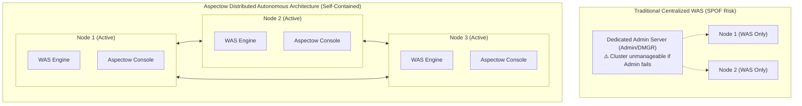
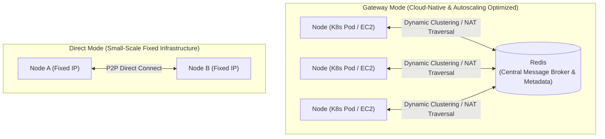

## Are You Facing These Challenges?

*   Do you feel that **traditional WAS (like JBoss)** is too heavy and complex for modern cluster and MSA environments?
*   Do you experience the hassle of "Assembly Hell" with **lightweight containers (like Tomcat)**, where you have to manually combine DI, DB integration, scheduling, and monitoring?
*   Is it difficult to understand or control the internal workings of **modern platforms (like Spring Boot)** because of excessive auto-configuration (Magic), despite their convenience?
*   Do you want to manage node survival monitoring, remote command execution, scheduler control, and real-time traffic monitoring in a **distributed cluster environment** through a single unified web console without installing complex external APM tools?

## That's Why Aspectow Was Born.

**Aspectow** is an **enterprise WAS and control platform** based on the powerful open-source framework `Aspectran`, optimized and stabilized for modern enterprise environments.

Unlike traditional WAS (such as WebSphere or WebLogic) that required deploying and running a separate, dedicated administration server (DMGR/Admin Server), **Aspectow embeds the visual web management console (Aspectow Console) directly into every node (Self-Contained Architecture)** alongside its high-performance WAS engine.



Following modern distributed architecture principles, this eliminates the need for separate external management infrastructure and provides high availability, allowing administrators to seamlessly monitor and control the entire cluster through any active node.

## Why Should You Develop with Aspectran?

The true value of Aspectow begins with its foundation, the `Aspectran` framework. Aspectran offers developers the following clear advantages:

### 1. A Controllable and Explicit Structure

You don't need to waste time tracing hidden behaviors behind Spring Boot's complex auto-configuration (Magic). In Aspectran, all configurations and execution flows are explicitly defined, allowing anyone to easily understand and control the application's behavior. This directly leads to exceptional maintainability.

### 2. An All-in-One Framework with Integrated Core Features

Core features that form the backbone of an application, such as DI, AOP, and MVC flow control, are built into the framework. Developers can escape "Assembly Hell"—the struggle of matching library versions—and focus solely on developing business logic in a stable and consistent environment.

### 3. Intuitive Rule-Based Development

In Aspectran, all requests are processed in simple, clear rule units called `Translets`. You can freely generate not only simple text responses but also dynamic content using templates:

```xml
<translet name="hello">
    <transform format="text">
        <template style="apon">
            |Hello, World!
        </template>
    </transform>
</translet>
```

This intuitive structure helps developers quickly adapt and increase productivity without needing a deep understanding of the framework.

### 4. Freedom from Runtime Lock-in: Adapter-Based Runtime Independence

Aspectran completely decouples business logic (Translets) from the runtime environment using the Adapter Pattern. Because your code never binds directly to a specific WAS or Servlet API, the exact same business logic runs **with zero code changes** whether deployed in Undertow-based enterprise Servlet environments, Netty-based ultra-fast non-servlet microservices, or Jetty. This adapter abstraction architecture empowers Aspectow to offer developers the flexibility to choose the edition best optimized for their infrastructure needs.

Aspectow is the platform built to run these powerful and easy-to-maintain applications with peak performance, stability, and comprehensive visual control.

## Aspectow Editions

Aspectow offers modular editions tailored to specific usage purposes and deployment environments:

*   **Aspectow Enterprise Edition**
    > Fully supports the Servlet specification and is suitable for building enterprise web applications. It **includes the visual management platform, Aspectow Console, by default**, alongside JBoss's [Undertow](https://undertow.io) web server and [Apache Jasper](https://mvnrepository.com/artifact/org.mortbay.jasper/apache-jsp), the JSP engine used by Apache Tomcat.

*   **Aspectow Edge Edition**
    > An ultra-lightweight, high-performance edition that eliminates servlet overhead. By combining an embedded [Netty](https://netty.io) server with Java 21 Virtual Threads, it is optimized for building high-throughput microservices and REST API services with a minimal resource footprint.

*   **Aspectow Jetty Edition**
    > A version with the Jetty web server built-in, providing flexibility for specific infrastructure requirements while running Servlet-based web applications.

## Aspectow's Differentiated Core Competencies

Aspectow provides practical and powerful core competencies that differentiate it from traditional WAS and platforms:

### 1. Unified Management Web Console (Aspectow Console)

Beyond server execution, Aspectow includes **Aspectow Console**, a unified web interface to visually control the entire cluster and applications:
*   **Cluster Node Management**: Real-time monitoring of node statuses (Active, Paused, Inactive) and bulk action controls (Pause, Resume, Restart).
*   **Interactive Remote Command Center**: Dispatch interactive CLI/Shell commands to specific nodes or all nodes in real time with live console streaming via WebSocket dark terminals.
*   **Distributed Scheduler Manager**: Offers a Dashboard view for cluster-wide schedule overview and a Detail View for node-specific job dynamic control (Pause, Resume, Details).
*   **Remote Build & Rollout Deployment Manager (Build & Deployment)**: Orchestrates Git source synchronization, Maven build packaging, configuration/web asset deployment, and process-independent safe server restarts (Detached Restart) directly from the web console with a single click—eliminating the need for external CI/CD tools or separate agents—while streaming real-time build and deployment logs through an interactive dark WebSocket terminal.
*   **Enterprise Token Security (Remember-Me)**: Features Spring Security-grade Persistent Token Rotation and token theft detection, client IP and User-Agent device binding, and PBE encrypted secure cookies alongside comprehensive Vault management for ironclad administrative security.
*   **Runtime Diagnostic Tools**: Built-in developer utilities including Wildcard Pattern Tester, AsEL Expression Evaluator, and APON Data Converter.

### 2. High-Performance Cluster Architecture & Node Manager (Node Manager Control Plane)

Aspectow embeds **`Aspectow Node Manager`**, a core Control Plane library that binds multiple distributed nodes into an organic, cohesive cluster. Developers can flexibly select between **Gateway Mode** and **Direct Mode** based on infrastructure environments and scaling plans.



*   **Gateway Mode (Cloud-Native & Autoscaling Optimized)**:
    *   **Dynamic Clustering**: Utilizes Redis as a central message broker and metadata repository. Nodes autonomously generate UUID-based unique identifiers upon startup and register dynamically, perfectly adapting to **Kubernetes (K8s) and AWS Auto Scaling** environments where instances are frequently added or removed.
    *   **Infrastructure Flexibility & Private Network Traversal**: Operates seamlessly across L4/L7 load balancers. Nodes hidden behind firewalls or private IPs (NAT) can be securely controlled without opening external ports.
    *   **Automatic Cleanup (GC)**: Automatically purges stale metadata (Group - Node - App) via Pulse survival signal monitoring when nodes detach.
*   **Direct Mode (Static & Fixed Infrastructure)**:
    *   A static operation mode performing direct P2P communication between nodes without Redis.
    *   Optimized for small-scale private networks or L7 Nginx path-based routing environments with fixed node counts and IPs.

With just a single-line configuration change (`mode: gateway`) inside `node-config.apon`, you can seamlessly evolve your cluster architecture as your infrastructure grows.

### 3. Native High-Performance Redis Session Store

Through the `aspectran-rss-lettuce` module, session data is managed directly using `Lettuce`, a high-performance Redis client. This is significantly faster and more efficient than traditional JDBC-based methods, accelerating the horizontal scaling of stateful services in MSA and cluster environments.

### 4. Built-in Real-Time AppMon Monitoring (Group - Node - App)

Includes the `Aspectow AppMon` monitoring engine by default. Without complex external APM setups, observe Canvas-based dynamic traffic flow (physics bullet rendering and Hot Core visualization), JVM heap/thread metrics with inline sparklines and modal popovers, always-on session tracking with ISO geolocation, real-time/historical reverse log tailing (`loadPrevious`), and a pre-aggregation 3-tier persistence architecture that guarantees sub-100ms chart queries across massive datasets via a 3-tier navigation (Group - Node - App).

### 5. Battle-Tested Enterprise Stack and Samples

Through the `aspectow-demo` project, Aspectow provides a practical enterprise stack combining battle-tested libraries such as `HikariCP` (high-performance DB connection pool), `Querydsl` (type-safe queries), `JPetStore`, and `PetClinic`, allowing users to start development on a proven foundation.

## Next Steps & Related Architecture Guides

Explore Aspectow's internal mechanisms and configuration options in depth through the following guide documents:

*   [Aspectow Platform Overview & System Architecture](/ko/docs/aspectow/overview/): Runtime stack, SiblingClassLoader safe reloading mechanism, Translet/AOP pipeline, and distributed deployment topologies.
*   [Aspectow Configuration Guide](/ko/docs/aspectow/configuration-guide/): Detailed server and context rule configurations for the Enterprise Edition.
*   [Aspectow Edge Configuration Guide](/ko/docs/aspectow/edge-configuration-guide/): Ultra-lightweight microservice setup powered by Netty and Virtual Threads.
*   [Aspectow Node Manager Guide](/ko/docs/aspectow/node-manager/): Distributed clustering deployment with Gateway Mode and Direct Mode.
*   [Aspectow AppMon Overview & Architecture Guide](/ko/docs/aspectow/appmon-overview/): Real-time observability engine and standalone operational setup.
*   [Aspectow Console Overview & Architecture Guide](/ko/docs/aspectow/console-overview/): Centralized enterprise web operations center and security architecture.

## Project Templates and Samples

Aspectow offers starter projects to kickstart new development and sample/demo projects that demonstrate how to use specific technologies, all available via GitHub. You can develop your applications based on these projects.

### Starter Projects

These projects provide only the basic environment and are intended to be used as a skeleton for starting a new project.

*   [Aspectow Enterprise](https://github.com/aspectran/aspectow-enterprise): The default starter for the Aspectow Enterprise Edition.
*   [Aspectow Edge](https://github.com/aspectran/aspectow-edge): The default starter for the Aspectow Edge Edition.
*   [Aspectow Jetty](https://github.com/aspectran/aspectow-jetty): The default starter for the Aspectow Jetty Edition.

### Demo and Sample Projects

These are complete, runnable projects that demonstrate how to use specific features or libraries.

*   [Aspectow Demo Site](https://github.com/aspectran/aspectow-demo): A comprehensive demo site showcasing JPetStore, PetClinic, Examples, and AppMon running together on the Aspectow WAS.
*   [ToDo Webapp](https://github.com/aspectran/aspectow-todo-webapp): A simple ToDo example application based on the Aspectow Enterprise Edition.
*   [JPetStore Webapp](https://github.com/aspectran/aspectran-jpetstore): A database integration example application using MyBatis.
*   [Petclinic Webapp](https://github.com/aspectran/aspectran-petclinic): A web application example using JPA and Thymeleaf.
