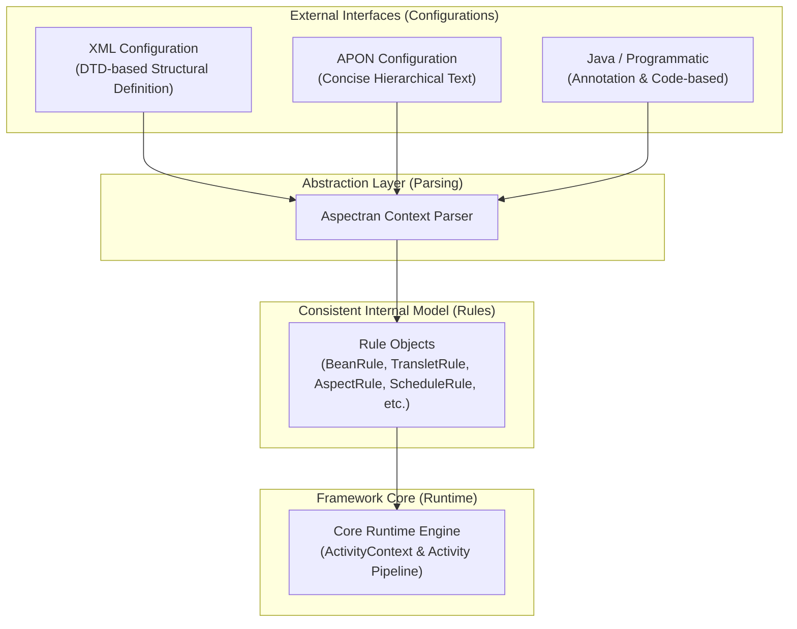
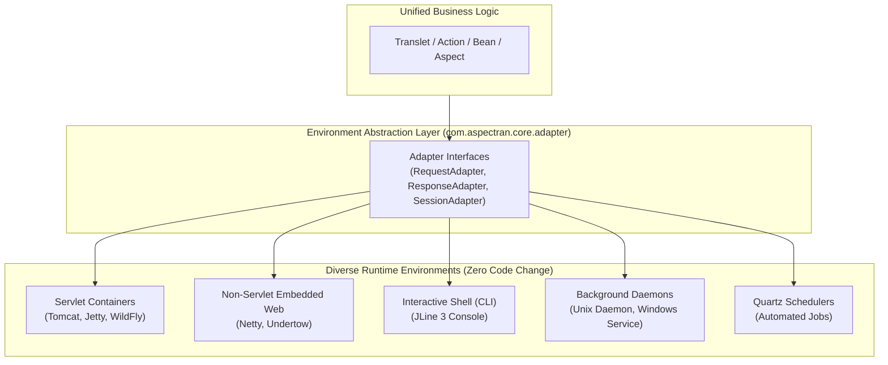

## Introduction

Software frameworks tend to become progressively more complex over time as features are added and backward compatibility is maintained. This increase in complexity can steepen the learning curve, make maintenance difficult, and sometimes even hinder the inherent productivity of the framework.

Aspectran was designed as an answer to this very problem: **"Can richness of functionality and simplicity of design coexist?"** Specifically, it aims to provide a lighter, more intuitive, yet powerful architecture as an alternative to the large and complex Spring Framework. This document explains the core design principles and architectural philosophy that have allowed Aspectran to evolve while maintaining the value of 'sustainable simplicity'.

This philosophy is deeply embedded in the name of the framework itself. When development first began in March 2008, the initial name of the project was **'Translets'**. This was a compound word for 'Transformation Servlet', representing the initial vision of focusing on the core function of receiving a user's request, transforming it, and generating a response.

Later in the development process, as AOP (Aspect-Oriented Programming) functionality was integrated as a core idea, the project was renamed around July 2012 to reflect its new identity. That name is **Aspectran**.



The change of name was not just a simple renaming, but a symbol of the framework's evolutionary direction to **achieve both structural simplicity and functional modularity** by adding the powerful cross-cutting concern separation feature of 'Aspect' on top of the clear structure of request processing represented by 'Translet'.

Since its first release on September 1, 2015, Aspectran has evolved based on this core philosophy. Now, let's take a closer look at the specific design principles that have allowed Aspectran to maintain its simplicity.

## The First Step Towards Simplicity: A Pragmatic Choice

One of the early choices that best illustrates Aspectran's design philosophy was the adoption of DTD instead of XML Schema (XSD) for validating XML configurations. While XSD offers technically more powerful features like data type specification and namespace support, Aspectran intentionally chose the simpler DTD. This was not because DTD is superior, but because it was **sufficient and appropriate** for Aspectran's goals.

- **The Core is 'Structure', Validation is the 'Framework's Job'**: The core of Aspectran's configuration is not the validity of data types, but the correct definition of the structural relationships between elements like `<bean>`, `<translet>`, and `<aspect>`. DTD plays a sufficient role in verifying this structural validity. A pragmatic judgment was made that it is more efficient and consistent for the framework to handle detailed validation of data values, such as the existence of a class name or the correctness of an attribute value, directly with Java code at the time the configuration is read.

- **Eliminating Unnecessary Complexity**: Since Aspectran's configuration does not need to be mixed with other XML vocabularies, the biggest advantage of XSD, namespace support, was unnecessary. Technical complexity that was not essential to the framework's goals was boldly excluded.

In this way, Aspectran began to secure its simplicity through a pragmatic approach of choosing the most appropriate and simple solution for the problem at hand, rather than the technical superiority of the technology itself.

## The Core of Sustainable Simplicity: A Consistent Internal 'Rule' Model

The most crucial secret to how Aspectran has been able to maintain its simplicity over time lies in its **consistent internal configuration model, the 'Rule objects'**.

External configuration files (XML, APON) are merely an interface for the user to define the framework's behavior; Aspectran does not use them directly. Instead, it parses any format of configuration and converts it into 'Rule objects' such as `BeanRule`, `TransletRule`, and `AspectRule`, which are defined in the `com.aspectran.core.context.rule` package.

This architecture provides the following powerful advantages:

1. **Isolation of Complexity**: Changes in the external interface, such as the complexity of XML parsing or the addition of new configuration attributes, do not directly affect the core execution logic of the framework. All changes are absorbed and standardized at the abstraction layer of the 'Rule model'.

2. **Flexibility of Configuration Method**: This is also why Aspectran was later able to add a new configuration method similar to JSON, called APON (Aspectran Parameter Object Notation). The APON parser simply had to generate the same 'Rule objects' as the XML parser, so no other code in the framework needed to be modified at all.

3. **Clear Division of Roles**: Since the framework only needs to deal with a well-defined data structure called 'Rule objects', the logic becomes much simpler and clearer. 'How to read (Parsing)' and 'How to execute (Runtime)' are perfectly separated.

Ultimately, **controlling external complexities by transforming them into a simple and consistent internal model of 'Rules'** is the key design technique by which Aspectran has secured its sustainable simplicity.

## Principles for Maintaining Simplicity

In addition to the 'Rule model', Aspectran maintains simplicity through the following design principles.

### Clear Separation of Concerns

The core concepts of Aspectran have their roles clearly separated and do not encroach on each other.

- **Translet**: Focuses solely on a single unit of work: receiving a request, controlling the processing flow, and the final response.
- **Bean**: Focuses solely on the definition and lifecycle management of reusable components (objects) that have state.
- **Aspect**: Focuses solely on separating and modularizing cross-cutting concerns that are commonly applied to various business logics, such as transactions, logging, and security.

It is intentionally designed so that a single element does not have too many responsibilities. For example, the structure where a `Translet` delegates logic to a `Bean` through an `Action` instead of directly accessing a database makes the role of each element clear and the overall design simple and predictable.

### Freedom from Runtime Lock-in: Adapter-Based Environment Abstraction

A major driver of framework complexity is coupling business logic to specific runtime environments (such as the Servlet API or specific web servers). When business code becomes polluted with Servlet-specific objects like `HttpServletRequest` or `HttpServletResponse`, running that code outside of a web container—such as in CLI command-line tools, batch daemons, or standalone schedulers—becomes extremely difficult and complicates unit testing.

Aspectran completely abstracts the runtime environment using the **Adapter Pattern**.

The core engine and business logic only interact with abstract adapter interfaces (`RequestAdapter`, `ResponseAdapter`, `SessionAdapter`). Concrete implementations tailored for the target environment (Servlet, Netty, Undertow, console shell, or daemon) are seamlessly bound at bootstrap time.

As a result, business logic implemented by developers runs in exactly the same way—**with zero code changes**—across web browser requests, interactive CLI commands, or recurring scheduled batch jobs. Eliminating environment dependencies at their source is a core philosophy that minimizes total system complexity and guarantees long-term extensibility.

### Explicit and Controllable Architecture Without Black-Box Magic

Many modern frameworks prioritize superficial convenience by introducing excessive auto-configuration and opaque runtime proxy "magic." While this may lower the initial barrier to entry, it makes diagnosing internal behavior during complex edge cases or system failures notoriously difficult.

Aspectran adheres to the principle that **there should be no black box beyond the developer's comprehension and control**.

- **Transparent Execution Pipeline**: The entire lifecycle—from request ingress and Aspect interception to sequential Action execution and final response transformation (Text, JSON, XML, or template engines)—is explicitly orchestrated through the `Activity` pipeline.
- **Predictable Behavior**: Rather than relying on hidden auto-wiring magic, components interact through clearly defined rules and POJO relationships. This makes debugging and failure analysis straightforward, ensuring stable and reliable long-term operations.

### Separation of Configuration and Logic

Configuration serves as the structural skeleton declaring application components and execution rules, while business logic must reside entirely within Java POJO code. By strictly preventing complex computations or operational logic from infiltrating configuration files, Aspectran preserves the legibility, predictability, and maintainability of the entire system over the long haul.

## Conclusion

Aspectran's simplicity is not an accident, but the **product of intentional design that started from an awareness of the problem of 'frameworks becoming complex' and aimed for 'sustainable simplicity'**.

Pragmatic technology choices, isolation of complexity through a consistent internal 'Rule' model, clear separation of roles across components, Adapter-based runtime abstraction, and a steadfast commitment to explicit flow control while keeping configuration strictly separated from logic—all work in concert to form Aspectran's lightweight and powerful architecture.

Through this foundation, Aspectran delivers high productivity and intuitive maintainability without black boxes, providing developers with a rock-solid platform to build sustainable, resilient enterprise software in an ever-evolving technological landscape.
