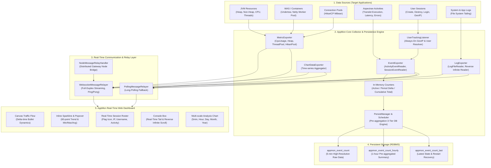
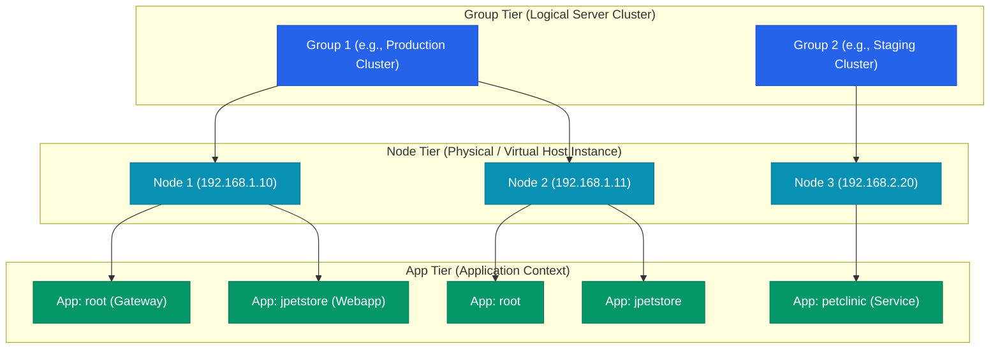
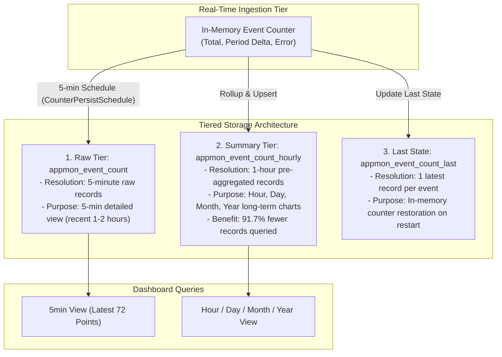

## 1. Overview

Aspectow AppMon is a lightweight real-time monitoring and observability platform tailored for Aspectran-based applications operating in distributed and microservice environments. Engineered to impose less than 1% runtime overhead on the monitored applications, AppMon empowers operators and developers to stream and inspect application activities (Activity/Translet), session lifecycles, live logs, JVM internals, and web container (WAS) metrics in real time via an intuitive web dashboard.

AppMon can be deployed **embedded within Aspectow Console** to provide an enterprise-grade, centralized operations and control center, or it can be deployed as an **independent standalone solution on target application servers or dedicated nodes** without installing Console, enabling lightweight and agile operational monitoring.



## 2. Key Features

*   **Ultra-Low Latency Real-Time Streaming (Push)**: Uses native WebSocket connections to stream internal server events and metrics without polling delay. For environments behind restrictive firewalls or corporate proxies, it automatically falls back to an intelligent Long-Polling transport.
*   **Non-Intrusive Lightweight Integration**: Integrates into target applications via Aspectran Bean definitions and declarative AOP interceptors without modifying existing business logic or domain code.
*   **Always-On User Tracking & Geolocation**: Operates 24/7/365 to capture client IP addresses and resolve two-letter ISO country codes upon session creation, even when no operator is viewing the dashboard.
*   **Non-Intrusive Username Resolution**: Automatically extracts login identities from complex session attributes (`UserSession`, `Account`, etc.) using declarative property expressions (`usernameAttribute`) or custom `SessionUserResolver` extensions.
*   **High-Performance Visualization Engine**:
    *   **Canvas-Based Dynamic Traffic Flow**: Employs a physics-based delta-time rendering engine to animate incoming requests as flying bullets, dynamically decelerating velocity and extending persistence in response to server latency.
    *   **Inline Sparklines & Interactive Popovers**: Embeds dynamic 60-sample trend lines with automated red alert coloring when thresholds are breached (e.g., CPU > 85%), and delivers detailed dual time-series curves (solid vs. dashed) with real-time Min/Max/Avg statistics via floating modal popovers.
    *   **Reverse Infinite Scrolling Log Console (`loadPrevious`)**: Seamlessly prepends historical log lines when scrolling to the top while preserving user scroll anchoring and continuing real-time tailing.
*   **Pre-Aggregation 3-Tier Storage Architecture**:
    *   Stores data across three distinct tiers—5-minute raw (`appmon_event_count`), 1-hour pre-aggregated summary (`appmon_event_count_hourly`), and last recorded state (`appmon_event_count_last`)—reducing long-term dashboard query loads by over 90%.
*   **Self-Contained Standalone Authentication**: When operating without Aspectow Console, AppMon enforces secure session authentication through `AppMonAuthCheckAspect` and password-based encrypted tokens (`TimeLimitedPBTokenIssuer`) with automatic sliding expiration.

## 3. Core Architecture & 3-Tier Hierarchy

To effectively monitor complex distributed clusters and multi-server environments, Aspectow AppMon organizes monitoring targets into a structured 3-tier hierarchy: **`Group` (Server Group) - `Node` (Physical/Virtual Server) - `App` (Application Context)**.



### Key Engine Components

*   **`AppMonManager`**: The central orchestrator that coordinates the lifecycle of the monitoring system, wiring together application configuration (`AppInfoHolder`), cluster node topologies (`NodeManager`), real-time communication relays (`MessageRelayManager`), and persistent storage (`PersistManager`).
*   **`AppInfoHolder` & `AppInfo`**: Holds and serves metadata and configurations for all monitored application contexts, including events, metrics, and logs.
*   **`ExporterManager`**: Manages a collection of `Exporter` instances and their dedicated background schedulers for a specific application (`appId`) and exporter category (`LOG`, `METRIC`, `EVENT`, `DATA`).
*   **`Exporter`**: The top-level data collection unit dedicated to a specific type of resource.
    *   **`Reader`**: The concrete low-level implementation that extracts metrics or events from underlying subsystems (JMX, JVM Native, OS statistics, servlet contexts, or the file system).
*   **`UserTrackingListener`**: An always-on session listener that permanently injects client IP addresses (`user.ipAddress`) and resolved country codes (`user.countryCode`) into session attributes upon creation.
*   **`CounterPersistSchedule` & `PersistManager`**: Background schedulers and managers that periodically (default: every 5 minutes) persist in-memory event counters into database pre-aggregation tables.
*   **`MessageRelayer` & `MessageRelayManager`**: Manages active client browser relay sessions (`RelaySession`) and routes unicast and broadcast data packets via WebSocket or Long-Polling.
*   **`NodeMessageRelayHandler`**: Bridges and multiplexes telemetry packets from internal remote worker nodes through a public-facing gateway node in multi-server cluster environments.

## 4. Collection Engine & Readers Catalog

AppMon provides a comprehensive suite of built-in readers spanning system hardware metrics, container worker threads, database connection pools, application activities, user sessions, and disk logs.

| Exporter Type | Reader Class Full Name | Monitored Target & Key Metrics | Recommended Sampling Interval |
| :--- | :--- | :--- | :--- |
| **`metric`** | `com.aspectran.aspectow.appmon.engine.exporter.metric.jvm.CpuUsageReader` | JVM process CPU usage, host system CPU usage, available processor cores, system load average | 500ms ~ 1000ms |
| **`metric`** | `com.aspectran.aspectow.appmon.engine.exporter.metric.jvm.HeapMemoryUsageReader` | JVM Heap memory used, maximum allocatable heap, committed heap | 500ms ~ 1000ms |
| **`metric`** | `com.aspectran.aspectow.appmon.engine.exporter.metric.undertow.UndertowThreadPoolMetricsReader` | Undertow worker thread pool active threads, maximum threads, pool size, queued tasks | 500ms ~ 1000ms |
| **`metric`** | `com.aspectran.aspectow.appmon.engine.exporter.metric.netty.NettyThreadPoolMetricsReader` | Netty EventLoop thread pool active threads, maximum capacity, task processing throughput | 500ms ~ 1000ms |
| **`metric`** | `com.aspectran.aspectow.appmon.engine.exporter.metric.jdbc.HikariPoolMBeanReader` | HikariCP pool status (Active connections, Idle connections, Total connections, Threads awaiting connection) | 500ms ~ 2000ms |
| **`event`** | `com.aspectran.aspectow.appmon.engine.exporter.event.activity.ActivityEventReader` | Aspectran Activity/Translet executions, response latency, success/failure counts, active in-flight requests | Instant on execution |
| **`event`** | `com.aspectran.aspectow.appmon.engine.exporter.event.session.SessionEventReader` | Session creation/destruction, active session count, live authentication changes, client IP & geolocation | Instant on lifecycle event |
| **`log`** | `com.aspectran.aspectow.appmon.engine.exporter.log.LogExporter` | Real-time tailing and reverse historical retrieval (`loadPrevious`) of application and access log files | 200ms ~ 500ms |
| **`data`** | `com.aspectran.aspectow.appmon.engine.exporter.event.ChartDataExporter` | Pre-aggregated time-series statistical datasets (5min, hour, day, month, year) for dashboard charts | On-demand refresh |

## 5. Real-Time Dashboard Visualization & UX Architecture

The AppMon dashboard transcends static numerical readouts by leveraging dynamic frontend rendering technologies that allow operators to visually sense system load and user activity.

### 5.1 Canvas-Based Dynamic Traffic Flow
*   Every incoming HTTP request (`Activity`) is rendered on an HTML5 Canvas as an animated **'Bullet'** traveling from left to right.
*   **Delta-Time Physics Engine**: Ensures smooth 60fps animations without dropped frames even during spikes of thousands of concurrent requests, keeping browser CPU consumption low.
*   **Latency-Proportional Deceleration**: Bullet flight velocity decelerates by up to 60% as server processing latency increases, providing instant visual feedback of server slowdowns.
*   **Latency-Proportional Persistence**: The duration that bullets remain embedded on the target wall before disappearing is directly proportional to response time. Slower requests linger on screen longer, drawing operator attention.
*   **Hotspots & Hot Core Identification**: Requests from heavy users with an Activity Intensity exceeding 0.3 generate a glowing **white hot core (Hot Core)** at the center of the bullet, enabling instant detection of abnormal traffic surges or aggressive clients.
*   **Color-Coded Health Status**:
    *   **Green**: Requests completed within normal response time thresholds.
    *   **Yellow**: Warning requests exhibiting latency over 500ms.
    *   **Red**: Failed requests resulting in unhandled exceptions or 5xx HTTP errors.

### 5.2 Inline Sparklines & Detail Popover Cards
*   **Real-Time Sparklines**: Displays a compact 60-sample trend line and latest value dot directly beside each resource metric (CPU, Heap, Thread Pools).
*   **Dynamic Alert Thresholds**: When critical thresholds are breached (e.g., CPU exceeding 85%), the sparkline dynamically shifts from calm blue to vivid red.
*   **Interactive Modal Popovers**:
    *   Clicking any metric card opens a floating popover displaying high-resolution dual time-series curves.
    *   **Dual Time-Series Representation**:
        *   **CPU**: Process CPU usage (solid line) vs. System CPU usage (dashed line).
        *   **Heap Memory**: Current used memory (solid line) vs. Maximum limit (dashed line).
        *   **Thread Pool**: Active worker threads (solid line) vs. Total pool size (dashed line).
    *   **Real-Time Statistical Summary**: Automatically computes and displays the **Minimum (Min), Maximum (Max), and Average (Avg)** values captured during the active viewing session.

### 5.3 Reverse Infinite Scroll Log Console (`loadPrevious`)
*   When an operator scrolls to the very top of the log console (`scrollTop === 0`), a **"Load Previous Logs"** trigger is exposed.
*   The client issues a `command:loadPrevious` APON command with the earliest line offset, and the server reads backward through the file by the requested line count (e.g., 300 lines).
*   The client prepends the historical lines while maintaining precise **Scroll Anchoring**, ensuring the operator's viewing position remains stable without jumping.

### 5.4 3-Tier Activity Counters & 5-Minute Period Timer
*   **Active Activity**: Number of concurrent translets currently executing in the server.
*   **Current Period Count**: Requests accumulated during the current 5-minute sampling interval (e.g., `+94`).
*   **Cumulative Total**: Total requests processed since application startup or initial recording.
*   **5-Minute Countdown Timer**: Displays interval progress (e.g., `280/300`). Upon reaching 300 seconds, accumulated counters are persisted to the database, analytical charts are updated, and the period counter resets.

## 6. Session Monitoring & User Tracking Architecture

AppMon integrates **Always-On User Tracking** with **On-Demand Live Broadcasting** into a unified, resource-efficient session monitoring engine.

### 6.1 Lifecycle Separation: Always-On vs. On-Demand

*   **Always-On User Tracking (`UserTrackingListener`)**:
    *   Permanently registered to the target context's `SessionManager` during `SessionEventReader.init()` at server startup.
    *   Runs 24/7/365 in the background to inject client IP addresses and country codes into all newly created sessions, even when no administrators are viewing the UI.
    *   Ensures that when an operator connects later and calls `getAllActiveSessions`, full IP and geographical metadata are immediately available without omissions.
    *   Built-in duplicate registration guards (`registeredTrackingTargets`) guarantee that even if multiple `app` blocks target the same context (`tow.server/demo`), the listener is registered only once.
*   **On-Demand Live Broadcasting (`SessionEventReadingListener`)**:
    *   Registered only when an operator subscribes to an application's dashboard and unregistered when active subscribers drop to zero (`stop()`), conserving runtime CPU and memory.

### 6.2 Country Code Resolution (`IPCountryResolver`)

AppMon resolves ISO 2-letter country codes (e.g., `KR`, `US`, `JP`) from client IP addresses using the pluggable `IPCountryResolver` interface:

```java
package com.aspectran.aspectow.appmon.common.support;

public interface IPCountryResolver {
    String resolveCountryCode(String ipAddress, Locale locale);
    default String resolveCountryCode(String ipAddress) { ... }
}
```

By registering an implementation such as `WhoisIPCountryResolver` (integrating with KISA WHOIS OpenAPI) or a MaxMind GeoIP database bean in `appmon-rules.xml`, AppMon automatically queries the country and populates `user.countryCode`, displaying corresponding national flags on the session roster.

### 6.3 Non-Intrusive Username Extraction (`usernameAttribute` & `SessionUserResolver`)

Production enterprise systems frequently store user credentials inside complex domain models rather than simple strings. AppMon provides a 3-tier hierarchy to extract usernames without altering application code:

1.  **Custom Resolver (`userResolver`)**: Preferentially executes a custom bean or class implementing `SessionUserResolver`:
    ```java
    public interface SessionUserResolver {
        String resolveUsername(String deploymentName, Session session);
    }
    ```
2.  **Declarative Property Path Navigation (`usernameAttribute`)**: Evaluates JavaBean nested property paths (e.g., `user.account.username`) to dynamically traverse getters (`session.getAttribute("user").getAccount().getUsername()`):
    ```apon
    event: {
        id: session
        target: tow.server/jpetstore
        parameters: {
            usernameAttribute: user.account.username
        }
    }
    ```
3.  **Default Fallback**: Reads the standard `user.name` session attribute if present.

### 6.4 Real-Time Authentication State Detection

When an unauthenticated guest logs in and authentication objects (e.g., `"user"`) are injected or modified in the session, `SessionEventReader` intercepts `attributeAdded` / `attributeUpdated` events and broadcasts an updated session packet, reflecting login transitions in real time.

## 7. Pre-Aggregation Data Persistence Architecture

To guarantee constant query latency in milliseconds across millions of accumulated events, AppMon utilizes a **Pre-Aggregation 3-Tier Storage Architecture**.



### 7.1 Core Schema & Composite Primary Key

The event count tables utilize a composite primary key consisting of `node_id`, `app_id`, `event_id`, and `datetime`, backed by a `group_id` index for group-level aggregations:

*   **`node_id`**: Server node identifier (e.g., `appmon-node1`, `node01`).
*   **`group_id`**: Server group identifier (e.g., `group1`, `cluster-prod`).
*   **`app_id`**: Monitored application identifier (e.g., `jpetstore`, `console`).
*   **`event_id`**: Metric event identifier (`activity`, `session`).
*   **`datetime`**: Data collection timestamp in UTC.

### 7.2 Gauge and Counter Hybrid Recording

*   **`total` (Gauge)**: Cumulative total since event monitoring began (analogous to an automobile's total odometer). Ensures metric continuity across server restarts.
*   **`delta` (Counter)**: Incremental events generated during the previous 5-minute sampling interval (analogous to a trip meter). Used to compute TPS and request rate curves.
*   **`error` (Counter)**: Incremental errors and unhandled exceptions during the interval.

### 7.3 Performance Optimization & Rollup Integrity
Every 5 minutes, `CounterPersistSchedule` inserts a new raw row into `appmon_event_count` while simultaneously truncating the timestamp to the hour (`truncatedTo(ChronoUnit.HOURS)`) and accumulating `delta` and `error` counts into `appmon_event_count_hourly` using `ON DUPLICATE KEY UPDATE` (MySQL/MariaDB) or `MERGE` (PostgreSQL/Oracle).

This eliminates the need for full table scans over millions of raw rows when generating daily, monthly, or yearly charts, allowing queries to hit pre-summarized data directly.

## 8. Real-Time Communication & Relay Architecture

AppMon implements a streamlined text protocol and distributed relay architecture to efficiently handle both single-instance and multi-node cluster deployments.

### 8.1 Server-to-Client Push Message Format
Telemetry packets pushed from the server to web clients follow a colon-delimited structure:

```text
{nodeId}:{exporterType}[/{subType}]:{exporterName}:{content}
```

*   **Real-Time Log Stream**: `node01:log:app:[INFO] User logged in...`
*   **Historical Log Prepend**: `node01:log/p:app:[WARN] Cache refreshed...` (Client prepends to console box)
*   **Time-Series Chart Data**: `node01:data/chart:activity:{"labels":[...],"data1":[...]}`
*   **Session Lifecycle Event**: `node01:event:session:{"numberOfActives":12,"createdSessions":[...]}`
*   **System Metric**: `node01:metric:heap:{"format":"{used}/{max}","data":{"used":"512MB","max":"2GB"}}`

### 8.2 Client Command Protocol (APON Inline)
Commands sent from client browsers to the server utilize APON inline syntax (semicolon-separated):

```text
command:{commandName};nodeId:{nodeId};{optionKey1}:{value1};...
```

*   **Subscribe Request (`subscribe`)**: `command:subscribe;timeZone:Asia/Seoul;nodeToSubscribe:node01;appsToSubscribe:jpetstore;nodeId:node01`
*   **Load Previous Logs (`loadPrevious`)**: `command:loadPrevious;nodeId:node01;appId:jpetstore;logId:app;loadedLines:300`
*   **Refresh Chart Data (`refresh`)**: `command:refresh;nodeId:node01;appId:jpetstore;dateUnit:hour`
*   **Heartbeat Ping (`ping`)**: `command:ping` → Server response: `node01::pong:{securityToken}`

### 8.3 Distributed Gateway Bridge (`NodeMessageRelayHandler`)
In multi-server architectures, client browsers establish a single WebSocket connection to a public gateway node. Telemetry from internal private worker nodes (`Node-2`, `Node-3`) is collected by the gateway's `NodeMessageRelayHandler` across internal backbones and multiplexed over the existing client connection using `{nodeId}::...` system packets. This allows seamless monitoring of the entire cluster through a single WebSocket channel.

## 9. Security & Access Control Architecture

AppMon provides tailored dual security mechanisms depending on its operational mode.

### 9.1 Standalone Mode: Token-Based Authentication
Active when running AppMon independently without Aspectow Console:

*   **`@Profile("appmon.standalone")` AOP Guard**:
    *   [`AppMonAuthCheckAspect`](file:///Users/Aspectran/Projects/workspace/aspectow/appmon/src/main/java/com/aspectran/aspectow/appmon/common/auth/aspect/AppMonAuthCheckAspect.java) intercepts requests (`+: /**`, `-: /auth-expired`) to verify credentials prior to execution.
*   **Time-Limited PBToken Authentication (`TimeLimitedPBTokenIssuer`)**:
    *   [`AppMonTokenIssuer`](file:///Users/Aspectran/Projects/workspace/aspectow/appmon/src/main/java/com/aspectran/aspectow/appmon/common/auth/AppMonTokenIssuer.java) signs and generates encrypted password-based tokens encapsulating expiration windows (default: 30 minutes) and demo flags.
    *   Tokens are transmitted as secure HTTP cookies (`HttpOnly`, `Path: /`) via `AppMonCookieIssuer`.
*   **Sliding Session Expiration**:
    *   Valid incoming requests automatically refresh and slide the token expiration window, enabling uninterrupted monitoring sessions during active operation.

### 9.2 Console Embedded Mode: Integrated Enterprise RBAC
*   When running embedded within Aspectow Console, AppMon delegates authorization to Console's centralized Role-Based Access Control (RBAC).
*   Fine-grained privileges (`APPMON_VIEW`, `APPMON_MANAGE`) govern access to specific node groups, nodes, and apps, seamlessly inheriting Console's Remember-Me token rotation and audit logging features.

## 10. Operational Mode Comparison (Standalone vs. Console Embedded)

Aspectow AppMon adapts to diverse architectural requirements through two primary deployment topologies:

| Evaluation Aspect | Standalone AppMon | Embedded in Aspectow Console |
| :--- | :--- | :--- |
| **Target Environment** | Single services, dev/staging servers, lightweight microservices | Centralized enterprise operations centers, multi-tenant clouds |
| **Console Prerequisite** | None (Fully autonomous) | Requires Aspectow Console |
| **Active Profile** | Requires `appmon.standalone` | Runs under `console` profile |
| **Authentication & RBAC** | Self-contained `TimeLimitedPBTokenIssuer` session cookies | Enterprise RBAC, session isolation, audit trails, Remember-Me |
| **Configuration Path** | Monitored application's `/config/appmon/` directory | Unified Console management and node configurations |
| **Database** | Embedded H2 or dedicated external RDBMS | Shared Console database and clustered reporting schemas |
| **Deployment Overhead** | Minimal (Included directly in application archive) | Moderate (Requires Console cluster setup) |

## 11. Standalone Installation & Configuration Guide (Without Console)

To deploy AppMon as an independent monitoring solution on an application server, configuration files are placed under the project's **`/config/appmon/`** directory.

### 11.1 Configuration Directory Structure (`/config/appmon/`)

*   **`appmon-config.apon`**: Main configuration file defining target applications (`app`), events, metrics, logs, and counter persistence intervals.
*   **`node-config.apon`**: Server group (`group`) and server node (`node`) definitions.
*   **`appmon-rules.xml` & `node-rules.xml`**: Aspectran XML rule files configuring `AppMonConfigResolver`, `NodeConfigResolver`, and `NodeManagerFactoryBean`.
*   **`appmon.db-h2.properties`**: Property file specifying the embedded H2 DB file location.

### 11.2 APON Main Configuration (`appmon-config.apon`) Example

The `appmon-config.apon` file specifies target applications, events, metrics, logs, and persistence schedules:

```apon
# DB persistence interval (in minutes, e.g., 1 minute)
counterPersistInterval: 1

# Long-Polling configuration for non-WebSocket environments
pollingConfig: {
    pollingInterval: 3000   # Polling interval (ms)
    sessionTimeout: 30000   # Session expiration (ms)
}

# Monitored application definition
app: {
    id: jpetstore
    title: JPetStore Webapp
    event: {
        id: activity
        target: jpetstore
        parameters: {
            +: /**
        }
    }
    event: {
        id: session
        target: tow.server/jpetstore
        parameters: {
            # Declaratively extract username from session objects without code changes
            usernameAttribute: user.account.username
        }
    }
    metric: {
        id: cpu
        title: CPU Usage
        description: Monitors system and JVM CPU utilization.
        reader: com.aspectran.aspectow.appmon.engine.exporter.metric.jvm.CpuUsageReader
        sampleInterval: 500
    }
    metric: {
        id: heap
        title: Heap Usage
        description: Monitors JVM Heap memory consumption.
        reader: com.aspectran.aspectow.appmon.engine.exporter.metric.jvm.HeapMemoryUsageReader
        sampleInterval: 500
    }
    # For Undertow server
    metric: {
        id: undertow-tp
        title: Undertow Thread Pool
        description: Monitors Undertow worker thread pool resources.
        reader: com.aspectran.aspectow.appmon.engine.exporter.metric.undertow.UndertowThreadPoolMetricsReader
        target: tow.server
        sampleInterval: 500
    }
    # For Netty server
    # metric: {
    #     id: netty-tp
    #     title: Netty Thread Pool
    #     description: Monitors Netty worker thread pool and concurrent request processing.
    #     reader: com.aspectran.aspectow.appmon.engine.exporter.metric.netty.NettyThreadPoolMetricsReader
    #     target: netty.server
    #     sampleInterval: 500
    # }
    log: {
        id: app
        file: /logs/jpetstore.log
        sampleInterval: 300
        lastLines: 300
    }
}
```

### 11.3 Key APON Parameter Specifications

*   **`counterPersistInterval`**: Interval in minutes for saving aggregated event counters to the DB (default: 5 minutes; setting to `0` disables persistence).
*   **`pollingConfig`**: Configures Long-Polling connection timeouts and intervals (`pollingInterval`, `sessionTimeout`).
*   **`app`**: Monitored application configuration unit.
    *   **`event`**:
        *   `id`: Event type (`activity`, `session`).
        *   `target`: Target context identifier (`tow.server/<contextName>` or `netty.server/<contextName>`).
        *   `parameters`:
            *   For `activity`: Pointcut `+`/`-` path filters.
            *   For `session`: `usernameAttribute` (JavaBean property path), `userResolver` (custom `SessionUserResolver` class or bean ID).
    *   **`metric`**: `reader` (fully qualified class name of `MetricReader` implementation), `parameters` (custom arguments).
    *   **`log`**: `file` (log file path for real-time tailing), `lastLines` (initial lines loaded upon UI connection).

### 11.4 Step-by-Step Installation & Setup

#### Step 1: Define Target Applications (`/config/appmon/appmon-config.apon`)
Define monitored `app`, `event`, `metric`, and `log` targets in `appmon-config.apon`.

#### Step 2: Define Node Clusters (`/config/appmon/node-config.apon`)
Define server groups (`group`) and server nodes (`node`) inside `node-config.apon` (or `node-config-gateway.apon`):

```apon
cluster: {
    id: appmon-cluster1
    mode: direct
}
group: {
    id: group1
    title: Group 1
}
node: {
    id: appmon-node1
    group: group1
    title: Localhost
    endpoint: {
        mode: auto
    }
}
```

#### Step 3: Configure XML Rules (`appmon-rules.xml` & `node-rules.xml`)
In `appmon-rules.xml`, configure `AppMonConfigResolver` to load the APON configuration and append `node-rules.xml`:

```xml
<!-- Example appmon-rules.xml -->
<aspectran>
    <bean class="com.aspectran.aspectow.appmon.engine.config.AppMonConfigResolver">
        <properties profile="!prod">
            <item name="configLocation">/config/appmon/appmon-config.apon</item>
        </properties>
        <properties profile="prod">
            <item name="configLocation">/config/appmon/appmon-config-prod.apon</item>
        </properties>
    </bean>

    <!-- Optional: Register IP Country Resolver Bean -->
    <!-- <bean id="ipCountryResolver" class="com.aspectran.aspectow.demo.root.common.WhoisIPCountryResolver"/> -->

    <append file="/config/appmon/node-rules.xml"/>
</aspectran>
```

In `node-rules.xml`, load `node-config.apon` via `NodeConfigResolver` and register `NodeManagerFactoryBean`:

```xml
<!-- Example node-rules.xml -->
<aspectran>
    <bean class="com.aspectran.aspectow.node.config.NodeConfigResolver">
        <properties>
            <item name="configLocation">/config/appmon/node-config.apon</item>
        </properties>
    </bean>

    <bean id="nodeManager" class="com.aspectran.aspectow.node.manager.NodeManagerFactoryBean" lazyDestroy="true"/>
</aspectran>
```

#### Step 4: Database Connection and Profile Configuration

To run standalone AppMon, configure execution profiles and DB connection parameters:

*   **Mandatory Standalone Profile (`appmon.standalone`)**: Running AppMon without Console **requires activating the `appmon.standalone` profile**.
*   **Default Profile & Embedded H2 DB**: In the default configuration (`aspectran-config.apon`), `appmon.standalone` and embedded `h2` profiles are active by default, allowing immediate startup without external database setups.
*   **External RDBMS Support**: To connect to MariaDB, MySQL, PostgreSQL, or Oracle, activate the corresponding profile (e.g., `mariadb`) and create the matching property file (**`appmon.db-mariadb.properties`**) under `/config/appmon/`.

Standalone AppMon typically runs under the `appmon` context name. Supply execution profiles and database connection parameters via Java system properties:

```bash
# Example running standalone (appmon.standalone) with MariaDB
-Daspectran.profiles.base.appmon=appmon.standalone,mariadb -Dappmon.db-mariadb.url=jdbc:mariadb://127.0.0.1:3306/appmon_db -Dappmon.db-mariadb.username=appmon -Dappmon.db-mariadb.password=your-password
```

## 12. Conclusion & Future Extensibility

Aspectow AppMon delivers modern application observability by marrying non-intrusive lightweight instrumentation with dynamic Canvas physics rendering, high-resolution time-series sparklines, and pre-aggregated 3-tier persistence.

From agile single-node troubleshooting to enterprise-wide multi-cluster telemetry powered by Aspectow Console, AppMon's consistent 3-tier model and declarative APON configurations serve as a reliable, high-performance monitoring hub across any enterprise environment.
