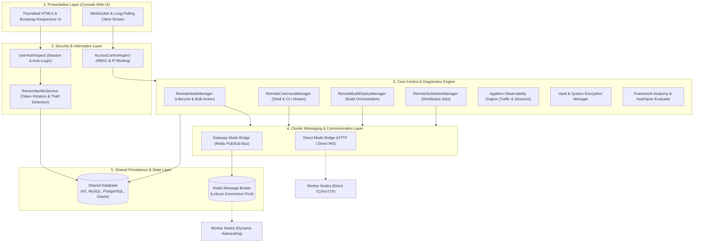
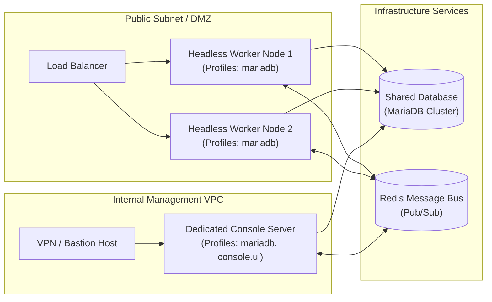

## 1. Background and Core Vision of Aspectow Console

### Challenges in Enterprise Distributed Environments

Modern enterprise web application environments have rapidly evolved from single monolithic servers into distributed architectures consisting of dozens or hundreds of microservices and node clusters. In such large-scale distributed topologies, simply monitoring heap memory and CPU utilization on isolated servers is insufficient to ensure business continuity.

Operational engineering teams in production environments continuously face several interconnected challenges:

*   **Decoupling of Observability and Controllability**: Even when anomalies are detected on monitoring dashboards (APMs), resolving them requires context-switching overhead—opening terminal sessions (SSH), connecting directly to individual hosts, restarting processes, or inspecting local log files manually.
*   **Uncontrollable Distributed Schedulers**: Lack of a centralized control plane to trace execution states, failure histories, and concurrency of batch scheduler jobs scattered across multiple nodes, or to safely pause and manually re-trigger specific jobs when incidents occur.
*   **Scattered Security Credentials and Configuration Drift**: Sensitive assets such as database credentials, external integration API keys, and cryptographic master keys are often stored in plaintext across configuration files on disparate nodes, presenting compliance risks and operational bottlenecks.
*   **Traceability of Distributed Build and Deployment**: Lack of systematic tracking for hotfix builds and deployment scripts executed across cluster nodes, including the exact Git commit hashes, exit codes, and raw console logs at the time of execution.

### Unifying Observability and Controllability

Aspectow Console was engineered specifically to bridge this fundamental gap in enterprise infrastructure management.

Historically, monitoring functionality was offered as a dedicated solution under `Aspectow AppMon`. However, true enterprise operational management must go beyond merely observing system state ("Observability"); it must seamlessly empower operators to intervene and enforce control ("Controllability") in real time.

Aspectow Console addresses this requirement by embedding the proven, high-throughput AppMon real-time monitoring engine as a first-class citizen, while synthesizing distributed node lifecycle control, a remote command center, build and deployment orchestration, a cryptographic Vault, runtime framework diagnostics, and fine-grained RBAC governance into a single cohesive web console interface.

## 2. System Architecture & Core Design Principles

Aspectow Console is built upon four fundamental architectural principles to achieve high availability and enterprise robustness without vendor lock-in.

### 2.1. Self-Contained Every-Node Console Architecture

Traditional legacy WAS solutions (such as WebLogic or WebSphere) mandated dedicated central administration servers (Admin Server / DMGR). This model introduced a catastrophic **Single Point of Failure (SPOF)**, where an admin server outage paralyzed cluster management entirely.

Aspectow Console eliminates this structural flaw through its **Self-Contained Every-Node Console Architecture**:

*   **Single Codebase with Profile Control**: Every Aspectow server node inherently embeds the full console capabilities. Without maintaining separate admin packages, a node functions as a pure headless worker or a full-featured web management console simply by toggling execution profiles (`console.ui`).
*   **SPOF-Free High Availability**: If any node goes down, administrators can immediately access the web interface of any remaining healthy node in the cluster to inspect and control the entire cluster state with zero loss of visibility.
*   **Ultra-Low Latency In-Memory Bus**: Because the management console and server engine run harmoniously within the same JVM memory space, diagnostics and metric collection occur instantaneously without network round-trip overhead.

### 2.2. Shared Database Architecture (Single Source of Truth)

All operational metadata managed by Aspectow Console (administrator accounts, RBAC permissions, Vault credentials, Remember-Me persistent tokens, distributed build histories, and security audit trails) represents **cluster-wide single state**.

Accordingly, Aspectow Console establishes an environment where all nodes in the cluster connect to a single **"Shared Database"** as its standard architectural baseline:

*   **Decentralized Persistence**: Each node directly records remote build executions, lifecycle state transitions, and audit events into the shared database through its own local transactions without funneling traffic through a central bottleneck node.
*   **Single Source of Truth**: Whether operators connect through a load balancer to arbitrary nodes or specific nodes restart, all UI views and REST/WebSocket endpoints consistently query the latest cluster state and historical data from the shared DB.
*   **Broad RDBMS Support**: Natively supports H2, MariaDB, MySQL, Oracle, and PostgreSQL with pre-packaged, production-grade DDL schemas and MyBatis mappers.

### 2.3. System Architecture Layers

Aspectow Console features a modular five-layer architecture spanning from the frontend presentation tier down to distributed messaging and persistence backbones.

### 2.4. Flexible Cluster Communication Modes (`direct` vs `gateway`)

Console provides two distinct communication pipelines tailored to your network topology and scale:

*   **Direct Mode (`mode: direct`)**:
    *   Console establishes direct HTTP and bidirectional WebSocket connections to each worker node's IP and port endpoint.
    *   Requires no external broker installation (e.g., Redis), making it ideal for single-machine setups, on-premises static IP networks, and small server groups.
*   **Gateway Mode (`mode: gateway`)**:
    *   Leverages a Redis Pub/Sub message bus powered by asynchronous Lettuce connection pools as the messaging backbone.
    *   Enables seamless remote control over outbound-only connections even when worker nodes reside behind corporate firewalls, private NAT subnets, or dynamic IPs.
    *   Essential for cloud-native environments such as Kubernetes Pods or AWS Auto Scaling Groups where nodes join and terminate dynamically.

## 3. In-Depth Architecture by Functional Domain

Aspectow Console provides seven major operational domains to empower administrators with complete platform governance.

### 3.1. Cluster Node Lifecycle Management (Node Management)

Centrally monitors and governs the operational health and resource metrics of all cluster nodes in real time.

*   **Real-time Heartbeat Monitoring**: Collects periodic pulse packets (default: 50s) from nodes to detect active, lagging, or unresponsive states instantly.
*   **Comprehensive Node Profiles**: Inspects node hostnames, operating systems, Java runtime versions, JVM heap memory (used/max), local ports, and network interfaces.
*   **Fine-Grained Lifecycle Actions**:
    *   Graceful Shutdown: Completes active in-flight transactions before terminating cleanly.
    *   Hard Stop / Restart: Instantly halts and restarts processes during critical emergencies.
    *   Pause / Resume: Blocks incoming traffic to specific nodes for zero-downtime maintenance.
    *   Bulk Actions: Dispatches batch lifecycle commands across entire server groups or cluster-wide.

### 3.2. Integrated Distributed Build & Deployment (Build & Deployment)

Aspectow Console incorporates a built-in CI/CD orchestration engine capable of executing remote builds and deployments across cluster nodes.

*   **Script-Based Remote Execution**: Triggers host-level deployment shell scripts (or local scripts) on target nodes remotely.
*   **Real-time ANSI Console Streaming**: Streams standard output (StdOut) and standard error (StdErr) to the browser in real time via WebSockets with full ANSI color terminal rendering.
*   **SHA-256 Integrity Verification**: Records build requester, Git branch, pre/post Git commit hashes, exit codes, execution duration, and SHA-256 integrity digests of console outputs into master (`asc_build_history`) and log (`asc_build_log`) tables for compliance auditability.

### 3.3. Remote Command Center

Executes shell and Aspectran CLI commands directly on target nodes without requiring SSH sessions.

*   **Bidirectional Streaming Bridges**: Streams command execution results to a terminal-styled web viewer in real time via `WebsocketCommandBridge` or Long-Polling bridges.
*   **RCE Protection**: Execution privileges are strictly limited to `SUPER_ADMIN` and accounts with explicit `COMMAND_EXECUTE` permissions, with all commands and remote IPs logged to the audit trail in real time.

### 3.4. Distributed Scheduler Management

Centrally oversees distributed jobs running on Aspectran's embedded Quartz-based scheduler services.

*   **Real-time Job Telemetry**: Aggregates trigger types (Cron, Simple), next scheduled firing times, recent execution statuses (Running, Paused, Normal), and execution outcomes across nodes.
*   **Manual Triggering & Control**: Empowers operators to manually trigger batch jobs immediately or issue Pause/Resume commands for maintenance.

### 3.5. AppMon Observability Engine

High-performance real-time application monitoring embedded natively into the Console:

*   **Traffic Flow Analytics**: Visualizes transactions per second (TPS), latency distributions, and HTTP error rates (4xx, 5xx) in real time.
*   **Active Session Telemetry & Geolocation**: Combines secure client IP resolution via `WebUtils` with `IPCountryResolver` to plot active sessions and client country codes (ISO 2-letter) on live dashboards.
*   **Non-Intrusive Username Extraction**: Automatically extracts login usernames from complex session attributes using declarative expressions like `usernameAttribute: user.account.username` without code modifications.
*   **System Metrics & Live Log Tailing**: Monitors JVM heap, garbage collection (GC), Undertow/Netty worker thread pools, and live streaming of application log files.
*   **Hierarchical Pre-aggregation**: Pre-aggregates metrics into 5-minute, hourly, daily, monthly, and yearly intervals within the database, ensuring instantaneous dashboard queries across long historical windows.

### 3.6. Cryptographic Vault & Security Asset Governance (System Vault)

Centrally manages and encrypts sensitive platform credentials and keys.

*   **PBE-Backed Asset Vault**: Encrypts database credentials, API keys, and third-party secrets using Password-Based Encryption (PBE) algorithms before persisting into `asc_vault`.
*   **Master Key Governance**: Access to encryption configurations and master keys is strictly restricted, with automatic server-side masking applied to sensitive values displayed on UI screens.

### 3.7. Framework Runtime Diagnostics

Provides developer- and operator-friendly runtime diagnostic tools to inspect framework internals without redeploying code.

*   **Context Anatomy**: Visually inspects all registered Aspectran Beans, Translets, Aspects, and View Dispatchers along with their runtime metadata and dependency graphs.
*   **Asel Evaluator**: Dynamically evaluates and tests Aspectran Expression Language (Asel) expressions within the live runtime context.
*   **Apon Converter**: Validates and interconverts APON (Aspectran Parameter Object Notation), JSON, and XML structures interactively.

## 4. Security Governance & Access Control

Aspectow Console enforces enterprise-grade security defenses aligned with its responsibility over mission-critical infrastructure control.

### 4.1. Granular RBAC & Role Governance

*   **Built-in Role Model**:
    *   `SUPER_ADMIN`: Unrestricted platform privileges (node lifecycle, commands, accounts, Vault, builds).
    *   `ADMIN`: General operational management (monitoring, schedulers, build viewing/execution).
    *   `BUILDER`: Dedicated build and deployment execution privileges.
    *   `VIEWER`: Read-only access to monitoring dashboards, metrics, and logs.
    *   `DEMO`: Isolated read-only sandbox mode (all modification and control operations blocked).
*   **Fine-Grained Permissions**:
    Supports granular permission bindings including `NODE_MANAGE`, `COMMAND_EXECUTE`, `BUILD_EXECUTE`, `BUILD_VIEW`, `MONITOR_VIEW`, `MONITOR_CONTROL`, and `USER_MANAGE`.

### 4.2. Account Protection & Session Hardening

*   **Account Lockout**: Automatically transitions an account to `LOCKED` state upon 5 consecutive failed login attempts.
*   **Session Fixation Protection**: Invalidates existing sessions (`sessionAdapter.invalidate()`) upon login and issues a fresh session identifier.
*   **Session IP Binding**: Binds the initial login IP to the session; any access attempt with a stolen session cookie from a different IP address triggers immediate session termination.
*   **User-Level IP Whitelisting (`allowedIps`)**: Restricts individual accounts to specific static IPs or subnet wildcards (`192.168.1.*`, `10.0.*.*`).

### 4.3. Persistent Token-based Remember-Me Architecture

Provides secure login persistence across browser restarts via **Persistent Token Rotation and four-tier defenses**:

*   **Opt-In Declarative Control**: Disabled (`false`) by default in production; enabled declaratively via `aspectow.console.auth.rememberMe.enabled` or in `demo` profiles.
*   **Human-Friendly Validity Periods (`DurationUtils`)**: Supports intuitive duration expressions via `aspectow.console.auth.rememberMe.tokenValiditySeconds` (e.g., `"30d"`, `"7d"`, `"24h"`, `"1800s"`).
*   **Series & Token Rotation**: Backed by the `asc_persistent_login` table, every successful auto-login rotates the single-use token (`token`) while retaining the browser identifier (`series`).
*   **Theft Detection & Global Invalidation**: Stolen tokens used concurrently trigger a **Token Theft Detected** alert, immediately purging all persistent tokens for that user and logging `REMEMBER_ME_THEFT_DETECTED` to the audit log.
*   **IP and User-Agent Verification**: Enforces matching remote IP and `User-Agent` headers before restoring sessions.

### 4.4. Enterprise Security Audit Trail

Records every high-risk action (user management, role modification, remote command execution, Vault inspection, and configuration updates) to `asc_audit_log` with **executor ID, action type, target resource, details, client IP, and timestamp** for complete compliance and forensic investigation.

## 5. Flexible Deployment Topologies

Aspectow's unified starter architecture enables diverse infrastructure topologies purely through execution profile combinations.

*   **Dedicated Management Console Node**: Deploys `aspectow-enterprise` into an internal management VPC with the `console.ui` profile enabled, accessible exclusively via corporate VPN or bastion hosts.
*   **Headless Worker Nodes**: Deploys the same artifact to public business instances with `console.ui` omitted. Console web routes return `404 Not Found`, minimizing attack surface while running pure application and scheduler engines.
*   **Small-Scale Integrated Node**: In resource-constrained environments, runs business services and the Console UI on a single instance, secured via IP whitelisting (`allowedIps`) and firewall port separation.

## 6. Relationship with Standalone AppMon & Coexistence Strategy

The introduction of Aspectow Console does not deprecate standalone `Aspectow AppMon`. Both tools serve distinct operational scopes:

| Criteria | Aspectow AppMon (Standalone) | Aspectow Console (Integrated) |
| :--- | :--- | :--- |
| **Core Purpose** | Lightweight Application Performance Monitoring (APM) | Enterprise Governance, Node Control, CI/CD, & Monitoring |
| **Key Capabilities** | Traffic flows, session telemetry, system metrics, log tailing | Complete AppMon suite + Node lifecycle + Build/Deploy + Schedulers + Vault + RBAC |
| **Recommended Scenario** | Pure application monitoring without infrastructure control needs | Multi-node cluster orchestration requiring centralized remote control |
| **Deployment Model** | Standalone lightweight WAR/JAR or daemon | Embedded WAS module or dedicated management server |
| **Interoperability** | Exposes metrics via standalone endpoints | Centrally embeds external standalone AppMon endpoints into console views |

For further technical details, explore the accompanying documentation guides:

*   Screen Functionality: [Aspectow Console Feature & Screen Guide](/en/docs/aspectow/console/feature-guide/)
*   Configuration Reference: [Aspectow Console Configuration Guide](/en/docs/aspectow/console/configuration-guide/)
*   Security Hardening: [Aspectow Console Operational Security Architecture & Hardening Guide](/en/docs/aspectow/console/security-architecture/)
