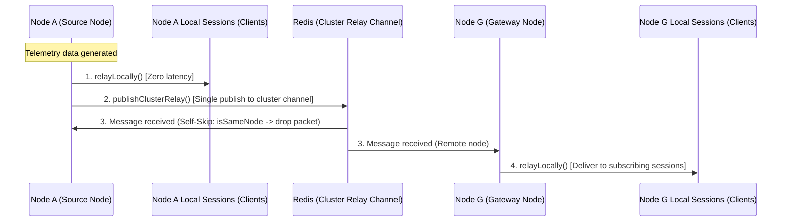

## 1. Overview

**Aspectow Node Manager** (`aspectow-node`) is a core Control Plane library designed to bind multiple distributed nodes into an organic, unified cluster.

Moving beyond traditional single-server WAS management, Aspectow Node Manager adopts Redis as a central message broker and metadata repository, completely decoupling node-console dependencies. This guarantees flexible scalability and high observability even in cloud and containerized environments where nodes dynamically scale up and down.

## 2. Core Capabilities

Aspectow Node Manager performs three essential roles to ensure cluster stability:

### 2.1. Node Lifecycle and Pulse Monitoring
Manages the lifecycle of all participating nodes. Nodes register detailed metadata (`NodeInfo`) upon startup and periodically send a pulse (survival signal, default 10 seconds). Aspectow Console observes these signals to track real-time active node states (Live, Paused, Dead), and zombie nodes that have not sent a pulse within the specified timeout (default 60 seconds) are automatically detected and evicted.

### 2.2. Transparent Message Relay
Relays control commands and telemetry data packets between Console and nodes or between nodes. Adopting a **Transparent Relay** model based on Redis Pub/Sub, the relaying agent forwards messages as text without parsing payloads, eliminating latency even in high-throughput environments. For detailed specifications on channel formats, *O*(1) cluster broadcast optimization, and session unicast channels, refer to **[4. Cluster Node Messaging Protocol & Architecture](#4-cluster-node-messaging-protocol--architecture)**.

### 2.3. Shared Secret & Encrypted Token Security
Enforces **Shared Secret**-based cryptographic verification to ensure communication only occurs between trusted nodes. Tokens feature short validity periods (default 30 seconds) and AES encryption to prevent unauthorized external access.

## 3. Operation Modes Comparison

Aspectow Node Manager supports two operation modes tailored to network topology and scaling requirements:

### 3.1. Gateway Mode (Cloud-Native & Autoscaling)

A modern Cloud-Native architecture utilizing Redis as a message bus and distributed state store.

*   **Autoscaling Optimization**: Nodes automatically generate UUID-based unique identifiers (`Node ID`) upon startup. Perfectly adapts to **Kubernetes (K8s) Pods and AWS Auto Scaling** environments where instances scale dynamically.
*   **Private Network & Firewall Traversal**: Nodes hidden behind firewalls or private IPs (NAT) can be securely controlled without opening external ports.
*   **Infrastructure Flexibility**: Operates seamlessly across L4/L7 load balancers without requiring URL path routing configurations.

### 3.2. Direct Mode (Static & Fixed Infrastructure)

A static architecture establishing direct P2P HTTP/WebSocket connections between nodes without Redis.

*   **Target Environment**: Suited for small-scale private networks with fixed node counts and IPs where autoscaling does not occur.
*   **Infrastructure Requirements**: Requires an L7 reverse proxy or load balancer (e.g., Nginx). Path-based routing must be explicitly configured to map unique node endpoints (e.g., `/console/nodes/node1/`, `/console/nodes/node2/`) directly to each backend server's fixed IP and port.

**Example Nginx Routing Configuration:**

```nginx
location /console/nodes/node1/ {
    proxy_pass          http://10.0.0.2:8080/console/nodes/node1/;
    proxy_http_version  1.1;
    proxy_buffering     off;
    proxy_cache_bypass  $http_upgrade;

    proxy_set_header    Upgrade             $http_upgrade;
    proxy_set_header    Connection          $http_connection;
    proxy_set_header    Host                $host;
    proxy_set_header    X-Real-IP           $remote_addr;
    proxy_set_header    X-Forwarded-For     $proxy_add_x_forwarded_for;
    proxy_set_header    X-Forwarded-Proto   $scheme;
    proxy_set_header    X-Forwarded-Host    $host;
    proxy_set_header    X-Forwarded-Port    $server_port;
    proxy_set_header    X-NginX-Proxy       true;

    # This is necessary to pass the correct IP to be hashed
    real_ip_header X-Real-IP;
}

location /console/nodes/node2/ {
    proxy_pass          http://10.0.0.3:8080/console/nodes/node2/;
    proxy_http_version  1.1;
    proxy_buffering     off;
    proxy_cache_bypass  $http_upgrade;

    proxy_set_header    Upgrade             $http_upgrade;
    proxy_set_header    Connection          $http_connection;
    proxy_set_header    Host                $host;
    proxy_set_header    X-Real-IP           $remote_addr;
    proxy_set_header    X-Forwarded-For     $proxy_add_x_forwarded_for;
    proxy_set_header    X-Forwarded-Proto   $scheme;
    proxy_set_header    X-Forwarded-Host    $host;
    proxy_set_header    X-Forwarded-Port    $server_port;
    proxy_set_header    X-NginX-Proxy       true;

    # This is necessary to pass the correct IP to be hashed
    real_ip_header X-Real-IP;
}
```

## 4. Cluster Node Messaging Protocol & Architecture

In Gateway mode, the Aspectow cluster employs a dedicated Redis Pub/Sub communication specification (`NodeMessageProtocol`) to deliver high-frequency telemetry streams and precise node control commands with zero latency.

This architecture strictly decouples the high-throughput real-time data pipeline (**Data Plane**) from the reliable cluster control pipeline (**Control Plane**), implementing an *O*(1) broadcast optimization that eliminates network overhead regardless of cluster size.

### 4.1. Separation of Control Plane and Data Plane

Traffic is separated logically and physically according to its operational characteristics, ensuring that large-volume monitoring data streams never interfere with or delay critical control commands:

*   **Control Plane**:
    *   Governs node lifecycles, subscription requests (`subscribe`), unsubscription notices (`unsubscribe`), and data refresh commands.
    *   Issues on-demand start/stop signals to dynamic exporters (log tailers, metric readers, etc.) for idle applications, preventing background resource waste when no dashboards are actively viewing them.
    *   Dispatched reliably via targeted 1:1 unicast control channels.
*   **Data Plane**:
    *   Transfers high-volume telemetry data streams, including real-time logs (`log`), performance metrics (`metric`), session/activity events (`event`), and rolled-up chart statistics (`data/chart`).
    *   Forwards packets transparently without parsing their payloads, utilizing a shared cluster relay channel to achieve a single-pass broadcast with maximum efficiency.

### 4.2. Redis Channel Specifications & 4 Core Communication Patterns

All Redis channels follow a standardized key prefix (`aspectow:cluster:`) defined in `NodeMessageProtocol`, categorized into four patterns based on purpose and destination:

| Channel Pattern | Redis Channel Format | Communication Mode | Primary Purpose & Payload |
| :--- | :--- | :--- | :--- |
| **Cluster Relay** | `aspectow:cluster:relay:<category>:<clusterId>` | 1 : N (Broadcast) | High-volume real-time streaming data (logs, metrics, events, chart rollups, etc.) |
| **Session Unicast Relay** | `aspectow:cluster:relay:<category>:<clusterId>:<nodeId>:<sessionId>` | 1 : 1 (Unicast) | Targeted 1:1 responses to specific client sessions (e.g., initial refresh, load previous logs) |
| **Node Control** | `aspectow:cluster:control:<category>:<clusterId>:<nodeId>:` | 1 : 1 (Control) | Dedicated control commands targeted at a specific node (`subscribe`, `unsubscribe`, `refresh`, `pulse`, etc.) |
| **Cluster Event** | `aspectow:cluster:event:<clusterId>` | 1 : N (Event) | Cluster topology lifecycle notifications (`joined`, `left`, `statusChanged`) |

### 4.3. Node Subscription Patterns

Upon startup, the `NodeMessageSubscriber` on each participating node automatically subscribes to two distinct channel patterns:

1.  **Node-Specific Pattern**:
    ```text
    aspectow:cluster:*:*:<clusterId>:<myNodeId>:*
    ```
    *   Receives 1:1 remote control commands (`control`) and targeted session responses (`relay`) addressed specifically to this node (`myNodeId`).
2.  **Cluster-Wide Relay Pattern**:
    ```text
    aspectow:cluster:relay:*:<clusterId>
    ```
    *   Receives all real-time data streams broadcast by any node in the cluster through a unified channel listener.

### 4.4. Cluster Broadcast Optimization (*O*(*M*) → *O*(1)) and Self-Skip Mechanism

Historically, when $M$ remote nodes monitored the same application, each generated log or metric required looping through all $M$ nodes to issue individual Redis `PUBLISH` commands (*O*(*M*) overhead).

Aspectow replaces this with a single-pass **Local Direct + Cluster Broadcast + Self-Skip** mechanism:



1.  **Local Direct Dispatch**: The node generating the data immediately delivers the message in-memory (`relayLocally`) to its directly connected client sessions with zero latency.
2.  **Single Cluster Publish (*O*(1) Broadcast)**: Instead of iterating over subscribers, the node publishes the message **exactly once** to the shared cluster relay channel (`aspectow:cluster:relay:<category>:<clusterId>`). Egress I/O remains constant regardless of cluster scale.
3.  **Self-Skip on Receive**: When a node receives a broadcast message from the shared channel, it checks the originating node identifier (`messageNodeId`) in the header. If it matches its own ID (`isSameNode()`), the message is immediately dropped, preventing double-rendering on local client dashboards.
4.  **Selective Local Relay**: Remote nodes inspect the application ID (`appId`) and relay the message only to their local sessions that actively subscribe to that application.

### 4.5. Session 1:1 Query/Response Isolation

Interactive user requests—such as clicking refresh (`refresh`), requesting a historical chart range, or loading previous log entries (`loadPrevious`)—demand responses meant **solely for the requesting browser session**.

*   These query responses bypass the cluster broadcast channel entirely. They are routed via the session-dedicated unicast channel (`aspectow:cluster:relay:<category>:<clusterId>:<nodeId>:<sessionId>`) directly back to the requesting node and session.
*   This isolates heavy historical data queries from the broadcast pipeline, ensuring real-time streaming telemetry continues flowing without packet contention or head-of-line blocking.

## 5. Node Identity Resolution Mechanism

Nodes follow autonomous resolution rules to establish identity upon startup without manual intervention:

### 5.1. Group ID Resolution
1.  **System Property**: `-Daspectow.node.group` takes highest precedence.
2.  **APON Config**: Automatically resolves the group ID defined in `node-config.apon`.
3.  **Default**: Defaults to `group1` if omitted.

### 5.2. Node ID Resolution
1.  **System Property**: `-Daspectow.node.id` takes highest precedence.
2.  **Dynamic Generation (Gateway Mode)**: Generates a **UUID-based unique ID** dynamically to prevent collisions during autoscaling.
3.  **Default (Direct Mode)**: Defaults to fixed `node1`.

### 5.3. Console-Dedicated Node (`console`) Flag and Role Separation
You can explicitly separate the roles of management console nodes (hosting Aspectow Console) and service nodes (running business applications) within the cluster.

1.  **System Property**: `-Daspectow.node.console=true` (or `false`) takes highest precedence.
2.  **APON Config**: Can be explicitly declared in the `node` block of `node-config.apon` using `console: true`.
3.  **Default**: Defaults to `false` (standard service node) if omitted.
4.  **Role Separation & Operational Safety**:
    *   **Safe Build & Deployment**: When a node is marked with `console: true`, selecting the `All Service Nodes` target in Aspectow Console's build interface automatically excludes the console node, preventing self-overwrites or accidental restarts that would disrupt live monitoring sessions.
    *   **Cluster Bulk Control**: The `Exclude Console` option in the bulk control modal easily safeguards console instances, and unsupported commands like `PAUSE`/`RESUME` are strictly blocked from being dispatched to console nodes.
    *   **Enhanced Visual Identification**: Console nodes are visually badged with `[Console]` across Cluster Nodes and Scheduler views, allowing operators to instantly distinguish node roles.

### 5.4. Group Concept and Service Consistency Principle
In Aspectow Node Manager, a **Group** represents a **logical scale-out set** of node instances performing identical roles.

*   **Consistency of Service Configuration**: Nodes sharing the same `Group ID` are treated as replicas providing identical service and application specifications.
*   **Independent Service Separation**: If nodes host differing services or internal application setups, they must not be placed in the same group but instead separated into **distinct `Group ID`s** to manage them as independent service pools.
*   **Operational Principles for Configuration Changes**: When service configurations (e.g., AppMon metadata) within a group change, a **rolling restart of the group** or a **blue/green group transition** is recommended to preserve consistency across the entire group.

## 6. Redis Dynamic Metadata Management, Self-Healing & Automatic Cleanup (GC)

In Gateway mode, a dynamic metadata management and Garbage Collection (GC) system powered by Redis ensures that management dashboards always reflect the latest cluster topology, even as nodes dynamically launch or terminate:

*   **Automatic Metadata Registration & Self-Healing**: Upon startup, each node immediately registers its cluster and group info, detailed specifications, application hierarchy (`Group` &rarr; `Node` &rarr; `App`), and telemetry metric definitions in the central Redis store. If a node is temporarily evicted due to GC pauses or network jitter and subsequently reconnects, `NodeRegistryListener` guarantees seamless self-healing by re-registering application and node metadata automatically in Redis.
*   **Real-time Topology Construction**: The management Console dynamically builds and visualizes the complete cluster hierarchy and active node list on the dashboard using the metadata aggregated in Redis.
*   **Separation of Concerns & Automatic Cleanup**: `NodeRegistry` exclusively governs node and group membership. When a node terminates gracefully or is evicted after the zombie timeout (default 60 seconds) expires, orphaned groups with no remaining active nodes are automatically purged from Redis. Application and domain metadata lifecycles are autonomously handled by their respective subscribing components (such as AppMon) via `NodeRegistryListener`.

## 7. Configuration Examples & XML Rules

### 7.1. Gateway Mode Setup (`/config/console/node-config.apon`)

```apon
cluster: {
    id: cloud-cluster1
    mode: gateway
    pulseInterval: 10000    # Heartbeat pulse interval in milliseconds (default: 10000ms = 10s)
    pulseTimeout: 60000     # Zombie eviction timeout in milliseconds (default: 60000ms = 60s)
    secret: {
        password: "your-cluster-secret-password"
    }
}
group: {
    id: backend-api
    title: Backend API Group
}
# Optional: Explicit definition for a dedicated console node
node: {
    id: admin-console-node1
    title: Admin Console Node
    console: true
}
```

> **Configuration Guide:**
> * `pulseInterval`: The interval at which a node refreshes its heartbeat timestamp in Redis. The 10-second default minimizes Redis I/O overhead while ensuring responsive state updates.
> * `pulseTimeout`: The timeout threshold before an unresponsive node is declared a zombie. The 60-second default provides ample tolerance against transient GC pauses and network jitter to prevent flapping.
> * `console`: Set to `true` or pass `-Daspectow.node.console=true` for dedicated management console instances.

### 7.2. Direct Mode Setup (`/config/console/node-config.apon`)

```apon
cluster: {
    id: static-cluster1
    mode: direct
}
# Dedicated Console Node
node: {
    id: console-node1
    title: Aspectow Console Node
    console: true
    port: 8082
    endpoint: {
        mode: auto
    }
}
# Service Node 1
node: {
    id: node1
    title: Service Node 01
    port: 8091
    endpoint: {
        mode: auto
    }
}
# Service Node 2
node: {
    id: node2
    title: Service Node 02
    port: 8092
    endpoint: {
        mode: auto
    }
}
```

### 7.3. Aspectran XML Bean Definitions (`node-rules.xml`)

```xml
<aspectran>
    <bean class="com.aspectran.aspectow.node.config.NodeConfigResolver">
        <property name="configLocation">/config/console/node-config.apon</property>
    </bean>

    <bean id="nodeManager" class="com.aspectran.aspectow.node.manager.NodeManagerFactoryBean" lazyDestroy="true"/>
    <bean id="remoteNodeManager" class="com.aspectran.aspectow.node.management.nodes.RemoteNodeManager"/>
    <bean id="remoteCommandManager" class="com.aspectran.aspectow.node.management.commands.RemoteCommandManager"/>
</aspectran>
```

## 8. Conclusion

Aspectow Node Manager transforms standalone servers into an **organically connected and securely controlled intelligent cluster system**.
