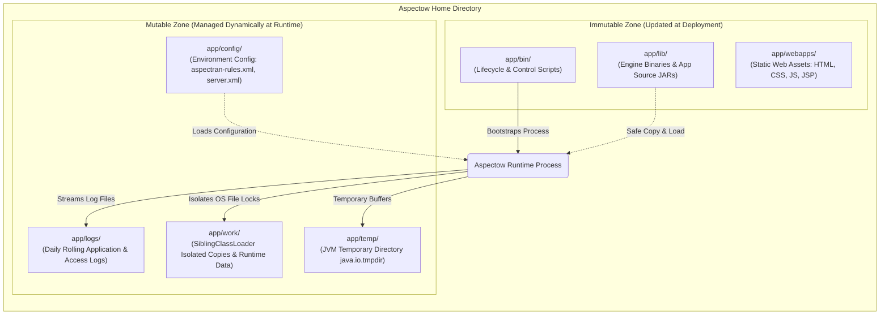
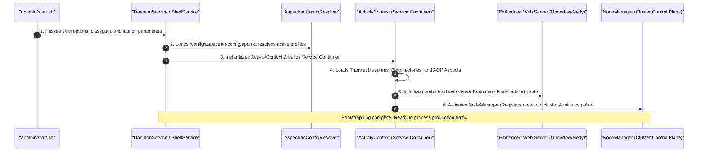
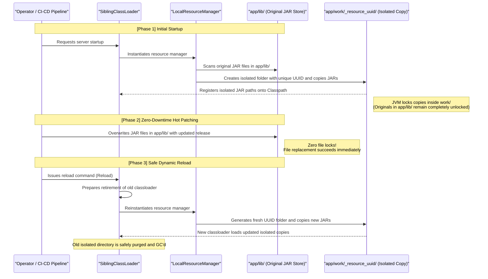
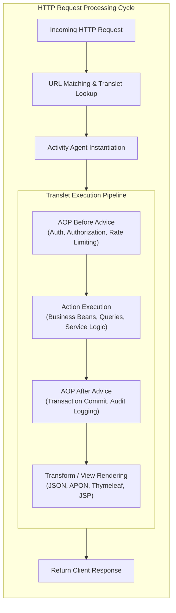
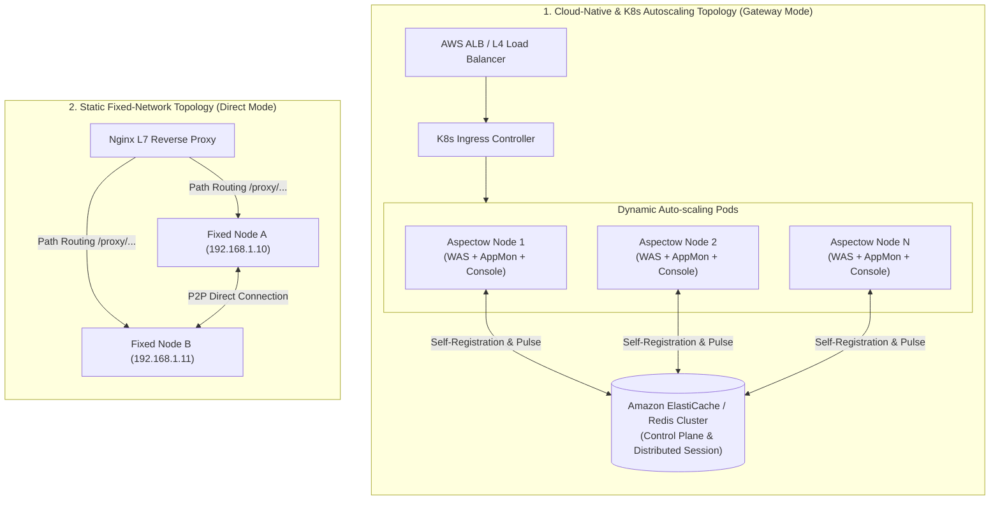

Aspectow is a next-generation enterprise application platform built upon the Aspectran framework, unifying a high-performance WAS engine, distributed cluster control plane, real-time observability, and an integrated web operations console into a single cohesive ecosystem.

## 1. Platform Overview

Aspectow is an **all-in-one enterprise WAS and operations control platform** designed to conquer the operational complexities of microservice architectures (MSA) and large-scale distributed cloud environments.

Historically, traditional enterprise WAS solutions (e.g., WebSphere, WebLogic, JBoss) required heavy, dedicated central management servers (Admin Server / DMGR), introducing single points of failure (SPOF) and heavy operational friction. Conversely, lightweight servlet containers (e.g., Tomcat) suffered from "assembly hell," forcing engineers to manually select, wire, and maintain external libraries for dependency injection, database clustering, scheduling, and monitoring. Modern cloud-native platforms like Spring Boot improved convenience but introduced excessive implicit behavior (Magic) and opaque auto-configurations that made runtime introspection and granular control challenging.

Aspectow bridges this divide by fusing an **explicit, declarative, and controllable application framework (Aspectran)** with a **self-contained, autonomous runtime platform featuring built-in distributed clustering and a visual web console (Aspectow)**.

```mermaid
flowchart TB
    subgraph WebConsoleLayer["1. Integrated Operations & Control Layer (Aspectow Console)"]
        direction LR
        CON_NODE["Cluster Node Management<br/>(Live / Pause / Restart)"]
        CON_CMD["Interactive Remote Terminal<br/>(Remote Shell / WebSocket)"]
        CON_SCHED["Distributed Scheduler Management<br/>(Dashboard & Detail View)"]
        CON_BUILD["Remote Build & Rollout Deployment<br/>(Git / Maven / Detached Restart)"]
        CON_SEC["Security & Vault Management<br/>(PBE Tokens / Audit Logs)"]
    end

    subgraph ObservabilityLayer["2. Real-Time Observability & Telemetry Layer (Aspectow AppMon)"]
        direction LR
        MON_TRAFFIC["Canvas Traffic Flow<br/>(Bullet Dynamics Engine)"]
        MON_SPARK["Inline Sparklines & Popovers<br/>(60-pt Trend & Dual Curves)"]
        MON_SESSION["Real-Time Session Roster<br/>(Always-On GeoIP / IP)"]
        MON_LOG["Reverse Infinite Scroll Logs<br/>(loadPrevious Tailing)"]
        MON_PRE["Pre-Aggregation 3-Tier Storage<br/>(Raw / Hourly / Last)"]
    end

    subgraph ControlPlaneLayer["3. Distributed Cluster Control Plane Layer (Node Manager)"]
        direction LR
        NM_GW["Gateway Mode<br/>(Redis Dynamic Clustering / NAT Traversal)"]
        NM_DIR["Direct Mode<br/>(Static L7 Nginx / P2P Mesh)"]
        NM_PULSE["Liveness Pulse & Auto GC<br/>(Dead Node Metadata Cleanup)"]
        NM_3TIER["3-Tier Identification Hierarchy<br/>(Group - Node - App)"]
    end

    subgraph AppBizLayer["4. Application & Business Logic Layer (Aspectran Engine)"]
        direction LR
        TRANSLET["Translet<br/>(Declarative Request Blueprint)"]
        ACTIVITY["Activity<br/>(Isolated Execution Agent)"]
        AOP_CTX["Aspectran AOP & DI<br/>(Aspect Separation / Bean Container)"]
        SESSION_STRAT["Multi-Context Session Strategy<br/>(Non-blocking Redis Lettuce)"]
    end

    subgraph WASEngineLayer["5. High-Performance WAS Runtime Layer (Aspectow WAS Engines)"]
        direction LR
        ED_ENT["Enterprise Edition<br/>(Undertow + Apache Jasper JSP)"]
        ED_EDGE["Edge Edition<br/>(Netty + Java 21 Virtual Threads)"]
        ED_JETTY["Jetty Edition<br/>(Eclipse Jetty Server)"]
    end

    subgraph InfraLayer["6. Infrastructure & Operating System Layer (Infrastructure)"]
        direction LR
        JVM["Java Virtual Machine (JVM 17 / 21+)"]
        OS["Linux / macOS / Windows (Docker, Kubernetes, Bare Metal)"]
    end

    WebConsoleLayer --> ObservabilityLayer
    ObservabilityLayer --> ControlPlaneLayer
    ControlPlaneLayer --> AppBizLayer
    AppBizLayer --> WASEngineLayer
    WASEngineLayer --> InfraLayer
```



### 1.1. Three Official Runtime Editions

Aspectow provides three modular editions tailored to diverse operational profiles and performance requirements:

1.  **Aspectow Enterprise Edition**:
    *   Designed for mission-critical enterprise web applications requiring full Java Servlet specifications.
    *   Integrates JBoss's high-throughput, non-blocking **Undertow** web server and Apache Tomcat's battle-tested JSP compiler, **Apache Jasper**.
    *   Includes **Aspectow Console by default**, enabling turnkey production deployment and immediate visual operations without installing external monitoring agents.
2.  **Aspectow Edge Edition**:
    *   Engineered for ultra-low latency REST APIs and microservices by completely eliminating servlet overhead.
    *   Combines the asynchronous event-driven **Netty** network engine with **Java 21 Virtual Threads**, delivering maximum concurrency and I/O throughput with minimal memory footprint and CPU overhead.
3.  **Aspectow Jetty Edition**:
    *   Embeds the Eclipse **Jetty** web server for servlet environments requiring integration with Jetty-specific ecosystems or enterprise infrastructure constraints.

## 2. Physical & System Directory Architecture

Aspectow enforces a standardized system directory hierarchy designed for zero-downtime hot patches, clean configuration separation, and maximum operational maintainability.



### 2.1. Immutable Zone
Contains system binaries and application binaries updated strictly during deployment phases. Files in this zone are never directly modified while the server is running.

*   **`app/bin/`**: Contains shell scripts and batch scripts (`start.sh`, `stop.sh`, `restart.sh`, `status.sh`) alongside daemon and system service installers.
*   **`app/lib/`**: Contains core Aspectow engine JARs and application business logic JARs.
*   **`app/webapps/`**: Stores static web resources, including HTML, CSS, client-side JavaScript, images, and JSP templates served directly to web clients.

### 2.2. Mutable Zone
Contains dynamically generated runtime telemetry, application state, and environment-specific configurations.

*   **`app/config/`**: Houses application business rules (`aspectran-config.apon`, `aspectran-rules.xml`), web server engine parameters (`server.xml`), and logging rules (`logging.xml`). Switching this folder accommodates dev, staging, and production environments without modifying binary JARs.
*   **`app/logs/`**: Stores operational server logs, translet execution traces, and rolling error logs.
*   **`app/work/`**: Manages runtime scratch data (session persistence stores, compiled JSP classes, etc.). Crucially, to achieve **Safe Reloading**, Aspectow copies JARs from `app/lib/` into isolated directories within `app/work/` before classloading, eliminating OS-level **file locking (File Lock)** on the originals.
*   **`app/temp/`**: Acts as the system temporary directory (`java.io.tmpdir`).

## 3. Server Runtime & ClassLoader Isolation Model

The lifecycle of an Aspectow instance follows a strictly managed, isolated bootstrapping and execution model.

### 3.1. Bootstrapping Lifecycle



1.  **Script Execution**: Launch scripts in `app/bin/` configure optimal JVM memory settings, GC policies, and system properties, then spawn the background process.
2.  **Service Initialization**: Dedicated `CoreService` implementations (e.g., `DaemonService` for headless server background execution, `ShellService` for interactive CLI environments) initialize and resolve primary configuration files.
3.  **Context Creation**: The core `ActivityContext` container initializes, loading all declared Beans, Translet blueprints, and AOP aspects into memory. Embedded web server Beans (Undertow, Netty, or Jetty) bind to target network sockets.
4.  **Cluster Join**: `NodeManager` activates, acquires a unique node identity, and registers its health status into Redis (Gateway mode) or the static node registry (Direct mode).

### 3.2. ClassLoader Strategy: SiblingClassLoader & Safe Reloading

On modern operating systems, once the JVM loads a JAR via standard classloaders, it holds an exclusive OS-level file lock, preventing operators from overwriting or patching the file while the server is active.

Aspectow circumvents this limitation through its proprietary **`SiblingClassLoader`** and **`LocalResourceManager`** architecture:



This mechanism empowers operators to deploy binary updates into `app/lib/` and trigger dynamic service reloads without process termination.

## 4. Request Processing Pipeline: Translet & AOP

Application logic inside Aspectow abandons procedural MVC controller boilerplate in favor of an **AOP-driven Translet and Activity execution pipeline**.



### 4.1. Translet: Declarative Request Blueprint
Instead of scattering input parsing, validation, business invocation, and view rendering across fragmented controller methods, Aspectran's **Translet** encapsulates the entire lifecycle of a request into an explicit, modular blueprint.

```xml
<translet name="/api/user/info">
    <action bean="userService" method="getUserInfo"/>
    <transform format="json"/>
</translet>
```

### 4.2. Activity: Isolated Execution Agent
Upon request arrival, the Aspectow engine instantiates a dedicated, short-lived **Activity** agent. Guided by the Translet blueprint, the Activity:
*   Parses and binds incoming request parameters.
*   Executes declared AOP aspects (security checks, session validation, transactions) transparently before and after execution.
*   Invokes target business Bean actions.
*   Transforms resulting data into client-specified formats (JSON, APON, Thymeleaf HTML, or JSP).

### 4.3. Adapter-Based Runtime Independence
Application logic (`Translet` and Beans) remains completely decoupled from low-level container APIs such as `HttpServletRequest` or vendor-specific constructs. Abstracted through Aspectran's `RequestAdapter` and `ResponseAdapter`, the identical business code executes seamlessly across Undertow servlet containers, Netty asynchronous non-servlet microservices, or standalone CLI daemons **without changing a single line of code**.

## 5. Core Subsystem Architecture (The 4 Pillars)

Aspectow is anchored by four foundational enterprise subsystems.

### 5.1. Pillar 1: Distributed Control Plane (Node Manager)
The underlying control plane library interconnecting distributed server instances into a unified, self-organizing cluster.

*   **Gateway Mode (Cloud-Native & Autoscaling Optimized)**:
    *   Leverages **Redis as a central message broker and dynamic registry**.
    *   Nodes self-generate UUID identities upon boot and dynamically publish registration metadata.
    *   Tailor-made for **Kubernetes Pods and AWS Auto Scaling groups** where instances launch and terminate dynamically.
    *   Traverses internal private subnets (NAT) and corporate firewalls without requiring external inbound port forwarding.
    *   Monitors periodic node pulses to automatically clean up orphaned metadata (Group - Node - App) when instances terminate.
*   **Direct Mode (Static Fixed Infrastructure & On-Premise)**:
    *   Operates via direct peer-to-peer (P2P) communication without requiring Redis infrastructure.
    *   Optimized for static environments, fixed IP addresses, and L7 Nginx path-based routing topologies.

### 5.2. Pillar 2: Integrated Web Operations Console (Aspectow Console)
A centralized web-based management center providing complete visual control over distributed clusters:

*   **Cluster Node Administration**: Real-time status telemetry (Active, Paused, Inactive) and bulk cluster commands (Pause, Resume, Restart).
*   **Interactive Remote Terminal**: Dispatches shell and CLI commands to target cluster nodes with real-time output streamed over WebSocket dark terminals.
*   **Distributed Scheduler Management**: Inspects Quartz and Aspectran scheduled jobs, execution histories, and trigger states across all nodes with live pause/resume controls.
*   **One-Click Remote Build & Rollout Deployment**:
    *   Orchestrates Git sync, Maven packaging, configuration deployment, and safe detached restarts without external CI/CD servers.
    *   Employs process detachment to prevent build process kills from disrupting target server restarts.
*   **Enterprise Token Security (Remember-Me)**:
    *   Features Spring Security-grade Persistent Token Rotation, token theft detection, IP and User-Agent device binding, and PBE encrypted cookies for ironclad administrative security.

### 5.3. Pillar 3: Real-Time Observability & Telemetry (Aspectow AppMon)
A high-performance, lightweight monitoring engine designed to impose less than 1% runtime overhead:

*   **3-Tier Navigation Hierarchy (`Group - Node - App`)**: Seamlessly inspects server groups, physical hosts, and individual application contexts across massive clusters.
*   **Canvas-Based Dynamic Traffic Flow**: Renders incoming requests as flying bullets powered by a delta-time physics engine, decelerating speed and extending linger duration based on latency, while highlighting heavy users (>0.3 intensity) with a glowing **white hot core (Hot Core)**.
*   **Inline Sparklines & Modal Popovers**: Displays live 60-sample micro-trend lines, shifts to red alerts when thresholds are breached (>85%), and delivers dual time-series curves (solid vs. dashed) with real-time Min/Max/Avg analytics upon click.
*   **Reverse Infinite Scrolling Log Console (`loadPrevious`)**: Streams live server logs while enabling operators to scroll to the top to fetch historical context without losing scroll anchoring.
*   **Pre-Aggregation 3-Tier Storage Architecture**: Maintains 5-minute raw data (`appmon_event_count`), 1-hour pre-aggregated summaries (`appmon_event_count_hourly`), and last recorded states (`appmon_event_count_last`), ensuring sub-100ms dashboard queries across millions of records.

### 5.4. Pillar 4: Redis Native Session Store
A high-throughput distributed session architecture supporting horizontal scaling of stateful microservices:

*   Utilizes the non-blocking **Lettuce** Redis client via `aspectran-rss-lettuce` to eliminate JDBC database connection pool bottlenecks.
*   Unifies servlet sessions and native Aspectran session management.
*   **Multi-Context Session Strategy**: Provides granular cookie and session scoping, enabling secure isolation or controlled sharing across multiple web application contexts (`app`) hosted on the same node.

## 6. Distributed Deployment Topologies

Aspectow adapts seamlessly to topologies ranging from bare-metal servers to cloud-native Kubernetes clusters.



### 6.1. Cloud-Native & Kubernetes Deployments (Recommended)
*   Every node operates as a self-contained unit packaging the WAS runtime, AppMon telemetry collector, and visual Console.
*   Operators connect through standard load balancers to any surviving pod; the embedded Console uses Redis to visualize and control the entire cluster.
*   **Zero Single Points of Failure (SPOF)**: The failure of any node never disrupts cluster management or other active instances.

### 6.2. Standalone Deployments
*   Lightweight deployments on single nodes running the target application and AppMon without Console overhead.
*   Enforces secure self-contained access via `@Profile("appmon.standalone")` and encrypted PBToken cookies, backed by embedded H2 databases.

## 7. Conclusion

Aspectow extends the clear, declarative architectural principles of Aspectran into modern enterprise infrastructure.

By uniting **zero-downtime safe reloading** via SiblingClassLoader, the ultra-fast asynchronous **Edge Edition** with virtual threads, an autonomous Redis-based **distributed control plane (Node Manager)**, visceral **real-time observability (AppMon)**, and complete **lifecycle operations (Console)**, Aspectow delivers unmatched productivity and resilience for modern enterprise software.
