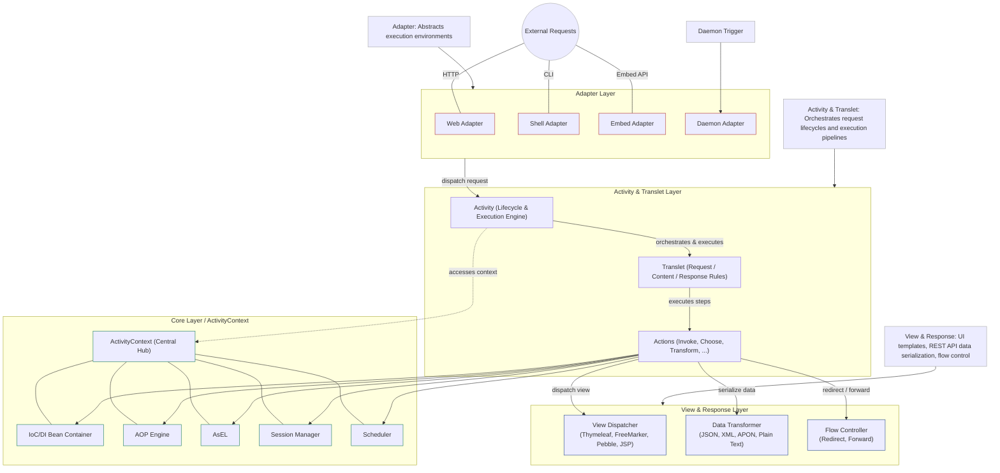
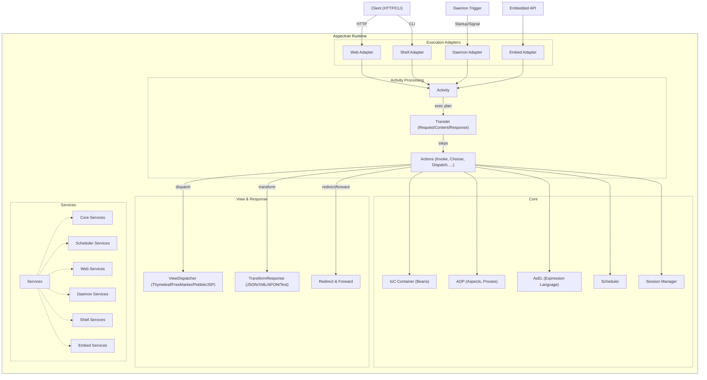
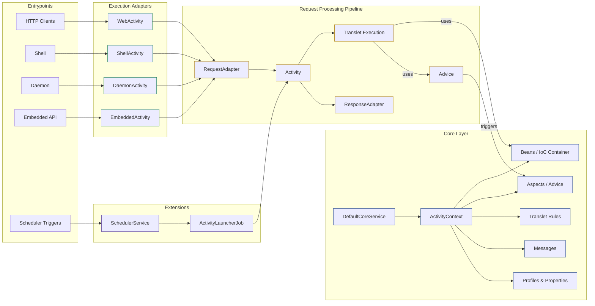
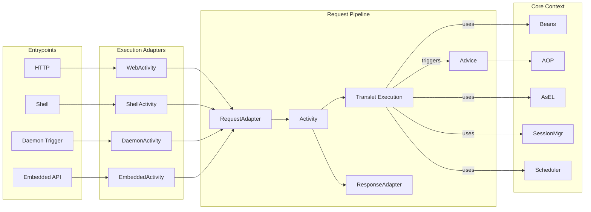
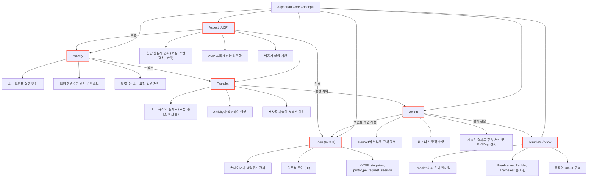
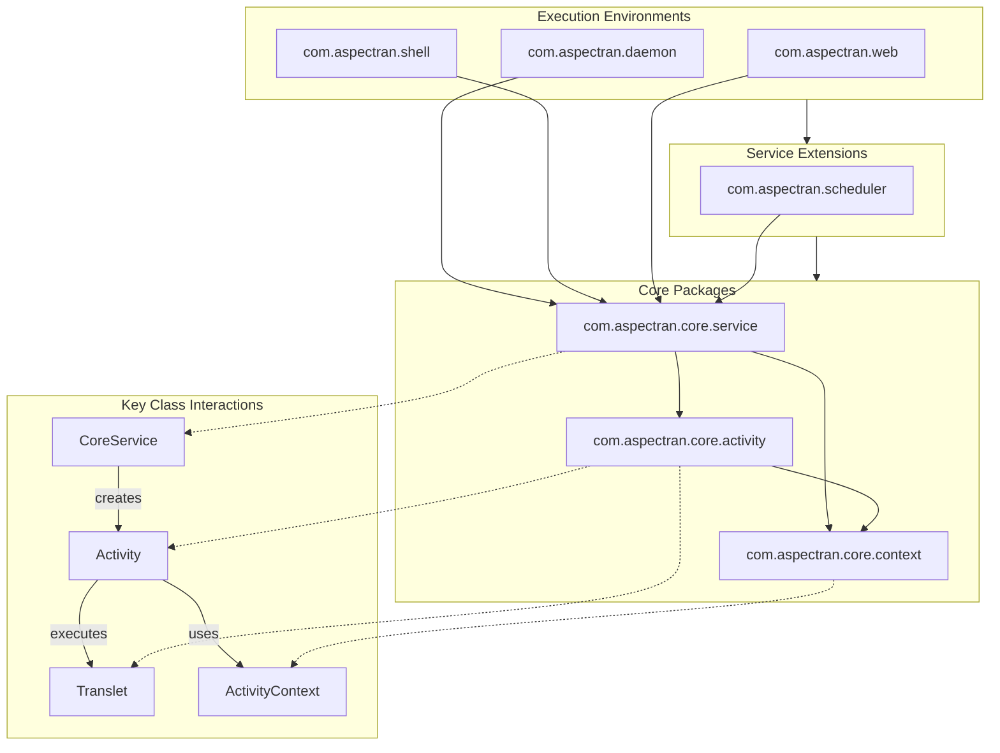
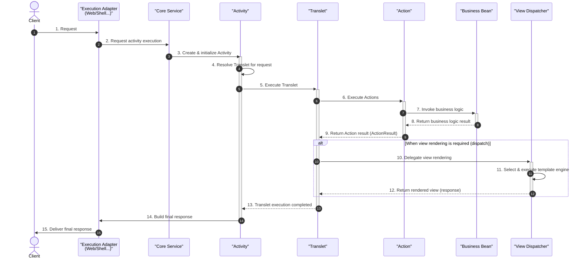
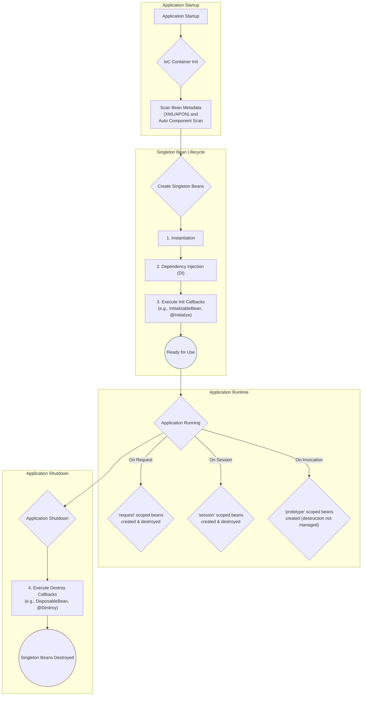
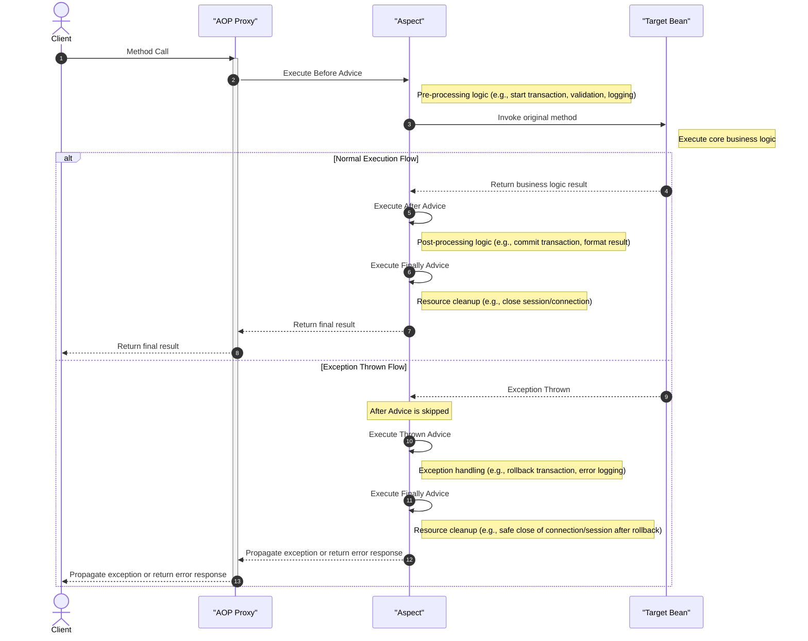

Aspectran is a lightweight, high-performance JVM framework that provides a single, unified programming model across diverse execution environments—including Web, Command-Line Shell, Background Daemon, and Embedded systems—based on a Request-Oriented Architecture and environment abstraction mechanisms.

This document brings together diagrams that visualize Aspectran's internal architecture and core operating principles across nine complementary perspectives (layered structures, request processing pipelines, conceptual models, package dependencies, runtime lifecycles, and AOP mechanisms). Each diagram focuses on specific architectural facets, helping developers and system architects develop a comprehensive understanding of the framework's design philosophy and component interactions.

## Overview of Core Components

*   **Adapters**: Standardize inputs and outputs across disparate execution environments—Web, CLI Shell, Background Daemon, and Embedded API—into uniform interfaces, delivering incoming requests to the `Activity` and returning responses in a consistent manner.
*   **Activity**: The execution engine that governs the entire lifecycle of an individual request. It manages the whole process from entry point, context resolution, and translet lookup/execution to view rendering, response delivery, and resource cleanup.
*   **Translet**: A declarative unit of execution rules for handling a request. It specifies under what conditions and in what sequence `Action`s are executed, as well as which `View` template or format receives the final results.
*   **Actions**: The atomic units that carry out concrete business operations. Actions invoke methods on Java Beans (InvokeAction), branch execution conditionally (ChooseAction), or dispatch control to another translet or view.
*   **Core Components**: Foundational infrastructure services powering the framework, including the IoC/DI Bean Container, AOP Proxy Engine, AsEL (Aspectran Expression Language), Session Manager, and Scheduler.
*   **View & Response**: Represents and delivers the outcome of executed actions into user-facing responses:
    *   **View Dispatcher**: Integrates with template engines (FreeMarker, Pebble, Thymeleaf, JSP) to render dynamic server-side UI views (`<dispatch>`).
    *   **Data Transformation**: Automatically serializes results into modern REST API and data exchange formats including JSON, XML, APON, and Plain Text (`<transform>`).
    *   **Redirect & Forward**: Supports client-side HTTP redirects (`RedirectResponse`) and internal server-side forwarding (`ForwardResponse`).
*   **Services**: Lifecycle-managed (`ServiceLifeCycle`) containers that bootstrap the framework within specific runtime environments. Rooted in `CoreService`, specialized implementations like `WebService`, `ShellService`, and `DaemonService` assemble and run the system.

## 1. Modular Layered Architecture

This diagram shows all the components of Aspectran divided into functional layers. External requests (HTTP, CLI, Daemon Trigger, Embed API) enter and become standardized through the Adapter Layer, initiate request lifecycles and pipeline orchestration within the integrated Activity & Translet Layer, and organically connect to Core Layer infrastructure (ActivityContext) and the View & Response Layer in a cohesive 4-layer architecture.

*   **Adapter Layer**: Abstracts environment and protocol differences (Web, Shell, Daemon, Embedded) into unified request specifications.
*   **Activity & Translet Layer**: Harmoniously integrates the execution engine (`Activity`) that governs request lifecycles with `Translet` blueprints that encapsulate processing rules, orchestrating and managing the execution of business actions (`Actions`).
*   **Core Layer (ActivityContext)**: Centered on `ActivityContext`—the heart of the framework—providing foundational infrastructure including the IoC/DI Bean Container, AOP Engine, AsEL expression language, Session Manager, and Scheduler.
*   **View & Response Layer**: The output tier that delivers business logic outcomes to clients. It encompasses template-driven dynamic UI rendering (`ViewDispatcher`), data format serialization for RESTful APIs (`TransformResponse` - JSON, XML, APON, Plain Text), and response flow control (`Redirect & Forward`).

## 2. Detailed Layered Structure

A comprehensive view of the subsystem groups within the `Aspectran Runtime` container and their runtime interactions. The `Services` tier bootstraps and supervises environment-specific services (`CoreServices`, `SchedulerServices`, `WebServices`, `DaemonServices`, `ShellServices`, `EmbedServices`). Incoming requests channeled through adapters transition through Activity -> Translet -> Actions, tapping into core capabilities (Beans, AOP, AsEL, Session, Scheduler) before being routed to various response channels such as view dispatching, data transformations, and redirects.

## 3. Pipeline-Centric View

A data-flow-oriented diagram illustrating how requests traverse the processing pipeline until a final response is generated. Requests originating from diverse entrypoints (HTTP, CLI, Daemon, Embedded, Scheduler) pass through dedicated adapters (WebActivity, ShellActivity, DaemonActivity, etc.) into an integrated pipeline (`RequestAdapter` → `Activity` → `Translet` → `Advice/Actions` → `ResponseAdapter`).

*   `DefaultCoreService` instantiates `ActivityContext`, feeding beans, AOP aspects, translet rules, messages, and profile configurations into the pipeline.
*   The Scheduler service drives scheduled/periodic executions through `ActivityLauncherJob` directly into the activity pipeline.

## 4. Simplified Pipeline View

A streamlined diagram focusing on the core request processing flow, abstracting away secondary details. It presents the four foundational pillars (`Entrypoints` → `Execution Adapters` → `Request Pipeline` → `Core Context`), allowing developers to build an intuitive mental model of Aspectran's request-response lifecycle.

## 5. Core Concept Map

A structured map visualizing the five foundational pillars of Aspectran (`Activity`, `Translet`, `Bean`, `Action`, `Aspect`) alongside the presentation tier (`Template / View`), highlighting their relationships and individual responsibilities.

*   **Activity**: The execution engine and lifecycle management context for every request.
*   **Translet**: The declarative blueprint specifying request processing rules.
*   **Bean**: Components whose lifecycles and dependency graphs are managed by the IoC/DI container.
*   **Action**: Concrete business logic units executed in sequence or conditionally within a Translet.
*   **Aspect**: Modular cross-cutting concern logic applied transparently across Activities and Beans.
*   **Template / View**: The output tier that dynamically renders action results for presentation.

## 6. Core Package Relationships

Shows package-level dependency hierarchies and runtime interactions among primary classes. Execution environment modules (`daemon`, `shell`, `web`) and service extensions (`scheduler`) depend on the core service package (`core.service`), which coordinates the activity (`core.activity`) and context (`core.context`) modules.

*   `CoreService` creates `Activity` instances to process requests.
*   `Activity` utilizes `ActivityContext` resources to execute configured `Translet`s.

## 7. Request Lifecycle Sequence

A step-by-step sequence diagram tracing chronological interactions among major components from initial request arrival to final response delivery:

1.  **Request Entry (Steps 1–3)**: The client request arrives at the execution adapter (Web/Shell, etc.), requests activity processing from CoreService, and initializes an `Activity` instance.
2.  **Rule Resolution & Execution (Steps 4–5)**: The `Activity` resolves the matching `Translet` rule for the request path and initiates execution.
3.  **Action & Bean Invocation (Steps 6–9)**: Actions defined within the Translet execute, invoking business bean methods and aggregating execution results (`ActionResult`).
4.  **View Dispatching (Steps 10–12)**: When response dispatching (`dispatch`) is configured, control passes to `ViewDispatcher` to select and execute the appropriate template engine.
5.  **Completion & Response (Steps 13–15)**: Upon translet completion, the `Activity` finalizes the response and delivers it back to the client via the adapter.

## 8. Bean Lifecycle & Scopes

Details how the Aspectran IoC container creates, manages, and destroys Beans, outlining scope lifecycle policies across the application lifetime:

*   **Application Startup**: During container boot, bean definitions and metadata are registered via XML, APON configuration files, and annotation-driven component scanning.
*   **Singleton Bean Lifecycle**: Singleton beans progress through `Instantiation` → `Dependency Injection (DI)` → `Initialization Callbacks (InitializableBean, @Initialize)` and remain available for reuse throughout the runtime.
*   **Application Runtime Scopes**:
    *   `request` scope: Created when an `Activity` starts and destroyed when the request completes.
    *   `session` scope: Created alongside user sessions and destroyed when sessions expire.
    *   `prototype` scope: Instantiated anew each time requested from the container.
*   **Application Shutdown**: On shutdown signals, `Destruction Callbacks (DisposableBean, @Destroy)` execute to cleanly release managed resources.

## 9. AOP Mechanism

A sequence diagram detailing how Aspectran's AOP proxy intercepts method invocations to transparently inject cross-cutting concerns (e.g., transactions, logging, security). It comprehensively depicts both the normal execution path and the exception handling (Exception Thrown) flow.

### Execution Flow Overview

1.  **Pre-Processing (Before Advice)**: When a client calls a target bean, the dynamic proxy intercepts the invocation and executes matching `Before` advice on the Aspect first (e.g., initiating transactions, validating parameters, logging request start).
2.  **Target Method Execution**: Upon successful pre-processing, the proxy delegates execution to the actual target bean method to perform core business logic.
3.  **Branch 1: Normal Execution (Normal Flow)**
    *   **After Advice**: When business logic completes successfully, `After` advice executes to perform post-processing tasks or commit transactions.
    *   **Finally Advice**: Always executes regardless of success or failure to safely release managed resources (e.g., closing database sessions).
    *   The final result returns to the client.
4.  **Branch 2: Exception Handling (Exception Thrown Flow)**
    *   **After Skipped**: If an exception occurs during business logic execution, `After` advice is immediately skipped.
    *   **Thrown Advice**: Runs **before the Finally stage** to safely handle transaction rollbacks, log error details, and issue administrative alerts while resources remain open.
    *   **Finally Advice**: Runs after rollback handling to ensure database connections and session resources are reliably closed.
    *   Propagates the exception up the call stack (Exception Re-throw) or returns a designated error response.

These diagrams will be a useful guide to understanding Aspectran's design philosophy and internal workings, serving as a dependable reference for architecting robust, scalable systems.
