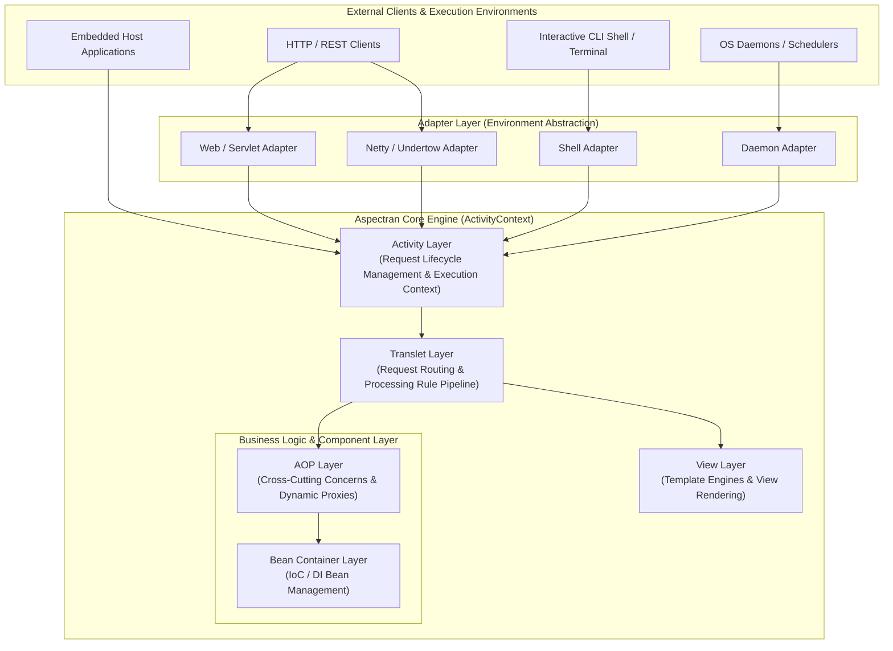
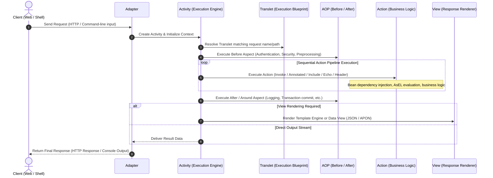

## Introduction

Aspectran is a lightweight, high-performance framework based on the JVM, designed to efficiently build a wide range of applications, from simple command-line applications to complex enterprise web services. It boasts fast startup times and low memory footprint through minimal dependencies and optimized resource usage, making it particularly suitable for microservices architecture or cloud environments. By actively leveraging the runtime optimizations and Virtual Threads of the latest Java LTS (Java 21 or higher), it features a highly efficient structure capable of handling massive concurrent requests with minimal resources.

Aspectran emphasizes an intuitive POJO-centric programming model, allowing developers to focus on business logic using plain old Java objects (POJOs) without needing to deeply understand the complex internal structure of the framework. It embeds powerful enterprise patterns such as Inversion of Control (IoC), Dependency Injection (DI), and Aspect-Oriented Programming (AOP) to maximize code modularity, reusability, and maintainability. Additionally, it facilitates the building of modern web applications, real-time WebSocket services, and high-performance microservices through optimized support for RESTful web service development and integration with various embedded web and network servers (Netty, Undertow, Jetty).

In particular, the **adapter pattern for environment abstraction** is a key strength that enhances Aspectran's flexibility and development productivity. The adapter abstracts the differences in runtime environments (web, console, daemon, etc.), allowing the same business logic to run without modification in any environment.

## Architecture Overview

Aspectran adopts a modular, layered architecture to provide flexibility and extensibility. The core is the Activity-based request processing mechanism implemented in the `aspectran-core` module. Each layer has a clear role, and through the **adapter pattern**, it abstracts the differences of various execution environments, allowing business logic to operate independently of the environment.



*   **Activity Layer**: Receives all external requests (web, shell, etc.) and creates an Activity context to process those requests. This layer manages the lifecycle of the request and finds the appropriate Translet to process the request according to defined rules. `Activity` is the central execution object for single request processing, and it uses `ThreadLocal` to ensure stable request handling even in multi-threaded environments.
*   **Translet Layer**: This layer defines the `Translet` rules that the `Activity` references when processing requests. The `Activity` controls the flow of executing `Action`s, using `Bean`s, and finally generating a response through `View` according to the `Translet` rules defined in this layer. Translets serve as a "blueprint" for requests and as an "interface" between the engine and the user code.
*   **Bean Container Layer**: The core layer responsible for IoC/DI, managing all beans (objects) of the application. It handles bean creation, initialization, destruction, and dependency injection, ensuring loose coupling between components. It supports not only singleton and prototype but also request and session scopes for fine-grained object lifecycle management.
*   **AOP Layer**: This layer houses Aspectran's AOP engine. It applies Aspects to specific join points, such as before/after Translet execution or before/after Bean method calls, to handle cross-cutting concerns. It operates independently of the core business logic through runtime dynamic proxies and maximizes performance with intelligent optimizations like `@Advisable`.
*   **View Layer**: This layer renders views to display the request processing results to the user. It supports flexible implementation of presentation logic through integration with various template engines (FreeMarker, Pebble, Thymeleaf, etc.).

These layers are organically connected to form the request processing flow, and each module is responsible for a specific functional area, strengthening the overall system's modularity.

### Request Processing Lifecycle Flow

The complete flow from when a request enters Aspectran until the final response is returned proceeds through the following stages:



## Core Concepts

Aspectran operates based on several core concepts that provide its flexibility and power.

*   **Activity**: The **execution engine** that processes all requests in Aspectran and the context that manages the request's lifecycle. It processes all types of requests, such as web requests and shell commands, in a consistent manner. It sits at the center of all execution flows, and the `ActivityContext` acts as the heart that coordinates their initialization and configuration.
*   **Translet**: A **set of processing rules or a blueprint** for "how to handle" a specific request. It defines request/response/exception handling rules and the business logic (Action) to be executed. The `Activity` processes requests according to this blueprint, and the `Translet` instance created during this process acts as an **interface** for data sharing and control between the `Activity` and user code.
*   **Bean**: An object managed by Aspectran's IoC container. Application components (services, DAOs, utilities, etc.) are registered as beans, their lifecycle is managed by the framework, and they are provided where needed through dependency injection. It supports singleton, prototype, request, and session scopes, allowing for flexible object lifecycle management.
*   **Action**: An individual unit of work executed within an `Activity`, whose execution rules are defined in a `Translet`. It performs specific functions such as database queries, business logic method calls, or delegating to other Translets. Aspectran supports the following primary action types to compose modular business logic:
    *   **`InvokeAction`**: An action that explicitly calls a method on a bean to execute business logic and receive results.
    *   **`AnnotatedAction`**: An action that conveniently executes business logic by invoking methods annotated with `@Action`.
    *   **`IncludeAction`**: An action that invokes another Translet as a sub-task and synthesizes its results into the current context, maximizing composability and reusability across Translets.
    *   **`EchoAction`**: An action that directly records static attributes or evaluated expressions into the action result map.
    *   **`HeaderAction`**: An action that dynamically adds or modifies response headers (e.g., HTTP headers).
*   **Aspect**: A core element of Aspect-Oriented Programming (AOP), it modularizes and manages cross-cutting concerns such as logging, transaction management, security, and exception handling. The new AOP proxy mechanism optimizes performance and supports flexible context management in asynchronous execution environments.
*   **Template**: Used to render views to display the results processed by Translet to the user. It supports integration with various template engines like FreeMarker, Pebble, and Thymeleaf, enabling flexible UI/UX implementation.

## Key Features

Aspectran provides various powerful features for modern application development.

*   **POJO Programming**: Aspectran allows implementing business logic using plain old Java objects (POJOs) without implementing special interfaces or inheriting from specific framework classes. This reduces the learning curve for developers and allows them to focus on solving business problems with pure Java code.
*   **Inversion of Control (IoC)**: The framework is responsible for object creation, configuration, and lifecycle management. Developers can reduce code complexity and improve testability by delegating object creation to the framework instead of creating or managing objects directly.
*   **Dependency Injection (DI)**: A core function of the IoC container, it automatically injects dependencies (other objects) that an object needs at runtime, instead of the object creating or finding them itself. This minimizes coupling between components and allows for writing flexible and reusable code.
*   **Aspect-Oriented Programming (AOP)**: Modularizes cross-cutting concerns that appear repeatedly throughout the application, such as logging, transaction management, security, and caching, and separates them from the core business logic. Aspectran's AOP is dynamically applied at runtime, eliminating code duplication and improving maintainability.
*   **Transaction Management**: Aspectran provides a declarative transaction management infrastructure seamlessly integrated with the `aspectran-with-jpa` and `aspectran-with-mybatis` modules to guarantee enterprise data consistency.
    *   Transactions can be declaratively initiated, committed, or rolled back upon executing business methods, with fine-grained rollback policies based on specific exception types.
    *   The lifecycle of data sources and session factories is safely synchronized with the framework's IoC container to prevent connection leaks.
*   **Session Management**: Aspectran provides a **high-performance, environment-independent session management component** that can maintain state consistently across various execution environments such as web, shell, and daemon. 
    *   **Pluggable Storage**: You can choose from various session store implementations, such as file-based or Redis-based using high-performance Lettuce client, with full support for clustering in distributed environments.
    *   **Sophisticated Policies**: Features enterprise-grade capabilities like specialized timeout policies for new sessions (`maxIdleSecondsForNew`) to prevent bloat from bots or crawlers.
*   **Hint Mechanism**: A highly flexible and powerful tool used to convey execution "intents" or supplementary metadata from business logic (Service, DAO, etc.) to the framework or other underlying modules. 
    *   By using the `@Hint` annotation, developers can leave "sticky notes" on methods to dynamically instruct behaviors such as cache application, layout control, or security settings without creating direct dependencies on specific modules (**Loose Coupling**). 
    *   It supports propagation and isolation of hints, allowing for precise control even in nested method call environments.
*   **Profiles and Environment Management**: Provides a powerful way to enable or disable parts of an application's configuration only in specific environments (dev, test, prod, etc.). 
    *   Profiles are activated via system properties like `aspectran.profiles.active`, and Aspectran supports complex activation expressions using logical operators (`!`, `()`, `[]`). 
    *   Conditional configurations can be easily applied through XML elements like `<properties>` and `<append>` or via the `@Profile` annotation in Java code.
*   **Configuration and Loading**: Aspectran configures applications through configuration files in APON (Aspectran Object Notation) or XML format. 
    *   It uses a **highly advanced `nodelet` parsing engine** to efficiently load configuration files. Features like `mount`, which dynamically handles nested rules, maximize parsing speed.
    *   It supports dynamic reloading for enhanced development convenience.
*   **Dynamic Hot-Reloading**: Through a unique classloader mechanism called `SiblingClassLoader`, Aspectran can instantly reflect changes in configurations or classes without restarting the JVM. It uses a "Sibling-First" delegation model to flexibly support class sharing and dynamic replacement between modules.
*   **AsEL (Aspectran Expression Language)**: Aspectran provides its own expression language, AsEL, for handling dynamic values within configuration files. AsEL supports powerful features such as dynamically referencing and injecting request data or properties of other beans at runtime using tokens like `${...}` (parameters), `@{...}` (attributes), and `#{...}` (beans or bean properties). Additionally, it can process complex expressions, such as calling object methods or navigating properties within tokens, by internally using OGNL (Object-Graph Navigation Language).
*   **Logging**: Aspectran builds a flexible and powerful logging system based on SLF4J and Logback. It provides a unique feature, **`LoggingGroupDiscriminator`**, to separate and manage logs by service or URI path unit. This makes it easy to track logs for specific features even in environments where numerous requests are mixed.
*   **Job Scheduling**: Features a **built-in powerful scheduling framework based on Quartz** to automatically execute tasks according to a set time or cycle. 
    *   It can be used immediately through configuration without separate library integration, and its key characteristic is the ability to use **Translets** as the body of the tasks to be executed. 
    *   Supports both `simple` triggers (interval-based) and `cron` triggers (schedule-based), and provides both explicit XML/APON configuration and convenient `@Schedule` annotation-based configuration. 
    *   Execution events (start, success, failure) can be monitored through detailed logging via `ActivityJobReporter`.
*   **RESTful Web Services**: Aspectran provides optimized features for RESTful API development. It can process requests based on HTTP methods (GET, POST, PUT, DELETE, etc.) with concise configuration and generate responses in various formats like JSON/XML/APON. 
    *   It applies an **intelligent search priority** that favors the most specific rules, ensuring rational request mapping, such as finding `/users/info` before `/users/*`.
*   **Rapid Development and Startup**: Actively utilizes the Convention over Configuration principle to minimize boilerplate code that developers need to write. It also shortens application startup time through lightweight design and optimized initialization processes, enhancing development and deployment efficiency.
*   **Production-Grade Applications**: Aspectran is designed with stability and scalability in mind and can be flexibly deployed in various operating environments. It can be deployed as a standalone JVM application, an embedded server environment based on Netty, Undertow, or Jetty, a web application in traditional servlet containers (Tomcat, WildFly), or embedded within other Java applications, ensuring stable operation. By actively leveraging Java 21 Virtual Threads and non-blocking I/O, it maintains high throughput with minimal resource utilization even under heavy concurrent loads. The **adapter pattern for environment abstraction** allows the same business logic to run without modification in any environment.

## Modules

Aspectran provides fine-grained modules by function, allowing you to selectively use only the features you need.

*   **`aspectran-all`**: A single JAR file that includes all Aspectran modules and their dependencies. Useful when you want to include all features at once for development and deployment convenience.
*   **`aspectran-bom`**: Maven Bill of Materials (BOM), which helps manage consistent versions of Aspectran-related modules. You can add it to your project's `pom.xml` to prevent dependency version conflicts.
*   **`aspectran-core`**: The heart of the Aspectran framework. It includes the core APIs and implementations of the framework, such as Activity, Translet, Bean container, and AOP engine, forming the basis of all Aspectran-based applications.
*   **`aspectran-daemon`**: Provides functionality to run Aspectran applications as background daemons on Unix-like systems or as Windows services. Suitable for managing long-running, nonstop server processes or batch jobs.
*   **`aspectran-embed`**: Allows Aspectran to be embedded and used within other Java applications. Useful when you want to add Aspectran's powerful features to an existing application, and integration is possible without separate container configuration.
*   **`aspectran-logging`**: Provides a flexible interface for logging in Aspectran applications. It uses SLF4J and Logback by default and provides bridges for other logging APIs like JCL, JUL, and Log4j to ensure compatibility with existing logging systems.
*   **`aspectran-shell`**: Supports easy building of interactive command-line interface (CLI) applications. It provides functions to process user input, execute business logic through Translets, and output results to the console.
*   **`aspectran-shell-jline`**: Integrates the `aspectran-shell` module with the JLine 3 library to provide a richer interactive shell environment, including command-line auto-completion, history management, and colored output.
*   **`aspectran-test`**: A dedicated testing infrastructure module that supports unit and integration testing of Aspectran applications. It provides a JUnit 5 extension (`@AspectranTest`) for declarative context bootstrapping (across core and web environments) and enables testing beans and Translets in an isolated environment.
*   **`aspectran-utils`**: A module that collects various general utility classes that can be usefully employed both inside and outside the Aspectran framework.
*   **`aspectran-web`**: Provides foundational web infrastructure and container-agnostic abstractions for building web applications and RESTful services without a direct dependency on the Servlet API. It includes generic HTTP request and response adapters, RFC 6265-compliant cookie management, CORS processing, ETag caching interceptor, and locale resolution mechanisms, designed to run seamlessly across diverse runtimes such as Netty, Undertow, and Servlet containers.
*   **`aspectran-web-servlet`**: Specializes the Aspectran web infrastructure for Jakarta Servlet environments (such as Apache Tomcat, Jetty, WildFly, and standard WAR deployments). It provides comprehensive integration with the Servlet API, including `ServletWebService`, `WebActivityServlet`, request and response adapters, HTTP session management, servlet filters, lifecycle listeners, and JSP custom tag libraries (`aspectran.tld`).
*   **`aspectran-rss-lettuce`**: Provides a Redis-based high-performance Lettuce client implementation for session storage, allowing efficient management of session data in distributed environments.
*   **`aspectran-with-jetty`**: Integrates the embedded Jetty web server into Aspectran applications. It simplifies deployment by allowing Aspectran applications to run independently without separate web server installation.
*   **`aspectran-with-netty`**: Integrates an embedded Netty server into Aspectran applications, providing a high-performance, non-blocking, servlet-less microservice and REST API runtime. It features multi-context routing and virtual hosting, JSR-356 (Jakarta WebSocket) standard endpoint support, static resource serving, content compression, access logging, and interactive CLI/daemon command control (`NettyCommand`).
*   **`aspectran-with-undertow`**: Integrates the embedded Undertow web server into Aspectran applications. Undertow is a lightweight, high-performance web server suitable for environments requiring fast startup and low resource usage.
*   **`aspectran-with-freemarker`**: Integrates the FreeMarker template engine with Aspectran's View layer. It allows for the creation of dynamic web pages through server-side template rendering.
*   **`aspectran-with-pebble`**: Integrates the Pebble template engine with Aspectran, providing flexible and powerful template features.
*   **`aspectran-with-thymeleaf`**: Integrates the Thymeleaf template engine with Aspectran. It supports HTML5-friendly template writing and makes it easy to create web-standard-compliant views.
*   **`aspectran-with-jpa`**: Provides integration with Jakarta Persistence API (JPA), allowing safe and efficient database operations through object-relational mapping (ORM) and declarative transaction management.
*   **`aspectran-with-mybatis`**: Provides integration with the MyBatis persistence framework, supporting SQL Mapper-based database access and declarative transaction management.
*   **`aspectran-with-logback`**: A POM module for conveniently managing Logback logging framework dependencies. Primarily used in build and test environments of other modules.

Developers can combine necessary modules according to the project's nature to configure an optimal environment (e.g., building high-performance servlet-less microservices through `core` + `web` + `with-netty` or `with-undertow`, or standard servlet-based web applications through `core` + `web-servlet`).

## Supported Execution Environments

Aspectran is designed to be flexibly deployed and executed in various environments.

*   **Embedded Web and Network Servers (Netty, Undertow, Jetty)**: Aspectran applications can run independently as standalone services by embedding a high-performance network/web server directly within the application itself, without requiring an external web server or WAS installation.
    *   **Netty**: Builds ultra-lightweight, high-performance microservices, RESTful APIs, and real-time WebSocket services with asynchronous non-blocking I/O, Virtual Threads, and zero servlet overhead.
    *   **Undertow**: Delivers high-throughput web applications with rapid response times and minimal memory footprint using a lightweight non-blocking handler architecture.
    *   **Jetty**: Provides a mature, full-featured embedded servlet container environment with flexible extensibility.
*   **Servlet Containers (Apache Tomcat, Jetty, WildFly, etc.)**: Deployed as a standard WAR (Web Application Archive) file to servlet containers, providing full compatibility with existing enterprise infrastructure and servlet filter ecosystems.
*   **Standalone Background Daemons and OS Services**: Runs as background daemons on Unix/Linux systems or Windows services. Combined with the built-in scheduler, it is optimized for backend systems requiring 24/7 nonstop operations, such as scheduled batch processing and data synchronization.
*   **Interactive Command-Line Shell (CLI)**: Provides a rich interactive CLI application environment powered by JLine 3. It supports real-time input parsing, tab auto-completion, command history, and colored terminal output for building system administration and batch operation tools.

## Key Use Cases

Thanks to its flexibility and power, Aspectran can be used for developing various types of applications.

*   **RESTful APIs & Microservices**: Its lightweight, high-performance characteristics, intuitive RESTful web service support, and servlet-less runtimes on Netty or Undertow make it exceptionally well-suited for building core API servers in microservice architectures.
*   **Real-Time WebSocket Services**: Full compliance with the JSR-356 (Jakarta WebSocket) standard and deep integration with embedded Netty enables low-latency, high-efficiency two-way communication services such as chat applications, live notifications, and streaming feeds.
*   **Web Applications**: Traditional MVC-based dynamic web applications can be efficiently developed through integration with various template engines (FreeMarker, Pebble, Thymeleaf) and flexible web/servlet modules.
*   **Command-Line Tools (CLI Tools)**: Leveraging its powerful shell module and JLine 3 integration, you can build interactive CLI applications with auto-completion, history navigation, and colored output for system administration tools, batch scripts, and data processing utilities.
*   **Backend Daemon Services**: Through daemon mode and the built-in Quartz scheduler, it can stably operate long-running background services, scheduled batch processing systems, and data synchronization services.
*   **Embedded Systems**: Using the `aspectran-embed` module, you can embed Aspectran's IoC, DI, and AOP capabilities into existing Java applications to enhance or extend module functionalities without altering the existing architectural structure.

## Build

Here's how to build and run the Aspectran project in your local environment.

First, clone the repository:
```sh
git clone https://github.com/aspectran/aspectran.git
cd aspectran
```

Then, run the build script for your operating system:
```sh
# On Unix-like systems (Linux, macOS, Git Bash)
./build.sh rebuild

# On Windows (Command Prompt or PowerShell)
.\build.bat rebuild
```
Alternatively, you can use Maven directly: `./mvnw clean install`.

*   **Java 21 or higher**: Aspectran requires Java 21 as the minimum runtime version. It is recommended to use the latest Java LTS version.
*   **Maven**: Apache Maven 3.9.4 or higher must be installed for project builds.

## Run Demo

You can quickly explore the framework's features by building and running the Aspectran demo application.

Run the demo script for your operating system:
```sh
# On Unix-like systems (Linux, macOS, Git Bash)
./build.sh demo

# On Windows (Command Prompt or PowerShell)
.\build.bat demo
```
Then, access http://localhost:8080 in your web browser to check out the demo.

The demo application includes example code demonstrating various Aspectran features (web services, AOP, bean management, etc.).

## Continuous Integration

The Aspectran project manages continuous integration (CI) and continuous deployment (CD) through GitHub Actions workflows.

*   [GitHub Actions](https://github.com/aspectran/aspectran/actions): All changes to the project are automatically built, tested, and verified to ensure code quality and stability.

## Community and Support

*   **GitHub Issues**: Problems, bug reports, and feature suggestions during project use can be shared and discussed via GitHub Issues.
*   **Official Documentation**: You can learn and utilize all features of the framework through the detailed documentation provided on the Aspectran official website.
*   **Contribution**: The Aspectran project is open source, and anyone can participate in its development by contributing code, improving documentation, or fixing bugs.

## Links

*   **Official Site**: [https://aspectran.com/](https://aspectran.com/) - You can find the latest information and documentation about Aspectran.
*   **Demo**: [https://public.aspectran.com/](https://public.aspectran.com/) - Experience actual demo web applications built with Aspectran.
*   **API Documentation**: [https://javadoc.io/doc/com.aspectran/aspectran-all](https://javadoc.io/doc/com.aspectran/aspectran-all) - Provides detailed Javadoc documentation for all Aspectran APIs.

## License

Aspectran is distributed under the [Apache 2.0 License](https://www.apache.org/licenses/LICENSE-2.0). This means it can be freely used, modified, and distributed for commercial and non-commercial purposes.
