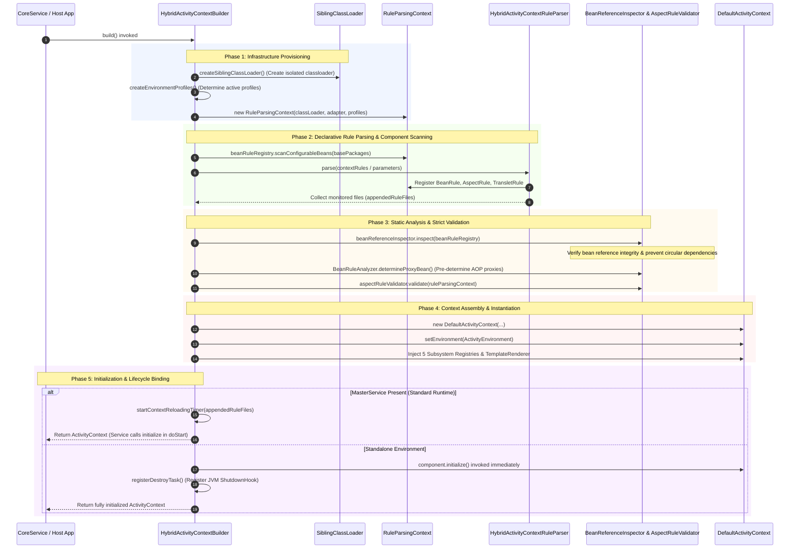
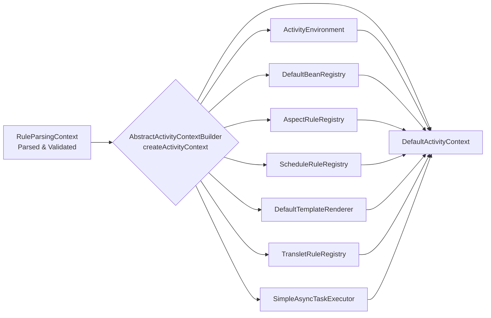

[`ActivityContext`](https://github.com/aspectran/aspectran/blob/master/core/src/main/java/com/aspectran/core/context/ActivityContext.java), the core IoC/DI container of an Aspectran application, is not instantiated directly at runtime. Instead, it is systematically assembled through the rigorous and disciplined pipeline of [`ActivityContextBuilder`](https://github.com/aspectran/aspectran/blob/master/core/src/main/java/com/aspectran/core/context/builder/ActivityContextBuilder.java).

The build process goes far beyond simple configuration parsing: it is a comprehensive engineering workflow encompassing **dedicated classloader isolation, environment profile resolution, XML/APON/annotation hybrid parsing, bean reference integrity inspection ([`BeanReferenceInspector`](https://github.com/aspectran/aspectran/blob/master/core/src/main/java/com/aspectran/core/context/rule/validation/BeanReferenceInspector.java)), AOP proxy pre-analysis ([`BeanRuleAnalyzer`](https://github.com/aspectran/aspectran/blob/master/core/src/main/java/com/aspectran/core/component/bean/BeanRuleAnalyzer.java)), aspect validation ([`AspectRuleValidator`](https://github.com/aspectran/aspectran/blob/master/core/src/main/java/com/aspectran/core/context/rule/validation/AspectRuleValidator.java)), and real-time reloading monitor timer binding**.

The entire build process is orchestrated by the [`HybridActivityContextBuilder`](https://github.com/aspectran/aspectran/blob/master/core/src/main/java/com/aspectran/core/context/builder/HybridActivityContextBuilder.java) class.

## 1. End-to-End Build Pipeline Architecture

The construction of an `ActivityContext` progresses through five deterministic, sequential phases.

## 2. Phase 1: Builder Configuration and Infrastructure Provisioning

The first phase isolates and configures the physical resources and runtime environment required for context execution.

### 1) ClassLoader Isolation ([`createSiblingClassLoader`](https://github.com/aspectran/aspectran/blob/master/core/src/main/java/com/aspectran/core/context/builder/AbstractActivityContextBuilder.java#L396))
- Instantiates a dedicated [`SiblingClassLoader`](https://github.com/aspectran/aspectran/blob/master/core/src/main/java/com/aspectran/core/context/resource/SiblingClassLoader.java) isolated from the host application's system classloader.
- Dynamically binds external directories or JAR paths configured in `<resourceLocations>` to the classpath, facilitating clean teardown and regeneration of classloader hierarchies during dynamic hot-reloading.

### 2) Environment Profile Resolution ([`createEnvironmentProfiles`](https://github.com/aspectran/aspectran/blob/master/core/src/main/java/com/aspectran/core/context/builder/AbstractActivityContextBuilder.java#L430))
- Evaluates system properties, environment variables, and configuration settings to determine `activeProfiles` and `defaultProfiles`, instantiating an [`EnvironmentProfiles`](https://github.com/aspectran/aspectran/blob/master/core/src/main/java/com/aspectran/core/context/env/EnvironmentProfiles.java) descriptor.
- Subsequent component definitions and property blocks are activated only if they satisfy these profile predicates.

### 3) Rule Parsing Context Initialization ([`RuleParsingContext`](https://github.com/aspectran/aspectran/blob/master/core/src/main/java/com/aspectran/core/context/rule/parsing/RuleParsingContext.java))
- Instantiates and prepares (`prepare()`) a dedicated parsing session object, `RuleParsingContext`, to stage parsed intermediate rule objects (`*Rule`) and establish inter-rule relationships.

## 3. Phase 2: Declarative Rule Parsing and Component Scanning

In this phase, component metadata from diverse sources (Java annotations, XML, APON) is collected and transformed into a unified rule object tree.

### 1) Annotation-Based Component Scanning
- Scans package paths designated in `basePackages` to identify classes annotated with `@Component`, `@Bean`, `@Aspect`, `@Service`, or `@Controller`.
- Discovered classes are converted into equivalent [`BeanRule`](https://github.com/aspectran/aspectran/blob/master/core/src/main/java/com/aspectran/core/context/rule/BeanRule.java) and [`AspectRule`](https://github.com/aspectran/aspectran/blob/master/core/src/main/java/com/aspectran/core/context/rule/AspectRule.java) definitions and registered into `RuleParsingContext`.

### 2) XML / APON Hybrid Parsing ([`HybridActivityContextRuleParser`](https://github.com/aspectran/aspectran/blob/master/core/src/main/java/com/aspectran/core/context/rule/parser/HybridActivityContextRuleParser.java))
- Automatically selects the appropriate parser engine based on file extensions and configurations:
  - XML Configurations: [`XmlActivityContextParser`](https://github.com/aspectran/aspectran/blob/master/core/src/main/java/com/aspectran/core/context/rule/parser/xml/XmlActivityContextParser.java) (Nodelet-based high-speed XML parser)
  - APON Configurations: [`AponActivityContextParser`](https://github.com/aspectran/aspectran/blob/master/core/src/main/java/com/aspectran/core/context/rule/parser/apon/AponActivityContextParser.java) (Aspectran's proprietary lightweight object notation parser)
- External configuration files imported during parsing via `<append file="..." />` are captured dynamically by [`RuleFileAppendedListener`](https://github.com/aspectran/aspectran/blob/master/core/src/main/java/com/aspectran/core/context/builder/HybridActivityContextBuilder.java#L173) and registered into the file monitoring set (`appendedRuleFiles`) for automatic reloading.

## 4. Phase 3: Static Analysis and Strict Validation

To guarantee that parsed rules operate seamlessly at runtime without unexpected failures, the builder conducts rigorous static analysis and validation.

### 1) Post-Processing (`BeanRuleRegistry.postProcess`)
- Resolves aliases, evaluates parent bean inheritance hierarchies, and sets autowiring candidate flags to ensure complete metadata resolution.

### 2) Bean Reference Integrity and Circular Dependency Inspection ([`BeanReferenceInspector`](https://github.com/aspectran/aspectran/blob/master/core/src/main/java/com/aspectran/core/context/rule/validation/BeanReferenceInspector.java))
- Verifies that target bean IDs and types referenced in constructor arguments, field injections, and property setters actually exist.
- When running under a parent service, links lookups into the parent context's bean registry.
- **Circular Dependency Prevention**: Identifies cyclic constructor references between beans and raises explicit errors during bootstrapping, fundamentally preventing runtime deadlocks and stack overflows.

### 3) AOP Proxy Pre-Determination ([`BeanRuleAnalyzer.determineProxyBean`](https://github.com/aspectran/aspectran/blob/master/core/src/main/java/com/aspectran/core/component/bean/BeanRuleAnalyzer.java))
- Analyzes pointcut expressions declared across all `AspectRule` definitions against candidate bean method signatures.
- Pre-determines whether a bean is advisable at build time and marks its `BeanRule` accordingly, completely eliminating the runtime overhead of inspecting AOP applicability on every invocation.

### 4) Aspect Rule Validation ([`AspectRuleValidator.validate`](https://github.com/aspectran/aspectran/blob/master/core/src/main/java/com/aspectran/core/context/rule/validation/AspectRuleValidator.java))
- Rigorously validates that advice beans and advice methods referenced in aspect rules exist and that method signatures comply with advice specifications.

## 5. Phase 4: `ActivityContext` Assembly and Instantiation

Validated rule definitions are converted into operational service registry instances and assembled into a [`DefaultActivityContext`](https://github.com/aspectran/aspectran/blob/master/core/src/main/java/com/aspectran/core/context/DefaultActivityContext.java).

1. **`DefaultActivityContext` Instantiation**: Establishes the context skeleton with the dedicated classloader, application adapter, and master service reference.
2. **`ActivityEnvironment` Construction**: Aggregates active profiles and declared `<properties>`, interpolating system environment variables and evaluating encrypted values.
3. **Assembly of 5 Core Subsystem Registries**:
   - `DefaultBeanRegistry`: Bean instantiation pool created from `BeanRuleRegistry` metadata.
   - `AspectRuleRegistry`: Pre-compiled pointcut rule lookup indexes.
   - `ScheduleRuleRegistry`: Scheduled task configurations.
   - `DefaultTemplateRenderer`: Template rule registry.
   - `TransletRuleRegistry`: Translet routing tree.
4. **Asynchronous Task Executor Configuration**: If `contextConfig.asyncConfig.enabled` is active, instantiates and binds [`SimpleAsyncTaskExecutor`](https://github.com/aspectran/aspectran/blob/master/core/src/main/java/com/aspectran/core/component/bean/async/SimpleAsyncTaskExecutor.java) equipped with a dedicated thread pool.

## 6. Phase 5: Initialization and Lifecycle Binding

The assembled context undergoes distinct initialization and lifecycle management workflows depending on host environment configuration:

### 1) Master Service Integrated Environment (Standard Web, Daemon, Shell, etc.)
- The builder defers invoking `ActivityContext.initialize()`, returning the assembled context instance to the master service ([`DefaultCoreService`](https://github.com/aspectran/aspectran/blob/master/core/src/main/java/com/aspectran/core/service/DefaultCoreService.java)).
- In the master service's `doStart()` lifecycle hook, `component.initialize()` is called to trigger singleton instantiation and dependency injection.
- **Context Reloading Timer Startup**: Registers all tracked configuration files (`appendedRuleFiles`) and launches [`ContextReloadingTimer`](https://github.com/aspectran/aspectran/blob/master/core/src/main/java/com/aspectran/core/context/builder/reload/ContextReloadingTimer.java) for zero-downtime hot-reloading.

### 2) Standalone Builder Execution Environment
- When the builder is used independently without a master service (e.g., unit tests or standalone utilities):
  - The builder immediately calls `((Component)activityContext).initialize()` to fully activate the context.
  - Registers a JVM shutdown hook via [`ShutdownHook.Manager`](https://github.com/aspectran/aspectran/blob/master/utils/src/main/java/com/aspectran/utils/ShutdownHook.java) to ensure graceful teardown upon process termination.

> 🔍 **Related Detailed Mechanisms**
> - For the runtime architecture and operational mechanics of the assembled context, see [ActivityContext: The Heart of the Aspectran Container](/en/docs/mechanisms/activity-context/).
> - For how configuration changes trigger zero-downtime reloads, see [Aspectran Reloading Mechanism](/en/docs/mechanisms/aspectran-reloading-mechanism/).
> - For environment profile resolution and property evaluation rules, see [ActivityEnvironment Architecture](/en/docs/mechanisms/activity-environment/).

## 7. Next Steps: Exploring Detailed Mechanisms

To examine how dynamic configuration properties, active profiles, and encrypted variables are evaluated within the context, proceed to the [ActivityEnvironment Architecture](/en/docs/mechanisms/activity-environment/) guide.

To inspect how all mechanisms and packages interconnect across the entire framework, refer to the **[Aspectran Detailed Mechanisms Index](/en/docs/mechanisms/)**.
