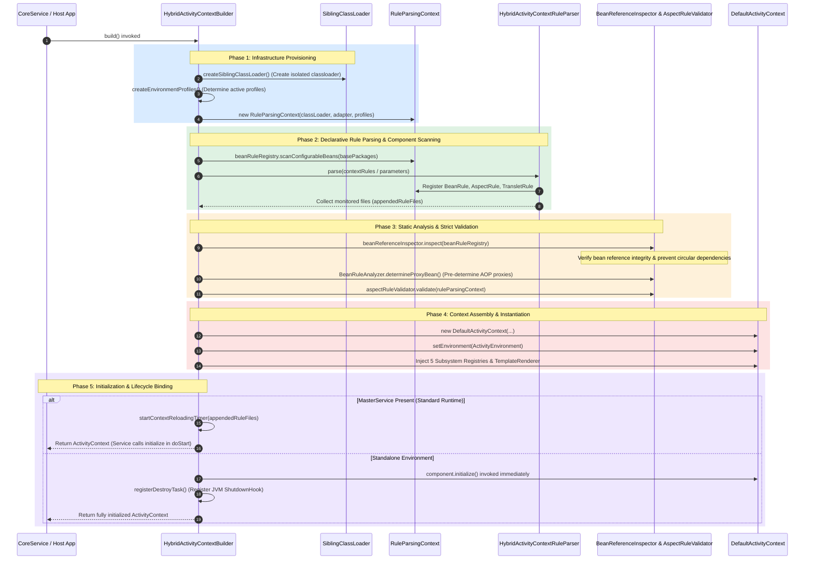
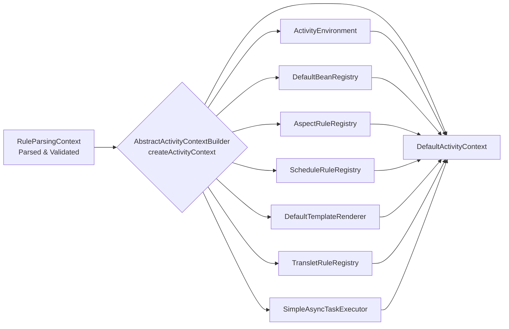

[`ActivityContext`](https://github.com/aspectran/aspectran/blob/master/core/src/main/java/com/aspectran/core/context/ActivityContext.java), the core IoC/DI container of an Aspectran application, is not instantiated directly at runtime. Instead, it is systematically assembled through the rigorous and disciplined pipeline of [`ActivityContextBuilder`](https://github.com/aspectran/aspectran/blob/master/core/src/main/java/com/aspectran/core/context/builder/ActivityContextBuilder.java).

The build process goes far beyond simple configuration parsing: it is a comprehensive engineering workflow encompassing **dedicated classloader isolation, environment profile resolution, XML/APON/annotation hybrid parsing, bean reference integrity inspection ([`BeanReferenceInspector`](https://github.com/aspectran/aspectran/blob/master/core/src/main/java/com/aspectran/core/context/rule/validation/BeanReferenceInspector.java)), AOP proxy pre-analysis ([`BeanRuleAnalyzer`](https://github.com/aspectran/aspectran/blob/master/core/src/main/java/com/aspectran/core/component/bean/BeanRuleAnalyzer.java)), aspect validation ([`AspectRuleValidator`](https://github.com/aspectran/aspectran/blob/master/core/src/main/java/com/aspectran/core/context/rule/validation/AspectRuleValidator.java)), and real-time reloading monitor timer binding**.

The entire build process is orchestrated by the [`HybridActivityContextBuilder`](https://github.com/aspectran/aspectran/blob/master/core/src/main/java/com/aspectran/core/context/builder/HybridActivityContextBuilder.java) class.

## 1. End-to-End Build Pipeline Architecture

The construction of an `ActivityContext` progresses through five deterministic, sequential phases.

## 2. Phase 1: Builder Configuration and Infrastructure Provisioning

The first phase isolates and configures the physical resources and runtime environment required for context execution.

### 1) ClassLoader Isolation ([`createSiblingClassLoader`](https://github.com/aspectran/aspectran/blob/master/core/src/main/java/com/aspectran/core/context/builder/AbstractActivityContextBuilder.java#L396))
- Instantiates a dedicated [`SiblingClassLoader`](https://github.com/aspectran/aspectran/blob/master/core/src/main/java/com/aspectran/core/context/resource/SiblingClassLoader.java) isolated from the host application's system classloader.
- Dynamically binds external directories or JAR paths configured in `<resourceLocations>` to the classpath, facilitating clean teardown and regeneration of classloader hierarchies during dynamic hot-reloading.

### 2) Environment Profile Resolution ([`createEnvironmentProfiles`](https://github.com/aspectran/aspectran/blob/master/core/src/main/java/com/aspectran/core/context/builder/AbstractActivityContextBuilder.java#L430))
- Evaluates system properties, environment variables, and configuration settings to determine `activeProfiles` and `defaultProfiles`, instantiating an [`EnvironmentProfiles`](https://github.com/aspectran/aspectran/blob/master/core/src/main/java/com/aspectran/core/context/env/EnvironmentProfiles.java) descriptor.
- Subsequent component definitions and property blocks are activated only if they satisfy these profile predicates.

### 3) Rule Parsing Context Initialization ([`RuleParsingContext`](https://github.com/aspectran/aspectran/blob/master/core/src/main/java/com/aspectran/core/context/rule/parsing/RuleParsingContext.java))
- Instantiates and prepares (`prepare()`) a dedicated parsing session object, `RuleParsingContext`, to stage parsed intermediate rule objects (`*Rule`) and establish inter-rule relationships.

## 3. Phase 2: Declarative Rule Parsing and Component Scanning

In this phase, component metadata from diverse sources (Java annotations, XML, APON) is collected and transformed into a unified rule object tree.

### 1) Annotation-Based Component Scanning
- Scans package paths designated in `basePackages` to identify classes annotated with `@Component`, `@Bean`, `@Aspect`, `@Service`, or `@Controller`.
- Discovered classes are converted into equivalent [`BeanRule`](https://github.com/aspectran/aspectran/blob/master/core/src/main/java/com/aspectran/core/context/rule/BeanRule.java) and [`AspectRule`](https://github.com/aspectran/aspectran/blob/master/core/src/main/java/com/aspectran/core/context/rule/AspectRule.java) definitions and registered into `RuleParsingContext`.

### 2) XML / APON Hybrid Parsing and Appender Processing ([`HybridActivityContextRuleParser`](https://github.com/aspectran/aspectran/blob/master/core/src/main/java/com/aspectran/core/context/rule/parser/HybridActivityContextRuleParser.java))
Declarative configuration files are processed through a unified hybrid parser pipeline according to their formats (XML or APON) and delivery mechanisms (file path, classpath resource, or parameter object):

- **Parser Hierarchy and Role Separation**:
  - [`ActivityContextRuleParser`](https://github.com/aspectran/aspectran/blob/master/core/src/main/java/com/aspectran/core/context/rule/parser/ActivityContextRuleParser.java): Defines the top-level parser contract (`AutoCloseable`) for reading configuration rules and populating a [`RuleParsingContext`](https://github.com/aspectran/aspectran/blob/master/core/src/main/java/com/aspectran/core/context/rule/parsing/RuleParsingContext.java).
  - [`AbstractActivityContextRuleParser`](https://github.com/aspectran/aspectran/blob/master/core/src/main/java/com/aspectran/core/context/rule/parser/AbstractActivityContextRuleParser.java): Manages the `RuleParsingContext`, character encoding (`encoding`), XML-to-APON conversion flag (`useXmlToApon`), and debug mode (`debugMode`), providing the core `resolveAppender()` logic to determine and instantiate the appropriate [`RuleAppender`](https://github.com/aspectran/aspectran/blob/master/core/src/main/java/com/aspectran/core/context/rule/appender/RuleAppender.java) from resource paths.
  - [`HybridActivityContextRuleParser`](https://github.com/aspectran/aspectran/blob/master/core/src/main/java/com/aspectran/core/context/rule/parser/HybridActivityContextRuleParser.java): The concrete hybrid parser implementation accommodating both XML and APON formats, delegating actual parsing and nested rule file handling to an internal [`HybridRuleAppendHandler`](https://github.com/aspectran/aspectran/blob/master/core/src/main/java/com/aspectran/core/context/rule/appender/HybridRuleAppendHandler.java).
- **Resource Resolution and Appender Determination (`resolveAppender`)**:
  - Generates the appropriate `RuleAppender` based on the configuration path prefix:
    - `classpath:` prefix: Uses [`ResourceRuleAppender`](https://github.com/aspectran/aspectran/blob/master/core/src/main/java/com/aspectran/core/context/rule/appender/ResourceRuleAppender.java) to load resources via the isolated class loader ([`SiblingClassLoader`](https://github.com/aspectran/aspectran/blob/master/core/src/main/java/com/aspectran/core/context/resource/SiblingClassLoader.java)).
    - `file:` prefix: Uses [`FileRuleAppender`](https://github.com/aspectran/aspectran/blob/master/core/src/main/java/com/aspectran/core/context/rule/appender/FileRuleAppender.java) for absolute filesystem paths.
    - Relative paths without prefix: Uses [`FileRuleAppender`](https://github.com/aspectran/aspectran/blob/master/core/src/main/java/com/aspectran/core/context/rule/appender/FileRuleAppender.java) resolved relative to `ruleParsingContext.getBasePath()`.
  - Determines the file format: sets [`AppendableFileFormatType.APON`](https://github.com/aspectran/aspectran/blob/master/core/src/main/java/com/aspectran/core/context/rule/type/AppendableFileFormatType.java) if the file extension is `.apon` (case-insensitive); otherwise defaults to [`AppendableFileFormatType.XML`](https://github.com/aspectran/aspectran/blob/master/core/src/main/java/com/aspectran/core/context/rule/type/AppendableFileFormatType.java).
- **Format-Specific Parsing Execution (`HybridRuleAppendHandler`)**:
  - `HybridRuleAppendHandler` dynamically routes parsing depending on the `RuleAppender` type and configuration format:
    - **XML Configuration (Default - Nodelet High-Speed XML Parsing)**: Bypasses intermediate model conversions and directly invokes [`AspectranNodeParser`](https://github.com/aspectran/aspectran/blob/master/core/src/main/java/com/aspectran/core/context/rule/parser/xml/AspectranNodeParser.java) to stream XML nodes via Nodelet-based SAX parsing, immediately creating and registering rule objects (`BeanRule`, `TransletRule`, `AspectRule`, etc.) into `RuleParsingContext`.
    - **XML Configuration (Alternative & Cross-Validation - with `useXmlToApon` enabled)**: Converts XML documents into intermediate [`RootParameters`](https://github.com/aspectran/aspectran/blob/master/core/src/main/java/com/aspectran/core/context/rule/params/RootParameters.java) via [`XmlToParameters`](https://github.com/aspectran/aspectran/blob/master/utils/src/main/java/com/aspectran/utils/apon/XmlToParameters.java), then transforms them into rule objects using [`ParametersToRules`](https://github.com/aspectran/aspectran/blob/master/core/src/main/java/com/aspectran/core/context/rule/converter/ParametersToRules.java). This path serves as an **independent cross-validation reference** against the direct Nodelet parser to verify parsing fidelity, guarantee rule mapping consistency across engines, and isolate potential defects during debugging.
    - **APON Configuration (`.apon` files)**: Reads APON documents into [`RootParameters`](https://github.com/aspectran/aspectran/blob/master/core/src/main/java/com/aspectran/core/context/rule/params/RootParameters.java) via a Reader, which are subsequently converted into rule objects using [`ParametersToRules`](https://github.com/aspectran/aspectran/blob/master/core/src/main/java/com/aspectran/core/context/rule/converter/ParametersToRules.java).
    - **Programmatic Parameters (`AspectranParameters`)**: When configuration is passed directly in memory as an `AspectranParameters` instance ([`AppenderType.PARAMETERS`](https://github.com/aspectran/aspectran/blob/master/core/src/main/java/com/aspectran/core/context/rule/type/AppenderType.java)), `ParametersToRules` assembles it directly into the context rule tree.
- **External Configuration Imports (`<append>`) and Dynamic File Tracking**:
  - External configuration files imported during parsing via `<append file="..." />` (XML) or `append: { file: "..." }` (APON) are processed recursively by `HybridRuleAppendHandler.handle(appender)`.
  - Whenever a filesystem-based appender ([`FileRuleAppender`](https://github.com/aspectran/aspectran/blob/master/core/src/main/java/com/aspectran/core/context/rule/appender/FileRuleAppender.java)) is processed, the [`RuleFileAppendedListener`](https://github.com/aspectran/aspectran/blob/master/core/src/main/java/com/aspectran/core/context/builder/HybridActivityContextBuilder.java#L173) callback registered by the builder is triggered in real time, appending physical `File` handles into the `appendedRuleFiles` collection without duplicates. This list is subsequently supplied to [`ContextReloadingTimer`](https://github.com/aspectran/aspectran/blob/master/core/src/main/java/com/aspectran/core/context/builder/reload/ContextReloadingTimer.java) for hot reloading.
- **Scope Isolation and Scoped Overrides**:
  - Protects nested parsing scopes by backing up and restoring [`RuleParsingScope`](https://github.com/aspectran/aspectran/blob/master/core/src/main/java/com/aspectran/core/context/rule/parsing/RuleParsingScope.java) before and after appending child configurations.
  - When child rules (`childRules`) are explicitly specified inside an `<append>` block (`applyScopedOverrides`), the handler precisely overrides beans (`BeanRule`), properties (`EnvironmentRule`), type aliases (`TypeAliasRule`), translets (`TransletRule`), aspects (`AspectRule`), schedules (`ScheduleRule`), and templates (`TemplateRule`) declared within the appended scope.
- **Debug Mode Support (XML to APON)**:
  - When `debugMode` is enabled during XML parsing, an equivalent `.apon` file (e.g., `app-config.xml.apon`) is automatically dumped alongside the XML file, allowing easy verification and migration of XML configurations into APON syntax.

## 4. Phase 3: Static Analysis and Strict Validation

To guarantee that parsed rules operate seamlessly at runtime without unexpected failures, the builder conducts rigorous static analysis and validation.

### 1) Post-Processing (`BeanRuleRegistry.postProcess`)
- Resolves aliases, evaluates parent bean inheritance hierarchies, and sets autowiring candidate flags to ensure complete metadata resolution.

### 2) Bean Reference Integrity and Circular Dependency Inspection ([`BeanReferenceInspector`](https://github.com/aspectran/aspectran/blob/master/core/src/main/java/com/aspectran/core/context/rule/validation/BeanReferenceInspector.java))
- Verifies that target bean IDs and types referenced in constructor arguments, field injections, and property setters actually exist.
- When running under a parent service, links lookups into the parent context's bean registry.
- **Circular Dependency Prevention**: Identifies cyclic constructor references between beans and raises explicit errors during bootstrapping, fundamentally preventing runtime deadlocks and stack overflows.

### 3) AOP Proxy Pre-Determination ([`BeanRuleAnalyzer.determineProxyBean`](https://github.com/aspectran/aspectran/blob/master/core/src/main/java/com/aspectran/core/component/bean/BeanRuleAnalyzer.java))
- Analyzes pointcut expressions declared across all `AspectRule` definitions against candidate bean method signatures.
- Pre-determines whether a bean is advisable at build time and marks its `BeanRule` accordingly, completely eliminating the runtime overhead of inspecting AOP applicability on every invocation.

### 4) Aspect Rule Validation ([`AspectRuleValidator.validate`](https://github.com/aspectran/aspectran/blob/master/core/src/main/java/com/aspectran/core/context/rule/validation/AspectRuleValidator.java))
- Rigorously validates that advice beans and advice methods referenced in aspect rules exist and that method signatures comply with advice specifications.

## 5. Phase 4: `ActivityContext` Assembly and Instantiation

Validated rule definitions are converted into operational service registry instances and assembled into a [`DefaultActivityContext`](https://github.com/aspectran/aspectran/blob/master/core/src/main/java/com/aspectran/core/context/DefaultActivityContext.java).

1. **`DefaultActivityContext` Instantiation**: Establishes the context skeleton with the dedicated classloader, application adapter, and master service reference.
2. **`ActivityEnvironment` Construction**: Aggregates active profiles and declared `<properties>`, interpolating system environment variables and evaluating encrypted values.
3. **Assembly of 5 Core Subsystem Registries**:
   - `DefaultBeanRegistry`: Bean instantiation pool created from `BeanRuleRegistry` metadata.
   - `AspectRuleRegistry`: Pre-compiled pointcut rule lookup indexes.
   - `ScheduleRuleRegistry`: Scheduled task configurations.
   - `DefaultTemplateRenderer`: Template rule registry.
   - `TransletRuleRegistry`: Translet routing tree.
4. **Asynchronous Task Executor Configuration**: If `contextConfig.asyncConfig.enabled` is active, instantiates and binds [`SimpleAsyncTaskExecutor`](https://github.com/aspectran/aspectran/blob/master/core/src/main/java/com/aspectran/core/component/bean/async/SimpleAsyncTaskExecutor.java) equipped with a dedicated thread pool.

## 6. Phase 5: Initialization and Lifecycle Binding

The assembled context undergoes distinct initialization and lifecycle management workflows depending on host environment configuration:

### 1) Master Service Integrated Environment (Standard Web, Daemon, Shell, etc.)
- The builder defers invoking `ActivityContext.initialize()`, returning the assembled context instance to the master service ([`DefaultCoreService`](https://github.com/aspectran/aspectran/blob/master/core/src/main/java/com/aspectran/core/service/DefaultCoreService.java)).
- In the master service's `doStart()` lifecycle hook, `component.initialize()` is called to trigger singleton instantiation and dependency injection.
- **Context Reloading Timer Startup**: Registers all tracked configuration files (`appendedRuleFiles`) and launches [`ContextReloadingTimer`](https://github.com/aspectran/aspectran/blob/master/core/src/main/java/com/aspectran/core/context/builder/reload/ContextReloadingTimer.java) for zero-downtime hot-reloading.

### 2) Standalone Builder Execution Environment
- When the builder is used independently without a master service (e.g., unit tests or standalone utilities):
  - The builder immediately calls `((Component)activityContext).initialize()` to fully activate the context.
  - Registers a JVM shutdown hook via [`ShutdownHook.Manager`](https://github.com/aspectran/aspectran/blob/master/utils/src/main/java/com/aspectran/utils/ShutdownHook.java) to ensure graceful teardown upon process termination.

> 🔍 **Related Detailed Mechanisms**
> - For the runtime architecture and operational mechanics of the assembled context, see [ActivityContext: The Heart of the Aspectran Container](/en/docs/mechanisms/activity-context/).
> - For how configuration changes trigger zero-downtime reloads, see [Aspectran Reloading Mechanism](/en/docs/mechanisms/aspectran-reloading-mechanism/).
> - For environment profile resolution and property evaluation rules, see [ActivityEnvironment Architecture](/en/docs/mechanisms/activity-environment/).

## 7. Next Steps: Exploring Detailed Mechanisms

To examine how dynamic configuration properties, active profiles, and encrypted variables are evaluated within the context, proceed to the [ActivityEnvironment Architecture](/en/docs/mechanisms/activity-environment/) guide.

To inspect how all mechanisms and packages interconnect across the entire framework, refer to the **[Aspectran Detailed Mechanisms Index](/en/docs/mechanisms/)**.
