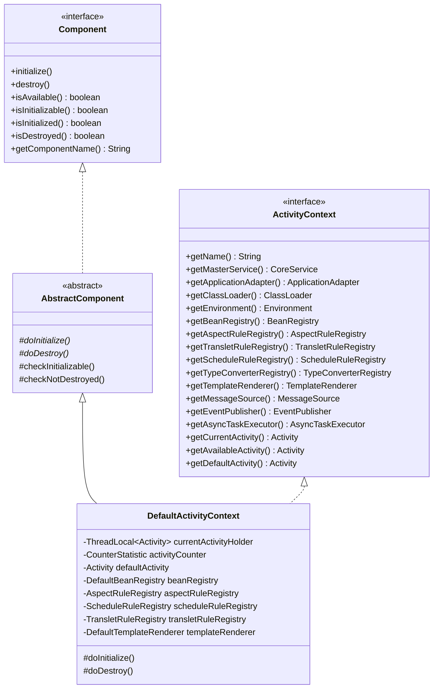
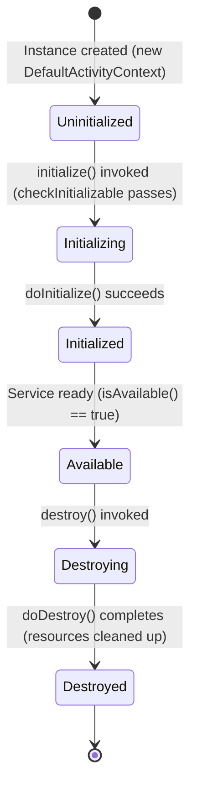

[`ActivityContext`](https://github.com/aspectran/aspectran/blob/master/core/src/main/java/com/aspectran/core/context/ActivityContext.java) is the heart of the Aspectran framework and the top-level IoC/DI (Inversion of Control & Dependency Injection) container governing all application components.

Unlike traditional framework containers that focus solely on object (Bean) lifecycles and dependency injection, Aspectran's `ActivityContext` is a central orchestrator that seamlessly integrates and controls metadata and runtime execution for all framework subsystems: **Bean Registry, Translets, Aspects, Schedules, Template Renderers, Type Converters, Async Task Executors, and Internationalized Message Sources**.

## 1. Structural Position and Interface Contract of `ActivityContext`

[`ActivityContext`](https://github.com/aspectran/aspectran/blob/master/core/src/main/java/com/aspectran/core/context/ActivityContext.java) defines the standard interface contract, while [`DefaultActivityContext`](https://github.com/aspectran/aspectran/blob/master/core/src/main/java/com/aspectran/core/context/DefaultActivityContext.java) acts as the primary concrete implementation inside the framework.

### Core Contracts & Inheritance Structure
- **Compliance with the [`Component`](https://github.com/aspectran/aspectran/blob/master/core/src/main/java/com/aspectran/core/component/Component.java) Contract**:
  `DefaultActivityContext` extends [`AbstractComponent`](https://github.com/aspectran/aspectran/blob/master/core/src/main/java/com/aspectran/core/component/AbstractComponent.java), incorporating a strict lifecycle state machine. Invalid access while uninitialized or after destruction is immediately blocked with explicit exceptions.
- **Bi-directional Binding with Master Service ([`CoreService`](https://github.com/aspectran/aspectran/blob/master/core/src/main/java/com/aspectran/core/service/CoreService.java))**:
  The context maintains a reference to its owning top-level service instance via [`getMasterService()`](https://github.com/aspectran/aspectran/blob/master/core/src/main/java/com/aspectran/core/context/ActivityContext.java#L84), ensuring tight coordination with host environments and lifecycle managers.

## 2. Nine Core Subsystems and Registries

`ActivityContext` unifies and manages nine essential subsystems that sustain the application.

```mermaid
graph TD
    AC[DefaultActivityContext]

    subgraph Registries["Core Registry Layer"]
        BR[BeanRegistry<br/>POJO bean instantiation, DI, lifecycle management]
        AR[AspectRuleRegistry<br/>AOP joinpoint & advice mapping]
        TR[TransletRuleRegistry<br/>Request routing, path variables, action pipelines]
        SR[ScheduleRuleRegistry<br/>Quartz jobs & trigger rules management]
        TCR[TypeConverterRegistry<br/>Data type conversion & formatting]
    end

    subgraph Services["Execution & Infrastructure Service Layer"]
        ENV[Environment<br/>Active profiles, properties, encryption context]
        TRnd[TemplateRenderer<br/>Pebble, FreeMarker, Thymeleaf view rendering]
        MS[MessageSource<br/>Internationalized i18n message bundles]
        EP[EventPublisher<br/>Component event broadcasting & listener dispatching]
        ATE[AsyncTaskExecutor<br/>Asynchronous background thread pool execution]
    end

    AC --> BR
    AC --> AR
    AC --> TR
    AC --> SR
    AC --> TCR
    AC --> ENV
    AC --> TRnd
    AC --> MS
    AC --> EP
    AC --> ATE
```

### 1) Bean Management Subsystem: [`BeanRegistry`](https://github.com/aspectran/aspectran/blob/master/core/src/main/java/com/aspectran/core/component/bean/BeanRegistry.java)
- Stores metadata ([`BeanRule`](https://github.com/aspectran/aspectran/blob/master/core/src/main/java/com/aspectran/core/context/rule/BeanRule.java)) for all objects defined via XML, APON, or Java annotations (`@Component`, `@Bean`, `@Autowired`).
- Manages diverse lifecycle scopes: Singleton, Prototype, Request, and Session.
- Supports constructor injection, field injection, and setter injection, while fundamentally preventing runtime dependency errors through bootstrap circular reference inspection ([`BeanReferenceInspector`](https://github.com/aspectran/aspectran/blob/master/core/src/main/java/com/aspectran/core/context/rule/validation/BeanReferenceInspector.java)).
- Executes initialization (`@Initialize`, `InitializableBean`) and destruction callbacks (`@Destroy`, `DisposableBean`).

### 2) AOP Subsystem: [`AspectRuleRegistry`](https://github.com/aspectran/aspectran/blob/master/core/src/main/java/com/aspectran/core/component/aspect/AspectRuleRegistry.java)
- Indexes and retains declared aspect rules ([`AspectRule`](https://github.com/aspectran/aspectran/blob/master/core/src/main/java/com/aspectran/core/context/rule/AspectRule.java)).
- Instantly matches joinpoints (`before`, `after`, `thrown`, `finally`) to determine which advice methods to invoke when specific translets or bean methods are called.

### 3) Request Routing Subsystem: [`TransletRuleRegistry`](https://github.com/aspectran/aspectran/blob/master/core/src/main/java/com/aspectran/core/component/translet/TransletRuleRegistry.java)
- Manages translet rules ([`TransletRule`](https://github.com/aspectran/aspectran/blob/master/core/src/main/java/com/aspectran/core/context/rule/TransletRule.java)), the primary units of execution in Aspectran.
- Evaluates RESTful URI patterns (e.g., `/users/{id}`), wildcard patterns (e.g., `/order/**`), and HTTP method constraints to perform high-speed routing.

### 4) Scheduling Subsystem: [`ScheduleRuleRegistry`](https://github.com/aspectran/aspectran/blob/master/core/src/main/java/com/aspectran/core/component/schedule/ScheduleRuleRegistry.java)
- Manages scheduled task definitions ([`ScheduleRule`](https://github.com/aspectran/aspectran/blob/master/core/src/main/java/com/aspectran/core/context/rule/ScheduleRule.java)) driven by Cron expressions or interval triggers, supplying schedule metadata to the subordinate `SchedulerService`.

### 5) Type Conversion Subsystem: [`TypeConverterRegistry`](https://github.com/aspectran/aspectran/blob/master/core/src/main/java/com/aspectran/core/component/converter/TypeConverterRegistry.java)
- Maintains a registry of converters capable of safely transforming string request parameters into Java primitives, dates, collections, or custom Enums.

### 6) View Template Rendering Subsystem: [`TemplateRenderer`](https://github.com/aspectran/aspectran/blob/master/core/src/main/java/com/aspectran/core/component/template/TemplateRenderer.java)
- A standardized component facilitating integrated rendering across diverse template engines including Pebble, FreeMarker, Thymeleaf, and JSP.

### 7) Internationalization (i18n) Subsystem: [`MessageSource`](https://github.com/aspectran/aspectran/blob/master/core/src/main/java/com/aspectran/core/support/i18n/message/MessageSource.java)
- Dynamically resolves internationalized messages according to the client's `Locale`.
- Automatically instantiates and delegates to a default [`DelegatingMessageSource`](https://github.com/aspectran/aspectran/blob/master/core/src/main/java/com/aspectran/core/support/i18n/message/DelegatingMessageSource.java) when no explicit `messageSource` bean is defined.

### 8) Event Subsystem: [`EventPublisher`](https://github.com/aspectran/aspectran/blob/master/core/src/main/java/com/aspectran/core/component/bean/event/EventPublisher.java)
- Provides event broadcasting and listener dispatching mechanisms for decoupled inter-component communication across the application.

### 9) Asynchronous Subsystem: [`AsyncTaskExecutor`](https://github.com/aspectran/aspectran/blob/master/core/src/main/java/com/aspectran/core/component/bean/async/AsyncTaskExecutor.java)
- Execution engine supporting concurrent, parallel execution of asynchronous background tasks across managed thread pools.

## 3. `Component` Lifecycle State Machine and Initialization/Destruction Pipelines

[`DefaultActivityContext`](https://github.com/aspectran/aspectran/blob/master/core/src/main/java/com/aspectran/core/context/DefaultActivityContext.java) enforces a deterministic two-stage lifecycle pipeline to guarantee consistency across all managed components during startup and teardown.

### Initialization Pipeline (`doInitialize`)
When `initialize()` is invoked on the context, the following steps execute sequentially within an isolated thread context classloader ([`ThreadContextHelper.runThrowable`](https://github.com/aspectran/aspectran/blob/master/utils/src/main/java/com/aspectran/utils/thread/ThreadContextHelper.java)) environment:

1. **Pre-Validation**:
   Asserts (`Assert.state`) that all mandatory registries (`beanRegistry`, `aspectRuleRegistry`, `scheduleRuleRegistry`, `transletRuleRegistry`, `templateRenderer`) are fully configured.
2. **Type Converter Initialization**: `typeConverterRegistry.initialize()`
3. **Bean Registry Initialization**: `beanRegistry.initialize()`
   - Instantiates singleton-scoped beans using constructor injection.
   - Injects field and setter dependencies.
   - Invokes `@Initialize` or `InitializableBean.initialize()` callbacks.
4. **Aspect & Rule Registries Initialization**:
   - `aspectRuleRegistry.initialize()`: Pre-compiles pointcut expressions and constructs lookup indexes.
   - `scheduleRuleRegistry.initialize()`: Activates schedule job rules.
   - `transletRuleRegistry.initialize()`: Optimizes request routing trees.
5. **Template Renderer Initialization**: `templateRenderer.initialize()`
6. **MessageSource Resolution**:
   - Locates any bean registered under the ID `messageSource`. If absent, instantiates a default `DelegatingMessageSource`.
7. **Event Publisher Configuration**: Creates `DefaultEventPublisher` integrated with the bean event listener registry.

### Destruction Pipeline (`doDestroy`)
During application shutdown, resources are safely released in reverse order of initialization:
1. **Asynchronous Task Termination**: If an active `AsyncTaskExecutor` exists, gracefully concludes pending jobs and closes it (`AutoCloseable.close()`).
2. **Event Listener Unregistration**: Cleans up all registered event listeners.
3. **Bean Instance Teardown**: Invokes destruction callbacks (`@Destroy`, `DisposableBean.destroy()`) on singleton beans and clears internal caches.
4. **Registry & Renderer Teardown in Reverse Order**: Successively tears down and frees memory for `templateRenderer`, `transletRuleRegistry`, `scheduleRuleRegistry`, `aspectRuleRegistry`, and `typeConverterRegistry`.

## 4. Multi-Threaded Request Isolation and Activity Management

In high-concurrency environments such as web applications, multiple concurrent client requests access the same `ActivityContext` simultaneously. The context provides the following activity management structure to maintain strict thread safety while isolating request execution states:

### `ThreadLocal`-Based Isolation
- [`currentActivityHolder`](https://github.com/aspectran/aspectran/blob/master/core/src/main/java/com/aspectran/core/context/DefaultActivityContext.java#L60):
  Isolates and retains the [`Activity`](https://github.com/aspectran/aspectran/blob/master/core/src/main/java/com/aspectran/core/activity/Activity.java) instance currently being processed by the executing thread in thread-local storage.
- **Three-Tier Activity Resolution Strategy**:
  - [`getCurrentActivity()`](https://github.com/aspectran/aspectran/blob/master/core/src/main/java/com/aspectran/core/context/DefaultActivityContext.java#L297):
    Returns the activity bound to the current thread. If no activity is bound, throws [`NoActivityStateException`](https://github.com/aspectran/aspectran/blob/master/core/src/main/java/com/aspectran/core/context/NoActivityStateException.java) to prevent illegitimate asynchronous access or context leaks.
  - [`getAvailableActivity()`](https://github.com/aspectran/aspectran/blob/master/core/src/main/java/com/aspectran/core/context/DefaultActivityContext.java#L291):
    Returns the thread's current activity if present; otherwise, safely falls back to the system-shared [`defaultActivity`](https://github.com/aspectran/aspectran/blob/master/core/src/main/java/com/aspectran/core/context/DefaultActivityContext.java#L108).
  - [`getDefaultActivity()`](https://github.com/aspectran/aspectran/blob/master/core/src/main/java/com/aspectran/core/context/DefaultActivityContext.java#L286):
    Fallback activity utilized for non-request background initialization, static template rendering, and system description output.
- **Real-Time Active Request Metering ([`CounterStatistic`](https://github.com/aspectran/aspectran/blob/master/utils/src/main/java/com/aspectran/utils/statistic/CounterStatistic.java))**:
  The internal [`activityCounter`](https://github.com/aspectran/aspectran/blob/master/core/src/main/java/com/aspectran/core/context/DefaultActivityContext.java#L62) monitors the total number of actively executing activities in real time, supporting graceful shutdown workflows and busy-state queries (`isBusy()`).

## 5. Aware Interface Infrastructure for Dependency Injection

POJO beans managed by the Aspectran IoC container can directly receive core framework infrastructure objects by implementing specific `*Aware` interfaces:

| Aware Interface | Injected Object | Injection Timing & Purpose |
| :--- | :--- | :--- |
| [`ActivityContextAware`](https://github.com/aspectran/aspectran/blob/master/core/src/main/java/com/aspectran/core/component/bean/aware/ActivityContextAware.java) | `ActivityContext` | Injects the entire context immediately after bean creation |
| [`CurrentActivityAware`](https://github.com/aspectran/aspectran/blob/master/core/src/main/java/com/aspectran/core/component/bean/aware/CurrentActivityAware.java) | `Activity` | Injects the executing thread's active activity at request processing time |
| [`EnvironmentAware`](https://github.com/aspectran/aspectran/blob/master/core/src/main/java/com/aspectran/core/component/bean/aware/EnvironmentAware.java) | `Environment` | Injects the environment object for profile and property resolution |
| [`ApplicationAdapterAware`](https://github.com/aspectran/aspectran/blob/master/core/src/main/java/com/aspectran/core/component/bean/aware/ApplicationAdapterAware.java) | `ApplicationAdapter` | Injects host environment adapters such as `ServletContext` |
| [`ClassLoaderAware`](https://github.com/aspectran/aspectran/blob/master/core/src/main/java/com/aspectran/core/component/bean/aware/ClassLoaderAware.java) | `ClassLoader` | Injects the dedicated classloader used by the context |

> **Related Detailed Mechanisms**:
> - For the detailed build process that parses configuration files and constructs `ActivityContext`, see [ActivityContext Building Process](/en/docs/mechanisms/activity-context-building/).
> - For the lifecycle and request execution pipelines managed by the context, see [Aspectran Activity Architecture](/en/docs/mechanisms/aspectran-activities/).
> - For how profiles and properties are resolved within the context, see [ActivityEnvironment Architecture](/en/docs/mechanisms/activity-environment/).

## 6. Next Steps: Exploring Detailed Mechanisms

To explore how the `ActivityContext` is assembled from configuration files, scanned annotations, and internal parsers, refer to the [ActivityContext Building Process](/en/docs/mechanisms/activity-context-building/) guide.

To inspect how all mechanisms and packages interconnect across the entire framework, refer to the **[Aspectran Detailed Mechanisms Index](/en/docs/mechanisms/)**.
