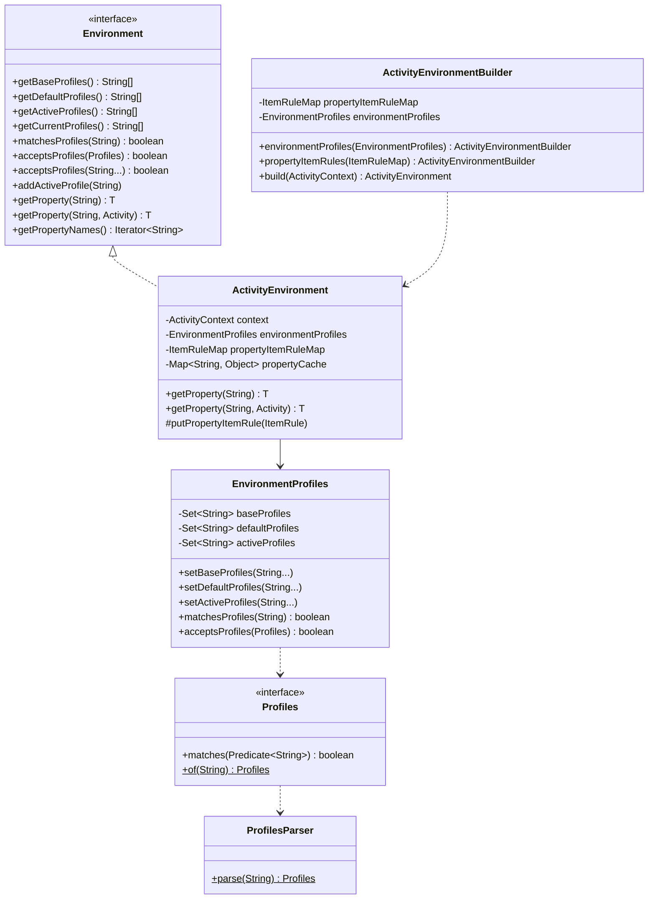
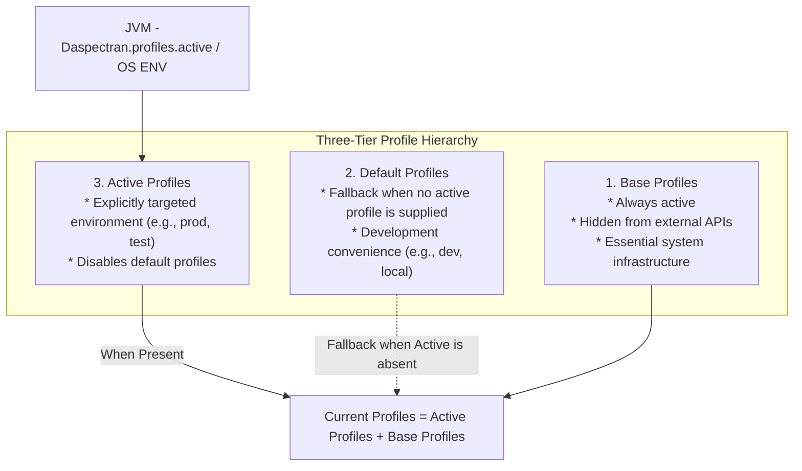
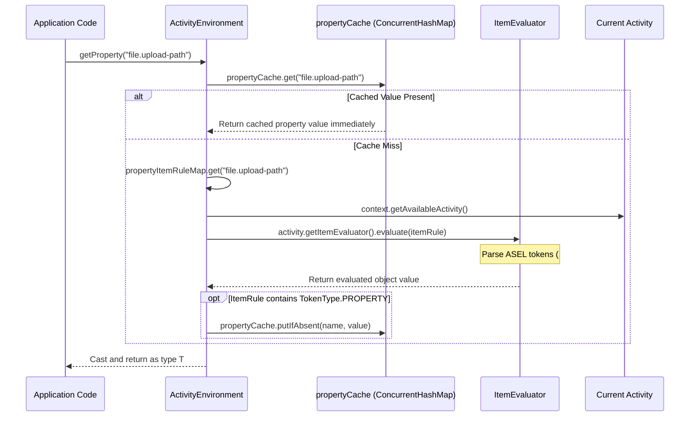

[`Environment`](https://github.com/aspectran/aspectran/blob/master/core/src/main/java/com/aspectran/core/context/env/Environment.java) and [`ActivityEnvironment`](https://github.com/aspectran/aspectran/blob/master/core/src/main/java/com/aspectran/core/context/env/ActivityEnvironment.java) form the core subsystem governing the runtime execution environment of an Aspectran application.

Modern enterprise applications demand deploying identical codebases across diverse infrastructure targets, from local development and automated testing to staging and production. Aspectran delivers a robust environment control architecture through **multidimensional Profiles** and **declarative dynamic Properties**, allowing teams to seamlessly toggle component activation states and runtime parameters using environment variables or system properties without code modifications or rebuilds.

Unlike conventional environment abstractions that store only static string key-value pairs, Aspectran's property system combines **ASEL (Aspectran Expression Language)-based lazy evaluation and token caching**, delivering intelligent, context-responsive environmental attributes at runtime.

## 1. Architecture Diagram and Core Components

The [`com.aspectran.core.context.env`](https://github.com/aspectran/aspectran/blob/master/core/src/main/java/com/aspectran/core/context/env) package strictly adheres to the Single Responsibility Principle, cleanly decoupling profile management from dynamic property evaluation.



### 1) [`Environment`](https://github.com/aspectran/aspectran/blob/master/core/src/main/java/com/aspectran/core/context/env/Environment.java) (Interface)
- Defines standard contracts for querying profiles (`getActiveProfiles`, `getDefaultProfiles`, `getBaseProfiles`), validating profile matches (`matchesProfiles`, `acceptsProfiles`), and retrieving properties (`getProperty`).

### 2) [`ActivityEnvironment`](https://github.com/aspectran/aspectran/blob/master/core/src/main/java/com/aspectran/core/context/env/ActivityEnvironment.java) (Implementation)
- Concrete implementation bound to `ActivityContext`. Delegates profile resolution to internal `EnvironmentProfiles` and performs real-time dynamic property evaluation via [`ItemRule`](https://github.com/aspectran/aspectran/blob/master/core/src/main/java/com/aspectran/core/context/rule/ItemRule.java) and [`ItemEvaluator`](https://github.com/aspectran/aspectran/blob/master/core/src/main/java/com/aspectran/core/context/asel/item/ItemEvaluator.java).

### 3) [`EnvironmentProfiles`](https://github.com/aspectran/aspectran/blob/master/core/src/main/java/com/aspectran/core/context/env/EnvironmentProfiles.java)
- Thread-safely manages base, default, and active profile sets and synchronizes state with JVM system properties.

### 4) [`Profiles`](https://github.com/aspectran/aspectran/blob/master/core/src/main/java/com/aspectran/core/context/env/Profiles.java) and [`ProfilesParser`](https://github.com/aspectran/aspectran/blob/master/core/src/main/java/com/aspectran/core/context/env/ProfilesParser.java)
- A profile expression engine that parses boolean logic strings (e.g., `(dev & local) | !cloud`) and compiles them into functional condition predicates (`Predicate<String>`).

## 2. Three-Tier Profile Model (Base, Default, Active)

Aspectran organizes profiles into a 3-tier hierarchy rather than a flat list.



### 1) Base Profiles ([`Base Profiles`](https://github.com/aspectran/aspectran/blob/master/core/src/main/java/com/aspectran/core/context/env/EnvironmentProfiles.java#L61))
- **Property Key**: `aspectran.profiles.base`
- Internal profiles required unconditionally for basic system infrastructure.
- Hidden from external discovery APIs (`getActiveProfiles()`), yet evaluated as unconditionally true (`true`) across internal profile checks.

### 2) Default Profiles ([`Default Profiles`](https://github.com/aspectran/aspectran/blob/master/core/src/main/java/com/aspectran/core/context/env/EnvironmentProfiles.java#L67))
- **Property Key**: `aspectran.profiles.default`
- Fallback profiles applied only when no active profiles are explicitly specified. Typically configured for local development (`dev` or `local`), allowing developers to launch applications immediately without JVM flags.

### 3) Active Profiles ([`Active Profiles`](https://github.com/aspectran/aspectran/blob/master/core/src/main/java/com/aspectran/core/context/env/EnvironmentProfiles.java#L72))
- **Property Key**: `aspectran.profiles.active`
- Profiles explicitly enabled for the target deployment environment. Multiple profiles can be activated simultaneously using comma delimiters (e.g., `prod,ap-northeast-2,mysql`).
- Defining even a single active profile completely deactivates default profiles.

### Profile Precedence in Multi-Context Environments
When multiple `ActivityContext` instances run concurrently within a single JVM, Aspectran supports context-suffixed system properties to target specific contexts independently:
```bash
# Target only context1 with prod profile
-Daspectran.profiles.active.context1=prod

# Global fallback active profile
-Daspectran.profiles.active=dev
```

## 3. Profile Expression Engine (`ProfilesParser`)

Aspectran incorporates a boolean expression parser capable of evaluating complex compound environment conditions within a single expression string, moving well beyond simple string equality.

### Supported Logical Operators
- **`!` (NOT)**: True when the specified profile is inactive.
- **`&` (AND)**: True when both conditions evaluate to true.
- **`|` (OR)**: True when either condition evaluates to true.
- **`(...)` (Parentheses)**: Controls operator precedence.

### Profile Evaluation Examples
```java
Environment env = activityContext.getEnvironment();

// True if both 'prod' and 'cloud' are active, or if 'local' is inactive
boolean match = env.matchesProfiles("(prod & cloud) | !local");

// Convenient varargs matching (combined as OR conditions)
boolean accepted = env.acceptsProfiles("dev", "test");
```

## 4. Declarative Profile Isolation Example

Using profiles, developers can declaratively partition DataSources, security modules, and external API gateways by environment.

### XML Configuration for Environment and DataSource Separation
```xml
<aspectran>
    <!-- Development environment: In-memory H2 Database -->
    <environment profiles="dev, local">
        <properties>
            <item name="db.driver">org.h2.Driver</item>
            <item name="db.url">jdbc:h2:mem:devdb;DB_CLOSE_DELAY=-1</item>
            <item name="db.username">sa</item>
            <item name="db.password"></item>
        </properties>
    </environment>

    <!-- Production Cloud: AWS Aurora MySQL with password from environment variable -->
    <environment profiles="prod & aws">
        <properties>
            <item name="db.driver">com.mysql.cj.jdbc.Driver</item>
            <item name="db.url">jdbc:mysql://aurora-cluster.internal:3306/service_db</item>
            <item name="db.username">app_user</item>
            <!-- ASEL Environment Variable Token -->
            <item name="db.password">${ENV:PROD_DB_PASSWORD}</item>
        </properties>
    </environment>

    <!-- Single DataSource Bean dynamically injected according to active profiles -->
    <bean id="dataSource" class="com.zaxxer.hikari.HikariDataSource">
        <property name="driverClassName">%{db.driver}</property>
        <property name="jdbcUrl">%{db.url}</property>
        <property name="username">%{db.username}</property>
        <property name="password">%{db.password}</property>
    </bean>
</aspectran>
```

## 5. Dynamic Properties Management and ASEL Evaluation Pipeline

A key differentiator in Aspectran's property architecture is that configuration values are retained as rule-based [`ItemRule`](https://github.com/aspectran/aspectran/blob/master/core/src/main/java/com/aspectran/core/context/rule/ItemRule.java) objects rather than raw strings.



### ASEL (Aspectran Expression Language) Token Substitution
Configuration values can combine multiple dynamic runtime tokens:
- **`%{property.name}`**: References another environment property (nested evaluation supported).
- **`#{beanId^propertyName}`**: References a getter property from a bean registered in the container.
- **`${paramName}`**: References an incoming request parameter.
- **`@{attributeName}`**: References an attribute from current activity data.
- **`${ENV:VAR_NAME}`**: References an OS system environment variable.
- **`${SYS:prop.name}`**: References a JVM system property.

### Intelligent Property Caching (`propertyCache`)
- When a property expression contains references to other properties ([`TokenType.PROPERTY`](https://github.com/aspectran/aspectran/blob/master/core/src/main/java/com/aspectran/core/context/rule/type/TokenType.java)), the evaluated result is retained in a thread-safe `ConcurrentHashMap` ([`propertyCache`](https://github.com/aspectran/aspectran/blob/master/core/src/main/java/com/aspectran/core/context/env/ActivityEnvironment.java#L46)) to eliminate redundant expression evaluations.
- Conversely, dynamic properties referencing request-specific state (parameters, attributes) bypass the cache, evaluating freshly on every request against the active `Activity` context.

## 6. Encrypted Properties and Secure Environment Variable Integration

Sensitive secrets—database credentials, API secret keys, personal data encryption keys—can be managed securely without storing plaintext credentials in version control systems (Git).

### `PBEncryptionUtils`-Based Encrypted Properties
Aspectran incorporates a password-based encryption ([`PBEncryptionUtils`](https://github.com/aspectran/aspectran/blob/master/utils/src/main/java/com/aspectran/utils/PBEncryptionUtils.java)) utility:

- **Encrypted Syntax**:
  ```xml
  <item name="db.password">ENC(vK9+Qz81dJk3A4F89gP1==)</item>
  ```
- **Master Key Injection**:
  Injecting the master password via an environment variable or JVM system parameter automatically decrypts the secret in memory during context bootstrapping:
  ```bash
  -Daspectran.encryption.password=MyMasterSecretKey!
  ```

> 🔍 **Related Detailed Mechanisms**
> - For the container architecture where the environment object is bound, see [ActivityContext: The Heart of the Aspectran Container](/en/docs/mechanisms/activity-context/).
> - For how profiles are evaluated during bootstrap time, see [ActivityContext Building Process](/en/docs/mechanisms/activity-context-building/).
> - For expression token parsing rules utilized during dynamic property evaluation, see [Aspectran Rule Architecture](/en/docs/mechanisms/aspectran-rule-architecture/).

## 7. Next Steps: Exploring Detailed Mechanisms

To examine how incoming requests are processed and responses rendered based on dynamic environment configurations, proceed to the [Aspectran Request & Response Architecture](/en/docs/mechanisms/aspectran-request-response/) guide.

To inspect how all mechanisms and packages interconnect across the entire framework, refer to the **[Aspectran Detailed Mechanisms Index](/en/docs/mechanisms/)**.
