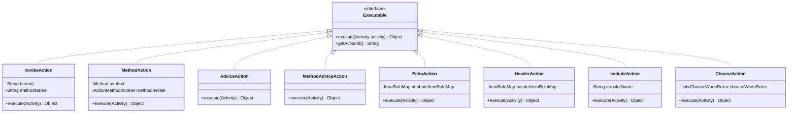
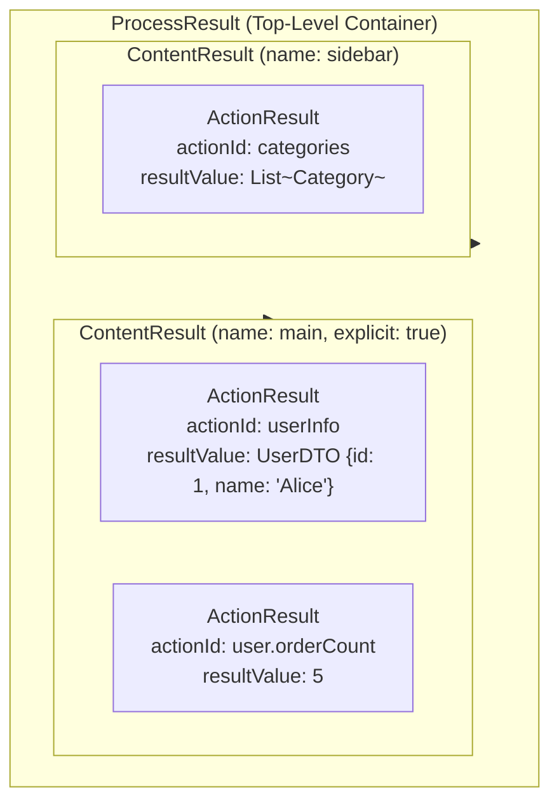

In the Aspectran framework, an **Action ([`Action`](https://github.com/aspectran/aspectran/blob/master/core/src/main/java/com/aspectran/core/activity/process/action/Executable.java))** is the fundamental execution unit that performs concrete operations—invoking business logic, evaluating data, manipulating HTTP headers, synthesizing sub-processes, or branching execution flows—within the lifecycle of a Translet.

A single Translet orchestrates complex business pipelines by combining one or more actions sequentially or conditionally. The output generated by each action is aggregated into a sophisticated three-tier data hierarchy ([`ActionResult`](https://github.com/aspectran/aspectran/blob/master/core/src/main/java/com/aspectran/core/activity/process/result/ActionResult.java) -> [`ContentResult`](https://github.com/aspectran/aspectran/blob/master/core/src/main/java/com/aspectran/core/activity/process/result/ContentResult.java) -> [`ProcessResult`](https://github.com/aspectran/aspectran/blob/master/core/src/main/java/com/aspectran/core/activity/process/result/ProcessResult.java)) that feeds directly into view rendering engines and RESTful serialization transformers.

## 1. Core Contract: The `Executable` Interface

All action implementations realize the top-level [`Executable`](https://github.com/aspectran/aspectran/blob/master/core/src/main/java/com/aspectran/core/activity/process/action/Executable.java) contract.



- **[`execute(Activity activity)`](https://github.com/aspectran/aspectran/blob/master/core/src/main/java/com/aspectran/core/activity/process/action/Executable.java#L48)**:
  - The unified entry point executing the action's business workload.
  - Receives the [`Activity`](https://github.com/aspectran/aspectran/blob/master/core/src/main/java/com/aspectran/core/activity/Activity.java) instance representing the full execution context of the active request, granting seamless access to request parameters, session state, and IoC bean registries.
  - Returns the execution result as an `Object`, which is automatically captured into the translet's result pool bound to the action's identifier (`actionId`).
- **Standardized Exception Handling**:
  - Any business or reflection exceptions arising during action execution are encapsulated into the framework's standard [`ActionExecutionException`](https://github.com/aspectran/aspectran/blob/master/core/src/main/java/com/aspectran/core/activity/process/action/ActionExecutionException.java) and propagated to the parent translet's exception handling pipeline.

## 2. Built-in Action Types and Detailed Mechanics

To satisfy diverse architecture patterns and domain requirements, Aspectran provides eight specialized built-in action implementations out of the box.

### 1) Declarative Bean Method Invocation: [`InvokeAction`](https://github.com/aspectran/aspectran/blob/master/core/src/main/java/com/aspectran/core/activity/process/action/InvokeAction.java)
- Invokes business logic on a bean identified by ID and method name defined in XML or APON rules.
- Evaluates declared argument expressions (`<argument>`) as ASEL tokens and passes them into method parameters.
- Configuration Example:
  ```xml
  <action id="user" bean="userService" method="getUserById">
      <argument name="id">${userId}</argument>
  </action>
  ```

### 2) Annotation-Based Method Invocation: [`MethodAction`](https://github.com/aspectran/aspectran/blob/master/core/src/main/java/com/aspectran/core/activity/process/action/MethodAction.java)
- Executes component methods mapped via Java annotations such as `@Component`, `@Action`, or `@RequestToGet`.
- Employs Convention over Configuration (CoC) to bind business components directly into translets without XML boilerplate.
- Couples with [`ActionMethodInvoker`](https://github.com/aspectran/aspectran/blob/master/core/src/main/java/com/aspectran/core/activity/process/action/ActionMethodInvoker.java) to achieve automated parameter binding and type resolution.

### 3) Intelligent Parameter Resolver: [`ActionMethodInvoker`](https://github.com/aspectran/aspectran/blob/master/core/src/main/java/com/aspectran/core/activity/process/action/ActionMethodInvoker.java)
When `MethodAction` executes, it uses reflection to inspect method parameter signatures, automatically resolving and injecting context data:
- **Framework Core Object Injection**: Automatically injects active instances if the parameter type is `Activity`, `Translet`, `Environment`, `RequestAdapter`, `ResponseAdapter`, or `SessionAdapter`.
- **Parameter and Uploaded File Injection**: Automatically recognizes and binds `ParameterMap`, `FileParameter`, and `FileParameterMap` types.
- **Command Object (DTO / POJO) Autowiring**: If a plain Java object (POJO) is declared as a method parameter, it autowires request parameters into getter/setter properties on the DTO, converting string inputs into target types via the [`TypeConverterRegistry`](https://github.com/aspectran/aspectran/blob/master/core/src/main/java/com/aspectran/core/component/converter/TypeConverterRegistry.java).

### 4) AOP Advice Actions: [`AdviceAction`](https://github.com/aspectran/aspectran/blob/master/core/src/main/java/com/aspectran/core/activity/process/action/AdviceAction.java) & [`MethodAdviceAction`](https://github.com/aspectran/aspectran/blob/master/core/src/main/java/com/aspectran/core/activity/process/action/MethodAdviceAction.java)
- Specialized actions that execute advice methods bound to AOP joinpoints (`before`, `after`, `thrown`, `finally`).
- Integrates cross-cutting concerns (transaction demarcation, authorization verification, performance profiling) directly into the unified action execution pipeline.

### 5) Context Data Echo: [`EchoAction`](https://github.com/aspectran/aspectran/blob/master/core/src/main/java/com/aspectran/core/activity/process/action/EchoAction.java)
- Without invoking external business methods, evaluates parameters, attributes, environment properties, and bean properties present in the current activity context to assemble model data for views.
- Configuration Example:
  ```xml
  <echo id="pageInfo">
      <item name="title">User Management</item>
      <item name="currentPage">${page:1}</item>
      <item name="serverTime">#{systemBean^currentTimeMillis}</item>
  </echo>
  ```

### 6) HTTP Header Manipulation: [`HeaderAction`](https://github.com/aspectran/aspectran/blob/master/core/src/main/java/com/aspectran/core/activity/process/action/HeaderAction.java)
- Dynamically injects or overrides HTTP response headers in outbound responses.
- Used to declaratively apply browser cache controls (`Cache-Control`), CORS configurations, or security policies (`X-Content-Type-Options`).
- Configuration Example:
  ```xml
  <headers>
      <item name="Cache-Control">no-cache, no-store, must-revalidate</item>
      <item name="Pragma">no-cache</item>
      <item name="X-Frame-Options">DENY</item>
  </headers>
  ```

### 7) Sub-Translet Composition: [`IncludeAction`](https://github.com/aspectran/aspectran/blob/master/core/src/main/java/com/aspectran/core/activity/process/action/IncludeAction.java)
- Invokes another translet internally during the active translet's execution and embeds its result as a child node in the parent translet's `ProcessResult`.
- Realizes the composite pattern, allowing modular encapsulation of common concerns such as navigation menus, authentication verification, and footer data.
- Configuration Example:
  ```xml
  <include translet="/common/navigation">
      <item name="menuId">USER_MNG</item>
  </include>
  ```

### 8) Dynamic Conditional Branching: [`ChooseAction`](https://github.com/aspectran/aspectran/blob/master/core/src/main/java/com/aspectran/core/activity/process/action/ChooseAction.java)
- Analogous to Java's `switch-case` or `if-else` branching, evaluates declared `<when>` conditions sequentially and executes only the actions within the first condition block evaluating to true.
- Facilitates dynamic workflow routing based on previous action outcomes or request attributes.
- Configuration Example:
  ```xml
  <choose>
      <when test="${role} == 'ADMIN'">
          <action id="data" bean="adminService" method="getAdminData"/>
      </when>
      <when test="${role} == 'USER'">
          <action id="data" bean="userService" method="getUserData"/>
      </when>
      <otherwise>
          <redirect path="/login"/>
      </otherwise>
  </choose>
  ```

## 3. Three-Tier Hierarchy of Action Processing Results

Values returned from action execution are not discarded as ephemeral object references. Instead, they are systematically structured into a three-tier hierarchy that remains accessible throughout the translet lifecycle.



### 1) Unit Result: [`ActionResult`](https://github.com/aspectran/aspectran/blob/master/core/src/main/java/com/aspectran/core/activity/process/result/ActionResult.java)
- The smallest atom capturing the outcome of an individual `Executable` action.
- **Dot Notation and Nested Maps (`ResultValueMap`)**:
  When an `actionId` contains dots (e.g., `order.customer.name`), Aspectran parses the identifier into a nested map structure rather than a flat string key, constructing a hierarchical object model.

### 2) Group Result: [`ContentResult`](https://github.com/aspectran/aspectran/blob/master/core/src/main/java/com/aspectran/core/activity/process/result/ContentResult.java)
- A logical partition grouping multiple `ActionResult` instances produced within a `<content>` or `<contents>` configuration block.
- **Explicit Content (`explicit="true"`)**: Named content blocks can be explicitly scoped to target distinct UI slots in view templates.

### 3) Top-Level Container: [`ProcessResult`](https://github.com/aspectran/aspectran/blob/master/core/src/main/java/com/aspectran/core/activity/process/result/ProcessResult.java)
- The root container aggregating all `ContentResult` partitions generated across an entire `Activity`.
- Serves as the primary model passed to template view dispatchers and the source payload serialized into JSON/XML by `TransformResponse`.

## 4. Four Primary Use Cases for Action Results

The accumulated `ProcessResult` powers four primary downstream application patterns:

```mermaid
graph LR
    PR[ProcessResult] --> View[1. View Template Model Binding<br/>* Pebble / Thymeleaf / JSP<br/>* {{ userInfo.name }}]
    PR --> Rest[2. RESTful Response Serialization<br/>* JsonTransformResponse<br/>* {"userInfo": {"name": "Alice"}}]
    PR --> Inter[3. Inter-Action Data Chaining<br/>* ASEL Reference: @{userInfo.userId}<br/>* ProcessResult passing on Forward]
    PR --> Cond[4. Conditional Flow Control<br/>* ChooseAction Evaluation: @{userInfo^active}]
```

### 1) View Template (SSR) Model Data Binding
The `actionId` seamlessly becomes the model variable name exposed inside template contexts:
- **Translet Configuration**:
  ```xml
  <translet name="/user/profile">
      <action id="user" bean="userService" method="getUser">
          <argument name="id">${userId}</argument>
      </action>
      <dispatch name="user/profile.html"/>
  </translet>
  ```
- **Thymeleaf Template (`user/profile.html`)**:
  ```html
  <h1 th:text="${user.name}">User Name</h1>
  <p th:text="${user.email}">Email</p>
  ```

### 2) REST API Transformation Response (JSON/XML)
`TransformResponse` serializes objects stored within `ProcessResult` directly into root-level fields of the output payload:
```json
{
  "user": {
    "id": 100,
    "name": "Aspectran User",
    "email": "user@aspectran.com"
  }
}
```

### 3) Inter-Action Data Chaining (ASEL References)
Earlier action outputs can be piped as input arguments into subsequent actions using `@{actionId}` notation:
```xml
<!-- Step 1: Query User -->
<action id="user" bean="userService" method="getUser"/>

<!-- Step 2: Query orders using user ID from Step 1 -->
<action id="orders" bean="orderService" method="getOrdersByUserId">
    <argument name="userId">@{user.id}</argument>
</action>
```

### 4) Conditional Evaluation in `ChooseAction`
Evaluates properties of action results as boolean expressions to drive dynamic branching:
```xml
<choose>
    <when test="@{user^admin}">
        <forward translet="/admin/dashboard"/>
    </when>
    <otherwise>
        <dispatch name="user/dashboard.html"/>
    </otherwise>
</choose>
```

## 5. Programmatic Result Access API

Application code, filters, or custom interceptors can inspect and manipulate `ProcessResult` programmatically via [`Translet`](https://github.com/aspectran/aspectran/blob/master/core/src/main/java/com/aspectran/core/activity/Translet.java):

```java
// Obtain the root ProcessResult
ProcessResult processResult = translet.getProcessResult();

// Query action execution results directly (supports nested dot-notation paths)
User user = (User)processResult.getResultValue("user");
String city = (String)processResult.getResultValue("user.address.city");
```

> **Related Detailed Mechanisms**:
> - For the overarching lifecycle pipeline that executes actions, see [Aspectran Activity Architecture](/en/docs/mechanisms/aspectran-activities/).
> - For how action results are transformed into responses and streamed to clients, see [Aspectran Request & Response Architecture](/en/docs/mechanisms/aspectran-request-response/).
> - For declarative XML and APON syntax rules governing actions, see [Aspectran Rule Architecture](/en/docs/mechanisms/aspectran-rule-architecture/).

## 6. Next Steps: Exploring Detailed Mechanisms

To examine the declarative metadata models defining translets, actions, aspects, and views, proceed to the [Aspectran Rule Architecture](/en/docs/mechanisms/aspectran-rule-architecture/) guide.

To inspect how all mechanisms and packages interconnect across the entire framework, refer to the **[Aspectran Detailed Mechanisms Index](/en/docs/mechanisms/)**.
