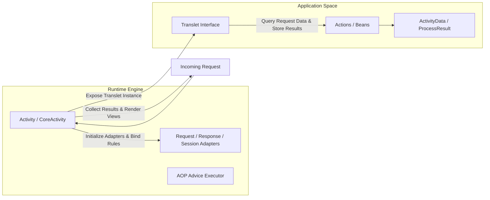
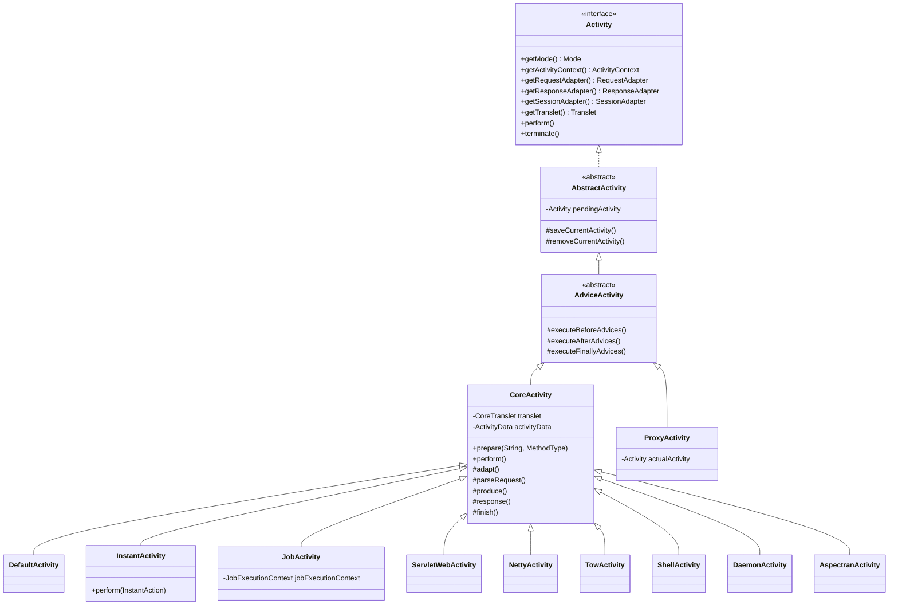
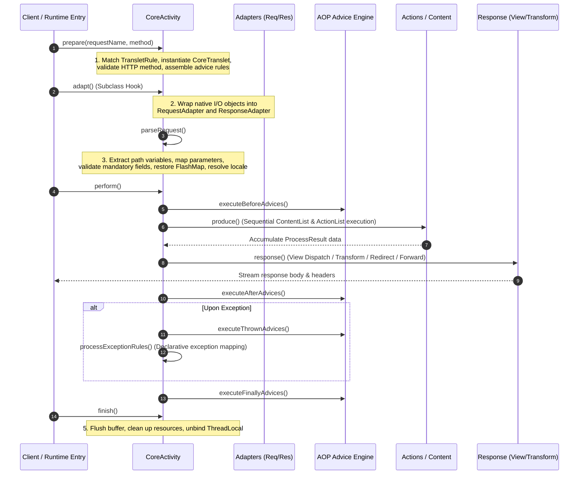

In Aspectran, an **Activity ([`Activity`](https://github.com/aspectran/aspectran/blob/master/core/src/main/java/com/aspectran/core/activity/Activity.java))** is the framework's core runtime execution engine orchestrating a single request-response lifecycle. Every unit of execution arriving from the external world—an HTTP request from a web browser, a non-blocking network event loop, a background scheduler trigger, an interactive CLI command, or an internal method invocation—is encapsulated and processed within a dedicated `Activity` instance.

The `Activity` architecture completely decouples business logic (Actions, Beans) from the underlying execution environment (Servlet, Netty, Undertow, etc.), enforcing a uniform, standard lifecycle for AOP advices, parameter parsing, translet rule evaluation, response rendering, and exception handling pipelines.

## 1. Division of Roles: `Activity` vs `Translet`

To understand Aspectran's execution model, it is vital to distinguish the distinct responsibilities and interaction between [`Activity`](https://github.com/aspectran/aspectran/blob/master/core/src/main/java/com/aspectran/core/activity/Activity.java) and [`Translet`](https://github.com/aspectran/aspectran/blob/master/core/src/main/java/com/aspectran/core/activity/Translet.java).



- **[`Activity`](https://github.com/aspectran/aspectran/blob/master/core/src/main/java/com/aspectran/core/activity/Activity.java) (Internal Execution Engine)**:
  - Serves as the framework-level runtime controller.
  - Owns and manages the `ActivityContext`, classloader, environment adapters (`RequestAdapter`, `ResponseAdapter`, `SessionAdapter`), AOP advice chains, and exception processors, driving the internal state machine.
  - Application developers rarely interact with `Activity` directly; it is created and driven by the service layer.
- **[`Translet`](https://github.com/aspectran/aspectran/blob/master/core/src/main/java/com/aspectran/core/activity/Translet.java) (Application Space Facade)**:
  - Serves as the business-facing medium for application developers.
  - Encapsulates the specific translet rule ([`TransletRule`](https://github.com/aspectran/aspectran/blob/master/core/src/main/java/com/aspectran/core/context/rule/TransletRule.java)), execution data ([`ActivityData`](https://github.com/aspectran/aspectran/blob/master/core/src/main/java/com/aspectran/core/activity/ActivityData.java)), and execution results ([`ProcessResult`](https://github.com/aspectran/aspectran/blob/master/core/src/main/java/com/aspectran/core/activity/process/result/ProcessResult.java)) associated with a single request.
  - Acts as the standard interface injected into action methods or view templates to inspect parameters or set attributes.

## 2. Hierarchical Class Structure and Core Models

Aspectran's `Activity` class hierarchy is meticulously designed around the Single Responsibility Principle and the Template Method pattern.



### 1) [`Activity.Mode`](https://github.com/aspectran/aspectran/blob/master/core/src/main/java/com/aspectran/core/activity/Activity.java#L79): 6 Runtime Modes
`Activity` defines enumeration constants representing the runtime characteristics of its host environment:
- `WEB`: Standard servlet or servlet-less HTTP web request processing
- `SHELL`: Interactive terminal command-line execution
- `DAEMON`: Persistent background OS daemon process execution
- `SCHEDULER`: Quartz-based scheduled batch job execution
- `PROXY`: IoC container AOP dynamic proxy method interception
- `DEFAULT`: General-purpose execution mode unbound to a specific service

### 2) [`AbstractActivity`](https://github.com/aspectran/aspectran/blob/master/core/src/main/java/com/aspectran/core/activity/AbstractActivity.java): ThreadLocal Binding & Nested Stack Management
Safely binds and unbinds the currently active `Activity` to a ThreadLocal for the current thread.
- **Nested Execution (`pendingActivity`) Stack**:
  When an `InstantActivity` or `ProxyActivity` is triggered inside an existing request, the active activity is stored in the [`pendingActivity`](https://github.com/aspectran/aspectran/blob/master/core/src/main/java/com/aspectran/core/activity/AbstractActivity.java#L158) field while the new activity takes over the thread context. Once the nested execution completes, the previous activity is restored seamlessly.

### 3) [`AdviceActivity`](https://github.com/aspectran/aspectran/blob/master/core/src/main/java/com/aspectran/core/activity/AdviceActivity.java): AOP Advice Execution Engine
Directly coupled with Aspectran's lightweight AOP engine to trigger aspect rules before, after, or upon exception of translet execution:
- `executeBeforeAdvices()`: Executes the `before` advice chain
- `executeAfterAdvices()`: Executes the `after` advice chain
- `executeFinallyAdvices()`: Executes the `finally` advice chain regardless of success or failure

### 4) [`CoreActivity`](https://github.com/aspectran/aspectran/blob/master/core/src/main/java/com/aspectran/core/activity/CoreActivity.java): 5-Phase Request Processing Pipeline
The core abstract class orchestrating the entire lifecycle: finding translets, parsing parameters, invoking actions, and rendering final responses.

## 3. End-to-End Request Processing: 5 Deterministic Phases

The request processing pipeline governed by `CoreActivity` consists of five sequential, deterministic phases.



### Phase 1: Preparation (`prepare`)
- Queries the [`TransletRuleRegistry`](https://github.com/aspectran/aspectran/blob/master/core/src/main/java/com/aspectran/core/component/translet/TransletRuleRegistry.java) for a matching [`TransletRule`](https://github.com/aspectran/aspectran/blob/master/core/src/main/java/com/aspectran/core/context/rule/TransletRule.java) based on the incoming request URI (`requestName`) and HTTP method (`MethodType`).
- Throws a [`TransletNotFoundException`](https://github.com/aspectran/aspectran/blob/master/core/src/main/java/com/aspectran/core/activity/TransletNotFoundException.java) if no matching rule is registered.
- Instantiates [`CoreTranslet`](https://github.com/aspectran/aspectran/blob/master/core/src/main/java/com/aspectran/core/activity/CoreTranslet.java) and validates allowed HTTP methods (`RequestMethodNotAllowedException`).
- Evaluates pointcuts to build the AOP advice rule chain ([`prepareAdviceRules`](https://github.com/aspectran/aspectran/blob/master/core/src/main/java/com/aspectran/core/activity/CoreActivity.java#L230)) applicable to the target translet.

### Phase 2: Environment Adaptation (`adapt`)
- Specialized `Activity` subclasses (`ServletWebActivity`, `NettyActivity`, etc.) wrap native request and response objects into standardized [`RequestAdapter`](https://github.com/aspectran/aspectran/blob/master/core/src/main/java/com/aspectran/core/adapter/RequestAdapter.java) and [`ResponseAdapter`](https://github.com/aspectran/aspectran/blob/master/core/src/main/java/com/aspectran/core/adapter/ResponseAdapter.java) contracts.
- Beyond this step, all subsequent business logic and framework pipelines operate completely independently of underlying infrastructure.

### Phase 3: Request Parsing (`parseRequest`)
- Normalizes and injects request parameters, character encodings, and session attributes into the execution context:
  - **Path Variable Extraction**: Extracts dynamic tokens from RESTful URI patterns (e.g., `/users/{id}`) into a [`PathVariableMap`](https://github.com/aspectran/aspectran/blob/master/core/src/main/java/com/aspectran/core/activity/request/PathVariableMap.java).
  - **Declarative Parameter/Attribute Binding**: Evaluates default values and ASEL token expressions defined in `RequestRule` and binds them to [`ActivityData`](https://github.com/aspectran/aspectran/blob/master/core/src/main/java/com/aspectran/core/activity/ActivityData.java).
  - **Mandatory Field Validation**: Immediately raises a [`MissingMandatoryParametersException`](https://github.com/aspectran/aspectran/blob/master/core/src/main/java/com/aspectran/core/activity/request/MissingMandatoryParametersException.java) if required parameters are missing.
  - **FlashMap & Locale Resolution**: Restores transient flash attributes passed from prior redirect requests and resolves the client locale using `LocaleResolver`.

### Phase 4: Execution & Response (`perform`)
- The central phase where business actions run and outputs are rendered:
  1. **Before Advices**: Starts transactions, performs authentication/authorization checks, and logs audit traces.
  2. **Content Action Execution (`produce`)**: Executes actions ([`Executable`](https://github.com/aspectran/aspectran/blob/master/core/src/main/java/com/aspectran/core/activity/process/action/Executable.java)) declared in `<content>` sections sequentially, collecting return values into [`ProcessResult`](https://github.com/aspectran/aspectran/blob/master/core/src/main/java/com/aspectran/core/activity/process/result/ProcessResult.java).
  3. **Response Handling (`response`)**:
     - `TransformResponse`: Data transformation (JSON, XML, Text, APON).
     - `DispatchResponse`: View template dispatching (JSP, Thymeleaf, FreeMarker).
     - `RedirectResponse`: HTTP 302/303 URL redirection.
     - `ForwardResponse`: Internal delegation to another translet while preserving accumulated `ProcessResult` data (forwarding loop).
  4. **After Advices**: Post-processing following successful action execution.
  5. **Exception Handling (`processExceptionRules`)**: Catches thrown exceptions, routes them to declarative `<exception>` rules, and executes `Thrown` advices to generate error views or error responses.
  6. **Finally Advices**: Guaranteed cleanup and release of acquired transactional or system resources.

### Phase 5: Teardown & Cleanup (`finish`)
- Flushes and closes response output streams and buffers.
- Removes the `Activity` from the thread-local storage ([`removeCurrentActivity()`](https://github.com/aspectran/aspectran/blob/master/core/src/main/java/com/aspectran/core/activity/AbstractActivity.java#L166)) or restores the prior `pendingActivity`.
- Decrements the active request counter in `ActivityCounter`.

## 4. Specialized `Activity` Implementations per Runtime

Specialized subclasses extend `CoreActivity`'s template pipeline to handle the I/O mechanics of each runtime environment.

| Environment | Dedicated Activity Implementation | Bound Native Object | Key Responsibilities & Characteristics |
| :--- | :--- | :--- | :--- |
| **Servlet Web** | [`ServletWebActivity`](https://github.com/aspectran/aspectran/blob/master/web-servlet/src/main/java/com/aspectran/web/servlet/activity/ServletWebActivity.java) | `HttpServletRequest`, `HttpServletResponse` | Combines `HttpServletRequestAdapter` & `HttpServletResponseAdapter`, manages servlet session binding and Servlet 3.0+ `AsyncContext` lifecycles |
| **Netty** | [`NettyActivity`](https://github.com/aspectran/aspectran/blob/master/with-netty/src/main/java/com/aspectran/netty/activity/NettyActivity.java) | `ChannelHandlerContext`, `FullHttpRequest` | Directly coupled to non-blocking event loops, streams zero-copy `ByteBuf` responses, binds servlet-less `NettyRequestAdapter` & `NettyResponseAdapter` |
| **Undertow** | [`TowActivity`](https://github.com/aspectran/aspectran/blob/master/with-undertow/src/main/java/com/aspectran/undertow/activity/TowActivity.java) | `HttpServerExchange` | Native Undertow communication, binds `TowRequestAdapter` & `TowResponseAdapter`, delivers low-overhead servlet-free streaming |
| **Shell** | [`ShellActivity`](https://github.com/aspectran/aspectran/blob/master/shell/src/main/java/com/aspectran/shell/activity/ShellActivity.java) | `TransletCommandLine`, `ShellConsole` | JLine3-based interactive terminal I/O, binds `ShellRequestAdapter` & `ShellResponseAdapter`, manages ANSI formatting and console output |
| **Daemon** | [`DaemonActivity`](https://github.com/aspectran/aspectran/blob/master/daemon/src/main/java/com/aspectran/daemon/activity/DaemonActivity.java) | Internal `ParameterMap`, Attribute Map | Standalone OS daemon process, binds `DaemonRequestAdapter` & `DaemonResponseAdapter`, captures internal memory I/O buffers |
| **Embedded** | [`AspectranActivity`](https://github.com/aspectran/aspectran/blob/master/embed/src/main/java/com/aspectran/embed/activity/AspectranActivity.java) | In-Memory Parameter / Attribute Maps | Embedded invocations from host Java applications, binds `EmbeddedRequestAdapter` & `EmbeddedResponseAdapter`, returns results directly in memory |

## 5. Special-Purpose Activity Implementations

Beyond standard translet executions, Aspectran provides lightweight and specialized infrastructure `Activity` implementations:

### 1) Lightweight Programmatic Execution: [`InstantActivity`](https://github.com/aspectran/aspectran/blob/master/core/src/main/java/com/aspectran/core/activity/InstantActivity.java)
Allows immediate execution of arbitrary Java code blocks ([`InstantAction<V>`](https://github.com/aspectran/aspectran/blob/master/core/src/main/java/com/aspectran/core/activity/InstantAction.java)) within Aspectran's managed context (Bean injection, environment variable access, transaction management) without declaring a pre-configured translet rule.
```java
InstantActivity activity = new InstantActivity(activityContext);
Integer count = activity.perform(() -> {
    UserService userService = activity.getBean(UserService.class);
    return userService.countUsers();
});
```

### 2) Quartz Scheduling Execution: [`JobActivity`](https://github.com/aspectran/aspectran/blob/master/core/src/main/java/com/aspectran/core/scheduler/activity/JobActivity.java)
Receives schedule metadata (`JobRule`, `Trigger`) from Quartz's [`JobExecutionContext`](https://github.com/aspectran/aspectran/blob/master/core/src/main/java/com/aspectran/core/scheduler/activity/JobActivity.java#L38) to execute designated translets in the background, providing scheduled batch jobs with the exact same DI, AOP, and template capabilities as standard web requests.

### 3) IoC/AOP Proxy Interception: [`ProxyActivity`](https://github.com/aspectran/aspectran/blob/master/core/src/main/java/com/aspectran/core/activity/ProxyActivity.java)
A specialized virtual activity created inside dynamic proxies or CGLIB/Javassist proxies to intercept method calls on POJO beans managed by the IoC container. If an active activity already exists ([`actualActivity`](https://github.com/aspectran/aspectran/blob/master/core/src/main/java/com/aspectran/core/activity/ProxyActivity.java#L35)), it references and preserves that context.

## 6. ThreadLocal Management and Context Injection

To ensure thread safety and concurrency isolation in multi-threaded environments, [`ActivityContext`](https://github.com/aspectran/aspectran/blob/master/core/src/main/java/com/aspectran/core/context/ActivityContext.java) maintains a `ThreadLocal<Activity>`.

- **Active Activity Lookup**:
  ```java
  Activity activity = ActivityContext.getCurrentActivity();
  ```
  If no activity is bound to the current thread, a [`NoActivityStateException`](https://github.com/aspectran/aspectran/blob/master/core/src/main/java/com/aspectran/core/context/NoActivityStateException.java) is thrown to prevent invalid asynchronous access.
- **Dependency Injection Support**:
  - Beans implementing [`CurrentActivityAware`](https://github.com/aspectran/aspectran/blob/master/core/src/main/java/com/aspectran/core/component/bean/aware/CurrentActivityAware.java) receive the current active `Activity` automatically upon instantiation or method invocation.
  - [`CurrentActivityDataFactoryBean`](https://github.com/aspectran/aspectran/blob/master/core/src/main/java/com/aspectran/core/support/CurrentActivityDataFactoryBean.java) can be used to inject the current request's `ActivityData` directly into bean properties.

> **Related Detailed Mechanisms**:
> - For how activities isolate input/output data using adapter interfaces, see [Aspectran Adapter Architecture](/en/docs/mechanisms/aspectran-adapters/).
> - For how the service layer creates and orchestrates activities, see [Aspectran Service Architecture](/en/docs/mechanisms/aspectran-services/).
> - For the structural details of translet rules and actions parsed by activities, see [Aspectran Rule Architecture](/en/docs/mechanisms/aspectran-rule-architecture/).

## 7. Next Steps: Exploring Detailed Mechanisms

To explore the specific types of business actions (`BeanAction`, `MethodAction`, `EchoAction`, `HeaderAction`, etc.) and response transformation strategies that run inside the `Activity` pipeline, continue to the dedicated mechanism documents.

To see how all mechanisms and packages interconnect across the entire framework, refer to the **[Aspectran Detailed Mechanisms Index](/en/docs/mechanisms/)**.
