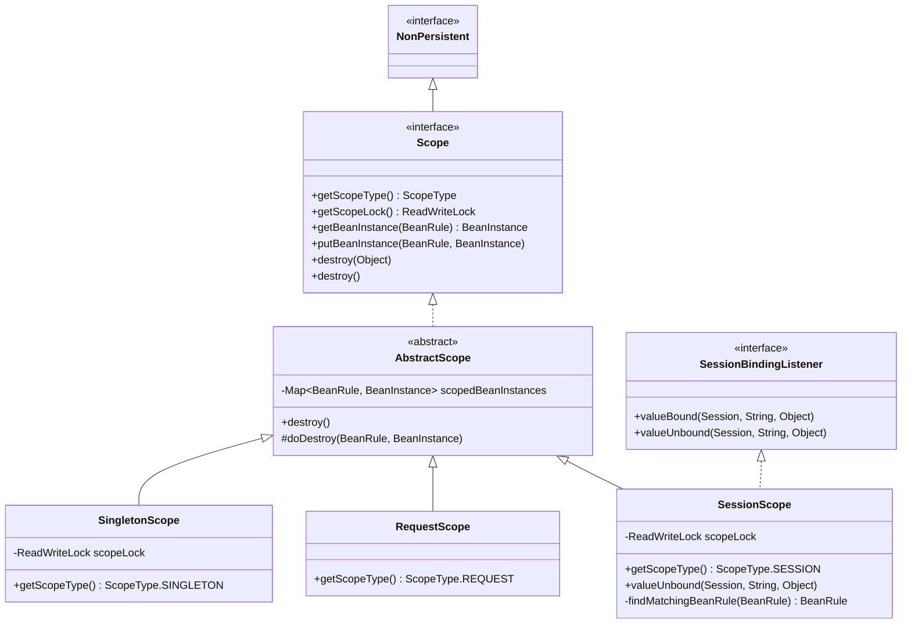
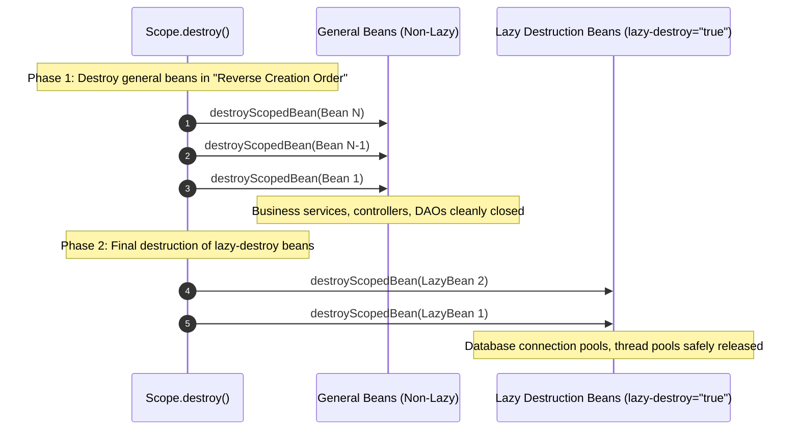

Aspectran's IoC/DI container supports a comprehensive **Bean Scopes** architecture that governs the instantiation timing, lifecycle boundaries, and memory residency of managed Bean components.

Scopes define whether a component is shared globally across the entire application (Singleton), instantiated freshly upon every retrieval (Prototype), or strictly isolated to a single HTTP/CLI request (Request) or user session (Session).

Aspectran provides four standard scopes defined in the [`ScopeType`](https://github.com/aspectran/aspectran/blob/master/core/src/main/java/com/aspectran/core/context/rule/type/ScopeType.java) enumeration. Internally, the framework drives a sophisticated lifecycle pipeline through dedicated scope strategy contracts ([`Scope`](https://github.com/aspectran/aspectran/blob/master/core/src/main/java/com/aspectran/core/component/bean/scope/Scope.java) and [`AbstractScope`](https://github.com/aspectran/aspectran/blob/master/core/src/main/java/com/aspectran/core/component/bean/scope/AbstractScope.java)), delivering thread safety, reverse-order destruction, lazy destruction (`lazy-destroy`), and distributed session clustering support.

## 1. Scope Architecture Class Diagram

Aspectran's scope subsystem employs the Strategy Pattern to abstract instance caching and destruction lifecycles uniformly across runtime environments.



## 2. In-Depth Analysis of 4 Standard Bean Scopes

Aspectran provides four distinct scopes tailored to component responsibilities and concurrency requirements.

### 1) `SINGLETON` ([`SingletonScope`](https://github.com/aspectran/aspectran/blob/master/core/src/main/java/com/aspectran/core/component/bean/scope/SingletonScope.java))
- **Lifecycle and Visibility**:
  - Exactly one shared instance is created within the `ActivityContext` and reused application-wide.
  - Pre-instantiated (eager initialization) during container startup (`initialize()`), or deferred until first access if configured with `lazy-init="true"`.
- **Concurrency and Thread Safety**:
  - Incorporates an internal [`ReentrantReadWriteLock`](https://github.com/aspectran/aspectran/blob/master/core/src/main/java/com/aspectran/core/component/bean/scope/SingletonScope.java#L33) to thread-safely coordinate concurrent access.
- **Ideal Use Cases**:
  - Stateless service classes, DAOs, repositories, utility classes, and factory components.
- **Operational Cautions**:
  - Because singleton instances are accessed concurrently by multiple threads, they must avoid mutable instance state. Mutable fields require explicit synchronization.

### 2) `PROTOTYPE`
- **Lifecycle and Visibility**:
  - Creates a brand-new independent instance every time the bean is looked up (via injection or `getBean()`).
- **Container Non-Managed Characteristics**:
  - The container participates only through instantiation, dependency injection, and initial callbacks (`@Initialize`).
  - Created instances are not cached within any scope registry; ownership transfers entirely to client code, and subsequent memory reclamation is handled exclusively by the JVM Garbage Collector (GC).
  - Therefore, **destruction callbacks (`@Destroy`, `DisposableBean.destroy()`) on prototype beans are never invoked by the container.**
- **Ideal Use Cases**:
  - Stateful components that cannot be shared across threads, dynamic calculation models, or short-lived batch tasks.

### 3) `REQUEST` ([`RequestScope`](https://github.com/aspectran/aspectran/blob/master/core/src/main/java/com/aspectran/core/component/bean/scope/RequestScope.java))
- **Lifecycle and Visibility**:
  - Valid strictly within the lifecycle of a single request ([`Activity`](https://github.com/aspectran/aspectran/blob/master/core/src/main/java/com/aspectran/core/activity/Activity.java)).
  - Repeated lookups within the same request return the identical instance, while concurrent client requests receive isolated instances.
- **Environment Binding Mechanism**:
  - Stored inside the internal attribute registry of the environment's [`RequestAdapter`](https://github.com/aspectran/aspectran/blob/master/core/src/main/java/com/aspectran/core/adapter/RequestAdapter.java).
  - When request handling finishes and `Activity.finish()` is called, `RequestScope.destroy()` triggers sequentially, invoking destruction callbacks on all request-scoped beans and clearing memory.
- **Environmental Constraints**:
  - Requires runtime environments supporting `RequestAdapter` (Web: `ServletWebActivity`, `NettyActivity`, `TowActivity`; CLI: `ShellActivity`). Invoking in unsupported environments raises an [`UnsupportedBeanScopeException`](https://github.com/aspectran/aspectran/blob/master/core/src/main/java/com/aspectran/core/component/bean/UnsupportedBeanScopeException.java).
- **Ideal Use Cases**:
  - Request audit tokens, distributed trace IDs, and form command binding objects.

### 4) `SESSION` ([`SessionScope`](https://github.com/aspectran/aspectran/blob/master/core/src/main/java/com/aspectran/core/component/bean/scope/SessionScope.java))
- **Lifecycle and Visibility**:
  - Valid throughout the lifetime of a single user session. Successive requests from the same authenticated user share the same instance.
- **Session Lifecycle Binding ([`SessionBindingListener`](https://github.com/aspectran/aspectran/blob/master/core/src/main/java/com/aspectran/core/component/session/SessionBindingListener.java))**:
  - When a session is invalidated or expires due to timeout, the [`valueUnbound()`](https://github.com/aspectran/aspectran/blob/master/core/src/main/java/com/aspectran/core/component/bean/scope/SessionScope.java#L62) callback is triggered, executing destruction callbacks on all session-scoped beans stored in the session.
- **Distributed Clustering Support ([`findMatchingBeanRule`](https://github.com/aspectran/aspectran/blob/master/core/src/main/java/com/aspectran/core/component/bean/scope/SessionScope.java#L95))**:
  - In clustered multi-node environments where sessions are serialized and replicated across different JVMs, memory hash addresses change. `SessionScope` incorporates cluster-aware matching logic that re-binds deserialized instances against local `BeanRule` definitions by bean ID or class name.
- **Serialization Defense ([`NonPersistent`](https://github.com/aspectran/aspectran/blob/master/core/src/main/java/com/aspectran/core/component/session/NonPersistent.java))**:
  - Implements marker contract `NonPersistent` to prevent framework scope metadata from being needlessly dumped into external persistence stores (Redis, session databases) when sessions are replicated.
- **Ideal Use Cases**:
  - User authentication credentials, shopping carts, and personalized UI preference state.

## 3. Two-Phase Reverse Destruction Pipeline in `AbstractScope`

[`AbstractScope`](https://github.com/aspectran/aspectran/blob/master/core/src/main/java/com/aspectran/core/component/bean/scope/AbstractScope.java) executes a disciplined **Two-Phase Reverse Destruction** pipeline to prevent dependency breakage and guarantee safe resource closure during teardown.



### 1) Reverse Creation Order Principle
- If Bean A depends on Bean B, Bean B is instantiated first and Bean A second.
- During destruction, Bean A (the dependent) must be cleaned up before Bean B (the dependency) is closed. `AbstractScope` traverses its registered instance list ([`scopedBeanInstances`](https://github.com/aspectran/aspectran/blob/master/core/src/main/java/com/aspectran/core/component/bean/scope/AbstractScope.java#L47)) in reverse order using [`ListIterator.previous()`](https://github.com/aspectran/aspectran/blob/master/core/src/main/java/com/aspectran/core/component/bean/scope/AbstractScope.java#L125).

### 2) Lazy Destruction Property (`lazy-destroy="true"`)
- Critical infrastructure resources—such as database connection pools (HikariCP), network sockets, and asynchronous thread pools—must remain operational until all business beans have completely shut down.
- Beans marked with `lazy-destroy="true"` are excluded from Phase 1 destruction and staged in a deferred queue, executing their shutdown hooks only in Phase 2 after all standard beans are destroyed.

### 3) Safe Teardown of Factory-Style Beans
- For product beans generated via factory beans (`factory`):
  1. Invokes the product bean's own `destroyMethod` and `DisposableBean.destroy()`.
  2. Invokes the factory bean's own `destroyMethod` and `DisposableBean.destroy()`.
  3. Guarantees that callbacks across both layers execute without omission.

## 4. Declarative Scope Configuration Syntax

Aspectran supports identical scope declarations across XML, APON, and Java annotations.

### XML Configuration
```xml
<!-- Singleton Bean (Default) -->
<bean id="orderService" class="com.example.OrderServiceImpl" scope="singleton"/>

<!-- Prototype Bean -->
<bean id="reportTask" class="com.example.ReportTask" scope="prototype"/>

<!-- Request-Scoped Bean with Lazy Destruction -->
<bean id="requestContext" class="com.example.RequestContext" scope="request" lazy-destroy="true"/>

<!-- Session-Scoped Bean -->
<bean id="userCart" class="com.example.UserCart" scope="session"/>
```

### APON Configuration
```apon
bean: {
    id: userCart
    class: com.example.UserCart
    scope: session
}
```

### Java Annotations
```java
@Component
@Scope(ScopeType.PROTOTYPE)
public class ReportTask {
    // ...
}

@Component
@Scope("session")
public class UserCart {
    // ...
}
```

## 5. Comprehensive Comparison Matrix: 4 Bean Scopes

| Scope | Underlying Strategy Class | Instance Sharing Boundary | Thread Safety | Container Teardown Management | Ideal Use Cases | Environmental Constraints |
| :--- | :--- | :--- | :--- | :--- | :--- | :--- |
| **`SINGLETON`** | [`SingletonScope`](https://github.com/aspectran/aspectran/blob/master/core/src/main/java/com/aspectran/core/component/bean/scope/SingletonScope.java) | Entire `ActivityContext` | High (`ReadWriteLock`) | Fully Managed (Context shutdown) | Stateless services, DAOs, configuration beans | None |
| **`PROTOTYPE`** | None (Returned immediately) | Not shared (Created on every lookup) | Independent (No sharing) | Unmanaged (Collected by GC, no destroy callback) | Stateful computing tasks, short-lived jobs | None |
| **`REQUEST`** | [`RequestScope`](https://github.com/aspectran/aspectran/blob/master/core/src/main/java/com/aspectran/core/component/bean/scope/RequestScope.java) | Single request ([`Activity`](https://github.com/aspectran/aspectran/blob/master/core/src/main/java/com/aspectran/core/activity/Activity.java)) | Single-thread isolation | Fully Managed (Request completion) | Request tracers, form command binding objects | Requires `RequestAdapter` |
| **`SESSION`** | [`SessionScope`](https://github.com/aspectran/aspectran/blob/master/core/src/main/java/com/aspectran/core/component/bean/scope/SessionScope.java) | Single user session | High (`ReadWriteLock`) | Fully Managed (Session unbind / invalidation) | Login credentials, shopping carts, user preferences | Requires `SessionAdapter` |

> **Related Detailed Mechanisms**:
> - For the overarching IoC container model that manages bean registrations and lifecycles, see [ActivityContext: The Heart of the Aspectran Container](/en/docs/mechanisms/activity-context/).
> - For proxy interception mechanisms applied to scoped beans, see [Aspectran AOP Proxy Mechanism](/en/docs/mechanisms/new-aop-proxy-mechanism/).
> - For how request and session scopes bind into runtime adapters, see [Aspectran Adapter Architecture](/en/docs/mechanisms/aspectran-adapters/).

## 6. Next Steps: Exploring Detailed Mechanisms

To examine how Aspectran isolates resources and loads application classes dynamically, proceed to the [Aspectran ClassLoader Architecture](/en/docs/mechanisms/aspectran-classloader/) guide.

To inspect how all mechanisms and packages interconnect across the entire framework, refer to the **[Aspectran Detailed Mechanisms Index](/en/docs/mechanisms/)**.
