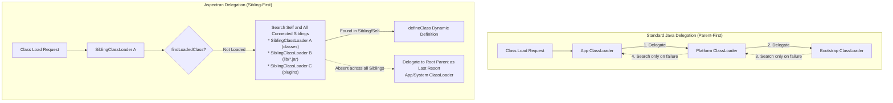
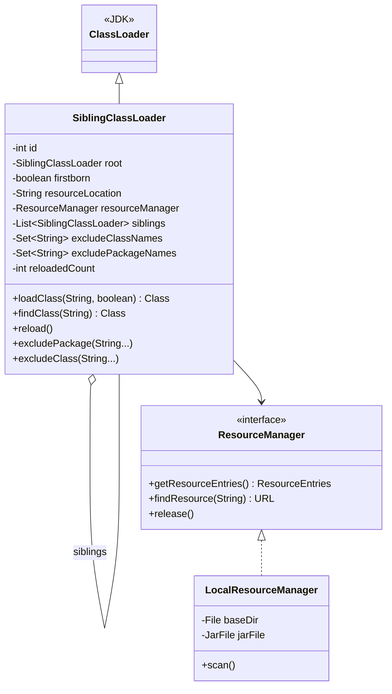
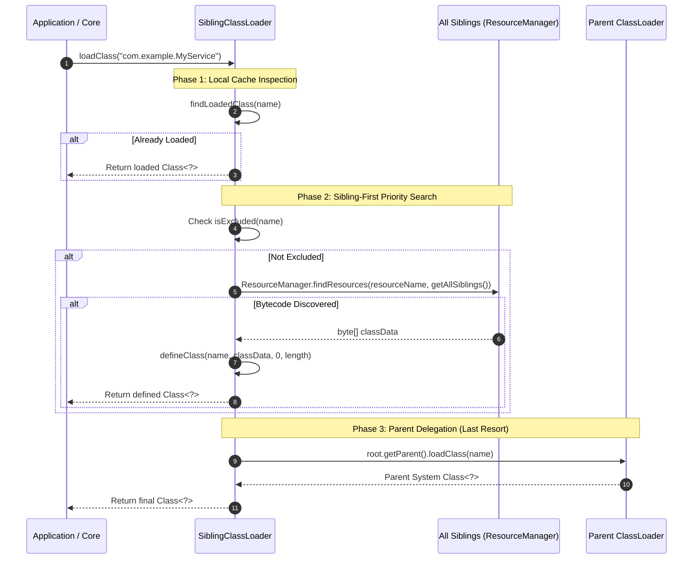
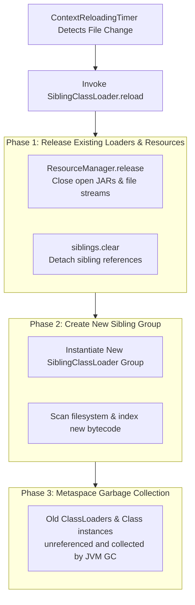

To overcome the static class-loading limitations of the standard Java Virtual Machine (JVM) and deliver robust zero-downtime hot reloading alongside modular application design, the Aspectran framework incorporates a proprietary classloader: [`SiblingClassLoader`](https://github.com/aspectran/aspectran/blob/master/core/src/main/java/com/aspectran/core/context/resource/SiblingClassLoader.java).

The strict "Parent-First Delegation" model enforced by standard JVM classloaders guarantees stability by preventing duplicate class loading, but fundamentally prohibits replacing class bytecode dynamically at runtime once loaded. Aspectran resolves this bottleneck by pioneering an innovative **"Sibling-First" delegation strategy** coupled with a high-performance resource indexing manager ([`ResourceManager`](https://github.com/aspectran/aspectran/blob/master/core/src/main/java/com/aspectran/core/context/resource/ResourceManager.java)).

## 1. Limitations of the Standard Model and Aspectran's Solution

The standard Java delegation model and Aspectran's sibling model diverge fundamentally in delegation direction and lookup priority.



### Critical Limitation of the Standard Model: Hot Reloading Impossibility
- In the parent-first model, once an application class is loaded by the App ClassLoader, any modified `.class` file introduced in a child classloader is ignored in favor of the parent's cached version.
- Consequently, business code or configuration updates cannot take effect dynamically without stopping the process and rebooting the JVM.

### Aspectran's Innovation: "Sibling-First" Lookup
- Rather than delegating unconditionally to parent loaders, [`SiblingClassLoader`](https://github.com/aspectran/aspectran/blob/master/core/src/main/java/com/aspectran/core/context/resource/SiblingClassLoader.java) **prioritizes searching the resource repositories managed by itself and all associated sibling classloaders**.
- Sibling loaders dedicated to separate directories (`classes/`) or independent JAR archives share access horizontally, behaving cohesively like a single virtual classpath.
- The framework delegates upward to the parent (System/App ClassLoader) only when neither the current loader nor any of its siblings find the requested bytecode.

## 2. Internal Architecture and Hierarchy of `SiblingClassLoader`

[`SiblingClassLoader`](https://github.com/aspectran/aspectran/blob/master/core/src/main/java/com/aspectran/core/context/resource/SiblingClassLoader.java) fully supports parallel class loading ([`ClassLoader.registerAsParallelCapable()`](https://github.com/aspectran/aspectran/blob/master/core/src/main/java/com/aspectran/core/context/resource/SiblingClassLoader.java#L59)) and exhibits the following structural composition:



### 1) Core Fields and Structural Roles
- **`root`**: The root classloader serving as the anchor for the entire sibling group. Acts as the designated gateway for ultimate delegation to the parent classloader.
- **`firstborn`**: Flag indicating whether this instance is the first child of the parent. Only the firstborn loader holds the privilege of creating and managing additional sibling loaders.
- **`resourceLocation`**: The physical filesystem path (specific directory or standalone JAR archive) monitored and served by this specific classloader instance.
- **[`ResourceManager`](https://github.com/aspectran/aspectran/blob/master/core/src/main/java/com/aspectran/core/context/resource/ResourceManager.java)**:
  - Scans and indexes class files and assets into in-memory metadata ([`ResourceEntries`](https://github.com/aspectran/aspectran/blob/master/core/src/main/java/com/aspectran/core/context/resource/ResourceEntries.java)) for wire-speed lookup.
- **`siblings` (`CopyOnWriteArrayList<SiblingClassLoader>`)**:
  - Thread-safe collection of peer loaders connected horizontally to the current loader.

## 3. Three-Phase Class Loading Algorithm

The [`loadClass(String name, boolean resolve)`](https://github.com/aspectran/aspectran/blob/master/core/src/main/java/com/aspectran/core/context/resource/SiblingClassLoader.java#L443) method executes in three deterministic phases inside fine-grained lock boundaries ([`getClassLoadingLock(name)`](https://github.com/aspectran/aspectran/blob/master/core/src/main/java/com/aspectran/core/context/resource/SiblingClassLoader.java#L444)):



1. **Phase 1: Local Cache Check (`findLoadedClass`)**:
   Verifies whether the class is already cached inside the current JVM classloader instance. If present, returns immediately.
2. **Phase 2: Sibling-First Priority Search (`findClass` -> `loadClassData`)**:
   - Provided the class does not match exclusion criteria ([`isExcluded(name)`](https://github.com/aspectran/aspectran/blob/master/core/src/main/java/com/aspectran/core/context/resource/SiblingClassLoader.java#L271)), the loader iterates across the `ResourceManager` of all sibling loaders ([`getAllSiblings()`](https://github.com/aspectran/aspectran/blob/master/core/src/main/java/com/aspectran/core/context/resource/SiblingClassLoader.java#L505)) to locate bytecode.
   - Upon finding bytecode bytes, it immediately calls [`defineClass()`](https://github.com/aspectran/aspectran/blob/master/core/src/main/java/com/aspectran/core/context/resource/SiblingClassLoader.java#L484) to define the new class dynamically within the current loader.
3. **Phase 3: Parent Delegation as Last Resort**:
   - If bytecode is absent across all siblings, or if the class is explicitly marked for exclusion, the loader delegates upward to the top-level parent ([`root.getParent()`](https://github.com/aspectran/aspectran/blob/master/core/src/main/java/com/aspectran/core/context/resource/SiblingClassLoader.java#L456)) to load standard JDK runtime classes (`java.lang.*`) or host server APIs.

## 4. Exclusion Rules for Preventing Class Conflicts

Indiscriminate sibling-first loading of shared foundational libraries (e.g., `org.slf4j.Logger`, Servlet APIs) would cause each sibling loader to define its own isolated copy of the same class. In Java, identical class names loaded by different classloaders are treated as incompatible types, triggering catastrophic [`ClassCastException`](https://github.com/aspectran/aspectran/blob/master/core/src/main/java/com/aspectran/core/context/resource/SiblingClassLoader.java#L43) errors when instances cross module boundaries.

`SiblingClassLoader` provides precise exclusion mechanisms to guarantee type uniqueness:
- **Package-Level Exclusion ([`excludePackage`](https://github.com/aspectran/aspectran/blob/master/core/src/main/java/com/aspectran/core/context/resource/SiblingClassLoader.java#L233))**:
  ```java
  classLoader.excludePackage("org.slf4j", "jakarta.servlet");
  ```
  Classes belonging to excluded package prefixes bypass sibling searching entirely and route straight to the parent classloader, ensuring single-instance class identity application-wide.
- **Class-Level Exclusion ([`excludeClass`](https://github.com/aspectran/aspectran/blob/master/core/src/main/java/com/aspectran/core/context/resource/SiblingClassLoader.java#L251))**:
  Allows targeting specific individual FQCN class names for exclusion.

## 5. Zero-Downtime Hot Reloading (`reload()`) and Garbage Collection

The signature capability of `SiblingClassLoader` is enabling zero-downtime hot reloading of modified application classes without restarting the JVM process.



- **Full ClassLoader Group Teardown**:
  Because the JVM specification forbids re-defining an already loaded `Class<?>` instance directly, `SiblingClassLoader`'s [`reload()`](https://github.com/aspectran/aspectran/blob/master/core/src/main/java/com/aspectran/core/context/resource/SiblingClassLoader.java#L408) releases all underlying file locks (`rm.release()`) and clears sibling references ([`leave()`](https://github.com/aspectran/aspectran/blob/master/core/src/main/java/com/aspectran/core/context/resource/SiblingClassLoader.java#L423)).
- **Instantiating Fresh Loader Groups**:
  Spawns an entirely fresh group of `SiblingClassLoader` instances initialized to read updated class files from disk.
- **Preventing Metaspace Memory Leaks**:
  With all references to the previous classloader severed, the obsolete classloader and its loaded class definitions in JVM Metaspace become eligible for full Garbage Collection (GC).
- **Reload Counter Metric ([`reloadedCount`](https://github.com/aspectran/aspectran/blob/master/core/src/main/java/com/aspectran/core/context/resource/SiblingClassLoader.java#L87))**:
  Tracks the total number of reload events performed, exposing operational observability metrics.

> 🔍 **Related Detailed Mechanisms**
> - For the periodic filesystem monitoring pipeline triggering `reload()`, see [Aspectran Reloading Mechanism](/en/docs/mechanisms/aspectran-reloading-mechanism/).
> - For how classloaders are instantiated and bound into containers, see [ActivityContext Building Process](/en/docs/mechanisms/activity-context-building/).
> - For how services isolate and look up classloaders, see [Aspectran Service Architecture](/en/docs/mechanisms/aspectran-services/).

## 6. Next Steps: Exploring Detailed Mechanisms

To examine how filesystem modifications are detected in real time to coordinate zero-downtime classloader and context reloads, refer to the [Aspectran Reloading Mechanism](/en/docs/mechanisms/aspectran-reloading-mechanism/) guide.

To inspect how all mechanisms and packages interconnect across the entire framework, refer to the **[Aspectran Detailed Mechanisms Index](/en/docs/mechanisms/)**.
