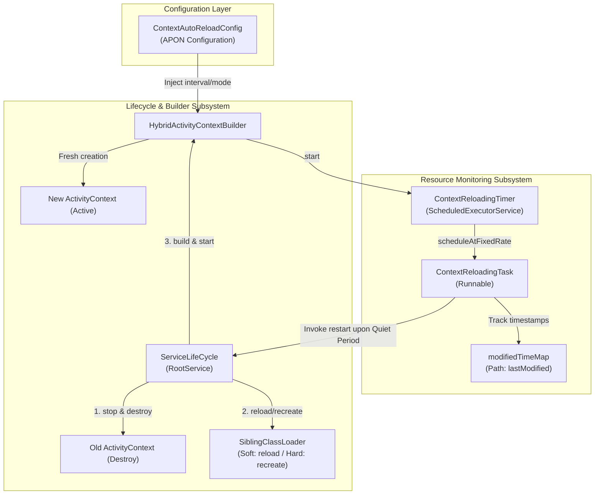
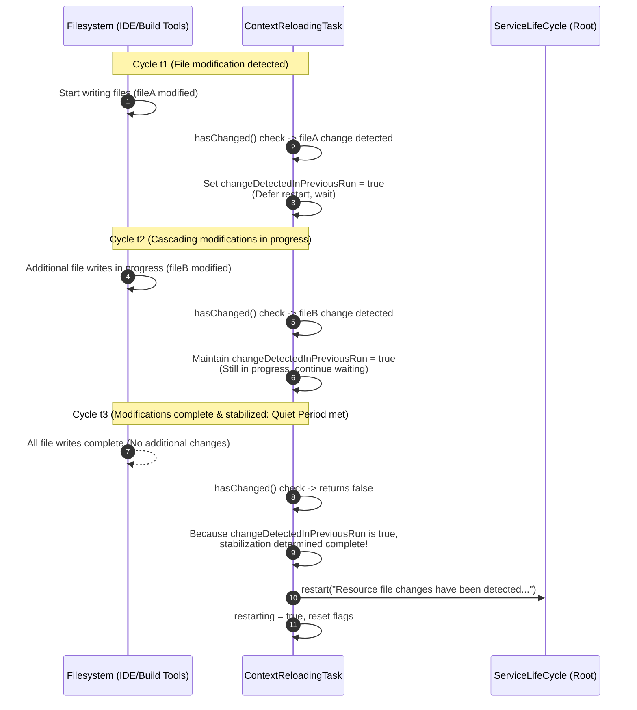
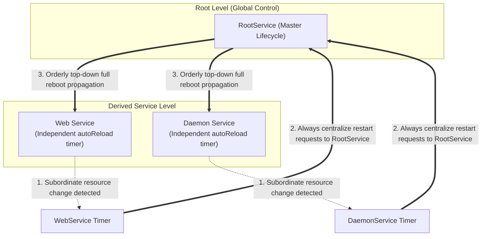
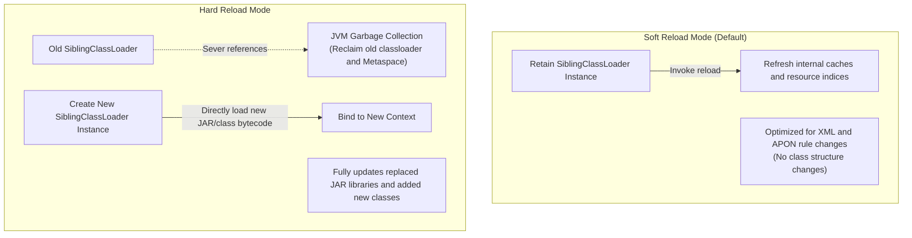
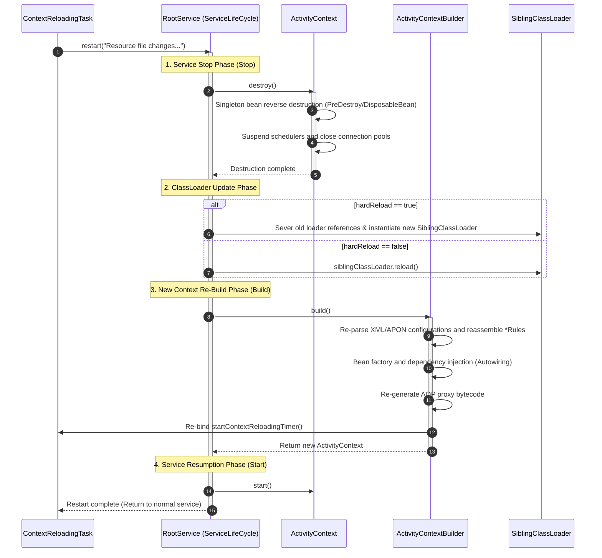

## 1. Overview

The auto-reloading (Hot-Reloading) feature of the Aspectran framework is a powerful runtime mechanism that dynamically detects modifications to XML/APON configuration files or resource JAR files while an application is running, immediately applying those changes to the context without restarting the entire JVM process.

The primary purposes and value of this feature are as follows:

*   **Maximizing Development Productivity**: After modifying business rules (Translets), Aspects, bean definitions, and more, developers do not need to reboot the server each time; changes are hot-swapped within seconds, drastically shortening the development feedback loop.
*   **Dynamic Updates in Production**: Runtime configurations—such as modifying DataSource connection parameters, toggling feature flags, and adjusting scheduling intervals—can be safely performed with zero downtime or near-instantaneous context replacement.
*   **Safe Atomic Updates**: Built-in sophisticated **Quiet Period** monitoring algorithms prevent incomplete restarts while files are still being copied or when multiple configuration files are written simultaneously.

Rather than being a makeshift workaround that merely modifies properties of certain beans, this mechanism follows a complete lifecycle model: upon detecting changes, it orderly destroys the existing `ActivityContext` (`destroy()`) and rebuilds (`rebuild()`) an entirely new `ActivityContext` through the initialization pipeline.

## 2. Auto-Reloading Architecture and Core Components

Aspectran's auto-reloading operates through the seamless coordination of a dedicated scheduler timer, a file timestamp monitoring task, a builder pipeline, and a service lifecycle controller.



### A. ContextAutoReloadConfig

`ContextAutoReloadConfig` is an APON parameter container defined within the `context` block of the `aspectran-config.apon` file, specifying activation status, inspection intervals, and reload modes for auto-reloading.

*   `enabled`: Specifies whether the auto-reloading feature is enabled. (Default: `false`)
*   `scanIntervalSeconds`: Specifies the resource change monitoring interval in seconds. If non-positive or omitted, it is automatically corrected to the default value of `10` seconds.
*   `reloadMode`: Determines the classloader handling policy during reloading.
    *   `soft` (Default): A lightweight mode that retains the existing `SiblingClassLoader` instance while refreshing internal resource caches. Suitable for detecting changes mainly in configuration files (XML, APON).
    *   `hard`: Completely discards the existing `SiblingClassLoader` and creates a new instance. Essential when external JAR files are replaced or new bytecode must be physically reloaded.

```apon
context: {
    rules: [
        /config/app-context.xml
    ]
    autoReload: {
        reloadMode: "hard"
        scanIntervalSeconds: 5
        enabled: true
    }
}
```

### B. ContextReloadingTimer

`ContextReloadingTimer` is the manager class in charge of background scheduling.

*   **Independent Daemon Thread Operation**: Uses `CustomizableThreadFactory("ContextReloading-")` to create a `SingleThreadScheduledExecutor` operating as a daemon thread, preventing it from interfering with graceful application termination.
*   **Fixed-Rate Scheduling**: Drives the inspection loop of `ContextReloadingTask` at configured intervals via `executor.scheduleAtFixedRate(task, 0, scanIntervalSeconds, TimeUnit.SECONDS)`.
*   **Resource Management**: When the context builder stops or restarts, it calls `stop()` to safely interrupt the existing scheduler via `shutdownNow()` and reclaim resources.

### C. ContextReloadingTask

`ContextReloadingTask` is a `Runnable` implementation that monitors timestamps of physical filesystem and classpath resources and issues restart commands.

*   **`modifiedTimeMap`**: Maintains a hash map storing the absolute path of monitored files as Key and the file's last modified timestamp (`lastModified`) as Value.
*   **Smart Resource Resolution (`setResources`)**: When a `URL` provided by the classloader uses the `jar:` protocol, it traces back to the JAR archive file itself on the filesystem as a `File` object via `JarURLConnection.getJarFileURL()` and registers it as a monitoring target.
*   **Two-Phase State Machine**: When file modifications are detected, it does not restart immediately; instead, it verifies the Quiet Period using the `changeDetectedInPreviousRun` flag.

### D. ActivityContextBuilder Integration

`AbstractActivityContextBuilder` initializes monitoring during the final stage (`startContextReloadingTimer`) of the context build pipeline.

*   Registers all configuration files collected during parsing (`appendedRuleFiles`) and all classpath resources loaded by `SiblingClassLoader` (`siblingClassLoader.getAllResources()`) into `ContextReloadingTimer` without omission.
*   When provisioning a new classloader upon restart, determines whether to call `reload()` on the existing classloader or instantiate a completely new `SiblingClassLoader` according to the `hardReload` option.

### E. ServiceLifeCycle

The entry point that receives restart signals. When file changes stabilize, `ContextReloadingTask` calls `serviceLifeCycle.restart(...)` to trigger a full application lifecycle refresh starting from the top-level root service.

## 3. Resource Registration and Monitored Targets Identification

Aspectran tracks not just a static file list, but also the modular structure of configuration files and dynamic classpaths.

### A. Automatic Rule File Collection

While `HybridActivityContextBuilder` parses the root configuration file (such as `aspectran-config.xml`), upon encountering an `<append file="..."/>` directive, the parser reads those auxiliary configuration files sequentially. At this time, the builder accumulates all actual file objects participating in the parsing process into the `appendedRuleFiles` collection.

When the build completes successfully, this list is passed directly to `ContextReloadingTimer.addResource(File)` and registered into the monitoring map. Therefore, modifications to any of the tens of partitioned sub-rule files, as well as the main configuration file, are captured immediately.

### B. Classpath and JAR Tracking Mechanism

Resources located in `<resourceLocations>` paths specified in `SiblingClassLoader` or deployed library JAR files are also targets of auto-reloading.

```java
public void setResources(Enumeration<URL> resources) {
    if (resources != null) {
        while (resources.hasMoreElements()) {
            URL url = resources.nextElement();
            try {
                File file;
                if (URL_PROTOCOL_JAR.equals(url.getProtocol())) {
                    JarURLConnection conn = (JarURLConnection)url.openConnection();
                    URL jarFileUrl = conn.getJarFileURL();
                    file = new File(jarFileUrl.toURI());
                } else {
                    file = new File(url.toURI());
                }
                addResource(file);
            } catch (Exception e) {
                logger.error("Failed to inspect resource for context reloading: {}", url, e);
            }
        }
    }
}
```

When a JAR URL (`jar:file:/app/lib/my-plugin.jar!/META-INF/...`) is supplied, it extracts the URI of the physical host file `my-plugin.jar`—rather than the internal entry—and converts it to a `File` object. Through this, simply overwriting a new version of the JAR externally allows the reloading timer to capture changes in the JAR file's modification timestamp.

> **Note**: When running tests in IDE development environments (Eclipse, IntelliJ, etc.), if `ActivityContext.class` is loaded from a regular directory (e.g., `target/classes`) rather than a JAR, the builder is designed to automatically bypass `resourceLocations` specifications to prevent duplicate class loading conflicts.

## 4. Quiet Period 2-Pass Monitoring Algorithm

When files are large (JAR files of tens to hundreds of megabytes) or when IDEs/build tools (Maven, Gradle) are copying multiple class and XML files into a directory, triggering a reload the moment the first file is written causes classes to be missing or XML parsing syntax errors (Unexpected EOF) because the remaining files have not finished copying.

To prevent such incomplete state updates, Aspectran uses a 2-Pass algorithm based on a **Quiet Period**.



### Detailed Algorithm Code Analysis

```java
@Override
public void run() {
    if (restarting || modifiedTimeMap.isEmpty()) {
        return;
    }

    boolean changed = hasChanged();

    if (changed) {
        // Change detected in this run: only raise flag and pass to next cycle
        changeDetectedInPreviousRun = true;
    } else {
        // No change detected in this run (quiet state)
        if (changeDetectedInPreviousRun) {
            // Changes were underway until just previous cycle, now stopped -> trigger restart!
            restarting = true;
            changeDetectedInPreviousRun = false;
            restartService();
        }
    }
}
```

1.  **Initial Check and Change Detection (`changed == true`)**:
    If `file.lastModified()` of any registered resource differs from the recorded value, the timestamp is updated via `entry.setValue(lastModifiedTime)` and `changed = true` is returned. The task only marks `changeDetectedInPreviousRun = true` and quietly finishes execution.
2.  **Waiting for Cascading Changes**:
    While build tools continue writing files, `changed == true` is maintained in each cycle, so the restart is repeatedly postponed.
3.  **Quiet Period Fulfillment (`changed == false && changeDetectedInPreviousRun == true`)**:
    Once a cycle passes where no files are modified any further, `changed` becomes `false` while the previous flag remains `true`. The system concludes that "file modification operations have completely finished and the system has stabilized," and calls `restartService()`.

Thanks to this simple yet powerful 2-pass structure, Aspectran achieves exceptionally stable hot swaps without requiring separate complex OS file locks.

## 5. Hierarchical Service Structure and Centralized Root Restart

Aspectran supports a hierarchical service (`CoreService`) architecture where multiple services are connected in a tree structure. Web services, scheduler services, background worker services, and more can be derived and operated under a root service.

In this hierarchical structure, the auto-reloading mechanism strictly adheres to the absolute principle: **"Distribute monitoring, centralize execution to the root."**



### Principle of Centralized Restart Guarantee

When creating a reloading timer, `AbstractActivityContextBuilder` always injects the top-level root service's `ServiceLifeCycle`, regardless of what service the current builder belongs to:

```java
// AbstractActivityContextBuilder.java
contextReloadingTimer = new ContextReloadingTimer(
        masterService.getRootService().getServiceLifeCycle(),
        scanIntervalSeconds);
```

At the same time, inside `AbstractServiceLifeCycle`, upon entering the restart method, it strictly verifies whether the calling subject is indeed the root service:

```java
// AbstractServiceLifeCycle.java
Assert.state(isRootService(), "Only the root service can be restarted");
```

### Why Partial Restart is Excluded

While 'partial restart' of restarting only subordinate services individually sounds theoretically appealing, it produces fatal side effects in real-world complex enterprise environments:

*   **Reference Integrity Destruction**: If a singleton bean existing in a parent or sibling context was injected with and cached a bean from the restarting child context, the moment the child bean is destroyed, dangling pointers or `BeanDestroyedException` errors occur.
*   **ClassLoader Memory Leaks**: When replacing classloaders for only a child service, static references, ThreadLocals, or unclosed JDBC drivers in parent classloaders prevent the old classloader from being garbage-collected, causing Metaspace Out of Memory (OOM) errors.
*   **Scheduler and Async Task Entanglement**: Running Quartz jobs or asynchronous action worker threads end up with half referencing old classes and half referencing new classes, encountering inconsistent states.

Therefore, instead of complex and incomplete partial updates, Aspectran adopts **the method of shutting down all child services collectively starting from the root service and completely reconfiguring the entire context**, guaranteeing 100% predictability and consistency.

## 6. SiblingClassLoader and Hot Class Reloading

Aspectran's classloader system, `SiblingClassLoader`, is the core engine that determines how class bytecode is updated during auto-reloading.



### A. Soft Reload vs Hard Reload Mechanisms

The `AbstractActivityContextBuilder.createSiblingClassLoader()` method takes completely different paths according to `reloadMode` in `ContextAutoReloadConfig`:

```java
protected SiblingClassLoader createSiblingClassLoader(String contextName, ClassLoader parentClassLoader)
        throws InvalidResourceException {
    if (siblingClassLoader == null || hardReload) {
        String[] resourcesToLoad = resourceLocations;
        if (resourceLocations != null) {
            URL url = ActivityContext.class.getResource("ActivityContext.class");
            if (url != null && !URL_PROTOCOL_JAR.equals(url.getProtocol())) {
                resourcesToLoad = null;
            }
        }
        siblingClassLoader = new SiblingClassLoader(contextName, parentClassLoader, resourcesToLoad);
    } else {
        siblingClassLoader.reload();
    }
    return siblingClassLoader;
}
```

*   **Soft Mode (`hardReload == false`)**:
    Calls `reload()` on the existing `siblingClassLoader`. Because the classloader instance itself is not changed, it is very fast and imposes no memory burden. Most suitable for reflecting Translet mappings, Aspect pointcuts, property value modifications, etc., within configuration files.
*   **Hard Mode (`hardReload == true`)**:
    Severs references to the existing `siblingClassLoader` and creates a completely new `SiblingClassLoader` instance. The new classloader reads the latest bytecode from filesystem JAR files or class files from scratch. Classes previously loaded by the old classloader lose references and are safely unloaded from Metaspace by the garbage collector (GC).

### B. Boundaries and Limitations of Class Reloading

No matter how powerful auto-reloading is, physical limits in the JVM language environment exist:

1.  **Immutability of Application System ClassLoader**:
    Classes loaded by `SiblingClassLoader` (i.e., `<resourceLocations>` or beans in the Aspectran context scope) can be completely unloaded and reloaded. However, classes of the Aspectran core framework itself or the `main()` method class already loaded by the JVM `AppClassLoader` or bootstrap classloader during application startup cannot have their bytecode changed unless the JVM process is restarted.
2.  **Recommended Module Separation Architecture**:
    Therefore, business logic, plugins, controllers, and the like that may change dynamically at runtime should not be placed on the host bootstrap classpath, but rather deployed as independent JARs in Aspectran's `resourceLocations` directories—this is the canonical approach to modular hot-swapping.

## 7. Reloading Execution Sequence Analysis

The complete end-to-end flow from the moment a configuration file is modified until the new context resumes service is as follows:



1.  **Service Suspension and Resource Destruction (`destroy`)**:
    The root service first safely stops running servlet listeners, Netty channels, and background schedulers. The `destroy()` of the existing `ActivityContext` is executed, and all registered singleton beans execute destruction callbacks (`@PreDestroy`, `DisposableBean`) in reverse order of creation. Database connection pools, file handles, and thread pools are all closed.
2.  **ClassLoader Initialization**:
    Prepares a new classloader according to the `hardReload` policy.
3.  **Configuration Re-Parsing and Context Re-Creation (`build`)**:
    `HybridActivityContextBuilder` reads modified configuration files from the beginning to construct `RuleParsingContext`, verifies dependency validity via `BeanReferenceInspector`, and creates an entirely fresh singleton registry and AOP proxy chain.
4.  **Reloading Timer Re-Binding**:
    Restarts `ContextReloadingTimer` based on the latest resource list of the newly built context to prepare for subsequent file modifications.

## 8. Comparison with Other Frameworks and Architectural Considerations

Hot reloading is a long-standing challenge that every application framework seeks to solve, and each framework adopts a different design depending on the values it pursues.

| Comparison Criterion | Aspectran Auto-Reloading | Spring Boot DevTools | OSGi (Equinox, Felix) | JRebel (Commercial Solution) |
| :--- | :--- | :--- | :--- | :--- |
| **Approach** | Fast Full Context Rebuild | Two-tier ClassLoader Fast Restart | Module (Bundle) Unit Independent Partial Restart | JVM Bytecode-Level Dynamic Class Patching |
| **Restart Scope** | Root service and all child contexts | Entire Spring ApplicationContext | Targeted Bundle only | None (Dynamic method/field hotswap) |
| **ClassLoader Strategy** | `SiblingClassLoader` (Soft/Hard modes) | Base (Libraries) + Restart (User code) | Independent module classloader per bundle | Dedicated Java Agent interception |
| **Complexity** | **Low (Stable, Predictable)** | Low (Stable) | Extremely High (Class visibility and dependency hell) | High (Requires environment setup and commercial license) |
| **Downtime** | Minimal (Hundreds of milliseconds to a few seconds) | Short (A few seconds) | Zero (Only the target bundle redeployed) | Zero Downtime (Completely seamless) |
| **State Preservation** | Lost (Reset upon restart) | Lost (Reset upon restart) | Preserved outside the bundle | Retained (Retains bean instances and sessions) |

### A. Contrast with OSGi Partial Restarts

OSGi advocates complete modularity and supports dynamic unloading and installation of individual bundles. However, in practice, due to complex package `Import/Export` coupling among bundles, updating a single bundle easily causes cascading `ClassNotFoundException` or `LinkageError`, and the learning curve and configuration complexity required to govern this are excessively large.

Instead of the illusion of partial restarts, Aspectran chose **full context rebuilding**, cutting off side effects at the source and securing predictability as its highest priority.

### B. Contrast with JRebel In-Place Patching

JRebel directly redefines bytecode via JVM agents and hooks framework-internal bean factories to replace only modified methods and fields in memory.

However, implementing this directly at the framework level requires introducing thick dynamic proxy layers across all bean invocations and property accesses, causing significant overhead in normal runtime performance. Aspectran made the pragmatic trade-off: "Deliver peak runtime performance in production environments, while providing fast full restarts for sufficient productivity in development environments."

## 9. Practical Usage and Operational Guide

Recommendations for safely and effectively utilizing the auto-reloading feature in production and development environments are as follows:

### A. Recommended Settings for Development Environments

In local development environments, immediate reflection of configurations and bytecode is paramount, so the following configuration is recommended:

```apon
context: {
    autoReload: {
        reloadMode: "hard"
        scanIntervalSeconds: 2
        enabled: true
    }
}
```

*   Set `scanIntervalSeconds` short, around 2 to 3 seconds, so that results can be verified quickly after code or rule modifications.
*   Set `reloadMode: "hard"` if you need to test JAR library replacements or new class additions in real time.

### B. Production Environment Considerations and Recommended Strategies

In production environments, a cautious approach is required when using auto-reloading:

*   **Awareness of In-Memory State Loss**: When `ActivityContext` restarts, in-memory singleton bean field values and local cache data evaporate completely. For user sessions, `DefaultSessionManager` should be separated and linked with Redis or an external clustered session store to prevent loss of user logins.
*   **Recommended Disabled by Default in Production**: In production environments with large incoming traffic, setting `enabled: false` is safe to prevent context reboots caused by unintentional file modifications.
*   **Safe Configuration Change Deployment**: When configurations must be changed dynamically, utilize Canary servers or Blue/Green deployment units, and update filesystem timestamps via atomic symlink (`ln -sfn`) switches only after configuration file copies are completely finished.

## 10. Conclusion

Aspectran's auto-reloading mechanism is not merely a simple file change detector, but an architecture that flawlessly reflects the framework's core philosophies: **Reliability** and **Simplicity**.

1.  Through the **Quiet Period algorithm**, it fundamentally prevents errors in incomplete states that may occur while files are being copied.
2.  Even in hierarchical service structures, it enforces **centralized rebooting anchored at the root service**, completely guaranteeing reference integrity across distributed components.
3.  Through the **dual Soft/Hard model of `SiblingClassLoader`**, it optimizes lightweight configuration changes and heavy bytecode replacements appropriately according to the situation.

Through this, developers can maximize productivity within a pleasant feedback loop, and system operators can control services in a predictable and safe manner.
