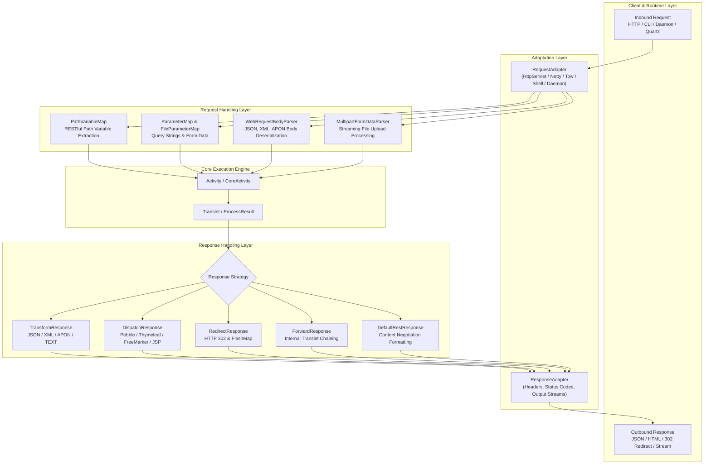
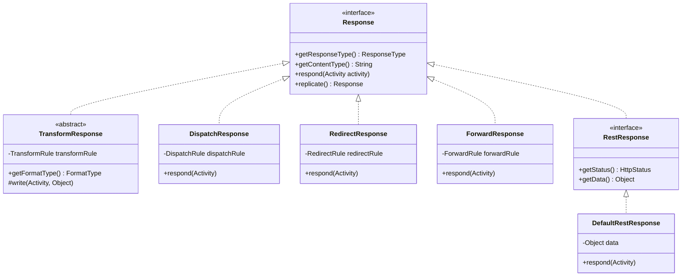
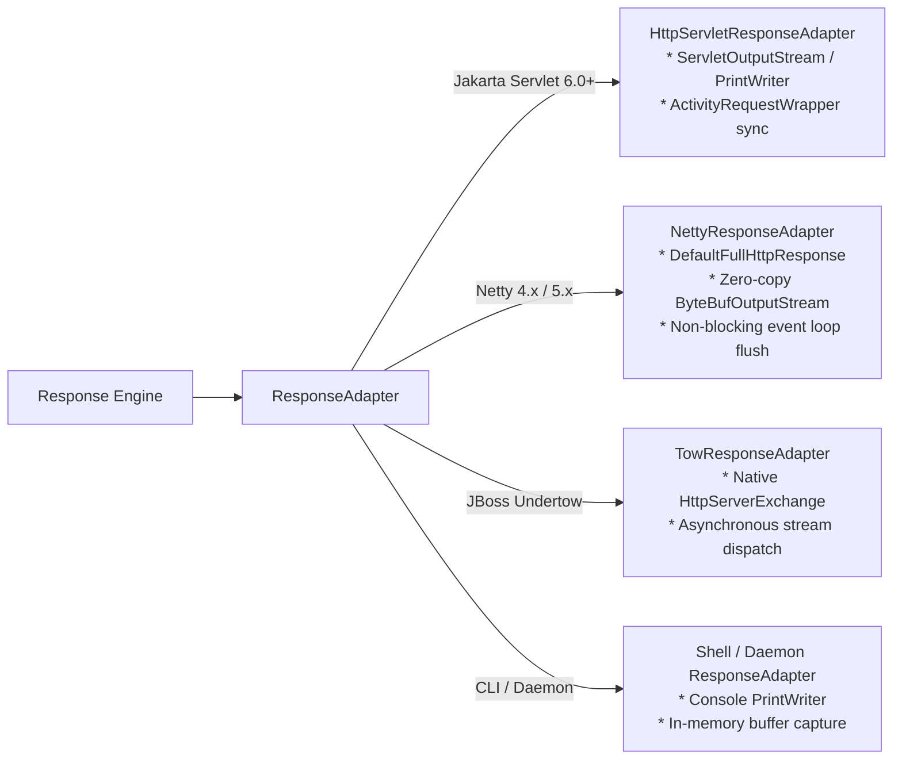

Aspectran's request-response processing pipeline is the core I/O orchestration subsystem of the framework. It absorbs heterogeneous inbound inputs from diverse runtimes—servlet containers, Netty non-blocking event loops, Undertow native handlers, OS daemons, and interactive CLI shells—into a unified standard contract, executes business actions, and transforms results into the optimal delivery format demanded by clients (RESTful JSON/XML, template-rendered HTML, HTTP redirects, or internal server-side forwarding).

Aspectran cleanly decouples its pure HTTP web abstraction layer (`aspectran-web`) from its servlet-specific module (`aspectran-web-servlet`), delivering identical request parsing and response rendering mechanisms across both standard servlet and high-performance servlet-less environments.

## 1. Overall Request-Response Architecture Diagram

The I/O pipeline is partitioned into two distinct phases: the **Request Handling Layer** for parsing and validation, and the **Response Handling Layer** for rendering and streaming.

## 2. Request Handling Pipeline

The request handling pipeline converts native communication objects into the framework's internal data model, verifies input constraints, and injects parameters into [`ActivityData`](https://github.com/aspectran/aspectran/blob/master/core/src/main/java/com/aspectran/core/activity/ActivityData.java) in four structured steps.

### 1) Environment Adaptation ([`RequestAdapter`](https://github.com/aspectran/aspectran/blob/master/core/src/main/java/com/aspectran/core/adapter/RequestAdapter.java))
- Inbound native request objects arriving at runtime entry points are wrapped in dedicated adapters:
  - Servlet: [`HttpServletRequestAdapter`](https://github.com/aspectran/aspectran/blob/master/web-servlet/src/main/java/com/aspectran/web/servlet/adapter/HttpServletRequestAdapter.java) (`jakarta.servlet.http.HttpServletRequest`)
  - Netty: [`NettyRequestAdapter`](https://github.com/aspectran/aspectran/blob/master/with-netty/src/main/java/com/aspectran/netty/adapter/NettyRequestAdapter.java) (Netty `FullHttpRequest`)
  - Undertow: [`TowRequestAdapter`](https://github.com/aspectran/aspectran/blob/master/with-undertow/src/main/java/com/aspectran/undertow/adapter/TowRequestAdapter.java) (`io.undertow.server.HttpServerExchange`)
  - Shell: [`ShellRequestAdapter`](https://github.com/aspectran/aspectran/blob/master/shell/src/main/java/com/aspectran/shell/adapter/ShellRequestAdapter.java) (`TransletCommandLine`)
  - Daemon: [`DaemonRequestAdapter`](https://github.com/aspectran/aspectran/blob/master/daemon/src/main/java/com/aspectran/daemon/adapter/DaemonRequestAdapter.java)
- The adapter layer provides a unified API for inspecting parameters, headers, attributes, and raw body input streams, shielding downstream business logic from platform-specific APIs.

### 2) Parameter and Path Variable Parsing
- **RESTful Path Variable Extraction ([`PathVariableMap`](https://github.com/aspectran/aspectran/blob/master/core/src/main/java/com/aspectran/core/activity/request/PathVariableMap.java))**:
  Matches incoming request URIs against URI templates defined in translet rules (e.g., `/users/{userId}/orders/{orderId}`), extracts variable path tokens, and binds them into the parameter pool.
- **Unified Parameter Map ([`ParameterMap`](https://github.com/aspectran/aspectran/blob/master/core/src/main/java/com/aspectran/core/activity/request/ParameterMap.java))**:
  Consolidates query strings and form data (`x-www-form-urlencoded`) into a consistent multi-value map structure (`MultiValueMap`).
- **Mandatory Parameter Validation**:
  If parameters marked as mandatory (`mandatory="true"`) in [`RequestRule`](https://github.com/aspectran/aspectran/blob/master/core/src/main/java/com/aspectran/core/context/rule/RequestRule.java) are absent from the request, the engine throws a [`MissingMandatoryParametersException`](https://github.com/aspectran/aspectran/blob/master/core/src/main/java/com/aspectran/core/activity/request/MissingMandatoryParametersException.java) before any business actions execute.

### 3) Automatic Web Request Body Parsing ([`WebRequestBodyParser`](https://github.com/aspectran/aspectran/blob/master/web/src/main/java/com/aspectran/web/activity/request/WebRequestBodyParser.java))
A static deserialization engine that automatically translates request payloads into structured objects:
- **Real-Time Request Payload Limiting ([`CountingInputStream`](https://github.com/aspectran/aspectran/blob/master/utils/src/main/java/com/aspectran/utils/io/CountingInputStream.java))**:
  Monitors stream byte counts against configured `maxRequestSize` limits during reading. If exceeded, it immediately aborts with a [`SizeLimitExceededException`](https://github.com/aspectran/aspectran/blob/master/core/src/main/java/com/aspectran/core/activity/request/SizeLimitExceededException.java) to prevent Denial of Service (DoS) attacks.
- **Content-Type-Driven Mapping**:
  - `application/json` / `*+json`: Deserializes JSON payloads into Aspectran parameters or DTOs using [`JsonToParameters`](https://github.com/aspectran/aspectran/blob/master/utils/src/main/java/com/aspectran/utils/apon/JsonToParameters.java).
  - `application/xml` / `text/xml`: Parses XML hierarchies via [`XmlToParameters`](https://github.com/aspectran/aspectran/blob/master/utils/src/main/java/com/aspectran/utils/apon/XmlToParameters.java).
  - `application/apon`: Applies APON object deserialization.
  - `application/x-www-form-urlencoded`: Parses URL-encoded form parameters.

### 4) Multipart File Upload Handling ([`MultipartFormDataParser`](https://github.com/aspectran/aspectran/blob/master/web/src/main/java/com/aspectran/web/activity/request/MultipartFormDataParser.java))
- Streams `multipart/form-data` uploads in memory-efficient chunks.
- Enables granular control over file size limits, temporary directory paths, and memory thresholds via translet-level configurations or `@Multipart("beanName")` annotations, storing parsed file metadata safely inside [`FileParameterMap`](https://github.com/aspectran/aspectran/blob/master/core/src/main/java/com/aspectran/core/activity/request/FileParameterMap.java).

## 3. Response Handling Pipeline

The response handling pipeline consumes business results accumulated in [`ProcessResult`](https://github.com/aspectran/aspectran/blob/master/core/src/main/java/com/aspectran/core/activity/process/result/ProcessResult.java) and applies declared response strategies to produce the final client response.

All response strategies implement the top-level [`Response`](https://github.com/aspectran/aspectran/blob/master/core/src/main/java/com/aspectran/core/activity/response/Response.java) contract.

### 1) Data Transformation Response ([`TransformResponse`](https://github.com/aspectran/aspectran/blob/master/core/src/main/java/com/aspectran/core/activity/response/transform/TransformResponse.java))
The primary response strategy for RESTful APIs and machine-to-machine data exchanges. Concrete transformers are created by [`TransformResponseFactory`](https://github.com/aspectran/aspectran/blob/master/core/src/main/java/com/aspectran/core/activity/response/transform/TransformResponseFactory.java) based on the target format ([`FormatType`](https://github.com/aspectran/aspectran/blob/master/core/src/main/java/com/aspectran/core/context/rule/type/FormatType.java)):

- **`JsonTransformResponse`**: Serializes `ProcessResult` data into formatted JSON strings, supporting pretty printing, date formatting, and null inclusion toggles.
- **`XmlTransformResponse`**: Serializes data into hierarchical XML document trees.
- **`AponTransformResponse`**: Outputs data in human-readable APON (Aspectran Parameters) syntax.
- **`TextTransformResponse`**: Converts data directly into raw plain text.
- **`XslTransformResponse`**: Transforms XML data through an XSLT stylesheet before streaming.

### 2) View Dispatch Response ([`DispatchResponse`](https://github.com/aspectran/aspectran/blob/master/core/src/main/java/com/aspectran/core/activity/response/dispatch/DispatchResponse.java))
The strategy dedicated to Server-Side Rendering (SSR):
- Resolves view templates defined in [`DispatchRule`](https://github.com/aspectran/aspectran/blob/master/core/src/main/java/com/aspectran/core/context/rule/DispatchRule.java) and delegates rendering to registered [`ViewDispatcher`](https://github.com/aspectran/aspectran/blob/master/core/src/main/java/com/aspectran/core/activity/response/dispatch/ViewDispatcher.java) beans (Pebble, Thymeleaf, FreeMarker, JSP).
- Model attributes stored in `ActivityData` are automatically exposed to the template rendering context.

### 3) Redirection Response ([`RedirectResponse`](https://github.com/aspectran/aspectran/blob/master/core/src/main/java/com/aspectran/core/activity/response/RedirectResponse.java))
- Emits HTTP 302 (Found) or 303 (See Other) status codes, directing client browsers to load a new URL.
- **FlashMap Integration**: Transient attributes and one-time feedback messages registered before redirection are retained across requests by [`FlashMapManager`](https://github.com/aspectran/aspectran/blob/master/core/src/main/java/com/aspectran/core/activity/FlashMapManager.java) and automatically purged upon access.

### 4) Internal Forwarding Response ([`ForwardResponse`](https://github.com/aspectran/aspectran/blob/master/core/src/main/java/com/aspectran/core/activity/response/ForwardResponse.java))
- Seamlessly transfers execution to another translet inside the server without client browser awareness.
- **Data Continuity**: Maintains all accumulated `ProcessResult` and `ActivityData` state across the forwarding loop, enabling clean functional chaining of business rules.

### 5) RESTful Content Negotiation Response ([`DefaultRestResponse`](https://github.com/aspectran/aspectran/blob/master/web/src/main/java/com/aspectran/web/activity/response/DefaultRestResponse.java))
A sophisticated REST component built into `aspectran-web`:
- **Two-Phase Content Negotiation**:
  1. URI Extension Check: Explicit extensions (`.json`, `.xml`, `.apon`, `.txt`) take immediate precedence.
  2. HTTP `Accept` Header Analysis: Weighs client `Accept` header quality values (`q`) to dynamically select the optimal representation.
- **Standardized Response Envelopes ([`ResponsePayload`](https://github.com/aspectran/aspectran/blob/master/web/support/rest/response/ResponsePayload.java))**:
  Wraps outputs in structured payloads—[`SuccessResponse`](https://github.com/aspectran/aspectran/blob/master/web/support/rest/response/SuccessResponse.java) for successful outcomes or [`FailureResponse`](https://github.com/aspectran/aspectran/blob/master/web/support/rest/response/FailureResponse.java) upon errors.

## 4. Multi-Runtime Stream Output and Buffering Control

Output data is physically dispatched to client channels via runtime-specific implementations of [`ResponseAdapter`](https://github.com/aspectran/aspectran/blob/master/core/src/main/java/com/aspectran/core/adapter/ResponseAdapter.java).

- **Jakarta Servlet Containers**:
  [`HttpServletResponseAdapter`](https://github.com/aspectran/aspectran/blob/master/web-servlet/src/main/java/com/aspectran/web/servlet/adapter/HttpServletResponseAdapter.java) wraps container output streams. [`ActivityRequestWrapper`](https://github.com/aspectran/aspectran/blob/master/web-servlet/src/main/java/com/aspectran/web/servlet/activity/ActivityRequestWrapper.java) bridges request attributes into servlet request scope for interoperability with JSP and servlet filters.
- **Netty Servlet-Less Runtime**:
  [`NettyResponseAdapter`](https://github.com/aspectran/aspectran/blob/master/with-netty/src/main/java/com/aspectran/netty/adapter/NettyResponseAdapter.java) writes serialized bytes directly into Netty's zero-copy [`ByteBufOutputStream`](https://github.com/aspectran/aspectran/blob/master/with-netty/src/main/java/com/aspectran/netty/adapter/NettyResponseAdapter.java), optimizing HTTP keep-alive, chunked transfers, and event-loop channel flushes without intermediate container buffers.
- **Undertow Native Runtime**:
  [`TowResponseAdapter`](https://github.com/aspectran/aspectran/blob/master/with-undertow/src/main/java/com/aspectran/undertow/adapter/TowResponseAdapter.java) directly drives Undertow's native `HttpServerExchange` output channels for minimal memory footprint and high streaming throughput.

## 5. Comprehensive Comparison Matrix: 5 Response Strategies

| Strategy | Primary Implementation | Target Output Format | Client URL Change | Data Transfer Mechanism | Ideal Use Cases |
| :--- | :--- | :--- | :--- | :--- | :--- |
| **Transform** | [`TransformResponse`](https://github.com/aspectran/aspectran/blob/master/core/src/main/java/com/aspectran/core/activity/response/transform/TransformResponse.java) | JSON, XML, APON, Text | None | Stream Serialization | RESTful Web APIs, mobile backends, microservice messaging |
| **Dispatch** | [`DispatchResponse`](https://github.com/aspectran/aspectran/blob/master/core/src/main/java/com/aspectran/core/activity/response/dispatch/DispatchResponse.java) | HTML (Pebble, Thymeleaf, JSP) | None | Template Model Binding | Web browser UIs, management consoles, SSR applications |
| **Redirect** | [`RedirectResponse`](https://github.com/aspectran/aspectran/blob/master/core/src/main/java/com/aspectran/core/activity/response/RedirectResponse.java) | HTTP 302 / 303 Headers | Changed | URL query tokens & `FlashMap` | Post/Redirect/Get (PRG) patterns, post-login navigation |
| **Forward** | [`ForwardResponse`](https://github.com/aspectran/aspectran/blob/master/core/src/main/java/com/aspectran/core/activity/response/ForwardResponse.java) | Result of targeted translet | None | In-memory `ProcessResult` passing | Chained business logic reuse, internal error routing |
| **REST (Content Negotiation)** | [`DefaultRestResponse`](https://github.com/aspectran/aspectran/blob/master/web/src/main/java/com/aspectran/web/activity/response/DefaultRestResponse.java) | Client-requested format | None | Resolved via `Accept` header / URI extension | Public APIs serving JSON and XML simultaneously from a single endpoint |

> **Related Detailed Mechanisms**:
> - For the overarching execution lifecycle governing request and response phases, see [Aspectran Activity Architecture](/en/docs/mechanisms/aspectran-activities/).
> - For how native environment objects are unified into adapter interfaces, see [Aspectran Adapter Architecture](/en/docs/mechanisms/aspectran-adapters/).
> - For the structure of action components that produce business results, see [Aspectran Action Architecture](/en/docs/mechanisms/aspectran-actions/).

## 6. Next Steps: Exploring Detailed Mechanisms

To examine the business action components (`BeanAction`, `MethodAction`, `EchoAction`, `HeaderAction`) that process incoming request data and generate results for responses, proceed to the [Aspectran Action Architecture](/en/docs/mechanisms/aspectran-actions/) guide.

To inspect how all mechanisms and packages interconnect across the entire framework, refer to the **[Aspectran Detailed Mechanisms Index](/en/docs/mechanisms/)**.
