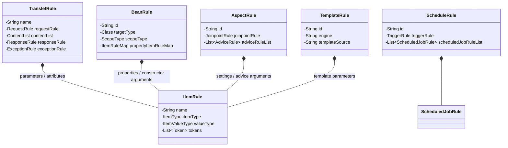

The [`com.aspectran.core.context.rule`](https://github.com/aspectran/aspectran/blob/master/core/src/main/java/com/aspectran/core/context/rule) package in the Aspectran framework represents the comprehensive **blueprint** object model that declaratively defines every application building block: Beans, Translets, Aspects, Schedules, Templates, Environments, and dynamic properties.

Aspectran strictly enforces the principle of **Separation of Declarative Definition from Runtime Execution**. Configurations authored in diverse representations—XML documents, APON (Aspectran Parameters Object Notation) text, or Java annotations—are parsed during the bootstrap phase into type-safe, plain Java objects (`*Rule` instances) and staged into memory. Downstream runtime engines, namely [`Activity`](https://github.com/aspectran/aspectran/blob/master/core/src/main/java/com/aspectran/core/activity/Activity.java) and [`CoreService`](https://github.com/aspectran/aspectran/blob/master/core/src/main/java/com/aspectran/core/service/CoreService.java), interpret these immutable rule structures to drive application behavior.

## 1. Rule Hierarchy and Core Object Tree

Aspectran's rule architecture forms a strict composite hierarchy spanning from top-level container rules down to atomic item rules.



### 1) 5 Top-Level Component Rules
- **[`TransletRule`](https://github.com/aspectran/aspectran/blob/master/core/src/main/java/com/aspectran/core/context/rule/TransletRule.java)**: Core container encapsulating the complete request processing lifecycle for a single translet.
- **[`BeanRule`](https://github.com/aspectran/aspectran/blob/master/core/src/main/java/com/aspectran/core/context/rule/BeanRule.java)**: Defines component metadata for beans instantiated, wired, and managed by the IoC container.
- **[`AspectRule`](https://github.com/aspectran/aspectran/blob/master/core/src/main/java/com/aspectran/core/context/rule/AspectRule.java)**: AOP aspect rule specifying joinpoint targeting criteria and advice execution chains.
- **[`ScheduleRule`](https://github.com/aspectran/aspectran/blob/master/core/src/main/java/com/aspectran/core/context/rule/ScheduleRule.java)**: Defines trigger recurrence rules and target translet jobs integrated with the Quartz engine.
- **[`TemplateRule`](https://github.com/aspectran/aspectran/blob/master/core/src/main/java/com/aspectran/core/context/rule/TemplateRule.java)**: Defines template engines, template resource locations, and inline template scripts for view rendering.

### 2) Data Unit Rule: [`ItemRule`](https://github.com/aspectran/aspectran/blob/master/core/src/main/java/com/aspectran/core/context/rule/ItemRule.java)
- The atomic data representation model configuring all request parameters, attributes, constructor arguments, and bean properties.

## 2. "Ability" Interface System for Composable Design

The [`com.aspectran.core.context.rule.ability`](https://github.com/aspectran/aspectran/blob/master/core/src/main/java/com/aspectran/core/context/rule/ability) package defines contract interfaces that modularize capabilities across rule implementations. Through these interfaces, the framework composes, traverses, and statically validates rules like Lego building blocks.

```mermaid
classDiagram
    direction TB
    class Replicable~T~ {
        <<interface>>
        +replicate() T
    }
    class BeanReferenceable {
        <<interface>>
        +getBeanId() String
        +getTargetType() Class
    }
    class HasActionRules {
        <<interface>>
        +getActionRuleList() ActionRuleList
    }
    class HasResponseRules {
        <<interface>>
        +getResponseRuleList() ResponseRuleList
    }
    class HasPropertyRules {
        <<interface>>
        +getPropertyItemRuleMap() ItemRuleMap
    }
    class HasParameterRules {
        <<interface>>
        +getParameterItemRuleMap() ItemRuleMap
    }
    class HasAttributeRules {
        <<interface>>
        +getAttributeItemRuleMap() ItemRuleMap
    }
    class HasArgumentRules {
        <<interface>>
        +getArgumentItemRuleMap() ItemRuleMap
    }

    TransletRule ..|> Replicable~TransletRule~
    TransletRule ..|> HasActionRules
    TransletRule ..|> HasResponseRules
    TransletRule ..|> HasParameterRules
    TransletRule ..|> HasAttributeRules
    BeanRule ..|> Replicable~BeanRule~
    BeanRule ..|> BeanReferenceable
    BeanRule ..|> HasPropertyRules
    BeanRule ..|> HasArgumentRules
    AspectRule ..|> Replicable~AspectRule~
```



### 1) Immutable Prototype Replication: [`Replicable<T>`](https://github.com/aspectran/aspectran/blob/master/core/src/main/java/com/aspectran/core/context/rule/ability/Replicable.java)
- **The Cornerstone of Thread Safety**:
  Parsed rule instances staged during bootstrap are retained in shared memory as **immutable prototypes**.
- When concurrent requests arrive in a multi-threaded environment, `Replicable.replicate()` clones an isolated rule instance for the active thread, fundamentally preventing race conditions or cross-request state corruption.

### 2) Bean Reference Integrity Tracking: [`BeanReferenceable`](https://github.com/aspectran/aspectran/blob/master/core/src/main/java/com/aspectran/core/context/rule/ability/BeanReferenceable.java)
- A marker contract implemented by rules that reference other beans in property setters or constructor arguments.
- During context building, [`BeanReferenceInspector`](https://github.com/aspectran/aspectran/blob/master/core/src/main/java/com/aspectran/core/context/rule/validation/BeanReferenceInspector.java) gathers all `BeanReferenceable` instances to comprehensively verify bean existence and catch circular dependencies before application startup.

### 3) Child Rule Ownership Ability Interfaces
- [`HasActionRules`](https://github.com/aspectran/aspectran/blob/master/core/src/main/java/com/aspectran/core/context/rule/ability/HasActionRules.java): Indicates that the rule can contain action rules (`<action>`, `<echo>`, `<headers>`, `<include>`) as children (`TransletRule`, `AdviceRule`, `ChooseWhenRule`).
- [`HasResponseRules`](https://github.com/aspectran/aspectran/blob/master/core/src/main/java/com/aspectran/core/context/rule/ability/HasResponseRules.java): Indicates that the rule can own response rules (`<transform>`, `<dispatch>`, `<redirect>`, `<forward>`) as children (`TransletRule`, `ExceptionThrownRule`).
- [`HasParameterRules`](https://github.com/aspectran/aspectran/blob/master/core/src/main/java/com/aspectran/core/context/rule/ability/HasParameterRules.java) / [`HasAttributeRules`](https://github.com/aspectran/aspectran/blob/master/core/src/main/java/com/aspectran/core/context/rule/ability/HasAttributeRules.java) / [`HasPropertyRules`](https://github.com/aspectran/aspectran/blob/master/core/src/main/java/com/aspectran/core/context/rule/ability/HasPropertyRules.java) / [`HasArgumentRules`](https://github.com/aspectran/aspectran/blob/master/core/src/main/java/com/aspectran/core/context/rule/ability/HasArgumentRules.java): Designate that the rule owns `ItemRule` maps representing parameters, attributes, properties, or arguments, respectively.

## 3. Deep Dive into 5 Top-Level Core Rules

### 1) Heart of Request-Response: [`TransletRule`](https://github.com/aspectran/aspectran/blob/master/core/src/main/java/com/aspectran/core/context/rule/TransletRule.java)
Encapsulates the complete execution pathway for a single web endpoint, CLI command, or scheduled task:
- **Routing Metadata**: Translet name (`name`), allowed HTTP methods (`allowedMethod`), asynchronous execution flags (`async`).
- **Request Rule ([`RequestRule`](https://github.com/aspectran/aspectran/blob/master/core/src/main/java/com/aspectran/core/context/rule/RequestRule.java))**: Character encoding, parameter and attribute validation constraints, request body parser rules.
- **Content and Action Pipeline ([`ContentList`](https://github.com/aspectran/aspectran/blob/master/core/src/main/java/com/aspectran/core/activity/process/ContentList.java))**: Ordered sequence of business action invocations.
- **Response Rule ([`ResponseRule`](https://github.com/aspectran/aspectran/blob/master/core/src/main/java/com/aspectran/core/context/rule/ResponseRule.java))**: Strategy executed upon successful action completion (Transform, Dispatch, Redirect, Forward).
- **Exception Mapping Rules ([`ExceptionRule`](https://github.com/aspectran/aspectran/blob/master/core/src/main/java/com/aspectran/core/context/rule/ExceptionRule.java))**: Declarative mappings routing specific exceptions to dedicated error responses or fallback views.

### 2) IoC Component Blueprint: [`BeanRule`](https://github.com/aspectran/aspectran/blob/master/core/src/main/java/com/aspectran/core/context/rule/BeanRule.java)
- **Identifier and Type**: Bean ID, target class ([`targetType`](https://github.com/aspectran/aspectran/blob/master/core/src/main/java/com/aspectran/core/context/rule/BeanRule.java#L87)), factory method ([`factoryMethodName`](https://github.com/aspectran/aspectran/blob/master/core/src/main/java/com/aspectran/core/context/rule/BeanRule.java#L93)).
- **Lifecycle Scope ([`ScopeType`](https://github.com/aspectran/aspectran/blob/master/core/src/main/java/com/aspectran/core/context/rule/type/ScopeType.java))**: `SINGLETON`, `PROTOTYPE`, `REQUEST`, `SESSION`.
- **Lifecycle Callbacks**: `initMethodName`, `destroyMethodName`.
- **Dependency Definitions**: Constructor argument list (`constructorArgumentList`), property injection map (`propertyItemRuleMap`).
- **AOP Proxy Marking ([`isProxied`](https://github.com/aspectran/aspectran/blob/master/core/src/main/java/com/aspectran/core/context/rule/BeanRule.java#L113))**: Activated at build time by `BeanRuleAnalyzer` when the bean is matched against AOP pointcuts.

### 3) AOP Cross-Cutting Concerns: [`AspectRule`](https://github.com/aspectran/aspectran/blob/master/core/src/main/java/com/aspectran/core/context/rule/AspectRule.java)
- **Joinpoint Rule ([`JoinpointRule`](https://github.com/aspectran/aspectran/blob/master/core/src/main/java/com/aspectran/core/context/rule/JoinpointRule.java))**: Target translet name patterns, bean method signature patterns, method type constraints.
- **Advice Rules ([`AdviceRule`](https://github.com/aspectran/aspectran/blob/master/core/src/main/java/com/aspectran/core/context/rule/AdviceRule.java))**: Interception phase (`BEFORE`, `AFTER`, `THROWN`, `FINALLY`) and target advice beans/methods.
- **Execution Order (`order`)**: Integer determining relative precedence when multiple aspects match the same joinpoint.

### 4) Batch and Scheduling: [`ScheduleRule`](https://github.com/aspectran/aspectran/blob/master/core/src/main/java/com/aspectran/core/context/rule/ScheduleRule.java)
- Scheduler identifier, initial startup delay (`startDelaySeconds`), Quartz Cron expressions or recurrence intervals.
- Ordered list of [`ScheduledJobRule`](https://github.com/aspectran/aspectran/blob/master/core/src/main/java/com/aspectran/core/context/rule/ScheduledJobRule.java) instances designating target translets to execute.

### 5) View Templates: [`TemplateRule`](https://github.com/aspectran/aspectran/blob/master/core/src/main/java/com/aspectran/core/context/rule/TemplateRule.java)
- Template engine name (`pebble`, `thymeleaf`, `freemarker`), resource location (`file`, `resource`, `url`), or inline template body.

## 4. Data Representation Unit: `ItemRule` and ASEL Token System

[`ItemRule`](https://github.com/aspectran/aspectran/blob/master/core/src/main/java/com/aspectran/core/context/rule/ItemRule.java) is the atomic building block for dynamic data expression and parameter binding across all Aspectran configuration models.

### 1) Structural & Value Type Support
- **Structure Type ([`ItemType`](https://github.com/aspectran/aspectran/blob/master/core/src/main/java/com/aspectran/core/context/rule/type/ItemType.java))**:
  - `SINGLE`: Scalar object
  - `ARRAY`: Array structure
  - `LIST`: Java `List` collection
  - `MAP`: Key-value `Map` collection
  - `PROPERTIES`: `java.util.Properties`
  - `SET`: Java `Set` collection
- **Value Type ([`ItemValueType`](https://github.com/aspectran/aspectran/blob/master/core/src/main/java/com/aspectran/core/context/rule/type/ItemValueType.java))**:
  - `STRING`, `INT`, `LONG`, `FLOAT`, `DOUBLE`, `BOOLEAN`, `PARAMETERS`

### 2) ASEL Token Parsing and Runtime Lazy Evaluation
`ItemRule` can embed dynamic expressions parsed into runtime tokens ([`Token`](https://github.com/aspectran/aspectran/blob/master/core/src/main/java/com/aspectran/core/context/asel/token/Token.java)):
- `#{beanId^property}`: Property value of a registered container bean
- `${paramName}`: Active request parameter value
- `@{attributeName}`: Active activity attribute value
- `%{propertyName}`: Dynamic environment property value
- `${ENV:VAR_NAME}`: Operating system environment variable
- `${SYS:sys.prop}`: JVM system property

## 5. Bi-Directional Rule Conversion Engine (`converter`)

Aspectran incorporates a robust bi-directional conversion engine capable of translating rule object hierarchies into APON parameter trees and vice versa.

- **[`RulesToParameters`](https://github.com/aspectran/aspectran/blob/master/core/src/main/java/com/aspectran/core/context/rule/converter/RulesToParameters.java)**:
  Serializes in-memory `TransletRule`, `BeanRule`, and `AspectRule` hierarchies into standard APON text syntax, facilitating configuration dumps or debugging console exports.
- **[`ParametersToRules`](https://github.com/aspectran/aspectran/blob/master/core/src/main/java/com/aspectran/core/context/rule/converter/ParametersToRules.java)**:
  Deserializes structured APON text hierarchies directly back into Java `*Rule` trees.

This bi-directional capability guarantees 100% lossless interoperability between XML configurations and APON configurations.

## 6. Large-Scale Modular Decomposition and Composition: `RuleAppender` Subsystem

To avoid monolithic configuration files, the [`RuleAppender`](https://github.com/aspectran/aspectran/blob/master/core/src/main/java/com/aspectran/core/context/rule/appender/RuleAppender.java) subsystem allows breaking configurations into domain- or feature-specific modules:

- **[`FileRuleAppender`](https://github.com/aspectran/aspectran/blob/master/core/src/main/java/com/aspectran/core/context/rule/appender/FileRuleAppender.java)**: Imports configuration files via relative or absolute paths on the local filesystem.
- **[`ResourceRuleAppender`](https://github.com/aspectran/aspectran/blob/master/core/src/main/java/com/aspectran/core/context/rule/appender/ResourceRuleAppender.java)**: Imports configuration files directly from classpath resources.
- **[`UrlRuleAppender`](https://github.com/aspectran/aspectran/blob/master/core/src/main/java/com/aspectran/core/context/rule/appender/UrlRuleAppender.java)**: Dynamically downloads and imports remote configurations over HTTP/HTTPS URLs.
- **[`ParametersRuleAppender`](https://github.com/aspectran/aspectran/blob/master/core/src/main/java/com/aspectran/core/context/rule/appender/ParametersRuleAppender.java)**: Directly merges in-memory `AspectranParameters` objects into the rule parsing pipeline.

```xml
<!-- Modular configuration example for enterprise applications -->
<aspectran>
    <append file="config/aspectran-common.xml"/>
    <append resource="com/aspectran/demo/user-translets.apon"/>
    <append resource="com/aspectran/demo/order-translets.apon"/>
</aspectran>
```

> **Related Detailed Mechanisms**:
> - For how rule objects are parsed and assembled into the live IoC container, see [ActivityContext Building Process](/en/docs/mechanisms/activity-context-building/).
> - For the runtime lifecycle where assembled rules are executed per request, see [Aspectran Activity Architecture](/en/docs/mechanisms/aspectran-activities/).
> - For the execution model of actions declared within translet rules, see [Aspectran Action Architecture](/en/docs/mechanisms/aspectran-actions/).

## 7. Next Steps: Exploring Detailed Mechanisms

To examine how declared rule objects are processed through the builder pipeline and indexed into the final `ActivityContext`, refer to the [ActivityContext Building Process](/en/docs/mechanisms/activity-context-building/) guide.

To inspect how all mechanisms and packages interconnect across the entire framework, refer to the **[Aspectran Detailed Mechanisms Index](/en/docs/mechanisms/)**.
