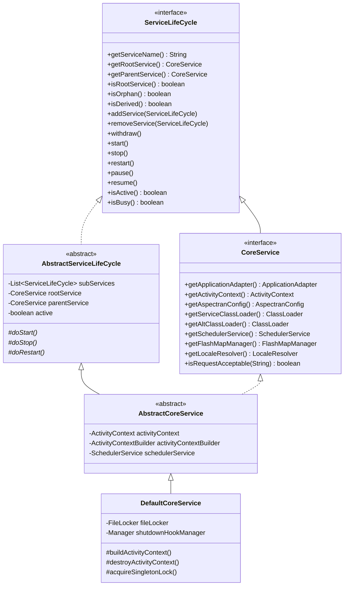
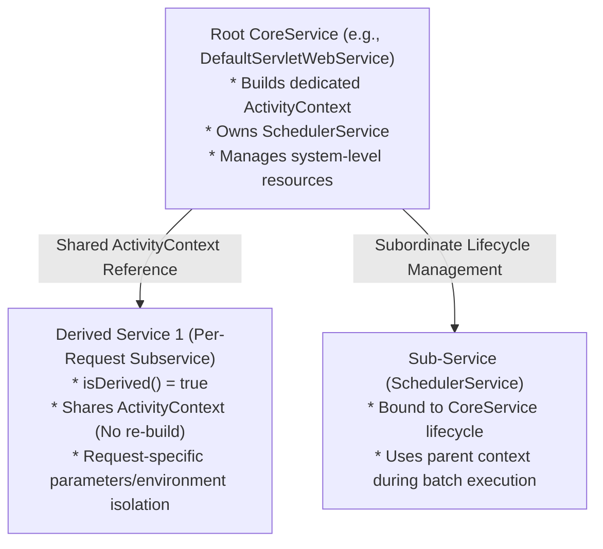
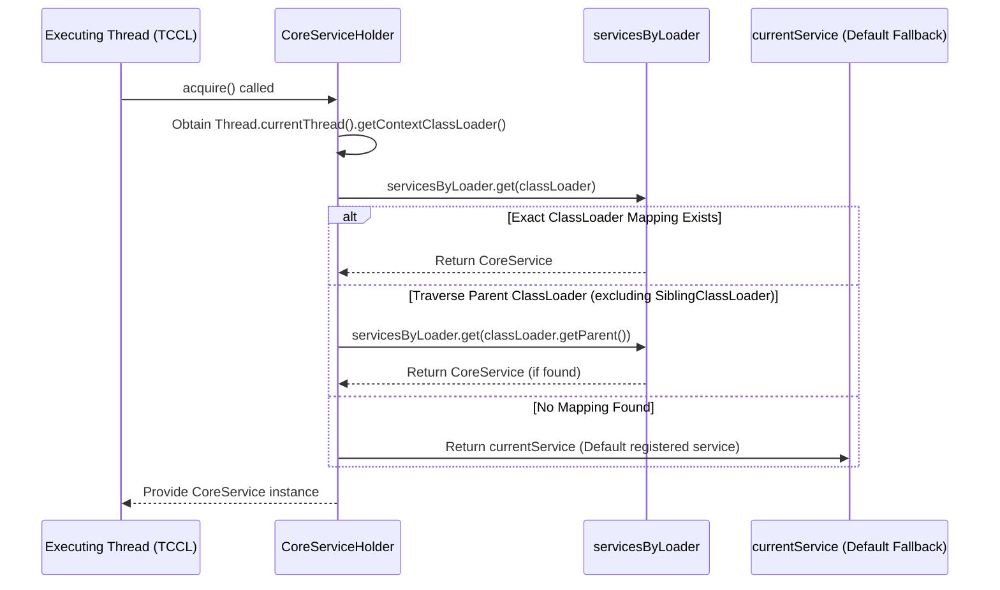
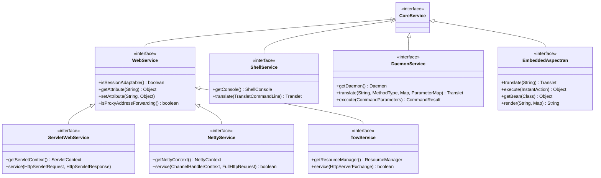
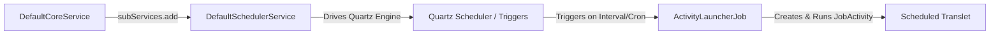

Aspectran's `Service` layer is the top-level orchestration container that manages the framework's lifecycle and acts as the entry point for diverse execution environments. From web application servers, high-performance asynchronous servlet-less networking engines, and background daemon processes, to interactive command-line shells and embedded libraries loaded into existing Java applications, every application entry point is bootstrapped and driven through dedicated service implementations.

The Aspectran service architecture shares a common core container ([`ActivityContext`](https://github.com/aspectran/aspectran/blob/master/core/src/main/java/com/aspectran/core/context/ActivityContext.java)) and lifecycle contracts, while being precisely designed under hierarchical abstraction and modularity principles to fully accommodate the unique characteristics of each runtime environment.

## 1. Top-Level Contracts: `CoreService` and `ServiceLifeCycle`

At the center of the Aspectran service ecosystem reside the [`CoreService`](https://github.com/aspectran/aspectran/blob/master/core/src/main/java/com/aspectran/core/service/CoreService.java) and [`ServiceLifeCycle`](https://github.com/aspectran/aspectran/blob/master/core/src/main/java/com/aspectran/core/service/ServiceLifeCycle.java) interfaces.



### `ServiceLifeCycle`: Transitive Tree Lifecycle Management

[`ServiceLifeCycle`](https://github.com/aspectran/aspectran/blob/master/core/src/main/java/com/aspectran/core/service/ServiceLifeCycle.java) controls the service state machine and governs hierarchical parent-child relationships between services.

- **State Control Methods**:
  - `start()`: Initializes the service and transitions it to the active state (`active = true`).
  - `stop()`: Shuts down and cleans up resources, cascading through associated child services, and deactivates the service.
  - `restart()`: Safely stops the service and restarts it with fresh configurations or resources. Can only be invoked on the root service (`isRootService() == true`).
  - `pause()`, `pause(timeout)`: Temporarily suspends request handling by rejecting or queuing incoming requests.
  - `resume()`: Restores a paused service back to active operation.
- **Hierarchy and Sub-service Orchestration**:
  - `addService(ServiceLifeCycle)` / `removeService(ServiceLifeCycle)`: Registers or unregisters child services under the parent service.
  - **Lifecycle Cascading**: Handled by [`AbstractServiceLifeCycle`](https://github.com/aspectran/aspectran/blob/master/core/src/main/java/com/aspectran/core/service/AbstractServiceLifeCycle.java), calls to `start()`, `stop()`, `pause()`, and `resume()` on a parent service are synchronously cascaded and sequentially propagated to all registered child services (`subServices`).
  - `withdraw()`: Detaches the service from its parent and withdraws from the service hierarchy.

### `CoreService`: Heart of the Framework Runtime

[`CoreService`](https://github.com/aspectran/aspectran/blob/master/core/src/main/java/com/aspectran/core/service/CoreService.java) extends beyond simple lifecycle management; it is the root interface providing access to all essential runtime components of an active Aspectran instance.

- **Context Access**: Returns the [`ActivityContext`](https://github.com/aspectran/aspectran/blob/master/core/src/main/java/com/aspectran/core/context/ActivityContext.java) wherein all Bean, Translet, and Aspect definitions are loaded.
- **Environment Abstraction**: Provides the top-level [`ApplicationAdapter`](https://github.com/aspectran/aspectran/blob/master/core/src/main/java/com/aspectran/core/adapter/ApplicationAdapter.java) that encapsulates the underlying execution environment (servlet container, embedded native server, OS process, etc.).
- **ClassLoader Isolation and Hot Reloading**: In addition to the primary service classloader ([`getServiceClassLoader()`](https://github.com/aspectran/aspectran/blob/master/core/src/main/java/com/aspectran/core/service/CoreService.java#L150)), it supports an alternate classloader ([`getAltClassLoader()`](https://github.com/aspectran/aspectran/blob/master/core/src/main/java/com/aspectran/core/service/CoreService.java#L156)) for dynamic class reloading and isolation.
- **Subsystem Infrastructure Management**: Oversees auxiliary subsystems including `FlashMapManager` for cross-redirect message passing, `LocaleResolver` for internationalization, and `SchedulerService` for asynchronous batch/scheduled workloads.

### `DefaultCoreService`: Bootstrapping Pipeline

[`DefaultCoreService`](https://github.com/aspectran/aspectran/blob/master/core/src/main/java/com/aspectran/core/service/DefaultCoreService.java) is the standard bootstrapper implementation extending `AbstractCoreService`, executing the following core bootstrapping pipeline:

1. **Configuration Injection and System Property Synchronization**:
   Parses [`AspectranConfig`](https://github.com/aspectran/aspectran/blob/master/core/src/main/java/com/aspectran/core/context/config/AspectranConfig.java) to configure password-based encryption algorithms (`PBEncryptionUtils`), system properties, and base directory paths (`basePath`).
2. **Singleton Instance File Locking (`FileLocker`)**:
   If the `context.singleton` configuration is enabled, it acquires an OS-level file lock ([`FileLocker`](https://github.com/aspectran/aspectran/blob/master/utils/src/main/java/com/aspectran/utils/FileLocker.java)) to fundamentally prevent concurrent execution of duplicate application instances.
3. **`ActivityContext` Building and Initialization**:
   Instantiates [`HybridActivityContextBuilder`](https://github.com/aspectran/aspectran/blob/master/core/src/main/java/com/aspectran/core/context/builder/HybridActivityContextBuilder.java) to parse XML, APON, and Java annotation rules, and builds and initializes (`initialize()`) the context.
4. **Child `SchedulerService` Creation**:
   If a scheduler configuration is declared, it automatically constructs a Quartz-based scheduler as a sub-service and binds its lifecycle.
5. **JVM Shutdown Hook Registration**:
   Registers a runtime shutdown hook to ensure safe release of file locks and graceful shutdown of context resources upon JVM termination.

## 2. Derived Services and Shared Context Model

A distinctive feature of the Aspectran service architecture is the **Derived Service** mechanism.



- **`isDerived()` Flag**:
  When a service is created in derived mode, it does not build its own `ActivityContext`. Instead, it directly shares the pre-built `ActivityContext` and `AspectranConfig` instances from its parent service ([`getParentService()`](https://github.com/aspectran/aspectran/blob/master/core/src/main/java/com/aspectran/core/service/CoreService.java#L49)).
- **Performance and Resource Conservation**:
  In large-scale enterprise environments, avoiding duplicate instantiations of heavyweight bean containers allows lightweight creation of sub-services tailored to distinct request entry points or isolated runtime parameters while sharing identical business components.
- **`isOrphan()` Determination Logic**:
  Determines whether a service lacks a parent or whether its parent is already active, enabling independent start/stop lifecycle management.

## 3. Global Runtime Registry: `CoreServiceHolder`

When multiple web applications, background workers, or OSGi/modular environments run concurrently within a single JVM, [`CoreServiceHolder`](https://github.com/aspectran/aspectran/blob/master/core/src/main/java/com/aspectran/core/service/CoreServiceHolder.java) acts as the central static hub assisting arbitrary threads in locating their corresponding `CoreService`.

### ClassLoader-Based Service Routing and Lookup Architecture

`CoreServiceHolder` registers and looks up services using thread-safe concurrent maps (`ConcurrentHashMap`).



- **Multi-Context Isolation**:
  By mapping individual `CoreService` instances using servlet container `WebAppClassLoader` or sub-module classloaders as keys (`ClassLoader`), multiple distinct applications coexisting in the same JVM remain strictly isolated without context cross-contamination.
- **Class-Based Mapping**:
  Supports binding by specific Bean class types ([`CoreServiceHolder.hold(Class<?>, CoreService)`](https://github.com/aspectran/aspectran/blob/master/core/src/main/java/com/aspectran/core/service/CoreServiceHolder.java#L128)), allowing static utilities or framework plugins to immediately resolve the active context.
- **`ServiceHoldingListener`**:
  Receives lifecycle events when a service is registered (`afterServiceHolding`) or released (`beforeServiceRelease`) in the holder, facilitating coordination with external monitoring or distributed lock engines.

## 4. Environment-Specific Specialized Service Implementations

Building upon `DefaultCoreService`, six specialized service implementations provide dedicated entry points and communication protocol handlers for each runtime environment.



### 1) Servlet Web Service: `ServletWebService` (`DefaultServletWebService`)

[`ServletWebService`](https://github.com/aspectran/aspectran/blob/master/web-servlet/src/main/java/com/aspectran/web/servlet/service/ServletWebService.java) serves as the seamless bridge to Jakarta Servlet containers (Servlet 6.0+) including Apache Tomcat, Jetty, and Red Hat WildFly.

- **Primary Entry Point**:
  The [`service(HttpServletRequest, HttpServletResponse)`](https://github.com/aspectran/aspectran/blob/master/web-servlet/src/main/java/com/aspectran/web/servlet/service/ServletWebService.java#L67) method is invoked by the front controller servlet (`WebActivityServlet`).
- **Key Features and Behavior**:
  - **URI Decoding and Normalization**: Restores the requested URI according to configured encoding rules and extracts the context path.
  - **Static Resource and DefaultServlet Delegation**: Requests that do not match registered translet rules ([`!isRequestAcceptable(requestName)`](https://github.com/aspectran/aspectran/blob/master/web-servlet/src/main/java/com/aspectran/web/servlet/service/DefaultServletWebService.java#L91)) are forwarded to the container's default servlet handler (`DefaultServletHttpRequestHandler`) to serve CSS, JS, and image assets at wire speed.
  - **Servlet 3.0+ Asynchronous Request Handling**: Detects `request.isAsyncStarted()` states and manages asynchronous processing cycles until the background thread completes response generation.
  - **Context Binding**: Binds the root service to `ServletContext` attributes (`ROOT_WEB_SERVICE_ATTR_NAME`), making the service globally accessible across the entire web application.

### 2) High-Performance Servlet-less Web Service: `NettyService` (`DefaultNettyService`)

[`NettyService`](https://github.com/aspectran/aspectran/blob/master/with-netty/src/main/java/com/aspectran/netty/service/NettyService.java) completely eliminates Servlet API overhead, processing HTTP/1.1 and HTTP/2 on top of Netty's non-blocking event loops (`EventLoopGroup`).

- **Primary Entry Point**:
  [`service(ChannelHandlerContext ctx, FullHttpRequest request)`](https://github.com/aspectran/aspectran/blob/master/with-netty/src/main/java/com/aspectran/netty/service/NettyService.java#L78)
- **Key Features and Behavior**:
  - Invoked directly from the inbound handler of the Netty pipeline, wrapping zero-copy buffers ([`ByteBuf`](https://github.com/aspectran/aspectran/blob/master/with-netty/src/main/java/com/aspectran/netty/service/DefaultNettyService.java#L35)) and native request objects into dedicated activity instances ([`NettyActivity`](https://github.com/aspectran/aspectran/blob/master/with-netty/src/main/java/com/aspectran/netty/activity/NettyActivity.java)).
  - When the framework is suspended (`checkPaused`), it immediately returns an HTTP 503 (Service Unavailable) status and manages socket connections.
  - Direct integration with Aspectran's built-in [`SessionManager`](https://github.com/aspectran/aspectran/blob/master/core/src/main/java/com/aspectran/core/component/session/SessionManager.java) provides full clustered and in-memory session capabilities even in servlet-free environments.

### 3) Ultra-Lightweight Embedded Web Service: `TowService` (`DefaultTowService`)

[`TowService`](https://github.com/aspectran/aspectran/blob/master/with-undertow/src/main/java/com/aspectran/undertow/service/TowService.java) directly bridges the asynchronous handler architecture of JBoss Undertow.

- **Primary Entry Point**:
  [`service(HttpServerExchange exchange)`](https://github.com/aspectran/aspectran/blob/master/with-undertow/src/main/java/com/aspectran/undertow/service/TowService.java#L52)
- **Key Features and Behavior**:
  - Bypasses servlet abstraction layers to directly manipulate Undertow's native [`HttpServerExchange`](https://github.com/aspectran/aspectran/blob/master/with-undertow/src/main/java/com/aspectran/undertow/service/TowService.java#L19), achieving an exceptionally low memory footprint.
  - Integrates the native [`ResourceManager`](https://github.com/aspectran/aspectran/blob/master/with-undertow/src/main/java/com/aspectran/undertow/service/TowService.java#L20) to directly stream static assets from classpath or external file directories.

### 4) Interactive CLI Shell Service: `ShellService` (`DefaultShellService`)

[`ShellService`](https://github.com/aspectran/aspectran/blob/master/shell/src/main/java/com/aspectran/shell/service/ShellService.java) integrates the JLine3 library to deliver a rich terminal console interface featuring ANSI color formatting, command autocompletion, and persistent history.

- **Primary Entry Point**:
  [`translate(TransletCommandLine transletCommandLine)`](https://github.com/aspectran/aspectran/blob/master/shell/src/main/java/com/aspectran/shell/service/ShellService.java#L93)
- **Key Features and Behavior**:
  - Parses terminal commands into [`TransletCommandLine`](https://github.com/aspectran/aspectran/blob/master/shell/src/main/java/com/aspectran/shell/command/TransletCommandLine.java) objects containing parsed options (`-option`), arguments, and request parameters.
  - Interacts via [`ShellConsole`](https://github.com/aspectran/aspectran/blob/master/shell/src/main/java/com/aspectran/shell/console/ShellConsole.java) for real-time interactive I/O while preserving CLI session state across command invocations via a CLI session adapter.

### 5) Background Daemon Service: `DaemonService` (`DefaultDaemonService`)

[`DaemonService`](https://github.com/aspectran/aspectran/blob/master/daemon/src/main/java/com/aspectran/daemon/service/DaemonService.java) supports background daemon processes running as persistent services on Unix/Linux/Windows operating systems.

- **Primary Entry Points**:
  - Business Translet Execution: [`translate(String name, MethodType method, Map, ParameterMap)`](https://github.com/aspectran/aspectran/blob/master/daemon/src/main/java/com/aspectran/daemon/service/DaemonService.java#L89)
  - Administrative Command Execution: [`execute(CommandParameters)`](https://github.com/aspectran/aspectran/blob/master/daemon/src/main/java/com/aspectran/daemon/service/DaemonService.java#L102) / [`execute(String apon)`](https://github.com/aspectran/aspectran/blob/master/daemon/src/main/java/com/aspectran/daemon/service/DaemonService.java#L113)
- **Key Features and Behavior**:
  - **Integration with 4 Daemon Bridges**: Cooperates seamlessly with `DefaultDaemon` (standalone thread), `ProcrunDaemon` (Windows Service), `JsvcDaemon` (Apache Commons Daemon), and `SimpleDaemon` (lightweight runner).
  - **Dual Command Branching**: When the service is paused (`pause`), business translet (`translate`) requests are blocked, while administrative commands (`execute`) remain active to handle restarts, health checks, and hot reloading.
  - **Asynchronous File Commander ([`FileCommander`](https://github.com/aspectran/aspectran/blob/master/daemon/src/main/java/com/aspectran/daemon/command/polling/FileCommander.java))**: Periodically polls designated command drop directories, automatically executing incoming command files and writing results back to disk.

### 6) Embedded Library Facade: `EmbeddedAspectran` (`DefaultEmbeddedAspectran`)

[`EmbeddedAspectran`](https://github.com/aspectran/aspectran/blob/master/embed/src/main/java/com/aspectran/embed/service/EmbeddedAspectran.java) provides a high-level facade API designed for embedding Aspectran as a lightweight component within existing external Java runtimes such as Spring Boot, Quarkus, or Java SE desktop applications.

- **Factory Bootstrap**:
  ```java
  EmbeddedAspectran aspectran = EmbeddedAspectran.run("config/aspectran-config.apon");
  ```
- **Intuitive Operations**:
  - Translet Execution: `aspectran.translate("myTranslet", parameterMap)`
  - Instant Action Execution: `aspectran.execute((activity) -> { return activity.getBean("myBean"); })`
  - Bean Lookup: `aspectran.getBean(MyService.class)`
  - Template Rendering: `aspectran.render("welcomeTemplate", modelMap)`
  - Resource Teardown: `aspectran.destroy()`

## 5. Feature Extension Sub-Service: `SchedulerService`

[`SchedulerService`](https://github.com/aspectran/aspectran/blob/master/core/src/main/java/com/aspectran/core/scheduler/service/SchedulerService.java) is a primary child service (sub-service) bound to `CoreService` that delivers fully integrated Quartz-based scheduling.



- **Lifecycle Synchronization**:
  `SchedulerService` is not started independently; its lifecycle is bound to the parent `CoreService`, automatically starting, stopping, pausing, and resuming in tandem with the parent.
- **Declarative Schedule Rule (`ScheduleRule`) Mapping**:
  Parses Cron expressions or interval schedules declared in XML or APON configurations and translates them automatically into Quartz `JobDetail` and `Trigger` instances.
- **Seamless Context Integration (`ActivityLauncherJob`)**:
  When a schedule triggers, Aspectran's specialized job runner `ActivityLauncherJob` is executed. This job instantiates a [`JobActivity`](https://github.com/aspectran/aspectran/blob/master/core/src/main/java/com/aspectran/core/scheduler/activity/JobActivity.java) bound to the parent service's `ActivityContext`, enabling batch jobs to benefit from dependency injection, AOP transactions, and template rendering exactly like standard web requests.
- **Distributed Job Locking ([`ScheduledJobLockProvider`](https://github.com/aspectran/aspectran/blob/master/core/src/main/java/com/aspectran/core/component/schedule/ScheduledJobLockProvider.java))**:
  In multi-node cluster deployments, it provides a distributed lock mechanism to ensure scheduled tasks run on only one instance at a time.
- **Fine-Grained Schedule Control**:
  In addition to pausing the entire scheduler (`pauseAll()`), individual schedule rules can be suspended (`pause(scheduleId)`) or resumed (`resume(scheduleId)`) on demand.

## 6. Comprehensive Service Implementation Comparison Matrix

| Service | Primary Implementation | Target Execution Environment | Entry Method | Native Communication Object | Session Support | Key Characteristics |
| :--- | :--- | :--- | :--- | :--- | :--- | :--- |
| **Servlet Web** | [`DefaultServletWebService`](https://github.com/aspectran/aspectran/blob/master/web-servlet/src/main/java/com/aspectran/web/servlet/service/DefaultServletWebService.java) | Servlet containers (Tomcat, Jetty, WildFly) | `service(HttpServletRequest, HttpServletResponse)` | `HttpServletRequest`, `HttpServletResponse` | Servlet Session Bridge | DefaultServlet static asset delegation, Servlet 3.0+ async context |
| **Netty** | [`DefaultNettyService`](https://github.com/aspectran/aspectran/blob/master/with-netty/src/main/java/com/aspectran/netty/service/DefaultNettyService.java) | Microservices, Servlet-less HTTP/2 | `service(ChannelHandlerContext, FullHttpRequest)` | Netty `FullHttpRequest`, `ChannelHandlerContext` | Aspectran SessionManager | Servlet-free, non-blocking event loops, zero-copy buffer handling |
| **Undertow** | [`DefaultTowService`](https://github.com/aspectran/aspectran/blob/master/with-undertow/src/main/java/com/aspectran/undertow/service/DefaultTowService.java) | Lightweight embedded web | `service(HttpServerExchange)` | Undertow `HttpServerExchange` | Aspectran SessionManager | Minimal memory footprint, direct native ResourceManager binding |
| **Shell** | [`DefaultShellService`](https://github.com/aspectran/aspectran/blob/master/shell/src/main/java/com/aspectran/shell/service/DefaultShellService.java) | Interactive Terminal (CLI) | `translate(TransletCommandLine)` | `TransletCommandLine`, `ShellConsole` | Shell Session Adapter | JLine3-based ANSI terminal handling, autocompletion & history |
| **Daemon** | [`DefaultDaemonService`](https://github.com/aspectran/aspectran/blob/master/daemon/src/main/java/com/aspectran/daemon/service/DefaultDaemonService.java) | OS background persistent process | `translate(...)` / `execute(...)` | `CommandParameters`, `CommandResult` | Daemon Session Adapter | 4 daemon bridges, dual business/admin command branching, file polling |
| **Embed** | [`DefaultEmbeddedAspectran`](https://github.com/aspectran/aspectran/blob/master/embed/src/main/java/com/aspectran/embed/service/DefaultEmbeddedAspectran.java) | Embedded in Java apps / tests | `translate(...)` / `execute(...)` / `getBean(...)` | `AspectranActivity`, `InstantActivity` | In-Memory Session | Clean high-level facade API, `run()` factory methods |
| **Scheduler** | [`DefaultSchedulerService`](https://github.com/aspectran/aspectran/blob/master/core/src/main/java/com/aspectran/core/scheduler/service/DefaultSchedulerService.java) | Recurring / Batch execution engine | `ActivityLauncherJob.execute()` | Quartz `JobExecutionContext` | Non-session | Bound child service to `CoreService`, distributed job locking |

> **Related Detailed Mechanisms**:
> - For the detailed structure and lifecycle of the individual execution unit instantiated when a service receives a request, see [Aspectran Activity Architecture](/en/docs/mechanisms/aspectran-activities/).
> - For how heterogeneous native environments are wrapped into unified contracts, see [Aspectran Adapter Architecture](/en/docs/mechanisms/aspectran-adapters/).
> - For detailed bootstrapping mechanics and multi-runtime server setups, see [Aspectran Execution Environments Architecture](/en/docs/mechanisms/aspectran-execution-environments/).

## 7. Next Steps: Exploring Detailed Mechanisms

When an incoming request reaches an Aspectran service, the service encapsulates the entire execution flow inside an [`Activity`](https://github.com/aspectran/aspectran/blob/master/core/src/main/java/com/aspectran/core/activity/Activity.java) instance and delegates control to it.

To explore how these core mechanisms and packages interconnect across the entire framework, refer to the **[Aspectran Detailed Mechanisms Index](/en/docs/mechanisms/)**.
