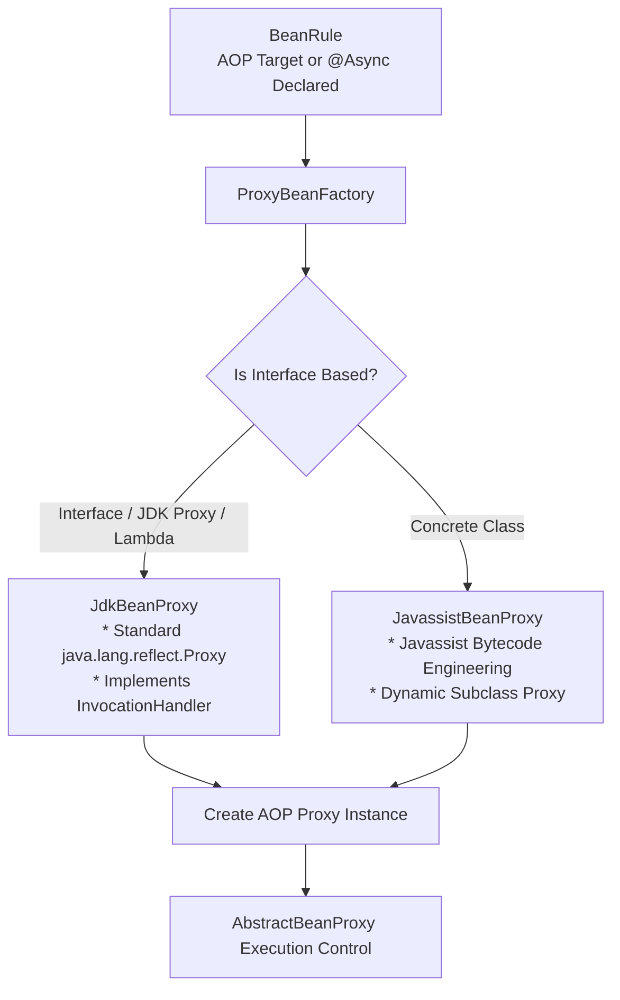
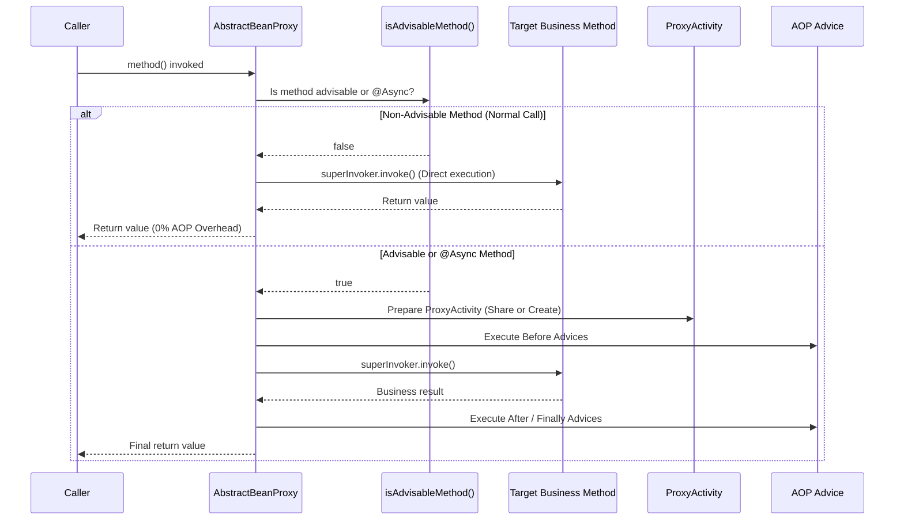
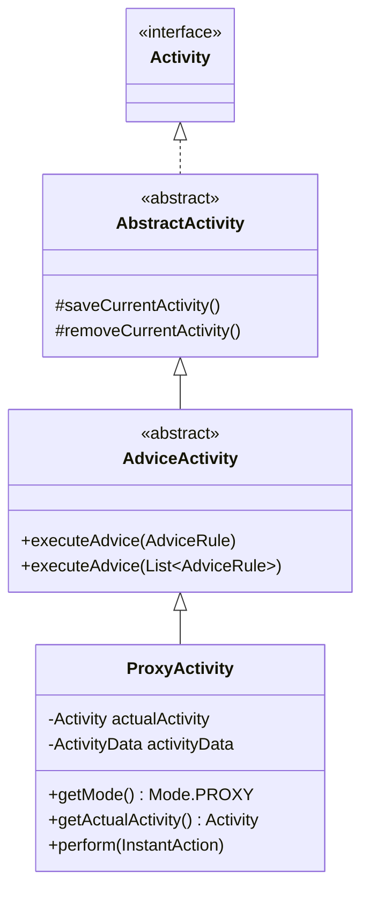
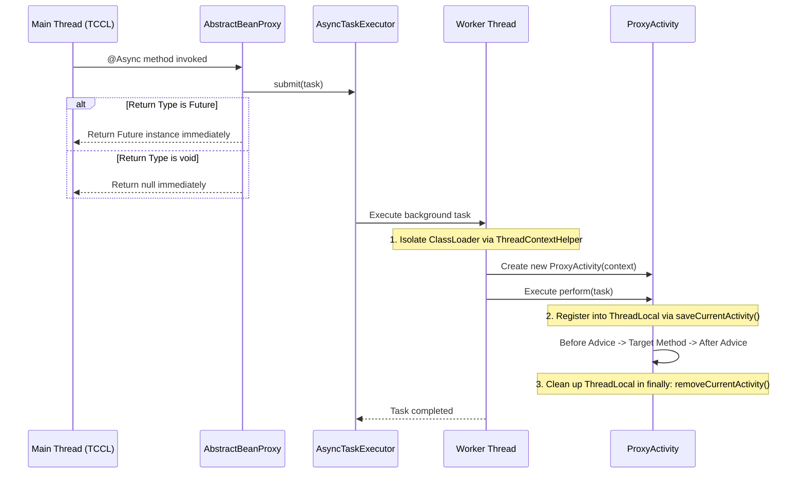

Aspectran's Aspect-Oriented Programming (AOP) proxy mechanism is engineered to achieve **maximum runtime performance**, **flawless context propagation**, and **strict thread isolation** in asynchronous (`@Async`) execution environments.

Traditional AOP frameworks incur noticeable runtime overhead by inspecting interceptor chains, evaluating pointcuts, and assembling context frames on every method call across proxied beans. Aspectran eliminates this penalty by combining static pre-analysis at bootstrap ([`BeanRuleAnalyzer`](https://github.com/aspectran/aspectran/blob/master/core/src/main/java/com/aspectran/core/component/bean/BeanRuleAnalyzer.java)), selective runtime interception ([`AbstractBeanProxy`](https://github.com/aspectran/aspectran/blob/master/core/src/main/java/com/aspectran/core/component/bean/proxy/AbstractBeanProxy.java)), and a dedicated lightweight advice execution container ([`ProxyActivity`](https://github.com/aspectran/aspectran/blob/master/core/src/main/java/com/aspectran/core/activity/ProxyActivity.java)), delivering a near zero-overhead AOP runtime.

## 1. Proxy Generation Architecture: `ProxyBeanFactory`

When a bean requires AOP aspects or the `@Async` annotation, the IoC container delegates to [`ProxyBeanFactory`](https://github.com/aspectran/aspectran/blob/master/core/src/main/java/com/aspectran/core/component/bean/proxy/ProxyBeanFactory.java) to instantiate the optimal proxy representation.



### 1) Dual Proxy Generation Strategy
- **Interface-Based Beans**: If the target class is an interface, an existing JDK proxy, or a lambda class, the container creates a reflection-based [`JdkBeanProxy`](https://github.com/aspectran/aspectran/blob/master/core/src/main/java/com/aspectran/core/component/bean/proxy/JdkBeanProxy.java).
- **Concrete Class-Based Beans**: For classes lacking interfaces, the container generates a dynamic subclass proxy ([`JavassistBeanProxy`](https://github.com/aspectran/aspectran/blob/master/core/src/main/java/com/aspectran/core/component/bean/proxy/JavassistBeanProxy.java)) utilizing high-performance Javassist bytecode manipulation.
- **[`SuperInvoker`](https://github.com/aspectran/aspectran/blob/master/core/src/main/java/com/aspectran/core/component/bean/proxy/SuperInvoker.java)**: A unified callback contract abstracting original (`super`) method invocation across both Javassist and JDK dynamic proxies.

### 2) Pre-Determination of Proxies at Bootstrap ([`BeanRuleAnalyzer`](https://github.com/aspectran/aspectran/blob/master/core/src/main/java/com/aspectran/core/component/bean/BeanRuleAnalyzer.java))
During context building, `BeanRuleAnalyzer.determineProxyBean()` statically checks registered `AspectRule` pointcuts against candidate bean methods. Only beans matched by at least one aspect rule have their proxy flag activated ([`beanRule.setProxied(true)`](https://github.com/aspectran/aspectran/blob/master/core/src/main/java/com/aspectran/core/context/rule/BeanRule.java#L113)). Beans unaffected by aspects operate as pure POJOs without proxy wrappers or overhead.

## 2. Core Execution Controller: `AbstractBeanProxy`

[`AbstractBeanProxy`](https://github.com/aspectran/aspectran/blob/master/core/src/main/java/com/aspectran/core/component/bean/proxy/AbstractBeanProxy.java) is the top-level abstract class shared by both JDK and Javassist proxies, governing method interception and advice dispatching.



### 1) Zero-Overhead Selective Interception ([`isAdvisableMethod`](https://github.com/aspectran/aspectran/blob/master/core/src/main/java/com/aspectran/core/component/bean/proxy/AbstractBeanProxy.java#L105))
When any method on a proxied bean is invoked, `AbstractBeanProxy` first verifies whether the method is advisable:
- If the method is not matched by an `AdviceRule` and lacks `@Async`, the proxy immediately delegates to [`superInvoker.invoke()`](https://github.com/aspectran/aspectran/blob/master/core/src/main/java/com/aspectran/core/component/bean/proxy/AbstractBeanProxy.java#L132) without context switching or rule evaluations.
- This design completely eliminates proxy penalties from getters, setters, and auxiliary helper methods inside the proxied class.

### 2) Synchronous & Asynchronous Dispatching
- When `@Async` is detected: The call routes to the asynchronous pipeline (`invokeAsync`), submitting the task to [`AsyncTaskExecutor`](https://github.com/aspectran/aspectran/blob/master/core/src/main/java/com/aspectran/core/component/bean/async/AsyncTaskExecutor.java).
- When standard `@Advisable` is present: The call routes to the synchronous pipeline (`invokeSync`), executing advice chains inline on the caller's thread.

### 3) Method Hint Scanner ([`ProxyHintScanner`](https://github.com/aspectran/aspectran/blob/master/core/src/main/java/com/aspectran/core/component/bean/proxy/ProxyHintScanner.java))
Scans `@Hint` annotations on bean methods to construct parameter hint structures ([`HintParameters`](https://github.com/aspectran/aspectran/blob/master/core/src/main/java/com/aspectran/core/activity/HintParameters.java)). Before invocation, hints (such as MyBatis SQL query hints or cache keys) are pushed onto the active activity stack (`activity.pushHint(hints)`) and reliably popped in the finally block (`popHint()`).

## 3. Lightweight Advice Execution Engine: `ProxyActivity`

[`ProxyActivity`](https://github.com/aspectran/aspectran/blob/master/core/src/main/java/com/aspectran/core/activity/ProxyActivity.java) is a specialized execution engine stripped of heavy web routing and response rendering overhead, focused strictly on **AOP advice dispatching and asynchronous context isolation**.



### 1) Two Instantiation Modes: Independent vs. Wrapping
`ProxyActivity` dynamically adapts to its calling environment via two constructors:
- **Independent Mode (`new ProxyActivity(context)`)**:
  - Instantiated when no active `Activity` exists on the current thread (e.g., standalone worker threads or background tasks).
  - Initializes its own isolated [`ActivityData`](https://github.com/aspectran/aspectran/blob/master/core/src/main/java/com/aspectran/core/activity/ActivityData.java) frame, executing advice in complete isolation.
- **Wrapping Mode (`new ProxyActivity(actualActivity)`)**:
  - Instantiated when an active `Activity` (e.g., `ServletWebActivity`) already exists on the caller thread.
  - Wraps the active activity ([`actualActivity`](https://github.com/aspectran/aspectran/blob/master/core/src/main/java/com/aspectran/core/activity/ProxyActivity.java#L35)) and **directly shares its `ActivityData` and execution context**. AOP advice methods can seamlessly inspect incoming HTTP request parameters, session attributes, or request scopes.

### 2) Explicit Role Boundaries
Because `ProxyActivity` does not perform HTTP routing or template rendering, calls to irrelevant methods (`getTranslet()`, `getDeclaredResponse()`) immediately throw `UnsupportedOperationException`, strictly enforcing architectural boundaries.

## 4. Asynchronous (`@Async`) Execution & Worker Thread Context Propagation

During `@Async` invocations, `AbstractBeanProxy` and `ProxyActivity` coordinate asynchronous context propagation and resource teardown across worker thread pools.



1. **Return Type Validation**:
   Methods marked with `@Async` must return `void` or implement `java.util.concurrent.Future`. Any other return type results in an immediate [`AsyncExecutionException`](https://github.com/aspectran/aspectran/blob/master/core/src/main/java/com/aspectran/core/component/bean/async/AsyncExecutionException.java).
2. **Context Creation in Worker Threads**:
   Because the worker thread possesses no prior activity, an independent-mode `ProxyActivity` is created.
3. **Context Reuse on Chained Calls**:
   If the asynchronous method internally invokes other `@Advisable` methods on the same or other beans, the proxy detects the existing `ProxyActivity` in the worker thread's `ThreadLocal` and reuses it without allocating redundant context objects.
4. **Guaranteed ThreadLocal Teardown**:
   When the asynchronous execution completes, the `finally` block of `perform()` invokes `removeCurrentActivity()`, cleanly detaching the activity and preventing thread-pool memory leaks.

## 5. Four-Stage AOP Joinpoint Processing Lifecycle

When an advisable method executes, `AbstractBeanProxy` drives the following deterministic four-stage lifecycle:

```mermaid
graph TD
    Start[Method Invocation] --> Before[1. BEFORE Advice<br/>* Start transaction<br/>* Authorization checks]
    Before --> Exec[2. Target Business Method Execution<br/>superInvoker.invoke()]
    Exec --> Success{Exception Occurred?}

    Success -->|Normal Execution| After[3. AFTER Advice<br/>* Commit transaction<br/>* Audit log generation]
    Success -->|Exception Thrown| Thrown[3. THROWN Advice<br/>* Rollback transaction<br/>* Exception logging & recovery]

    After --> Finally[4. FINALLY Advice<br/>* Pop hint stack<br/>* Resource cleanup]
    Thrown --> Finally
    Finally --> End[Return result or rethrow exception]
```

1. **Before Advice**: Runs prior to business logic, performing authorization checks, input validation, or distributed lock acquisition. Throws [`AdviceConstraintViolationException`](https://github.com/aspectran/aspectran/blob/master/core/src/main/java/com/aspectran/core/activity/aspect/AdviceConstraintViolationException.java) to abort execution if constraints are violated.
2. **Target Method Invocation**: Invokes original business logic through `superInvoker.invoke()`.
3. **After Advice**: Executes immediately following successful method execution to post-process results or emit events.
4. **Thrown Advice**: Invoked if an exception occurs during business execution, triggering transaction rollbacks or wrapping root causes into domain exceptions.
5. **Finally Advice**: Runs unconditionally after normal completion or exception handling, guaranteeing invocation of `activity.popHint()` and resource teardown.

> **Related Detailed Mechanisms**:
> - For the overarching advice execution engine, see [Aspectran Activity Architecture](/en/docs/mechanisms/aspectran-activities/).
> - For the IoC container model that registers and wires proxy beans, see [ActivityContext: The Heart of the Aspectran Container](/en/docs/mechanisms/activity-context/).
> - For how aspects and joinpoints are declared, see [Aspectran Rule Architecture](/en/docs/mechanisms/aspectran-rule-architecture/).

## 6. Next Steps: Exploring Detailed Mechanisms

To examine the memory management models governing the lifecycle scopes (Singleton, Prototype, Request, Session) of proxied beans, refer to the [Aspectran Bean Scopes Architecture](/en/docs/mechanisms/aspectran-bean-scopes/) guide.

To inspect how all mechanisms and packages interconnect across the entire framework, refer to the **[Aspectran Detailed Mechanisms Index](/en/docs/mechanisms/)**.
