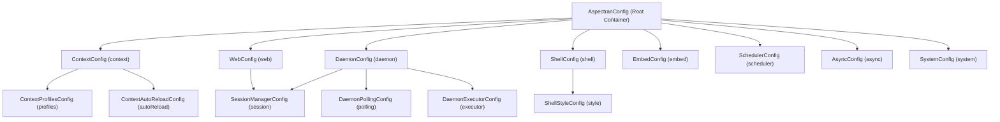

## 1. Design Goals and Primary Roles

The `com.aspectran.core.context.config` package provides a **cohesive set of type-safe APON parameter container classes** that encapsulate all configuration properties across every execution environment and functional subsystem of the Aspectran framework.

The core architectural objectives of this package are:

*   **Object Modeling and Strong Type Safety for Configurations**: Parses text-based configuration declarations (APON, XML) directly into strongly typed Java object models, allowing validated access via compile-time verification and intuitive getter/setter methods.
*   **Deep Integration with APON (Aspectran Parameters Object Notation) Engine**: All configuration classes extend `com.aspectran.utils.apon.DefaultParameters`, forming a hierarchical parameter tree that maps 1:1 with concise, human-readable APON syntax.
*   **Maximum Modularity Across Execution Environments**: Strictly decouples configuration scopes into functional modules—web (`WebConfig`), daemon (`DaemonConfig`), interactive shell (`ShellConfig`), embedded (`EmbedConfig`), scheduler (`SchedulerConfig`), asynchronous executor (`AsyncConfig`), and system properties (`SystemConfig`)—eliminating unwanted coupling.
*   **Commitment to Configuration Immutability**: Objects populated by `ActivityContextBuilder` during the bootstrap phase remain effectively immutable throughout application runtime, guaranteeing predictable state and system consistency.

## 2. Key Classes and Configuration Parameter Hierarchy



### `AspectranConfig` (Top-Level Root Class)

The top-level root parameter container representing an Aspectran configuration file (`aspectran-config.apon`).

*   **Core Responsibilities and Parameter Blocks**:
    *   `system`: Injects JVM-global system properties (`System.setProperty`) via a `SystemConfig` block.
    *   `context`: Core context configuration block (`ContextConfig`) essential to all Aspectran applications.
    *   `web` / `daemon` / `shell` / `embed`: Environment-specific configuration blocks for respective runtimes.
    *   `scheduler`: Background Quartz scheduler runtime options block (`SchedulerConfig`).
    *   `async`: Worker thread pool settings block (`AsyncConfig`) for `@Async` asynchronous methods.

### `ContextConfig` (Core Context Configuration)

Defines fundamental information required to construct the `ActivityContext`, independent of the target runtime environment.

*   **Key Parameter Breakdown**:
    *   `basePath`: Root base directory path of the application. All relative resource paths resolve against this base path.
    *   `rules`: List of XML/APON resource paths (`String[]`) defining primary business rules (Beans, Translets, Aspects, Schedules).
    *   `basePackages`: Base packages (`String[]`) scanned automatically for annotations such as `@Component`, `@Bean`, and `@Aspect`.
    *   `resources`: Dynamic class and JAR resource locations (`resourceLocations`) dynamically loaded by `SiblingClassLoader`.
    *   `profiles`: `ContextProfilesConfig` block defining active environment profiles.
    *   `autoReload`: `ContextAutoReloadConfig` block configuring automatic context reloads upon file modifications.

### `ContextProfilesConfig` and `ContextAutoReloadConfig`

*   **`ContextProfilesConfig`**:
    *   `baseProfiles`: Baseline profiles unconditionally active across all environments.
    *   `defaultProfiles`: Fallback profiles activated only when no active profiles are specified.
    *   `activeProfiles`: Profiles explicitly activated for the current runtime (e.g., `dev`, `prod`, `qa`).
*   **`ContextAutoReloadConfig`**:
    *   `enabled`: Toggles automated file reloading (`true` / `false`).
    *   `scanIntervalSeconds`: Resource timestamp scan interval in seconds.
    *   `reloadMode`: Classloader update policy (`soft` for cache refresh / `hard` for `SiblingClassLoader` recreation).

### `WebConfig` (Web Runtime Configuration)

Common web configuration referenced identically across all web runtimes: Servlet (`aspectran-web-servlet`), Undertow (`aspectran-undertow`), and Netty (`aspectran-netty`).

*   `uriDecoding`: Character encoding used to decode incoming HTTP request URIs (e.g., `UTF-8`).
*   `trailingSlashRedirect`: Toggles automatic HTTP 301/302 redirects when resolving translet mappings with or without trailing slashes (`/`).
*   `proxyAddressForwarding`: Enables trust for reverse proxy headers (`X-Forwarded-For`, `X-Forwarded-Proto`) to resolve client IP addresses and protocols accurately.
*   `session`: `SessionManagerConfig` block configuring HTTP session behavior.

### `SessionManagerConfig` and `SessionFileStoreConfig`

Granular configuration governing Aspectran session managers.

*   `timeout`: Session expiration interval (in seconds or minutes).
*   `maxActiveSessions`: Maximum active sessions retained in memory.
*   `evictionIdleSeconds`: Idle duration before inactive sessions are evicted from memory.
*   `fileStore`: `SessionFileStoreConfig` block configuring session state serialization to disk during server restarts.

### `DaemonConfig`, `ShellConfig`, and `EmbedConfig`

Specialized configuration classes for non-web environments.

*   **`DaemonConfig`**:
    *   `executor`: Asynchronous thread pool settings (`DaemonExecutorConfig`) for daemon command processing.
    *   `polling`: `DaemonPollingConfig` establishing polling intervals and work directories for file-based command monitoring (`FileCommander`).
*   **`ShellConfig`**:
    *   `greetings`: Greeting banner displayed in the terminal upon shell launch.
    *   `prompt`: Terminal prompt string format (e.g., `aspectran> `).
    *   `historyFile`: File path persisting command-line history.
    *   `style`: `ShellStyleConfig` block defining ANSI colors and text formatting styles.
*   **`EmbedConfig`**:
    *   Manages session timeouts and virtual execution options when embedded within third-party host applications.

### `SchedulerConfig` and `AsyncConfig`

*   **`SchedulerConfig`**:
    *   `startDelaySeconds`: Delay interval (in seconds) before triggering Quartz jobs after service startup.
    *   `waitOnShutdown`: Governs graceful shutdown, waiting for active batch jobs to terminate before shutting down.
*   **`AsyncConfig`**:
    *   `corePoolSize`, `maxPoolSize`, `queueCapacity`: Thread pool boundaries and queue capacities for `@Async` background execution.

### `SystemConfig`

*   Key-value map of global system properties injected via `System.setProperty(key, value)` during the earliest stage of application bootstrapping.

## 3. Configuration Mapping Example via APON

```apon
system: {
    properties: {
        file.encoding: "UTF-8"
        sun.stdout.encoding: "UTF-8"
    }
}
context: {
    basePath: "/app"
    rules: [
        /config/app-context.xml
    ]
    basePackages: [
        com.example.app
    ]
    profiles: {
        active: [ dev ]
    }
    autoReload: {
        reloadMode: "hard"
        scanIntervalSeconds: 5
        enabled: true
    }
}
web: {
    uriDecoding: "UTF-8"
    trailingSlashRedirect: true
    proxyAddressForwarding: true
    session: {
        timeout: 1800
        maxActiveSessions: 10000
    }
}
scheduler: {
    startDelaySeconds: 5
    waitOnShutdown: true
}
async: {
    corePoolSize: 10
    maxPoolSize: 50
    queueCapacity: 1000
}
```

During bootstrap, this declarative APON configuration is parsed into an `AspectranConfig` object tree by `AspectranConfigReader`, then delivered to service builders (`DefaultCoreService`, `DefaultServletWebService`, `DefaultTowService`, `DefaultNettyService`, etc.) to initialize all subsystems.

## 4. Package Summary and Architectural Significance

The `com.aspectran.core.context.config` package is the **quintessential abstraction bridging declarative configuration and runtime execution components**:

1.  **Type Safety and Defect Prevention**: Encapsulating string configurations into strongly typed parameter keys (`ParameterKey`) and dedicated classes allows runtime syntax errors and misconfigurations to be identified and prevented early.
2.  **Modular Environment Hierarchy**: The clear separation between shared context configuration (`ContextConfig`) and distinct runtime scopes (`WebConfig`, `DaemonConfig`, `ShellConfig`) simplifies multi-runtime hosting and facilitates frictionless environment extensions.
3.  **Comprehensive Utilization of the APON Model**: Forms the technical foundation that makes complex, deeply nested enterprise configurations expressive, clean, and intuitive.
