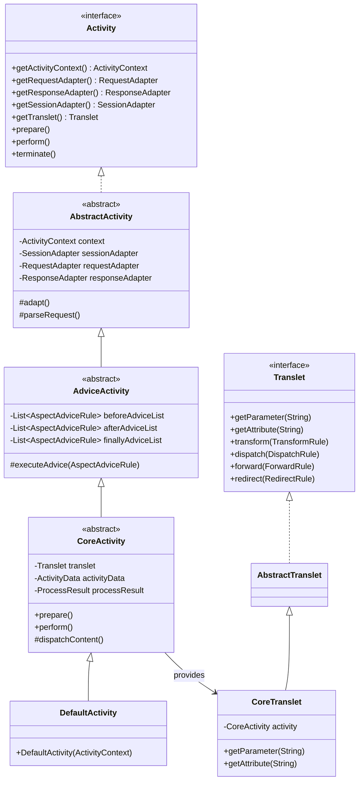

## 1. Design Goals and Key Roles

The `com.aspectran.core.activity` package represents the **heart of Aspectran's single request-response execution engine**. All abstractions and concrete mechanics required to coordinate inbound web HTTP requests, socket buffers, terminal CLI commands, or background scheduler triggers under a unified rule-based pipeline reside within this package.

The core architectural objectives of this package are:

*   **Complete Standardization of Request Processing**: Defines a uniform activity model ([`Activity`](https://github.com/aspectran/aspectran/blob/master/core/src/main/java/com/aspectran/core/activity/Activity.java)) to process any request type through a deterministic pipeline regardless of origin (HTTP, TCP, CLI, batch).
*   **Decoupled Engine vs. User Facade**: Complex framework internals (AOP advice queues, exception routing, adapter handshakes) are managed by `Activity`, while business code interacts exclusively through the clean [`Translet`](https://github.com/aspectran/aspectran/blob/master/core/src/main/java/com/aspectran/core/activity/Translet.java) facade, minimizing cognitive overhead.
*   **Environment-Independent Adapter Coupling**: Maximizes the Adapter pattern, ensuring the execution engine core operates completely independently of host environments (servlets, Netty pipelines, terminal streams) via standardized [`RequestAdapter`](https://github.com/aspectran/aspectran/blob/master/core/src/main/java/com/aspectran/core/adapter/RequestAdapter.java), [`ResponseAdapter`](https://github.com/aspectran/aspectran/blob/master/core/src/main/java/com/aspectran/core/adapter/ResponseAdapter.java), and [`SessionAdapter`](https://github.com/aspectran/aspectran/blob/master/core/src/main/java/com/aspectran/core/adapter/SessionAdapter.java) interfaces.
*   **Declarative AOP Advice Integration**: Intercepts and executes matching Aspect advices (`BEFORE`, `AFTER`, `THROWN`, `FINALLY`) dynamically at designated joinpoints throughout the request lifecycle.
*   **Flexible Derived Activity Models**: Provides specialized activity implementations, such as [`ProxyActivity`](https://github.com/aspectran/aspectran/blob/master/core/src/main/java/com/aspectran/core/activity/ProxyActivity.java) for asynchronous worker threads and [`InstantActivity`](https://github.com/aspectran/aspectran/blob/master/core/src/main/java/com/aspectran/core/activity/InstantActivity.java) for programmatic template rendering.

## 2. Key Classes and Interfaces

### `Activity` (Interface)

The top-level specification governing the central execution controller for a single request-response lifecycle:

*   **Core Responsibilities**:
    *   Grants access to the global application context ([`ActivityContext`](https://github.com/aspectran/aspectran/blob/master/core/src/main/java/com/aspectran/core/context/ActivityContext.java)).
    *   Exposes environment adapters (`RequestAdapter`, `ResponseAdapter`, `SessionAdapter`) encapsulating native I/O channels.
    *   Provides the developer-facing [`Translet`](https://github.com/aspectran/aspectran/blob/master/core/src/main/java/com/aspectran/core/activity/Translet.java) facade.
    *   Declares lifecycle pipeline hooks (`prepare()`, `perform()`).
    *   Provides early-termination control (`terminate()`) to abort pipelines and flush responses immediately.
    *   Exposes ASEL expression evaluation engines (`TokenEvaluator`, `ItemEvaluator`).

### `AbstractActivity` (Abstract Class)

The abstract template managing core infrastructure binding and thread-local state:

*   **Key Responsibilities**:
    *   Maintains binding to `ActivityContext` and registers the executing activity into thread-local storage via `ActivityContext.setCurrentActivity(this)`.
    *   Declares `adapt()` and `parseRequest()` template hooks for concrete subclasses to wrap native I/O streams into standard adapters.

### `AdviceActivity` (Abstract Class)

Extends `AbstractActivity`, integrating Aspectran's **declarative AOP advice interception engine**:

*   **Key Responsibilities**:
    *   Collects aspect rules matching the active request URI and method, ordering them by declared precedence (`order`).
    *   Maintains execution queues for `BEFORE`, `AFTER`, `THROWN`, and `FINALLY` advice stages.
    *   Controls context frames when advice methods invoke nested beans or secondary actions.

### `CoreActivity` (Abstract Class)

Extends `AdviceActivity`, providing the complete implementation of Aspectran's standard translet execution pipeline:

*   **End-to-End Pipeline Execution (`perform()`)**:
    1.  **Adaptation (`adapt`)**: Subclass hook converts native objects (Servlet, Netty, Terminal) into `RequestAdapter`, `ResponseAdapter`, and `SessionAdapter`.
    2.  **`BEFORE` Advices**: Executes security checks, initiates transactions, and performs audit authorization before business actions run.
    3.  **Content Action Dispatching (`dispatchContent`)**: Iterates through `<contents>` blocks, executing actions (`InvokeAction`, `IncludeAction`, `ChooseAction`) and accumulating results into `ProcessResult`.
    4.  **Response Processing (`response`)**: Evaluates declared response strategies (`TransformRule` for JSON/XML, `DispatchRule` for templates, `RedirectRule` for HTTP redirects, `ForwardRule` for internal chaining).
    5.  **`AFTER` Advices**: Post-processes results and logs transaction metrics upon successful completion.
    6.  **`THROWN` Advices**: Catches exceptions (`ActivityException`), rolling back transactions and routing to declarative error views.
    7.  **`FINALLY` Advices**: Executes mandatory teardown and resource release regardless of outcome.
    8.  **Stream Finalization (`response.end()`)**: Flushes buffers and closes output streams.

### `Translet` (Interface) & `CoreTranslet` (Implementation Class)

The **developer-facing facade** injected into action methods and controllers:

*   **Key Responsibilities**:
    *   Provides intuitive access to request parameters (`getParameter`, `getParameterValues`), attributes (`getAttribute`, `setAttribute`), and uploaded files (`getFileParameter`).
    *   Exposes dynamic programmatic flow-control methods (`transform()`, `dispatch()`, `redirect()`, `forward()`).
    *   Grants access to accumulated action outputs via `ProcessResult`.
    *   `CoreTranslet` safely delegates all calls to the underlying `CoreActivity` and adapters.

### `ActivityData` (Class)

A lazy-loading map facade providing a consolidated, single-namespace view over all request-scoped data:

*   Unifies request parameters, request attributes, session attributes, and `ProcessResult` action values into a single view.
*   Acts as the primary resolution target during ASEL expression evaluation (`#{user.name}`, `#{actionResult.orderId}`).

### `InstantActivity` & `InstantActivitySupport`

Lightweight, specialized activity models designed for executing ad-hoc tasks (such as on-the-fly template rendering or programmatic action calls) outside regular translet routes:

*   Inherits session and context state from parent activities when nested, or initializes minimal adapters for rapid execution when invoked standalone.

### `ProxyActivity` (Class)

A proxy activity designed to propagate security and request contexts to worker threads during `@Async` asynchronous method invocations:

*   Clones parent activity adapters and contexts in a thread-safe manner, enabling asynchronous code to safely invoke `ActivityContext.getCurrentActivity()`.

### `FlashMap` & `FlashMapManager`

Infrastructure components supporting the Post/Redirect/Get (PRG) pattern in web applications:

*   Temporarily stages transient flash attributes inside user sessions during redirects, automatically restoring them into `ActivityData` and purging them on the subsequent GET request.

## 3. Interactions with Other Packages

*   **`com.aspectran.core.service`**: Activates request execution via `CoreService.service(Activity)`.
*   **`com.aspectran.core.adapter`**: `Activity` owns `RequestAdapter`, `ResponseAdapter`, and `SessionAdapter`, driving all physical I/O through adapter contracts.
*   **`com.aspectran.core.activity.process`**: `CoreActivity.dispatchContent()` executes `ContentList` and `Executable` action pipelines, collecting outcomes into `ProcessResult`.
*   **Runtime Activity Packages (`web.servlet`, `netty`, `undertow`, `shell`, `daemon`, `embed`)**: Concrete activity classes (`ServletWebActivity`, `NettyActivity`, `TowActivity`, `ShellActivity`) extend `CoreActivity` to bind runtime-specific adapters.

## 4. Package Summary and Architectural Significance

The `com.aspectran.core.activity` package embodies Aspectran's core architectural strengths:

1.  **Engine vs. Facade Decoupling**: `Activity` manages complex orchestration, while `Translet` exposes a clean, developer-friendly facade.
2.  **Universal Adapter Pattern**: Decoupling the execution engine from networking protocols ensures business logic remains 100% portable across web, socket, console, and daemon runtimes.
3.  **Seamless AOP Integration**: Intercepts execution stages natively without external dependencies, embedding enterprise capabilities cleanly into the core request lifecycle.
