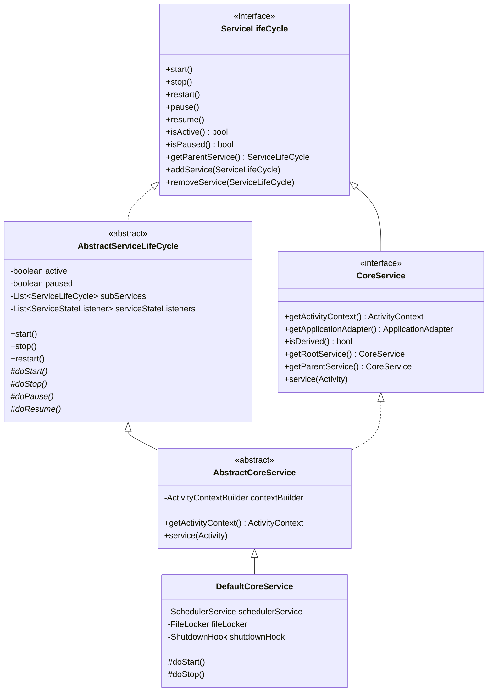

## 1. Design Goals and Key Roles

The `com.aspectran.core.service` package defines the **top-level foundation and bootstrapping engine of Aspectran's service layer**. Concrete service implementations across all target environments (Web, Netty, Undertow, Shell, Daemon, Embed) inherit from the contracts and abstract templates declared in this package.

The core architectural objectives of this package are:

*   **Consistent Lifecycle Contracts**: Provides a standardized lifecycle framework to predictably and thread-safely coordinate state transitions: starting (`start`), stopping (`stop`), restarting (`restart`), pausing (`pause`), and resuming (`resume`).
*   **Hierarchical Service Cascading**: Establishes parent-child relationships between services, guaranteeing that lifecycle signals issued at the root service cascade orderly down to all registered subordinate services (`subServices`).
*   **Centralized Access Point**: Defines `CoreService`, the sole standard gateway to the framework's core container ([`ActivityContext`](https://github.com/aspectran/aspectran/blob/master/core/src/main/java/com/aspectran/core/context/ActivityContext.java)), providing safe access to beans, translets, aspects, and environment configurations.
*   **Protocol-Agnostic Execution Foundation**: Delivers an environment-neutral core abstraction ([`AbstractCoreService`](https://github.com/aspectran/aspectran/blob/master/core/src/main/java/com/aspectran/core/service/AbstractCoreService.java)) that allows identical business logic to execute across servlet containers, Netty NIO event loops, and interactive terminal consoles.
*   **ClassLoader-Based Multi-Tenancy**: Incorporates the [`CoreServiceHolder`](https://github.com/aspectran/aspectran/blob/master/core/src/main/java/com/aspectran/core/service/CoreServiceHolder.java) service locator using `ClassLoader` keys to host multiple isolated applications or modular contexts within a single JVM process.

Key design patterns applied include the **Template Method Pattern** in `AbstractServiceLifeCycle` and `AbstractCoreService`, the **Service Locator Pattern** in `CoreServiceHolder`, and the **Observer Pattern** for broadcasting state change events via `ServiceStateListener`.

## 2. Key Classes and Interfaces



### `ServiceLifeCycle` (Interface)

The top-level contract that all stateful service components across Aspectran must implement:

*   **Core Responsibilities**:
    *   Defines standard lifecycle transition methods: `start()`, `stop()`, `restart()`, `pause()`, and `resume()`.
    *   Provides tree orchestration methods (`getParentService()`, `addService(ServiceLifeCycle)`, `removeService(ServiceLifeCycle)`) to allow parent services to govern the lifecycles of subordinate child services.
    *   Exposes status query methods to inspect whether the service is currently running (`isActive()`) or suspended (`isPaused()`).

### `AbstractServiceLifeCycle` (Abstract Class)

The abstract template implementing concurrency synchronization and cascading propagation for `ServiceLifeCycle`:

*   **Implementation Mechanics**:
    *   **Memory Visibility**: Maintains `volatile boolean active` and `volatile boolean paused` flags to ensure state modifications are immediately visible across all threads.
    *   **Thread Safety**: Enforces thread synchronization by executing all lifecycle transition methods inside `synchronized` blocks, preventing race conditions during concurrent invocations.
    *   **Transitive Lifecycle Cascading**: Propagates `start()` and `stop()` calls sequentially to all registered child services (`subServices`).
    *   **Root Service Constraint**: Guarantees architectural integrity during restarts by asserting `Assert.state(isRootService(), "Only the root service can be restarted")`, eliminating state fragmentation caused by partial restarts.
*   **Template Methods**:
    *   `start()`: Checks active status, invokes concrete startup logic in subclass hook `doStart()`, and cascades `start()` calls to all child services.
    *   `stop()`: Invokes subclass cleanup hook `doStop()` and stops all child services in reverse registration order.
    *   `doStart()`, `doStop()`, `doPause()`, `doResume()`: Abstract template methods forcing subclasses to provide environment-specific initialization and teardown logic.

### `CoreService` (Interface)

The primary service contract representing the **active core instance** of an Aspectran application. Extends `ServiceLifeCycle`:

*   **Core Responsibilities**:
    *   `getActivityContext()`: Returns the live `ActivityContext` instance housing all beans, translets, and aspects.
    *   `getApplicationAdapter()`: Exposes the `ApplicationAdapter` encapsulating host directory paths and environment resources.
    *   `isDerived()`: Returns true if the service is a derived child sharing its parent's `ActivityContext` without building its own context.
    *   `getRootService()` / `getParentService()`: Navigates upward through the service hierarchy tree.
    *   `service(Activity activity)`: The single execution gateway that feeds an inbound `Activity` into the processing pipeline.

### `AbstractCoreService` (Abstract Class)

The central skeletal class uniting `CoreService` and `AbstractServiceLifeCycle`:

*   **Implementation Mechanics**:
    *   Holds an `ActivityContextBuilder` instance, managing context construction for root services.
    *   Implements `service(Activity activity)`:
        ```java
        public void service(Activity activity) throws ActivityException {
            Assert.state(isActive(), "CoreService is not active");
            activity.prepare();
            activity.perform();
        }
        ```
        Verifies service availability and drives `Activity` through sequential `prepare()` and `perform()` execution phases.

### `DefaultCoreService` (Concrete Class)

The standard **bootstrapper implementation** for standalone Aspectran instances:

*   **Key Responsibilities**:
    *   **Config-Driven Bootstrapping**: Ingests [`AspectranConfig`](https://github.com/aspectran/aspectran/blob/master/core/src/main/java/com/aspectran/core/context/config/AspectranConfig.java) to configure [`HybridActivityContextBuilder`](https://github.com/aspectran/aspectran/blob/master/core/src/main/java/com/aspectran/core/context/builder/HybridActivityContextBuilder.java) and assemble the `ActivityContext`.
    *   **Scheduler Sub-Service Integration**: Automatically instantiates a Quartz-based [`SchedulerService`](https://github.com/aspectran/aspectran/blob/master/core/src/main/java/com/aspectran/core/scheduler/service/SchedulerService.java) as a bound child service if a scheduler block is declared.
    *   **Singleton Instance File Locking ([`FileLocker`](https://github.com/aspectran/aspectran/blob/master/utils/src/main/java/com/aspectran/utils/FileLocker.java))**: Acquires an OS-level `.lock` file to prevent duplicate concurrent processes from corrupting files or databases in the same `basePath`.
    *   **JVM Shutdown Hook Registration**: Registers a runtime shutdown task via `Runtime.getRuntime().addShutdownHook()` to guarantee graceful resource closure (`stop()`) upon process termination signals (`SIGTERM`).

### `CoreServiceHolder` (Utility Class)

A static **Service Locator** managing runtime references to active `CoreService` instances keyed by ClassLoader contexts:

*   **Routing Algorithm**:
    *   Maintains a thread-safe `Map<ClassLoader, CoreService>`.
    *   When `acquire()` is called, inspects the current thread context classloader (`Thread.currentThread().getContextClassLoader()`).
    *   If no direct mapping exists, it traverses parent classloaders upward, falling back to the globally registered root service in a 3-tier resolution strategy.
    *   Updates registrations dynamically through `putService(CoreService)` and `release(CoreService)` during service startup and teardown.

### `RequestAcceptor` (Interface)

A policy contract for filtering and admitting inbound requests at service entry points:

*   Applies name matching or exclusion patterns to incoming translets, intercepting unauthorized access or administrative endpoints at the service perimeter.

### `ServiceStateListener` & `ServiceHoldingListener`

Event listener mechanisms tracking service lifecycle transitions:

*   `ServiceStateListener`: Receives callbacks when service states transition to `STARTED`, `STOPPED`, `PAUSED`, or `RESUMED`.
*   `ServiceHoldingListener`: Automatically triggers `CoreServiceHolder.putService()` on start and `CoreServiceHolder.release()` on stop, preserving registry integrity.

## 3. Interactions with Other Packages

*   **`com.aspectran.core.context`**: `CoreService` encapsulates the `ActivityContext`, serving as the primary access pathway to bean registries, rule registries, and template renderers.
*   **`com.aspectran.core.activity`**: Delegates execution control to `Activity` via `CoreService.service(Activity)`. The activity receives context and adapter references from the service to execute translets.
*   **`com.aspectran.core.scheduler.service`**: `DefaultCoreService` automatically registers `SchedulerService` as a child service during `doStart()` to initiate background job scheduling.
*   **Runtime Service Packages (`web`, `netty`, `undertow`, `shell`, `daemon`, `embed`)**: Specialized top-level service implementations extend `AbstractCoreService` or `DefaultCoreService` to bridge their host engines (Netty channels, servlet handlers, JLine shells).

## 4. Package Summary and Architectural Significance

The `com.aspectran.core.service` package transforms Aspectran from a simple IoC container into an **autonomous, enterprise-grade runtime platform**:

1.  **Robust Lifecycle Encapsulation**: Employs the Template Method pattern to govern complex startup/shutdown sequences and enforces parent-child tree propagation to ensure holistic state consistency.
2.  **Environment-Neutral Core**: Decouples the request processing entry point (`service(Activity)`) from network protocols, enabling portable execution across web, non-blocking socket, console, and daemon runtimes.
3.  **Intelligent Multi-Tenant Isolation**: Uses `CoreServiceHolder` to isolate and route multiple distinct application contexts within a single JVM without context cross-contamination.
