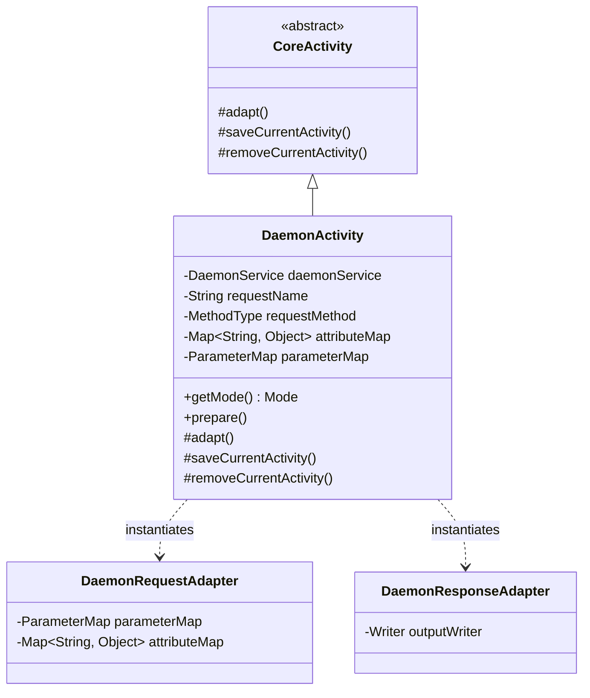

## 1. Design Goals and Primary Roles

The `com.aspectran.daemon.activity` package provides the **dedicated `Activity` implementation and virtualization adapters** that actually execute translet invocations initiated programmatically (`translate`) from `DaemonService`.

The core architectural objectives of this package are:

*   **Execution Environment Concretization for Programmatic Invocation**: Inherits from the abstract `CoreActivity` to provide `DaemonActivity`, capable of fully driving the translet pipeline in a background daemon environment without physical network sockets or console I/O.
*   **In-Memory Request/Response Simulation**: Mounts adapters that completely simulate requests and responses in memory using `Map<String, Object>` (attributes/parameters) and `OutputStringWriter` instead of external HTTP streams.
*   **Complete Session Lifecycle Management in Non-Web Environments**: Accesses the virtual session (`access()`) via `DefaultSessionAdapter` while `DaemonActivity` executes, and guarantees an elaborate session agent lifecycle by flushing and committing session state (`complete()`) at completion time.
*   **Seamless Bridge Between Engine and Caller**: Converts virtual request methods (`MethodType`), translet names (`requestName`), and arguments supplied by the caller into standard preparation (`prepare()`) and execution (`perform()`) phases of `CoreActivity`.

## 2. Key Classes In-Depth Analysis



### `DaemonActivity` (Concrete Implementation Class)

The final concrete `Activity` class tailored for the daemon runtime environment. It is instantiated per request whenever `DaemonService.translate()` is invoked.

*   **Core Responsibilities and Attributes**:
    *   `daemonService`: Holds the parent daemon service instance to retrieve the context, session manager, FlashMap manager, and Locale resolver.
    *   `getMode()`: Returns `Mode.DAEMON`, ensuring daemon-specific branch logic operates correctly.
    *   `requestName` / `requestMethod`: Stores the target translet name and virtual HTTP method (`GET`, `POST`, etc.), binding the target `TransletRule` based on these during the `prepare()` phase.
    *   `attributeMap` / `parameterMap`: Holds request attributes and parameters passed programmatically.

*   **Deep Dive into Core Methods**:
    *   `prepare()`:
        ```java
        public void prepare() throws TransletNotFoundException, ActivityPrepareException {
            Assert.state(requestName != null, "requestName is not set");
            Assert.state(requestMethod != null, "requestMethod is not set");
            prepare(requestName, requestMethod);
        }
        ```
        Validates required parameters prior to invocation, then queries and binds the translet rule matching the name and method from the core engine's rule registry.
    *   `adapt()`: **The core of daemon virtualization adaptation**.
        ```java
        @Override
        protected void adapt() throws AdapterException {
            setSessionAdapter(daemonService.newSessionAdapter());

            DaemonRequestAdapter requestAdapter = new DaemonRequestAdapter(getTranslet().getRequestMethod());
            if (attributeMap != null) {
                requestAdapter.setAttributeMap(attributeMap);
            }
            if (parameterMap != null) {
                requestAdapter.setParameterMap(parameterMap);
            }
            setRequestAdapter(requestAdapter);

            Writer outputWriter = new OutputStringWriter();
            DaemonResponseAdapter responseAdapter = new DaemonResponseAdapter(outputWriter);
            setResponseAdapter(responseAdapter);

            setFlashMapManager(daemonService.getFlashMapManager());
            setLocaleResolver(daemonService.getLocaleResolver());

            super.adapt();
        }
        ```
        1.  Binds a virtual session adapter via `daemonService.newSessionAdapter()`.
        2.  Injects caller-supplied attributes and parameters into `DaemonRequestAdapter` and registers it as the standard request adapter.
        3.  Creates a `DaemonResponseAdapter` wrapping `OutputStringWriter` and sets it as the response adapter. Template rendering or string conversion results accumulate safely in this Writer buffer.
        4.  Connects the internationalization resolver (`LocaleResolver`) and flash map manager registered in the service.
    *   `saveCurrentActivity()` / `removeCurrentActivity()`:
        ```java
        @Override
        protected void saveCurrentActivity() {
            super.saveCurrentActivity();
            if (isOriginalActivity() && hasSessionAdapter() &&
                    getSessionAdapter() instanceof DefaultSessionAdapter sessionAdapter) {
                sessionAdapter.getSessionAgent().access();
            }
        }

        @Override
        protected void removeCurrentActivity() {
            if (isOriginalActivity() && hasSessionAdapter() &&
                    getSessionAdapter() instanceof DefaultSessionAdapter sessionAdapter) {
                sessionAdapter.getSessionAgent().complete();
            }
            super.removeCurrentActivity();
        }
        ```
        When entering the root activity (`isOriginalActivity`), invokes `sessionAdapter.getSessionAgent().access()` to update the session's last access timestamp. Upon activity completion, calls `complete()` to flush and synchronize modified session data in a thread-safe manner.

## 3. Interactions with Other Packages

*   **`com.aspectran.daemon.service`**: `DefaultDaemonService` creates a `DaemonActivity` for every `translate()` request, injects parameters, and drives the execution pipeline.
*   **`com.aspectran.daemon.adapter`**: `DaemonActivity` internally instantiates `DaemonRequestAdapter` and `DaemonResponseAdapter` to process requests and responses in memory.
*   **`com.aspectran.core.activity`**: `DaemonActivity` inherits from `CoreActivity`, fully reusing its built-in AOP advice chains (`BEFORE`, `AFTER`, `THROWN`, `FINALLY`), action dispatching (`dispatchContent`), and response transformation logic without modification.

## 4. Package Summary and Architectural Significance

The `com.aspectran.daemon.activity` package and `DaemonActivity` demonstrate **the pinnacle of abstraction and isolation achieved by Aspectran's adapter architecture**:

1.  **Total Physical Environment Abstraction**: Even in a pure in-memory Java runtime without sockets or streams, `DaemonRequestAdapter` and `DaemonResponseAdapter` completely virtualize the request-response cycle.
2.  **Zero Modification to the Core Engine**: `CoreActivity` has no need to know whether it was invoked from the web or a daemon; it simply interacts with adapter interfaces to read parameters and record outputs.
3.  **Sophisticated Session Lifecycle Synchronization**: Through the `saveCurrentActivity` and `removeCurrentActivity` hooks, access (`access`) and completion (`complete`) of session agents are strictly governed even in non-web environments, ensuring robust state maintenance.
