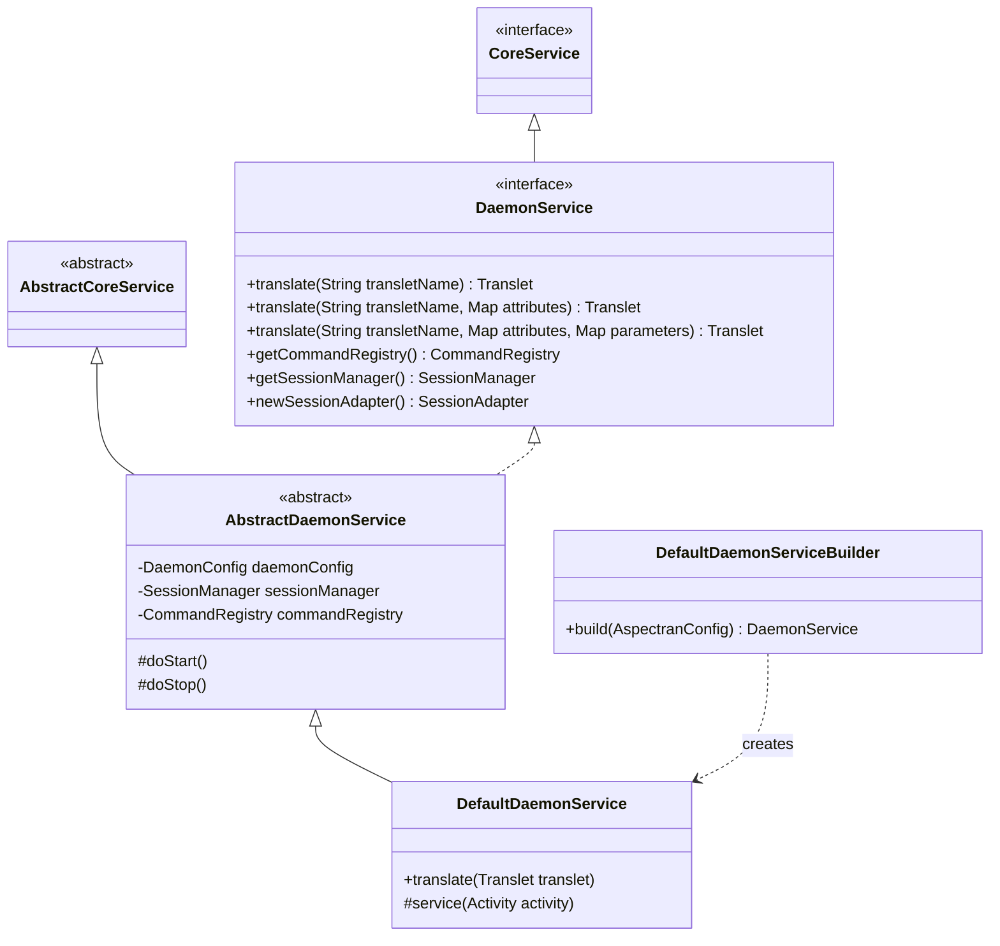

## 1. Design Goals and Key Roles

The `com.aspectran.daemon.service` package provides the **service layer implementation required to run Aspectran as an autonomous background daemon or operating system service** without web servers or GUI environments.

The primary architectural objectives of this package are:

*   **Complete Standalone Runtime**: Operates completely independently of web containers or application servers, integrating directly with operating system service managers (Linux `systemd`, Apache Commons Daemon `jsvc`, Windows Service `procrun`) to manage autonomous lifecycles.
*   **Proactive Execution Model**: Unlike reactive web architectures that wait passively for external HTTP requests, daemons drive a proactive execution model where internal schedulers, message queue consumers, and file pollers ([`FileCommander`](https://github.com/aspectran/aspectran/blob/master/daemon/src/main/java/com/aspectran/daemon/command/polling/FileCommander.java)) directly trigger business translets.
*   **Programmatic Standard Entry Point (`translate`)**: Exposes an intuitive API gateway allowing application code to programmatically dispatch translets with virtual parameters and receive outcomes synchronously.
*   **In-Memory Session Management in Non-Web Contexts**: Incorporates [`DefaultSessionManager`](https://github.com/aspectran/aspectran/blob/master/core/src/main/java/com/aspectran/core/component/session/DefaultSessionManager.java) to provide virtual session state across sequential `translate()` calls in long-running processes.
*   **Integrated Command Control Subsystem**: Couples with [`DaemonCommandRegistry`](https://github.com/aspectran/aspectran/blob/master/daemon/src/main/java/com/aspectran/daemon/command/DaemonCommandRegistry.java) to enable runtime administrative commands (restart, component reloading, status inspections) via file-based command drops or internal consoles.

## 2. Key Classes and Interfaces



### `DaemonService` (Interface)

The top-level specification for daemon-specific services in Aspectran. Extends `CoreService`:

*   **Key Responsibilities**:
    *   `translate(...)`: The primary overloaded entry point executing translets programmatically. Accepts translet names, attribute maps, parameter maps, and virtual HTTP methods, executing the pipeline and returning the completed `Translet` instance.
    *   `getCommandRegistry()`: Returns the `CommandRegistry` managing commands runnable within the daemon process.
    *   `getSessionManager()`: Exposes the `SessionManager` maintaining in-memory session state across translet invocations.
    *   `newSessionAdapter()`: Instantiates a daemon-specific `SessionAdapter` for session virtualization.

### `AbstractDaemonService` (Abstract Class)

The abstract template encapsulating core infrastructure wiring for `DaemonService`:

*   **Implementation Mechanics**:
    *   **Session Manager Lifecycle**: Instantiates `DefaultSessionManager` configured via `DaemonConfig` (`sessionConfig`), binding its start and stop routines to `doStart()` and `doStop()`.
    *   **Command Registry Configuration**: Populates `DaemonCommandRegistry` with built-in commands (`restart`, `quit`, `sysinfo`, `translet`, `pollingInterval`).
    *   **File Poller Integration**: Launches background monitoring threads when external file command pollers (`FileCommander`) are activated.

### `DefaultDaemonService` (Implementation Class)

The primary concrete implementation of `DaemonService`, translating programmatic calls into `DaemonActivity` instances and driving execution:

*   **Execution Pipeline (`translate`)**:
    1.  **Availability Verification**: Ensures the service is active and not paused (`isPaused`). Rejects requests if suspended.
    2.  **Access Control Inspection (`RequestAcceptor`)**: Validates requested translet names against configured `RequestAcceptor` rule constraints.
    3.  **`DaemonActivity` Instantiation**: Creates a dedicated [`DaemonActivity`](https://github.com/aspectran/aspectran/blob/master/daemon/src/main/java/com/aspectran/daemon/activity/DaemonActivity.java), injecting supplied parameters, attributes, and virtual methods.
    4.  **Pipeline Dispatching**: Calls `service(activity)` -> `activity.prepare()` -> `activity.perform()`, executing AOP advice chains, business actions, and response transformers.
    5.  **Outcome Delivery**: Returns the completed `Translet` object housing accumulated `ProcessResult` data and serialized output.

### `DefaultDaemonServiceBuilder` (Builder Class)

Factory builder that constructs and initializes `DefaultDaemonService` from [`AspectranConfig`](https://github.com/aspectran/aspectran/blob/master/core/src/main/java/com/aspectran/core/context/config/AspectranConfig.java):

*   Parses encoding settings, session timeouts, and command registry configurations from the `daemon` configuration block.
*   Registers `ServiceStateListener` handlers to register the daemon service with `CoreServiceHolder` upon startup.

## 3. Interactions with Other Packages and Subsystems

```mermaid
graph TD
    subgraph Host ["OS Service Host Bridges"]
        Jsvc["JsvcDaemon (Linux jsvc)"]
        Procrun["ProcrunDaemon (Windows Service)"]
        Simple["SimpleDaemon (Standalone Process)"]
        DefaultD["DefaultDaemon (FileCommander Bundled)"]
    end

    subgraph ServiceLayer ["com.aspectran.daemon.service"]
        DService["DefaultDaemonService"]
        Registry["DaemonCommandRegistry"]
    end

    subgraph ActivityLayer ["com.aspectran.daemon.activity"]
        DActivity["DaemonActivity"]
        ReqAdapter["DaemonRequestAdapter (Map-based)"]
        ResAdapter["DaemonResponseAdapter (Writer-based)"]
    end

    Jsvc --> DService
    Procrun --> DService
    Simple --> DService
    DefaultD --> DService
    DService --> Registry
    DService -->|Created on translate()| DActivity
    DActivity --> ReqAdapter
    DActivity --> ResAdapter
```

*   **Four Daemon Host Bridges**: [`JsvcDaemon`](https://github.com/aspectran/aspectran/blob/master/daemon/src/main/java/com/aspectran/daemon/JsvcDaemon.java) (Apache Commons Daemon), [`ProcrunDaemon`](https://github.com/aspectran/aspectran/blob/master/daemon/src/main/java/com/aspectran/daemon/ProcrunDaemon.java) (Windows Service), [`SimpleDaemon`](https://github.com/aspectran/aspectran/blob/master/daemon/src/main/java/com/aspectran/daemon/SimpleDaemon.java) (main entry point), and [`DefaultDaemon`](https://github.com/aspectran/aspectran/blob/master/daemon/src/main/java/com/aspectran/daemon/DefaultDaemon.java) (bundled with `FileCommander`) own a `DaemonService` instance, delegating OS service commands (`init`, `start`, `stop`, `destroy`) to `ServiceLifeCycle`.
*   **`com.aspectran.daemon.command.polling`**: [`FileCommander`](https://github.com/aspectran/aspectran/blob/master/daemon/src/main/java/com/aspectran/daemon/command/polling/FileCommander.java) monitors incoming `.command` files in designated polling directories, dispatching tasks to `DaemonService.translate()`.
*   **`com.aspectran.daemon.activity`**: `DaemonService` transforms programmatic invocations into `DaemonActivity` instances, executing them within Aspectran's core pipeline.

## 4. Package Summary and Architectural Significance

The `com.aspectran.daemon.service` package expands Aspectran from a reactive web framework into an **autonomous enterprise batch and background worker container**:

1.  **Multi-Purpose Business Logic Reuse**: Translets written for web controllers can be invoked directly as background batch jobs or administration commands via `translate()` without altering business logic.
2.  **OS-Native Lifecycle Support**: Integrates cleanly with standard Linux and Windows service wrappers, supporting resilient, long-running production daemon workloads.
3.  **In-Memory Session Virtualization**: Simulates virtual sessions and in-memory I/O streams in network-less environments, preserving a uniform programming model across all application domains.
