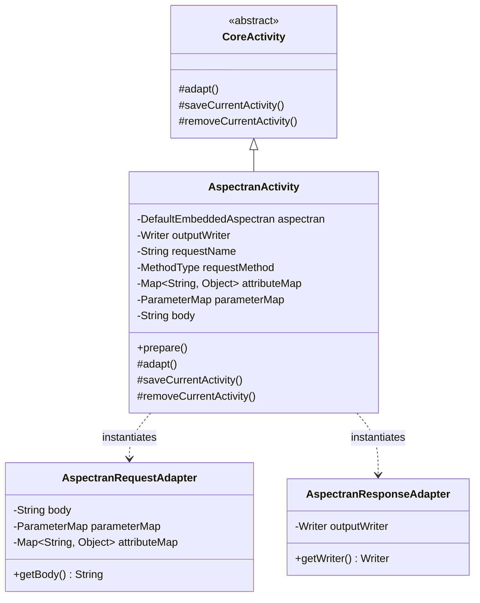

## 1. Design Goals and Primary Roles

The `com.aspectran.embed.activity` package provides the **dedicated `Activity` implementation and embedded adapters** that execute programmatic translet invocations—originating from an `EmbeddedAspectran` service hosted inside another Java application—within the core Aspectran pipeline.

The core architectural objectives of this package are:

*   **Concretization of the Embedded Execution Context**: Supplies `AspectranActivity`, tailored for execution directly within the memory space of a host JVM application without physical network sockets or web containers.
*   **Advanced In-Memory Request Simulation**: Accurately simulates REST API style `POST`, `PUT`, and `PATCH` requests at the code level by accepting not only simple parameters (`ParameterMap`) and attributes (`Map`), but also arbitrary **request body** strings (such as JSON or XML payloads).
*   **Flexible Output Stream Binding**: Supports direct streaming of translet rendering output not only to the default in-memory buffer (`OutputStringWriter`), but also to any caller-supplied `Writer` stream (file stream, socket stream, console output, etc.).
*   **Safe Session State Control**: Integrates with the `DefaultSessionManager` configured in the embedded environment to transparently guarantee session access timestamp updates (`access`) and session data synchronization (`complete`) at activity entry and exit.

## 2. Key Classes In-Depth Analysis



### `AspectranActivity` (Concrete Implementation Class)

The final concrete `Activity` class for the embedded runtime environment. It is newly instantiated on each invocation of `DefaultEmbeddedAspectran.translate()`.

*   **Core Responsibilities and Attributes**:
    *   `aspectran`: Holds a reference to the parent `DefaultEmbeddedAspectran` service to retrieve the context, virtual session adapter, flash map manager, and locale resolver.
    *   `outputWriter`: The `Writer` instance to which response output is recorded. If omitted by the caller, an `OutputStringWriter` is instantiated by default to buffer output strings in memory.
    *   `body`: Stores client request body payloads (e.g., JSON/XML), utilized by body parsing actions.
    *   `requestName` / `requestMethod`: Target translet identifier and virtual HTTP method (`GET`, `POST`, etc.).
    *   `attributeMap` / `parameterMap`: Programmatically supplied containers for request attributes and parameters.

*   **Deep Dive into Core Methods**:
    *   `prepare()`:
        ```java
        public void prepare() throws TransletNotFoundException, ActivityPrepareException {
            Assert.state(requestName != null, "requestName is not set");
            Assert.state(requestMethod != null, "requestMethod is not set");
            prepare(requestName, requestMethod);
        }
        ```
        Validates required request identifiers prior to execution and retrieves and binds the target rule from the core engine's `TransletRuleRegistry`.
    *   `adapt()`: **The core implementation of embedded adaptation**.
        ```java
        @Override
        protected void adapt() throws AdapterException {
            setSessionAdapter(aspectran.newSessionAdapter());

            AspectranRequestAdapter requestAdapter = new AspectranRequestAdapter(getTranslet().getRequestMethod());
            if (parameterMap != null) {
                requestAdapter.setParameterMap(parameterMap);
            }
            if (attributeMap != null) {
                requestAdapter.setAttributeMap(attributeMap);
            }
            if (body != null) {
                requestAdapter.setBody(body);
            }
            setRequestAdapter(requestAdapter);

            if (outputWriter == null) {
                outputWriter = new OutputStringWriter();
            }
            AspectranResponseAdapter responseAdapter = new AspectranResponseAdapter(outputWriter);
            setResponseAdapter(responseAdapter);

            setFlashMapManager(aspectran.getFlashMapManager());
            setLocaleResolver(aspectran.getLocaleResolver());

            super.adapt();
        }
        ```
        1.  Binds a virtual session adapter via `aspectran.newSessionAdapter()`.
        2.  Instantiates `AspectranRequestAdapter`, supplying parameters, attributes, and the `body` payload to complete the request adapter configuration.
        3.  Instantiates `AspectranResponseAdapter` wrapping the designated `outputWriter` to bind view rendering and output streams.
        4.  Connects the flash map manager and locale resolver.
    *   `saveCurrentActivity()` / `removeCurrentActivity()`:
        Invokes session agent `access()` upon activity startup to update the last accessed timestamp, and calls `complete()` upon activity termination to safely commit modified session attributes and clean up resources.

## 3. Interactions with Other Packages

*   **`com.aspectran.embed.service`**: Upon `translate()` requests, `DefaultEmbeddedAspectran` instantiates `AspectranActivity`, binds arguments, and delegates execution via `service(activity)`.
*   **`com.aspectran.embed.adapter`**: `AspectranActivity` internally instantiates `AspectranRequestAdapter` and `AspectranResponseAdapter` to normalize I/O with external environments.
*   **`com.aspectran.core.activity`**: `AspectranActivity` inherits from `CoreActivity`, fully reusing built-in AOP advice chains (`BEFORE`, `AFTER`, `THROWN`, `FINALLY`), action dispatching (`dispatchContent`), and response transformation logic without modification.

## 4. Package Summary and Architectural Significance

The `com.aspectran.embed.activity` package and `AspectranActivity` highlight the **exceptional reusability and extensibility of Aspectran's adapter-driven architecture**:

1.  **Excellence in Request Body Simulation**: Beyond standard key-value parameters, it accommodates arbitrary body payloads (`body`), allowing complete RESTful API service pipelines to be executed and tested within embedded library contexts.
2.  **Custom Stream Output Support**: Direct injection of custom `Writer` instances from the host application eliminates memory buffering overhead and allows direct rendering to disk files or external network streams.
3.  **Comprehensive Platform Isolation**: Independent of the host application's technology stack, it provides the foundation to harness an enterprise-grade translet processing engine solely through pure Java object invocations.
