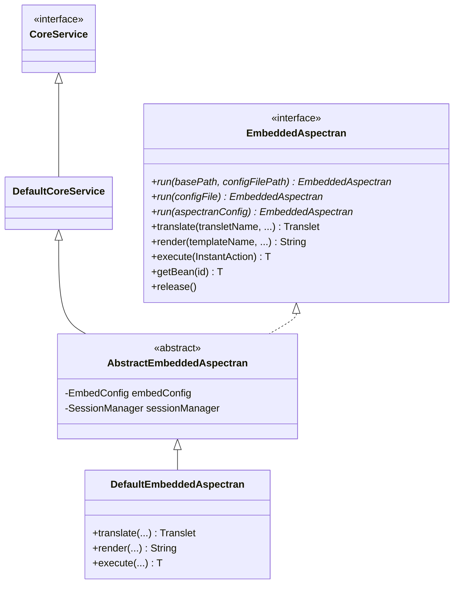
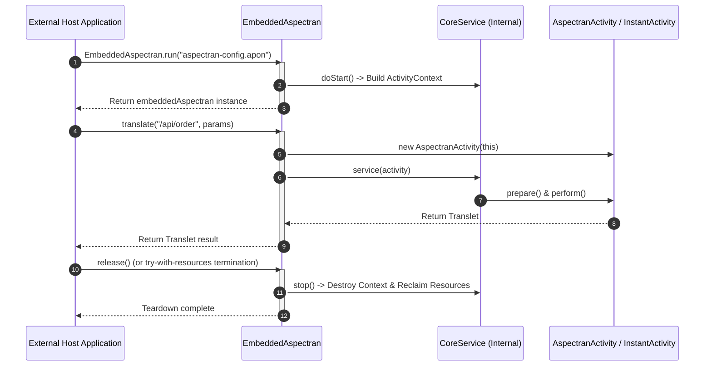

## 1. Design Goals and Primary Roles

The `com.aspectran.embed.service` package provides an **optimized, high-level facade** that enables the Aspectran framework to be embedded like a lightweight library inside standard Java applications (such as Spring Boot, Dropwizard, standalone CLIs, GUI apps, or batch systems).

The core architectural objectives of this package are:

*   **Developer-Friendly One-Stop Facade**: Allows developers to intuitively control all core framework capabilities—such as DI, AOP, template rendering, and translet execution—through a single interface (`EmbeddedAspectran`), without requiring intimate knowledge of `CoreService` hierarchies or lifecycle propagation internals.
*   **One-Liner Bootstrapping**: Enables context building and service startup via a single line of code through static factory methods (`EmbeddedAspectran.run(...)`), accepting configuration file paths, `File` references, or raw APON strings.
*   **Use-Case Focused API Design**: Provides specialized methods centered on real-world embedded use cases: synchronous translet execution (`translate`), direct template engine rendering (`render`), lambda-based context block execution (`execute`), and bean retrieval (`getBean`).
*   **Resource Management and Isolation**: Shares memory and threads with the host application while ensuring a safe, isolated environment where all singleton beans and resources (thread pools, DB connection pools, background timers) can be cleanly torn down with a single `release()` call.

## 2. Key Classes and Interfaces In-Depth Analysis

### `EmbeddedAspectran` (Interface)

The **single point of entry facade** for interacting with Aspectran in embedded mode. It implements `AutoCloseable`, fully supporting Java's `try-with-resources` statement.

*   **Core Responsibilities and Key Methods**:
    *   **Static Factory Methods (`run`)**:
        *   `EmbeddedAspectran.run(File aspectranConfigFile)`
        *   `EmbeddedAspectran.run(String basePath, String configFilePath)`
        *   `EmbeddedAspectran.run(AspectranConfig aspectranConfig)`
        *   Accepts a base path and configuration definition, instantiates `DefaultEmbeddedAspectran`, immediately triggers internal `start()`, and returns an active facade instance.
    *   `translate(String transletName, ...)`: Programmatically invokes a specific translet and returns the resulting `Translet` object holding execution output and state.
    *   `render(String templateName, ...)` / `render(TemplateRule, ...)`: Renders view templates (Thymeleaf, FreeMarker, etc.) on the fly without executing the entire translet pipeline, returning the output as a String.
    *   `execute(InstantAction<T> action)`: Executes a lambda code block while Aspectran's thread-local activity context is active and returns the computed result.
    *   `getBean(String id)` / `getBean(Class<T> type)`: Directly retrieves singleton bean instances from the bean registry of the underlying `ActivityContext`.
    *   `release()`: Destroys the embedded Aspectran context entirely and safely cleans up all allocated resources (equivalent to `close()`).

### `AbstractEmbeddedAspectran` (Abstract Class)

The foundational bridge class that directly extends `DefaultCoreService` while implementing the `EmbeddedAspectran` interface.

*   **Core Responsibilities and Structural Role**:
    *   Internally incorporates all lifecycle management and context orchestration logic of a complete `CoreService`.
    *   Externally hides complex internal framework classes, exposing only the simplified convenience methods of `EmbeddedAspectran`.
    *   Parses injected `EmbedConfig` settings to instantiate and manage the embedded session manager (`DefaultSessionManager`).

### `DefaultEmbeddedAspectran` (Concrete Implementation Class)

The final concrete implementation of `EmbeddedAspectran`, responsible for translating programmatic invocations into `AspectranActivity` and `InstantActivity` executions.

*   **Execution Pipeline Deep Dive**:
    *   `translate(...)`:
        1.  Instantiates the dedicated `AspectranActivity`.
        2.  Injects the target translet name, attribute map, parameter map, and request body stream.
        3.  Binds an `OutputStringWriter` to capture rendered output in memory.
        4.  Executes `service(activity)` -> `activity.prepare()` -> `activity.perform()` to trigger business rules and AOP advice, then returns the completed `Translet` instance.
    *   `render(...)` and `execute(...)`:
        *   Instantiates and runs a lightweight **`InstantActivity`** rather than the full translet pipeline.
        *   For `execute(InstantAction<T>)`, the supplied lambda block runs within the context stack of `InstantActivity`, ensuring that calls to `ActivityContext.getCurrentActivity()` succeed normally inside the lambda body.

## 3. Interactions with Other Packages

*   **`com.aspectran.core.service`**: `DefaultEmbeddedAspectran` extends `DefaultCoreService`, completely inheriting and sharing the core context lifecycle.
*   **`com.aspectran.embed.activity`**: When `translate()` is called, `AspectranActivity` is created to wrap request parameters and body data in virtualized adapters.
*   **`com.aspectran.core.activity`**: Utilizes lightweight, one-shot `InstantActivity` during `render()` and `execute()` invocations.

## 4. Package Summary and Architectural Significance

The `com.aspectran.embed.service` package represents an **exemplary implementation of the Facade Pattern**:

1.  **Minimized Barrier to Entry**: External developers do not need to learn Aspectran's 5-stage build pipeline or symmetric adapter architecture; a single `EmbeddedAspectran.run()` invocation immediately unlocks powerful framework capabilities (AOP, transactions, template engines).
2.  **Use-Case Oriented Architecture**: Perfectly satisfies requirements where running a full servlet or socket server is unnecessary—such as "using Aspectran solely as a template rendering module" or "using it as a rule-based translet computation engine".
3.  **Safe Isolation and Teardown**: Implementing `AutoCloseable` guarantees safe instantiation and teardown without memory leaks within foreign frameworks or applications.
