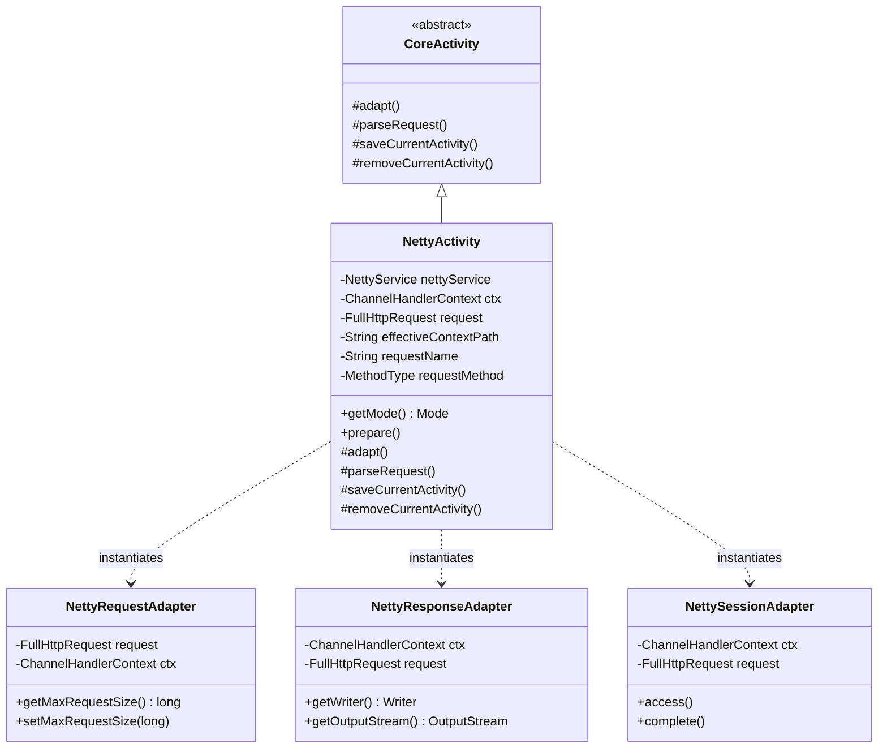

## 1. Design Goals and Primary Roles

The `com.aspectran.netty.activity` package provides the **dedicated `Activity` implementation and adapter layer** that processes HTTP requests incoming from an embedded Netty web server directly via native `ChannelHandlerContext` and `FullHttpRequest`, completely without standard servlet APIs.

The core architectural objectives of this package are:

*   **Concretization of the Netty Asynchronous Channel Execution Context**: Inherits from standard `CoreActivity` to provide `NettyActivity`, wrapping Netty's `ChannelHandlerContext` and `FullHttpRequest` directly without intermediate servlet container layers.
*   **Complete Support for Advanced Web Specifications**: Delivers channel-level handling for HTTP method overrides (`X-HTTP-Method-Override`, `X-Method-Override`), reverse proxy forwarding headers (`X-Forwarded-For`), payload size restrictions (`maxRequestSize`), and character encoding resolutions.
*   **Netty-Specific Session Manager Integration**: Connects with `NettySessionAdapter` to ensure cookie-based session tracking, expiration scheduling, and proper session agent lifecycles (`access()`, `complete()`).
*   **Web Request Body and Multipart Form Parsing**: Coordinates with `WebRequestBodyParser` to parse large file uploads (`multipart/form-data`) and URL-encoded forms (`application/x-www-form-urlencoded`) directly from Netty's `ByteBuf` buffers.

## 2. Key Classes In-Depth Analysis



### `NettyActivity` (Concrete Implementation Class)

The final concrete `Activity` class tailored for Netty environments. It is newly instantiated per incoming `ChannelHandlerContext` and `FullHttpRequest` on each invocation of `DefaultNettyService.service()`.

*   **Core Responsibilities and Attributes**:
    *   `nettyService`: References the parent `NettyService` instance to retrieve session managers, flash maps, and locale resolvers.
    *   `ctx`: Netty's channel handler context, controlling the underlying network socket channel and pipeline execution.
    *   `request`: Netty native `FullHttpRequest` object holding HTTP methods, URIs, headers, and `ByteBuf` body data.
    *   `effectiveContextPath`: The resolved context path used to construct accurate absolute URLs in reverse proxy configurations.
    *   `getMode()`: Always returns `Mode.WEB`, activating web-specific AOP advice and view dispatchers.

*   **Deep Dive into Core Methods**:
    *   `prepare()` and Hidden Method Override:
        ```java
        @Override
        public void prepare(@NonNull String requestName, MethodType requestMethod)
                throws TransletNotFoundException, ActivityPrepareException {
            if (requestMethod == MethodType.POST) {
                String method = request.headers().get(HttpHeaders.X_HTTP_METHOD_OVERRIDE);
                if (method == null) {
                    method = request.headers().get(HttpHeaders.X_METHOD_OVERRIDE);
                }
                if (method != null) {
                    MethodType hiddenRequestMethod = MethodType.resolve(method);
                    if (hiddenRequestMethod != null) {
                        requestMethod = hiddenRequestMethod;
                    }
                }
            }
            super.prepare(requestName, requestMethod);
        }
        ```
        Detects `X-HTTP-Method-Override` headers in incoming `POST` requests, dynamically promoting the virtual request method to `PUT`, `DELETE`, etc.
    *   `adapt()`: **The core implementation of Netty adaptation**.
        ```java
        @Override
        protected void adapt() throws AdapterException {
            NettyResponseAdapter responseAdapter = new NettyResponseAdapter(ctx, request, this);
            setResponseAdapter(responseAdapter);

            if (nettyService.isSessionAdaptable()) {
                if (getPendingActivity() == null) {
                    NettySessionAdapter sessionAdapter = new NettySessionAdapter(ctx, request, responseAdapter, this);
                    setSessionAdapter(sessionAdapter);
                } else if (getPendingActivity().hasSessionAdapter()) {
                    setSessionAdapter(getPendingActivity().getSessionAdapter());
                }
            }

            NettyRequestAdapter requestAdapter = new NettyRequestAdapter(
                    getTranslet().getRequestMethod(), request, ctx, getContextPath(),
                    nettyService.isProxyAddressForwarding());
            setRequestAdapter(requestAdapter);

            setFlashMapManager(nettyService.getFlashMapManager());
            setLocaleResolver(nettyService.getLocaleResolver());

            super.adapt();
        }
        ```
        1.  Initializes `NettyResponseAdapter` first to prepare response headers and output buffer channels.
        2.  Attaches `NettySessionAdapter` to enable cookie-based session tracking within Netty channels.
        3.  Instantiates `NettyRequestAdapter` to bind parameters, headers, proxy forwarding rules, and payload limits.
        4.  Integrates the flash map manager and locale resolver.
    *   `parseRequest()`:
        Drives `WebRequestBodyParser` to parse multipart forms (`multipart/form-data`) and form parameters directly from Netty's `ByteBuf` payload.
    *   `saveCurrentActivity()` / `removeCurrentActivity()`:
        Invokes `sessionAdapter.access()` upon activity start to update access timestamps, and triggers `sessionAdapter.complete()` upon completion to commit modified attributes and update response cookie headers.

## 3. Interactions with Other Packages

*   **`com.aspectran.netty.service`**: `DefaultNettyService` creates `NettyActivity` for each incoming HTTP request and delegates execution via `prepare()` and `perform()`.
*   **`com.aspectran.netty.adapter`**: `NettyActivity` internally instantiates `NettyRequestAdapter`, `NettyResponseAdapter`, and `NettySessionAdapter` to abstract interactions with native Netty constructs.
*   **`com.aspectran.web.activity.request`**: Coordinates with `WebRequestBodyParser` to handle large file uploads and form parameters.
*   **`com.aspectran.core.activity`**: `NettyActivity` extends `CoreActivity`, fully reusing its built-in AOP advice chains (`BEFORE`, `AFTER`, `THROWN`, `FINALLY`), action dispatching (`dispatchContent`), and response transformations without modification.

## 4. Package Summary and Architectural Significance

The `com.aspectran.netty.activity` package and `NettyActivity` demonstrate **how smoothly Aspectran's adapter architecture harmonizes with high-performance, asynchronous, event-driven networking**:

1.  **Direct Socket Channel Binding**: Integrates directly with `ChannelHandlerContext` to flush response buffers immediately (`writeAndFlush`) or manage HTTP chunked streaming without thread blocking.
2.  **Full Enterprise Web Capability**: Despite operating without a servlet container, it fully supports multipart uploads, session management, Method Override, and content negotiation required by enterprise web applications.
3.  **Cross-Runtime Consistency**: Honors identical adapter contracts as Servlet (`ServletWebActivity`) and Undertow (`TowActivity`), ensuring developers maintain a unified codebase even across changing deployment environments.
