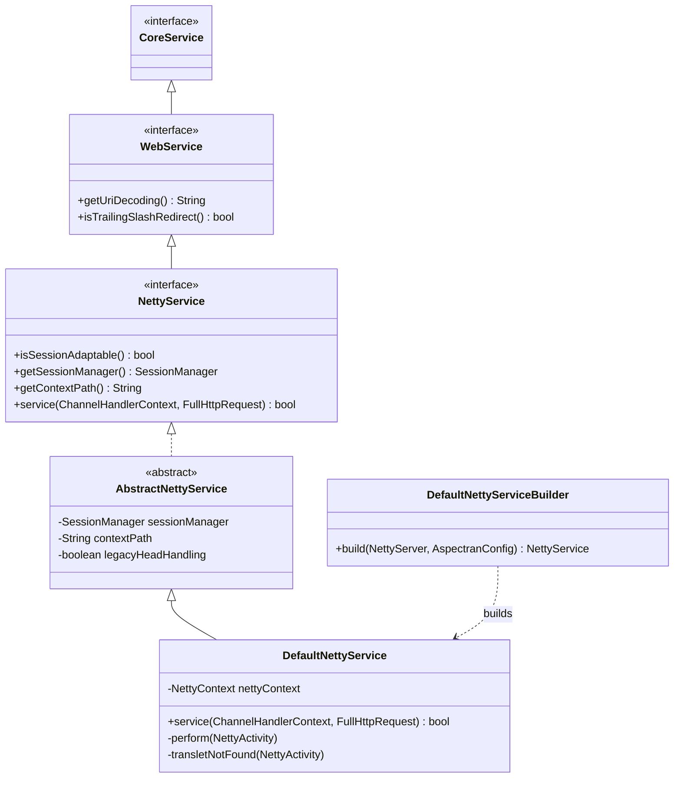
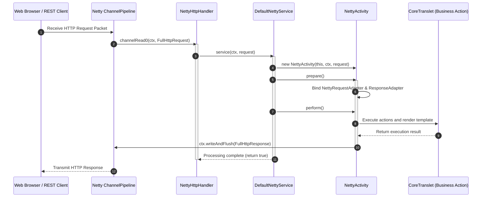

## 1. Design Goals and Primary Roles

The `com.aspectran.netty.service` package provides specialized service layer implementations that enable Aspectran to run on Netty—an asynchronous, event-driven network application framework—**as a pure non-blocking I/O (NIO) web server without requiring a servlet container**.

The core architectural objectives of this package are:

*   **Servlet-Free Asynchronous Non-Blocking Web Server**: Eliminates constraints imposed by standard servlet specifications (`jakarta.servlet`) or blocking I/O thread pools, integrating directly with Netty's `EventLoopGroup`, `ChannelHandlerContext`, and `FullHttpRequest` to achieve maximum network throughput and ultra-low latency.
*   **Inheritance of Pure Web Interface (`WebService`)**: Implements the root `WebService` interface from the `aspectran-web` module, fully reusing standard web configurations (`WebConfig`)—including session management, URI decoding, and trailing slash redirection (`trailingSlashRedirect`)—in total symmetry with Servlet and Undertow environments.
*   **Seamless Integration with Netty Channel Pipelines**: Registered as an inbound channel handler via `NettyHttpHandler`, smoothly coordinating with static resource handlers (`NettyResourceHandler`), path-based logging group handlers (`PathBasedLoggingGroupHandler`), and dynamic HTTP compression (`SelectiveHttpContentCompressor`).
*   **Thread Context ClassLoader Switching and Session Isolation**: Temporarily binds the `SiblingClassLoader` context to Netty worker threads via `ThreadContextHelper.overrideClassLoader()` during business execution, while managing isolated session state via cookie-based `NettySessionManager`.

## 2. Key Classes and Interfaces In-Depth Analysis



### `NettyService` (Interface)

The core specification for Netty-based asynchronous web services in Aspectran, extending `WebService`.

*   **Core Responsibilities**:
    *   Extends `WebService` to inherit common web lifecycles and configuration mechanisms.
    *   `service(ChannelHandlerContext ctx, FullHttpRequest request)`: Declares the web entry-point method that accepts an incoming HTTP request from Netty's channel pipeline and executes the translet pipeline.
    *   `getSessionManager()` / `setSessionManager(SessionManager)`: Manages the session manager customized for Netty runtime environments.
    *   `getContextPath()` / `setContextPath(String)`: Controls context paths for multi-context request routing.

### `AbstractNettyService` (Abstract Class)

An abstract base class encapsulating foundational web infrastructure logic for `NettyService`.

*   Parses injected `WebConfig` settings to configure URI string decoding strategies, session timeout parameters, and trailing slash redirection rules.
*   Oversees the lifecycle of Netty session managers and background resource reclamation across service lifecycles (`doStart`, `doStop`).

### `DefaultNettyService` (Concrete Implementation Class)

The primary concrete implementation of `NettyService`, handling `FullHttpRequest` objects dispatched from Netty channels, instantiating `NettyActivity`, and executing the translet pipeline.

*   **Core Execution Pipeline (`service(ChannelHandlerContext, FullHttpRequest)`)**:
    1.  **Service State Verification**: If the service is paused (`isPaused`), immediately transmits an HTTP `503 Service Unavailable` response to the channel and halts processing.
    2.  **Request URI Parsing and Decoding**: Isolates the path from `request.uri()`, safely decodes it according to `getUriDecoding()`, and extracts the translet name (`requestName`) by stripping the `contextPath`.
    3.  **Authorization Verification (`isRequestAcceptable`)**: Verifies through `RequestAcceptor` whether the URI is an authorized translet managed by Aspectran, returning `404 Not Found` if unauthorized.
    4.  **`NettyActivity` Instantiation**: Constructs a dedicated `NettyActivity` injected with `ChannelHandlerContext`, `FullHttpRequest`, and the effective context path.
    5.  **`prepare()` and Trailing Slash Redirection**:
        *   If the translet is not found (`TransletNotFoundException`), checks if appending a trailing slash (`/`) matches an existing translet rule, automatically emitting an HTTP 301/302 redirect response across the Netty channel.
    6.  **`perform()` Execution and ClassLoader Isolation**:
        ```java
        ClassLoader origClassLoader = ThreadContextHelper.overrideClassLoader(getServiceClassLoader());
        try {
            activity.perform();
        } finally {
            ThreadContextHelper.restoreClassLoader(origClassLoader);
        }
        ```
        Temporarily swaps the thread context classloader with the Aspectran service classloader, executing standard AOP advice, business actions, and template transformations.

### `DefaultNettyServiceBuilder` (Builder Class)

A factory builder that constructs `DefaultNettyService` instances from embedded Netty server definitions (`NettyServer`) and `AspectranConfig`.

*   Configures Netty bootstrapping (`ServerBootstrap`), socket channel options, and channel initializers (`NettyChannelInitializer`) into an operational non-blocking web server service.

## 3. Interactions with Other Packages and Netty Pipeline



*   **`com.aspectran.web.service`**: Extends the root interface `WebService`, ensuring complete conformance with web standards.
*   **`com.aspectran.netty.activity`**: Instantiates `NettyActivity` for each incoming HTTP request, bridging it into the core engine's standard lifecycle.
*   **`io.netty.channel` and `io.netty.handler.codec.http`**: Communicates directly with Netty's `ChannelHandlerContext`, `FullHttpRequest`, and `FullHttpResponse` native APIs to manage headers, status codes, and byte buffers.

## 4. Package Summary and Architectural Significance

The `com.aspectran.netty.service` package represents an **advanced adapter layer demonstrating how the Aspectran framework fully embraces modern event-loop-driven non-blocking web server technologies**:

1.  **Servlet-Free Asynchronous Event Loop**: Completely departs from blocking servlet thread models to operate directly on Netty's high-performance `EventLoopGroup`, enabling tens of thousands of concurrent connections with minimal system resources.
2.  **Configuration Symmetry and Portability**: Translet business logic and XML/APON configurations originally authored for Servlet or Undertow environments port to Netty with 100% fidelity and zero code changes.
3.  **Sophisticated Channel Pipeline Cooperation**: Smoothly integrates with static resource handlers, access logs, path-based logging groups, and dynamic GZIP/Brotli compression handlers to deliver an enterprise-grade standalone web server.
