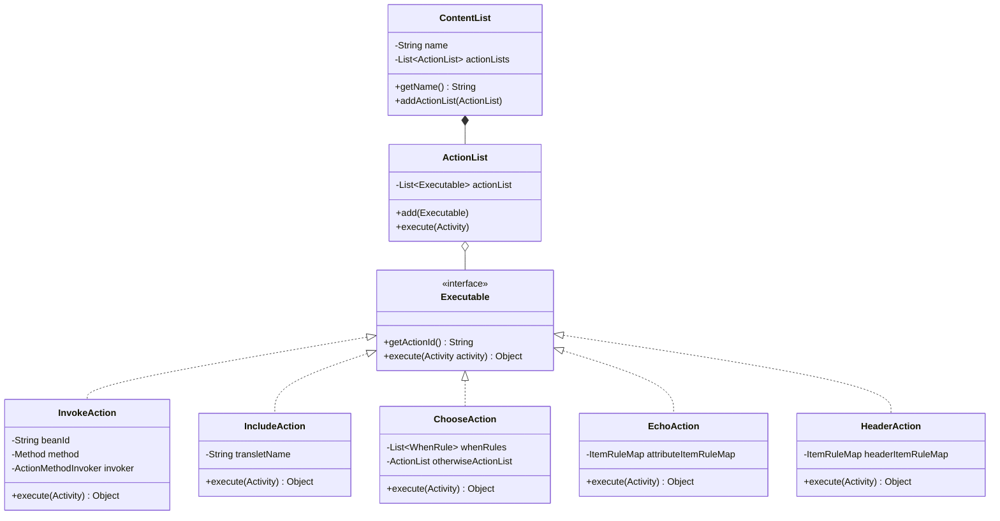
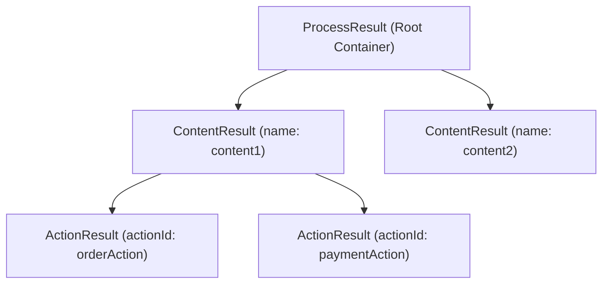

## 1. Design Goals and Primary Roles

The `com.aspectran.core.activity.process` package is responsible for **assembling executable actions declared within `<contents>` and `<response>` blocks into a structured tree within the `Activity` execution pipeline, sequentially dispatching them, and systematically collecting their results**.

The core architectural objectives of this package are:

*   **Standardization via the Command Pattern**: Abstructs all concrete business operations—bean method invocations, sub-translet inclusions, conditional branchings, header manipulations, string echoes—behind a common command interface (`Executable`), allowing the execution engine to run all action types through a unified contract.
*   **Structured Execution Containers via the Composite Pattern**: Employs `ActionList` (grouping actions) and `ContentList` (forming named logical execution blocks) to model nested configuration blocks in memory as an identical execution tree.
*   **Intelligent Parameter Binding (`ActionMethodInvoker`)**: Inspects method signatures via reflection and leverages the ASEL token evaluator to resolve and inject required invocation arguments (`Activity`, `Translet`, request parameters, attributes, sessions, etc.) automatically.
*   **Result Model with 1:1 Structural Symmetry (`result` package)**: Maintains a three-tier result hierarchy—`ProcessResult` -> `ContentResult` -> `ActionResult`—that mirrors the executed action tree, preserving returned values for subsequent actions and view templates to reference cleanly by ID.

## 2. Key Classes and Interfaces In-Depth Analysis

### Top-Level Action Containers: `ContentList` and `ActionList`

Components organizing action blocks defined in translet rules into in-memory tree hierarchies.

*   **`ContentList` (Class)**:
    *   Top-level execution container corresponding to `<contents>` or `<content>` tags.
    *   Can possess a unique identifier name (`name`) and encapsulates multiple `ActionList` child elements.
    *   Maps directly 1:1 with `ContentResult` in the execution output model.
*   **`ActionList` (Class)**:
    *   An ordered list container of `Executable` actions executed sequentially.
    *   Encapsulates action sequences inside `<content>` as well as conditionally executed groups like `<when>` and `<otherwise>` blocks.
    *   Invokes encapsulated actions via `execute(Activity activity)` and records their return values into `ContentResult`.

### Concrete Action Implementations: `com.aspectran.core.activity.process.action`

*   **`Executable` (Interface)**:
    *   The foundational command interface that all action classes must implement.
    *   `execute(Activity activity)`: Executes the concrete business logic of the action. Receives the active `Activity` to access contexts, bean registries, and request/session state freely.
    *   `getActionId()`: Returns the unique identifier of the action, utilized as the key to retrieve results from `ProcessResult`.
*   **`InvokeAction` (Class)**:
    *   The primary action class executing methods on designated bean instances.
    *   Integrates `ActionMethodInvoker` to intelligently inject `Translet`, `Activity`, attributes, and HTTP parameters based on parameter types declared in target method signatures.
*   **`MethodAction` (Class)**:
    *   Executes static methods or direct instance methods without requiring prior bean instantiation.
*   **`IncludeAction` (Class)**:
    *   Embeds the execution of another translet into the current processing flow.
    *   Looks up the target translet rule and executes it by creating a child derived activity under the active `Activity`, modularizing shared translet logic.
*   **`ChooseAction` (Class)**:
    *   Executes declarative conditional branching (`<choose>-<when>-<otherwise>`).
    *   Sequentially evaluates `test` boolean expressions (AsEL) on each `<when>` block, executing the first matching `ActionList` (or falling back to `<otherwise>` if all evaluate to false).
*   **`EchoAction` and `HeaderAction` (Classes)**:
    *   `EchoAction`: Streams attribute values directly into the response body stream.
    *   `HeaderAction`: Dynamically adds or updates HTTP response headers via `ResponseAdapter`.
*   **`AdviceAction` and `MethodAdviceAction` (Classes)**:
    *   Wraps AOP aspect advice logic (`BEFORE`, `AFTER`, `THROWN`, `FINALLY`) into `Executable` instances, integrating seamlessly with action execution pipelines.

### Action Execution Result Model: `com.aspectran.core.activity.process.result`

*   **`ProcessResult` (Class)**:
    *   The top-level container retaining all outcomes produced during a single `Activity` lifecycle.
    *   Manages multiple content block results in a `Map<String, ContentResult>` structure, integrating with `ActivityData` to allow immediate expression access via AsEL tokens such as `#{orderAction}`.
*   **`ContentResult` (Class)**:
    *   Represents the execution result of a single `ContentList` block.
    *   Maintains an internal `List<ActionResult>`, preserving the execution order and return values of all actions within that block.
*   **`ActionResult` (Class)**:
    *   Encapsulates the result of an individual `Executable` action.
    *   Securely stores the action identifier (`actionId`) alongside the actual object returned by the invoked method (`resultValue`).

## 3. Interactions with Other Packages

*   **`com.aspectran.core.activity`**: `CoreActivity.dispatchContent()` traverses `ContentList` instances in this package, calling `ActionList.execute()` and aggregating outputs into `ProcessResult`.
*   **`com.aspectran.core.context.rule`**: Rule objects parsed during configuration building (`ActionRule`, `InvokeActionRule`, `IncludeActionRule`, `ChooseRule`, etc.) are instantiated into concrete `Executable` objects within this package.
*   **`com.aspectran.core.component.bean`**: `InvokeAction` queries the bean registry via `Activity` to retrieve target bean instances and invoke methods reflectively.

## 4. Package Summary and Architectural Significance

The `com.aspectran.core.activity.process` package provides the **vital mechanism through which declarative XML/APON business rules materialize at runtime into executable object trees and structured result models**:

1.  **Synergy of Command and Composite Patterns**: Abstracting actions as `Executable` and nesting them via `ActionList` and `ContentList` allows complex, hierarchical enterprise workflows to be orchestrated intuitively and flexibly.
2.  **Clean Decoupling Between Execution and Data**: Eliminates tight coupling between actions by avoiding direct parameter passing, establishing a loosely coupled data pipeline mediated by the structured `ProcessResult` repository.
3.  **Superior Extensibility**: When custom business action types are needed, developers simply implement `Executable` and attach them to the action tree, fulfilling the Open-Closed Principle (OCP) without altering core engine execution code.
