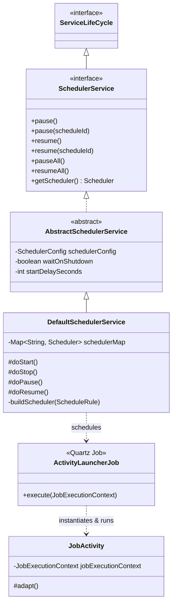
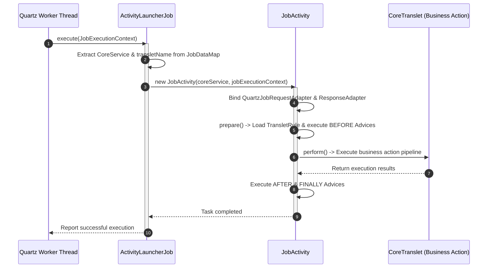

## 1. Design Goals and Key Roles

The `com.aspectran.core.scheduler.service` package is dedicated to **seamlessly integrating Quartz, the industry-standard enterprise scheduling engine, into Aspectran's service lifecycle and rule architecture**.

The primary architectural objectives of this package are:

*   **Declarative Scheduling**: Eliminates low-level Quartz boilerplate (`SchedulerFactory`, `JobDetail`, `TriggerBuilder`), allowing developers to schedule sophisticated batch jobs simply by declaring `<schedule>` rules in configuration files (XML/APON).
*   **Fully Context-Bound Task Execution**: Ensures scheduled tasks execute within Aspectran's complete `ActivityContext`. Batch jobs benefit from dependency injection (DI), declarative transactions, AOP advice interception, and template transformations identically to web requests.
*   **Complete Service Lifecycle Synchronization**: `SchedulerService` operates as a subordinate child service (`subServices`) bound to the root `CoreService`. When the root service starts (`start`), pauses (`pause`), resumes (`resume`), or stops (`stop`), Quartz schedulers transition atomically in tandem.
*   **Transparent Adapter/Bridge Architecture**: Bridges the gap between Quartz's execution model (`JobExecutionContext`, `JobDataMap`) and Aspectran's standard execution contracts ([`Activity`](https://github.com/aspectran/aspectran/blob/master/core/src/main/java/com/aspectran/core/activity/Activity.java), `RequestAdapter`, `ResponseAdapter`).

## 2. Key Classes and Components

### `SchedulerService` (Interface)

The top-level specification governing scheduling services in Aspectran. Extends `ServiceLifeCycle`:

*   **Key Responsibilities**:
    *   Registers as a child service under parent `CoreService`, sharing the application service tree lifecycle.
    *   Provides granular pause (`pause(String scheduleId)`) and resume (`resume(String scheduleId)`) operations for specific schedule rules.
    *   Supports bulk suspension (`pauseAll()`) and resumption (`resumeAll()`) across all managed tasks.
    *   Exposes secure access to the underlying Quartz `org.quartz.Scheduler` instance.

### `AbstractSchedulerService` (Abstract Class)

The abstract template implementing common infrastructure and lifecycle handling for `SchedulerService`:

*   **Key Responsibilities & Properties**:
    *   Holds [`SchedulerConfig`](https://github.com/aspectran/aspectran/blob/master/core/src/main/java/com/aspectran/core/context/config/SchedulerConfig.java) configurations.
    *   `startDelaySeconds`: Controls an initial startup delay in seconds before Quartz triggers begin firing, allowing background caches and singleton beans to warm up completely before batch workloads start.
    *   `waitOnShutdown`: Governs graceful shutdown behavior, determining whether `stop()` blocks until running batch tasks finish executing.

### `DefaultSchedulerService` (Implementation Class)

The primary concrete implementation of `SchedulerService`, binding Aspectran's `ScheduleRule` definitions to Quartz schedulers and coordinating execution:

*   **Operational Pipeline (`doStart()`)**:
    1.  Queries the `ScheduleRuleRegistry` inside `ActivityContext` to retrieve all registered [`ScheduleRule`](https://github.com/aspectran/aspectran/blob/master/core/src/main/java/com/aspectran/core/context/rule/ScheduleRule.java) descriptors.
    2.  Resolves designated `schedulerBean` instances, or provisions default schedulers via `QuartzSchedulerFactoryBean`.
    3.  Instantiates a Quartz `JobDetail` for each [`ScheduledJobRule`](https://github.com/aspectran/aspectran/blob/master/core/src/main/java/com/aspectran/core/context/rule/ScheduledJobRule.java), designating Aspectran's universal bridge class—**[`ActivityLauncherJob`](https://github.com/aspectran/aspectran/blob/master/core/src/main/java/com/aspectran/core/scheduler/service/ActivityLauncherJob.java)**—as the target job class.
    4.  Packs target translet names (`transletName`) and the `CoreService` reference into the Quartz `JobDataMap`.
    5.  Builds a `CronTrigger` (Cron expressions) or `SimpleTrigger` (interval-based) based on the `<trigger>` configuration.
    6.  Registers the job and trigger into the Quartz scheduler via `scheduler.scheduleJob(jobDetail, trigger)`.
    7.  Launches the scheduler via `scheduler.startDelayed(startDelaySeconds)` or `scheduler.start()`.
*   **Lifecycle Control (`doStop`, `doPause`, `doResume`)**:
    *   `doStop()`: Calls `shutdown(waitOnShutdown)` on all active Quartz schedulers, gracefully terminating jobs and reclaiming thread pool resources.
    *   `doPause()` / `doResume()`: Toggles schedulers between `standby()` and `start()` states.

### `ActivityLauncherJob` (Quartz Job Implementation)

Implements Quartz's `org.quartz.Job` interface, acting as the **core callback bridge** between Quartz worker threads and Aspectran's execution engine:

*   **Execution Mechanics**:
    *   Invoked by Quartz worker threads via `execute(JobExecutionContext)` when a trigger fires.
    *   Retrieves the parent `CoreService` reference and target `transletName` from `JobExecutionContext`.
    *   Instantiates a dedicated [`JobActivity`](https://github.com/aspectran/aspectran/blob/master/core/src/main/java/com/aspectran/core/scheduler/activity/JobActivity.java) and runs the translet execution pipeline (`prepare()`, `perform()`).
    *   Catches exceptions and wraps them into `JobExecutionException` to alert Quartz monitoring listeners.

### `JobActivity` & Dedicated Adapters

Concrete activity and adapter classes optimized for batch execution:

*   **[`JobActivity`](https://github.com/aspectran/aspectran/blob/master/core/src/main/java/com/aspectran/core/scheduler/activity/JobActivity.java)**: Specialized activity running on Quartz worker threads, safely binding contexts to thread-local storage and tearing them down upon completion.
*   **[`QuartzJobRequestAdapter`](https://github.com/aspectran/aspectran/blob/master/core/src/main/java/com/aspectran/core/scheduler/adapter/QuartzJobRequestAdapter.java)**: Exposes `JobDataMap` parameters and job context attributes through the standard `RequestAdapter` interface.
*   **[`QuartzJobResponseAdapter`](https://github.com/aspectran/aspectran/blob/master/core/src/main/java/com/aspectran/core/scheduler/adapter/QuartzJobResponseAdapter.java)**: Dedicated response adapter capturing batch outcomes and execution logs.

### `ActivityJobListener` & `ActivityJobReporter`

Monitoring listeners implementing Quartz's `JobListener`:

*   Intercepts job startup, completion, and exceptions to log elapsed times and record audit reports.

### `QuartzSchedulerFactoryBean`

A factory bean allowing developers to declare and customize Quartz `Scheduler` instances inside the IoC container:

*   Supports declarative configuration of clustered database job stores (`JobStoreTX`, `JobStoreCMT`), distributed locking, and DataSource connection pools.

## 3. Interactions with Other Packages

*   **`com.aspectran.core.service`**: `SchedulerService` registers as a child service under `CoreService`, synchronizing with parent lifecycle states.
*   **`com.aspectran.core.activity`**: `ActivityLauncherJob` instantiates `JobActivity`, executing the standard `CoreActivity` pipeline (AOP advices, action chains, transactions).
*   **`com.aspectran.core.context.rule`**: Parses `<schedule>` and `<job>` tags into `ScheduleRule` and `ScheduledJobRule` descriptors.
*   **`org.quartz`**: Directly integrates with the Quartz core library APIs (`Scheduler`, `JobDetail`, `Trigger`).

## 4. Package Summary and Architectural Significance

The `com.aspectran.core.scheduler.service` package establishes enterprise batch scheduling as a first-class citizen in Aspectran:

1.  **Exemplary Adapter/Bridge Architecture**: Transforms Quartz thread pool execution into Aspectran's unified execution model via `ActivityLauncherJob` and `JobActivity`.
2.  **Declarative Batch Development**: Developers author scheduled jobs as standard translets using familiar business actions, binding them to schedules via simple `<schedule>` tags without thread-management boilerplate.
3.  **Unified Service Lifecycle**: Unifies background schedulers with the master application lifecycle (`ServiceLifeCycle`), providing predictable pausing, resuming, and graceful shutdowns.
