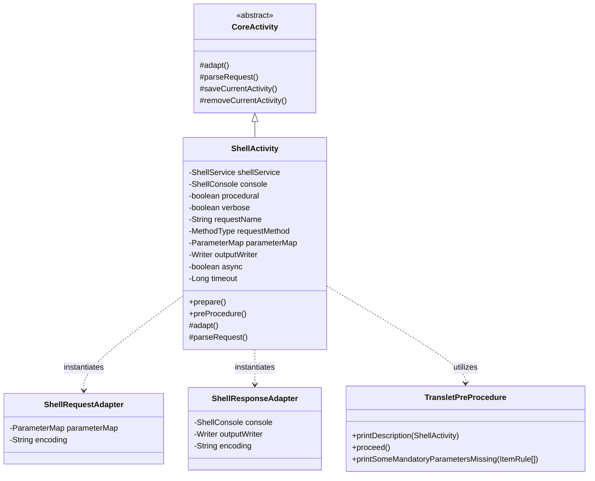

## 1. Design Goals and Primary Roles

The `com.aspectran.shell.activity` package provides the **dedicated `Activity` implementation and adapter layer** that executes command-line instructions—parsed by `ShellService`—directly within an interactive console terminal environment.

The core architectural objectives of this package are:

*   **Concretization of the Interactive Terminal Execution Context**: Extends abstract `CoreActivity` to provide `ShellActivity`, capable of driving the translet pipeline within a CLI environment characterized by ANSI color styling and interactive user keyboard input.
*   **Interactive Parameter Prompting (`TransletPreProcedure`)**: Rather than failing abruptly when mandatory parameters (`mandatory="true"`) are omitted from command arguments, it supports an intelligent fallback mechanism that prompts the operator interactively via `ShellConsole` to supply the missing values.
*   **Flexible Output Control and Redirection**: Transparently binds not only standard console output streams, but also user-specified file redirection streams (`>`, `>>`) to `ShellResponseAdapter`, allowing rendered results to be buffered or persisted to files.
*   **Verbose Diagnostics and Asynchronous Execution Control**: Accommodates verbose diagnostic mode (`-v`) for step-by-step pipeline logging, while preserving metadata to dispatch background tasks when translet rules declare asynchronous execution (`async="true"`, `timeout`).

## 2. Key Classes In-Depth Analysis



### `ShellActivity` (Concrete Implementation Class)

The final concrete `Activity` class tailored for interactive shell environments. It is newly instantiated per request each time `ShellService.translate()` is executed.

*   **Core Responsibilities and Attributes**:
    *   `shellService` / `console`: Maintains references to the parent shell service and the JLine3-backed `ShellConsole`.
    *   `procedural`: Governs whether interactive prompts should be launched when mandatory input parameters are missing.
    *   `verbose`: Indicates whether detailed step-by-step diagnostic information should be rendered to the console during execution.
    *   `parameterMap`: Holds parameters extracted by the command-line option parser (`OptionParser`).
    *   `outputWriter`: Points to the active console output stream or an opened file redirection stream.
    *   `async` / `timeout`: Caches asynchronous execution flags and timeout metadata (in ms) declared in the active `TransletRule`.

*   **Deep Dive into Core Methods**:
    *   `adapt()`: **The core adaptation method for shell runtime environments**.
        ```java
        @Override
        protected void adapt() throws AdapterException {
            setSessionAdapter(shellService.newSessionAdapter());

            ShellRequestAdapter requestAdapter = new ShellRequestAdapter(getTranslet().getRequestMethod());
            requestAdapter.setEncoding(console.getEncoding());
            if (getParameterMap() != null) {
                requestAdapter.setParameterMap(getParameterMap());
            }
            setRequestAdapter(requestAdapter);

            Writer outputWriter = (getOutputWriter() != null ? getOutputWriter() : new OutputStringWriter());
            ShellResponseAdapter responseAdapter = new ShellResponseAdapter(console, outputWriter);
            responseAdapter.setEncoding(console.getEncoding());
            setResponseAdapter(responseAdapter);

            setFlashMapManager(shellService.getFlashMapManager());
            setLocaleResolver(shellService.getLocaleResolver());

            super.adapt();
        }
        ```
        1.  Binds the shell session adapter via `shellService.newSessionAdapter()`.
        2.  Attaches parsed command-line parameters and sets character encoding on `ShellRequestAdapter`.
        3.  Wraps the output stream (`outputWriter`) and `console` inside `ShellResponseAdapter`, activating console styling and file redirection.
        4.  Integrates the flash map manager and locale resolver.
    *   `parseRequest()`: **The engine for interactive prompting and validation**.
        ```java
        @Override
        protected void parseRequest() throws RequestParseException, ActivityTerminatedException {
            TransletPreProcedure procedure = new TransletPreProcedure(
                    console, getTransletRule(), getParameterMap(), isProcedural());
            procedure.printDescription(this);
            try {
                procedure.proceed();
                super.parseRequest();
            } catch (MissingMandatoryParametersException e) {
                procedure.printSomeMandatoryParametersMissing(e.getItemRules());
                terminate("Some mandatory parameters are missing");
            } catch (MissingMandatoryAttributesException e) {
                procedure.printSomeMandatoryAttributesMissing(e.getItemRules());
                terminate("Some mandatory attributes are missing");
            }
        }
        ```
        1.  Instantiates `TransletPreProcedure` to render translet descriptions and guidance banners to the terminal.
        2.  Executes `procedure.proceed()`. If `isProcedural() == true`, it interactively prompts the user line by line for any missing mandatory parameters (supporting masked input for passwords) and injects the answers directly into the parameter map.
        3.  If mandatory parameters remain unfulfilled (`MissingMandatoryParametersException`), it prints clear error notifications in red and invokes `terminate()` to halt activity execution safely and gracefully.
    *   `saveCurrentActivity()` / `removeCurrentActivity()`:
        Ensures consistent session agent lifecycle handling (`access()`, `complete()`) through `DefaultSessionAdapter`, preserving session state across consecutive interactive command executions.

## 3. Interactions with Other Packages

*   **`com.aspectran.shell.service`**: `DefaultShellService` parses command-line tokens, instantiates `ShellActivity`, attaches redirection output streams, and commands execution.
*   **`com.aspectran.shell.console`**: `ShellActivity` leverages `ShellConsole` stylers and prompt builders to render ANSI color text and capture keyboard input.
*   **`com.aspectran.shell.command`**: `TransletPreProcedure` validates parameter specifications defined in translet rules and manages interactive prompt dialogs.
*   **`com.aspectran.core.activity`**: `ShellActivity` inherits from `CoreActivity`, reusing its full pipeline of AOP advice chains, action dispatchers, and response transformers without modification.

## 4. Package Summary and Architectural Significance

The `com.aspectran.shell.activity` package and `ShellActivity` demonstrate **how flexibly Aspectran's `Activity` model accommodates sophisticated interactive workflows beyond traditional web or batch processing**:

1.  **Intelligent Interactive Extension (`TransletPreProcedure`)**: Eliminates abrasive error halts when required parameters are missing by interactively querying the operator in real time, driving the execution pipeline to successful completion.
2.  **Comprehensive CLI I/O Virtualization**: Unifies UNIX standard file redirection (`>`, `>>`) and ANSI terminal styling under `ShellResponseAdapter`, freeing business action logic from dealing with low-level escape sequences.
3.  **Architectural Integrity**: Incorporates shell-specific interactivity seamlessly into the standard `Activity` lifecycle (`prepare -> adapt -> parseRequest -> perform -> finish`), maintaining total structural consistency with the core engine.
