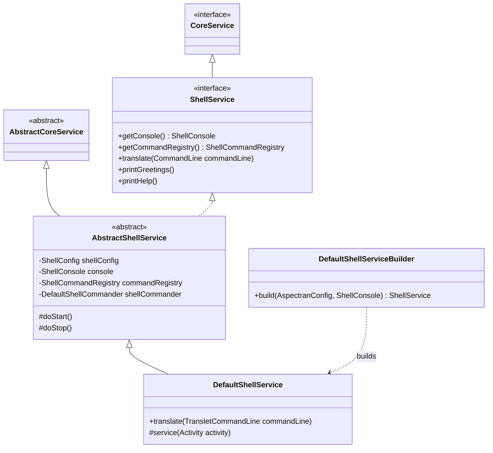
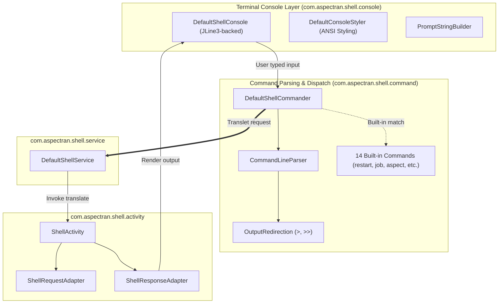

## 1. Design Goals and Primary Roles

The `com.aspectran.shell.service` package provides specialized service layer implementations for running the Aspectran framework as an **interactive, feature-rich command-line shell powered by JLine3**.

The core architectural objectives of this package are:

*   **User-Driven Interactive Runtime**: Implements an interactive human-in-the-loop interaction model that reads, parses, and executes commands typed directly into a terminal console by the operator, in contrast to passive HTTP request processing or automated schedulers.
*   **High-Level Terminal Console Abstraction (`ShellConsole`)**: Encapsulates advanced terminal features—such as ANSI color styling, tab completion, multiline editing, and persistent command history management (`historyFile`)—behind the `ShellConsole` interface, decoupling service business logic from low-level JLine3 complexities.
*   **Command-Line Parsing and Output Redirection**: Decomposes raw command-line strings into translet names, options, parameters, and attributes, providing transparent support for standard UNIX shell output redirection (`>` file overwrite, `>>` file append).
*   **Asynchronous Background Execution Mode**: Supports an asynchronous execution pipeline combined with the `--async` flag, enabling long-running batch translets or compute-intensive jobs to execute in the background without blocking the interactive shell session.
*   **Integration with Rich Built-in Administrative Commands**: Equips the runtime with `ShellCommandRegistry` to execute not only translet invocations, but also over 14 built-in administrative commands such as system diagnostics (`sysinfo`), aspect inspection (`aspect`), job scheduling control (`job`), encryption token generation (`pbencrypt`/`pbdecrypt`), and hot restarts (`restart`).

## 2. Key Classes and Interfaces In-Depth Analysis

### `ShellService` (Interface)

The top-level specification for Aspectran services operating within interactive shell environments, extending `CoreService`.

*   **Core Responsibilities**:
    *   `getConsole()`: Exposes the `ShellConsole` interface governing ANSI styling, prompt rendering, and keystroke capture.
    *   `getCommandRegistry()`: Provides access to the `ShellCommandRegistry` containing all available shell commands.
    *   `translate(CommandLine commandLine)`: Accepts a structured command-line representation of user input and executes the corresponding business pipeline.
    *   `printGreetings()` / `printHelp()`: Renders startup greeting messages (ASCII art banners) and command help guides to the console.

### `AbstractShellService` (Abstract Class)

The abstract foundation encapsulating common terminal infrastructure and command routing mechanisms for `ShellService`.

*   **Core Responsibilities and Implementation Details**:
    *   Applies terminal configurations defined in `ShellConfig`, including prompt formatting, greeting banners, history file paths, and default encoding.
    *   Instantiates `DefaultShellCommander` to inspect incoming user input and dispatch it appropriately: distinguishing framework built-in commands (`sysinfo`, `restart`, etc.) from translet execution requests.
    *   Opens and closes console I/O streams in alignment with the service lifecycle (`doStart`, `doStop`), while initializing the shell session manager.

### `DefaultShellService` (Concrete Implementation Class)

The primary concrete implementation of `ShellService`, responsible for converting parsed command-line requests into `ShellActivity` executions and displaying output to the console.

*   **Core Execution Pipeline (`translate`)**:
    1.  **Command-Line Analysis**: Extracts translet identifiers, virtual HTTP methods, option lists, request parameters, and attributes from the incoming `TransletCommandLine`.
    2.  **Target Writer Resolution**:
        *   If the user specified an output redirection operator (`> /tmp/out.txt` or `>> /tmp/out.txt`), opens a file stream `Writer` directed at the target file path.
        *   If no redirection is specified, binds `console.getWriter()` as the primary output stream.
    3.  **`ShellActivity` Instantiation**: Constructs a dedicated `ShellActivity` injected with parsed parameters and the resolved output `Writer`.
    4.  **Synchronous vs. Asynchronous Execution Branching**:
        *   Standard Execution: Sequentially triggers `service(activity)` -> `activity.prepare()` -> `activity.perform()`, rendering output immediately to the console.
        *   Asynchronous Execution (`--async` flag): Dispatches execution to a background thread pool via `CompletableFuture.runAsync()`, returning an immediate acknowledgment message to the interactive terminal.

### `DefaultShellServiceBuilder` (Builder Class)

A factory class that configures and constructs instances of `DefaultShellService` from `AspectranConfig` and console objects.

*   Provisions `DefaultShellConsole` backed by JLine3's `Terminal` and `LineReader`, configuring the console styler (`DefaultConsoleStyler`) and prompt builder (`DefaultPromptStringBuilder`).
*   Upon startup completion, registers the service with `CoreServiceHolder` and prints the configured greeting banner to the active terminal.

## 3. Interactions with Other Packages and Shell Subsystems

*   **`com.aspectran.shell.console`**: All user interactions traverse `ShellConsole`, which provides tab completion and real-time syntax highlighting.
*   **`com.aspectran.shell.command`**: Input parsed by `CommandLineParser` is packaged into a `TransletCommandLine`, while file redirection streams are managed transparently by `OutputRedirection`.
*   **`com.aspectran.shell.activity`**: `ShellService` delegates translet execution to `ShellActivity`, which executes interactive console callbacks if required parameters are missing.

## 4. Package Summary and Architectural Significance

The `com.aspectran.shell.service` package delivers **one of the most robust and modern interactive CLI management environments** available in enterprise Java frameworks:

1.  **User-Driven Interaction Model**: Distinct from passive web request handling or automated daemon tasks, it establishes an interactive CLI model that provides administrators and engineers with an intuitive operational interface.
2.  **Comprehensive Console Abstraction and UNIX Shell Capabilities**: Tightly integrated with JLine3, it seamlessly incorporates tab completion, history tracking, ANSI color formatting, and file redirection operators (`>`, `>>`) directly into the framework core.
3.  **Unified Control Center for Administration and Testing**: Offers an unrivaled productivity tool that allows developers to verify beans, execute translets, and trigger scheduled batch jobs on the fly without relying on external HTTP clients or REST testing tools.
