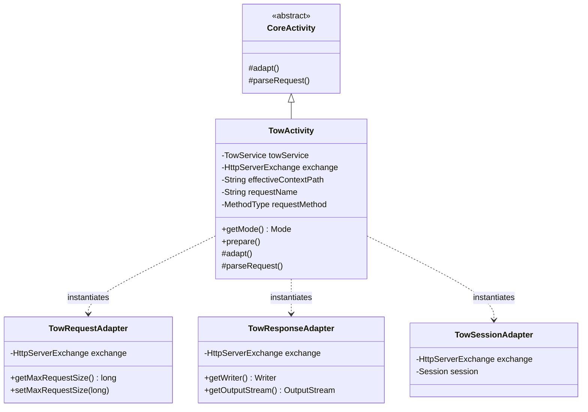

## 1. Design Goals and Primary Roles

The `com.aspectran.undertow.activity` package provides the **dedicated `Activity` implementation and adapter layer** that processes HTTP requests incoming from an embedded Undertow web server natively via `HttpServerExchange`, completely bypassing the traditional servlet API.

The core architectural objectives of this package are:

*   **Concretization of the Servlet-less Web Execution Context**: Inherits from standard `CoreActivity` to provide `TowActivity`, wrapping Undertow's ultra-fast native I/O construct (`HttpServerExchange`) directly without an intermediate servlet container (`jakarta.servlet`) layer.
*   **Complete Support for Advanced Web Features**: Handles HTTP method overrides (`X-HTTP-Method-Override`, `X-Method-Override`), reverse proxy IP forwarding (`X-Forwarded-For`), maximum entity size limits (`maxRequestSize`), and character encoding resolutions at the native exchange level.
*   **Transparent Integration with Undertow Session Manager**: Wraps Undertow's native session structures within `TowSessionAdapter` via channel attachment keys (`SessionManager.ATTACHMENT_KEY`, `SessionConfig.ATTACHMENT_KEY`), providing seamless in-memory and clustered session functionality.
*   **Web Request Body and Multipart Form Parsing**: Coordinates with `WebRequestBodyParser` to parse large file uploads (`multipart/form-data`) and URL-encoded form data (`application/x-www-form-urlencoded`) non-blockingly and efficiently.

## 2. Key Classes In-Depth Analysis



### `TowActivity` (Concrete Implementation Class)

The final concrete `Activity` class tailored for Undertow environments. It is newly instantiated per incoming `HttpServerExchange` on each invocation of `DefaultTowService.service()`.

*   **Core Responsibilities and Attributes**:
    *   `towService`: References the parent `TowService` instance to retrieve resource managers, flash maps, locale resolvers, and session activation policies.
    *   `exchange`: Undertow's native HTTP exchange object, owning request headers, query strings, and I/O buffer streams.
    *   `effectiveContextPath`: Retains the resolved context path to properly prefix generated absolute URLs and links.
    *   `getMode()`: Always returns `Mode.WEB`, activating web-specific AOP advice and view dispatchers.

*   **Deep Dive into Core Methods**:
    *   `prepare()` and Hidden Method Override:
        ```java
        @Override
        public void prepare(@NonNull String requestName, MethodType requestMethod)
                throws TransletNotFoundException, ActivityPrepareException {
            if (requestMethod == MethodType.POST) {
                String method = exchange.getRequestHeaders().getFirst(HttpHeaders.X_HTTP_METHOD_OVERRIDE);
                if (method == null) {
                    method = exchange.getRequestHeaders().getFirst(HttpHeaders.X_METHOD_OVERRIDE);
                }
                if (method != null) {
                    MethodType hiddenRequestMethod = MethodType.resolve(method);
                    if (hiddenRequestMethod != null) {
                        requestMethod = hiddenRequestMethod;
                    }
                }
            }
            super.prepare(requestName, requestMethod);
        }
        ```
        When RESTful API clients or restrictive firewalls cannot dispatch `PUT` or `DELETE` requests directly and fall back to `POST`, inspects the `X-HTTP-Method-Override` header to dynamically elevate the virtual request method.
    *   `adapt()`: **The core implementation of Undertow adaptation**.
        ```java
        @Override
        protected void adapt() throws AdapterException {
            if (towService.isSessionAdaptable()) {
                SessionManager sessionManager = exchange.getAttachment(SessionManager.ATTACHMENT_KEY);
                SessionConfig sessionConfig = exchange.getAttachment(SessionConfig.ATTACHMENT_KEY);
                if (sessionManager != null && sessionConfig != null) {
                    setSessionAdapter(new TowSessionAdapter(exchange));
                }
            }

            TowRequestAdapter requestAdapter = new TowRequestAdapter(getTranslet().getRequestMethod(), exchange);
            requestAdapter.setProxyAddressForwarding(towService.isProxyAddressForwarding());
            // maxRequestSize and encoding binding
            setRequestAdapter(requestAdapter);

            ResponseAdapter responseAdapter = new TowResponseAdapter(exchange, this);
            setResponseAdapter(responseAdapter);
            super.adapt();
        }
        ```
        1.  Verifies the active session manager via Undertow attachments and attaches `TowSessionAdapter`.
        2.  Instantiates `TowRequestAdapter`, configuring reverse proxy IP forwarding (`isProxyAddressForwarding`) and maximum request entity limits (`setMaxEntitySize`).
        3.  Constructs `TowResponseAdapter`, binding Undertow's native `OutputStream` and `Writer` directly for streaming response output.
    *   `parseRequest()`:
        Drives `WebRequestBodyParser` to parse incoming payloads according to their `MediaType`: extracting files from `multipart/form-data` uploads or decoding `application/x-www-form-urlencoded` form parameters.

## 3. Interactions with Other Packages

*   **`com.aspectran.undertow.service`**: `DefaultTowService` constructs `TowActivity` for each incoming HTTP exchange and delegates processing via `prepare()` and `perform()`.
*   **`com.aspectran.undertow.adapter`**: `TowActivity` internally instantiates `TowRequestAdapter`, `TowResponseAdapter`, and `TowSessionAdapter` to abstract interactions with Undertow native objects.
*   **`com.aspectran.web.activity.request`**: Leverages `WebRequestBodyParser` to process large multipart uploads and URL-encoded form data.
*   **`com.aspectran.core.activity`**: `TowActivity` extends `CoreActivity`, fully inheriting its AOP advice chains (`BEFORE`, `AFTER`, `THROWN`, `FINALLY`), action dispatching (`dispatchContent`), and response transformation logic without modification.

## 4. Package Summary and Architectural Significance

The `com.aspectran.undertow.activity` package and `TowActivity` illustrate **how Aspectran's adapter architecture transcends servlet limitations to master high-performance, native asynchronous web environments**:

1.  **Direct Native I/O Binding**: Operates directly on Undertow's `HttpServerExchange` without wrapping overhead from servlet specifications, maximizing HTTP header parsing speed and streaming throughput.
2.  **Mobile and REST Friendly Architecture**: Essential capabilities for enterprise REST APIs—including HTTP Method Override, proxy forwarding, and payload size restriction—are handled seamlessly during early activity phases.
3.  **Comprehensive Nested Activity (`pendingActivity`) Support**: When executing internal forwards or include actions, it safely inherits the previous `TowActivity`'s session and adapter contexts, guaranteeing complete data consistency throughout complex web workflows.
