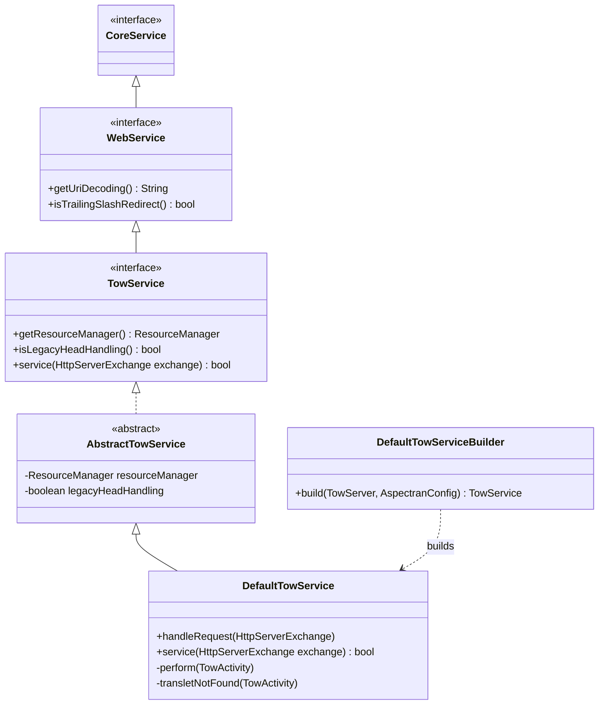
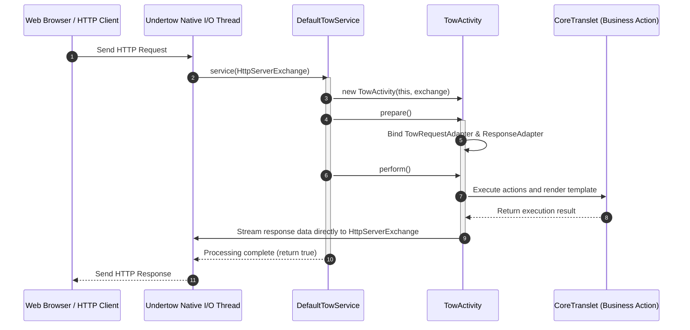

## 1. Design Goals and Primary Roles

The `com.aspectran.undertow.service` package provides specialized service layer implementations that enable Aspectran to run directly on JBoss Undertow—an ultra-lightweight, high-performance asynchronous web server—**without requiring a servlet container (Servlet-less Embedded Web Server)**.

The core architectural objectives of this package are:

*   **Servlet-Free Ultra-Fast Web Runtime**: Eliminates the overhead of traditional servlet specifications (`jakarta.servlet`) and container hierarchies by interacting directly with Undertow's native I/O construct, `HttpServerExchange`, delivering maximum throughput and minimal memory footprint in microservice environments.
*   **Inheritance of Pure Web Interface (`WebService`)**: Extends the root web service interface `WebService` from the `aspectran-web` module, fully reusing standard web configurations (`WebConfig`)—including session configuration (`sessionConfig`), URI decoding, and trailing slash redirection (`trailingSlashRedirect`)—with 100% compatibility.
*   **Seamless Integration with Undertow Handler Chains**: `DefaultTowService` can operate as an Undertow `HttpHandler` or serve as the terminal endpoint of a handler chain, coordinating smoothly with static resource serving (`ResourceManager`), access logging (`AccessLogHandler`), and content compression encoding handlers.
*   **Thread Context ClassLoader Switching**: Wraps request processing with `ThreadContextHelper.overrideClassLoader()` to bind the `SiblingClassLoader` context to the active thread, avoiding runtime class-loading collisions.

## 2. Key Classes and Interfaces In-Depth Analysis



### `TowService` (Interface)

The core specification for Undertow-based web services in Aspectran. (`Tow` is derived from the suffix of Undertow.)

*   **Core Responsibilities**:
    *   Extends `WebService` to share common web configurations and lifecycles.
    *   `service(HttpServerExchange exchange)`: Declares the web entry-point method that accepts a single HTTP exchange object from Undertow's I/O channels and executes the corresponding translet.
    *   `getResourceManager()`: Exposes an Undertow-specific resource manager for serving static assets (HTML, CSS, JS, images).

### `AbstractTowService` (Abstract Class)

An abstract base class implementing shared web infrastructure logic for `TowService`.

*   Parses injected `WebConfig` settings to configure URI string decoding strategies, trailing slash automatic redirection policies, and static resource managers.
*   Oversees Undertow session management and background resource cleanup across service lifecycles (`doStart`, `doStop`).

### `DefaultTowService` (Concrete Implementation Class)

The primary concrete implementation of `TowService`, responsible for receiving Undertow's `HttpServerExchange`, instantiating `TowActivity`, and driving the full execution pipeline.

*   **Core Execution Pipeline (`service(HttpServerExchange)`)**:
    1.  **Service Pause Check**: If the service is in a `paused` state, immediately returns a `503 Service Unavailable` response and halts processing.
    2.  **Request Identifier and Method Resolution**: Reads `exchange.getRequestURI()`, safely decodes it according to `getUriDecoding()`, and maps the HTTP method from `exchange.getRequestMethod()` to a virtual `MethodType` (`GET`, `POST`, etc.).
    3.  **Authorization Check (`isRequestAcceptable`)**: Verifies through `RequestAcceptor` whether the target URI represents an authorized translet eligible for execution by Aspectran.
    4.  **`TowActivity` Instantiation**: Constructs a dedicated `TowActivity` injected with the `exchange` object and the resolved context path.
    5.  **`prepare()` and Trailing Slash Redirection**:
        *   If the translet is not found (`TransletNotFoundException`), checks if appending a trailing slash (`/`) matches an existing translet rule, automatically issuing an HTTP 301/302 redirect if valid.
    6.  **`perform()` Execution and ClassLoader Isolation**:
        ```java
        ClassLoader origClassLoader = ThreadContextHelper.overrideClassLoader(getServiceClassLoader());
        try {
            activity.perform();
        } finally {
            ThreadContextHelper.restoreClassLoader(origClassLoader);
        }
        ```
        Temporarily swaps the thread context classloader with the Aspectran service classloader, then executes the standard pipeline of AOP advice, actions, and template transformations.

### `DefaultTowServiceBuilder` (Builder Class)

A factory builder that constructs fully initialized `DefaultTowService` instances from embedded Undertow server instances (`TowServer`) and `AspectranConfig` definitions.

*   Assembles port bindings, listener definitions, SSL/TLS contexts, web session configurations, and Undertow handler chains into an operational service instance.

## 3. Interactions with Other Packages and Undertow Engine



*   **`com.aspectran.web.service`**: Extends the root interface `WebService`, ensuring strict compliance with web specifications.
*   **`com.aspectran.undertow.activity`**: Instantiates `TowActivity` for each HTTP request exchange, bridging it directly into the core engine's standard lifecycle.
*   **`io.undertow.server`**: Communicates directly with Undertow's native `HttpServerExchange` APIs to govern headers, status codes, and buffer streams.

## 4. Package Summary and Architectural Significance

The `com.aspectran.undertow.service` package serves as a **prime adapter layer demonstrating how the Aspectran framework breaks free from traditional servlet constraints to evolve into a modern, ultra-fast asynchronous microservice web server**:

1.  **Zero Servlet Overhead**: Bypasses `HttpServletRequest`/`HttpServletResponse` wrappers and servlet filter chains, operating directly on Undertow native `HttpServerExchange` channels to achieve maximum I/O throughput.
2.  **Configuration Reusability and Portability**: Allows deployment infrastructure to be switched immediately to an embedded Undertow server without altering `<web>` configuration blocks or translet business code written for servlet environments.
3.  **Intelligent Routing and Redirection**: Combines URI decoding, automated trailing slash correction, and smooth coordination with static resource managers to provide a comprehensive enterprise web feature set within a lightweight footprint.
