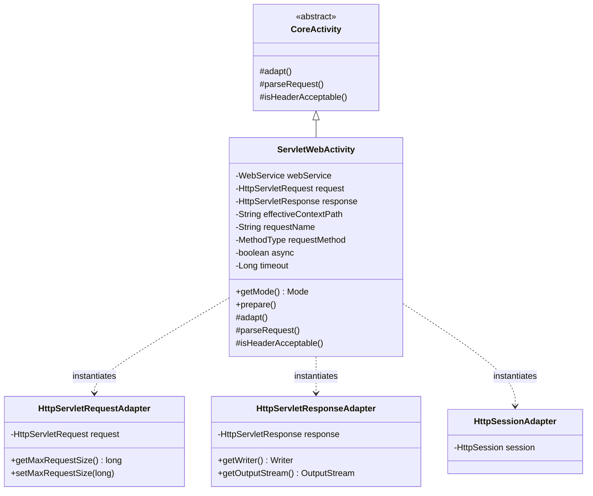

## 1. Design Goals and Primary Roles

The `com.aspectran.web.servlet.activity` package provides the **specialized execution engine and adapter layer** that adapts Aspectran's core execution engine (`CoreActivity`) to standard Java/Jakarta EE servlet environments.

The core architectural objectives of this package are:

*   **Concretization of the Servlet Web Execution Context**: Inherits from protocol-independent `CoreActivity` to provide `ServletWebActivity`, interfacing directly with modern Jakarta Servlet APIs (`jakarta.servlet.http.HttpServletRequest`, `HttpServletResponse`).
*   **Total Adapter Encapsulation**: Avoids exposing raw servlet objects directly by encapsulating them behind standard Aspectran interfaces—`HttpServletRequestAdapter`, `HttpServletResponseAdapter`, and `HttpSessionAdapter`—guaranteeing total independence of the core pipeline.
*   **Complete Support for Advanced Web Specifications**: Provides activity-level handling of HTTP method overrides (`X-HTTP-Method-Override`), reverse proxy forwarding headers (`X-Forwarded-For`), HTTP `Accept` header content negotiation (`isHeaderAcceptable`), and maximum request payload limits (`maxRequestSize`).
*   **Web-Specific Request Parsing and Asynchronous Processing**: Seamlessly coordinates large multipart file uploads (`multipart/form-data`) and URL-encoded forms via `WebRequestBodyParser`, alongside native Servlet 3.0+ asynchronous request processing (`isAsync()`, `AsyncContext`).

## 2. Key Classes In-Depth Analysis



### `ServletWebActivity` (Concrete Implementation Class)

The final concrete `Activity` class tailored for servlet-based web environments. It is newly instantiated per incoming `HttpServletRequest` on each invocation of `ServletWebService.service()`.

*   **Core Responsibilities and Attributes**:
    *   `webService`: References the parent `ServletWebService` to retrieve session activation policies, proxy forwarding configurations, flash map managers, and locale resolvers.
    *   `request` / `response`: Jakarta Servlet standard request and response instances.
    *   `effectiveContextPath`: The resolved context path used to build accurate relative and absolute URLs across reverse proxies or virtual hosts.
    *   `async` / `timeout`: Asynchronous execution flags and timeout metadata declared in the active translet rule.
    *   `getMode()`: Always returns `Mode.WEB`, activating web-specific AOP advice and view dispatchers.

*   **Deep Dive into Core Methods**:
    *   `prepare()` and Hidden Method Override:
        ```java
        @Override
        public void prepare(@NonNull String requestName, MethodType requestMethod)
                throws TransletNotFoundException, ActivityPrepareException {
            if (requestMethod == MethodType.POST) {
                String method = request.getHeader(HttpHeaders.X_HTTP_METHOD_OVERRIDE);
                if (method == null) {
                    method = request.getHeader(HttpHeaders.X_METHOD_OVERRIDE);
                }
                if (method != null) {
                    MethodType hiddenRequestMethod = MethodType.resolve(method);
                    if (hiddenRequestMethod != null) {
                        requestMethod = hiddenRequestMethod;
                    }
                }
            }
            super.prepare(requestName, requestMethod);
        }
        ```
        When firewalls or legacy HTTP clients cannot issue `PUT` or `DELETE` requests directly, inspects the `X-HTTP-Method-Override` header to safely elevate the virtual HTTP method.
    *   `adapt()`: **The core implementation of servlet adaptation**.
        ```java
        @Override
        protected void adapt() throws AdapterException {
            if (webService.isSessionAdaptable()) {
                SessionAdapter sessionAdapter = new HttpSessionAdapter(request);
                setSessionAdapter(sessionAdapter);
            }

            HttpServletRequestAdapter requestAdapter = new HttpServletRequestAdapter(getTranslet().getRequestMethod(), request);
            requestAdapter.setProxyAddressForwarding(webService.isProxyAddressForwarding());
            // Configure maxRequestSize and requestEncoding
            setRequestAdapter(requestAdapter);

            ResponseAdapter responseAdapter = new HttpServletResponseAdapter(response, this);
            // Configure responseEncoding
            setResponseAdapter(responseAdapter);

            setFlashMapManager(webService.getFlashMapManager());
            setLocaleResolver(webService.getLocaleResolver());

            super.adapt();
        }
        ```
        1.  Attaches `HttpSessionAdapter` wrapping `request.getSession()`, transparently bridging the servlet session to the Aspectran session subsystem.
        2.  Instantiates `HttpServletRequestAdapter` to bind parameters, headers, attributes, and payload limits (`maxRequestSize`).
        3.  Constructs `HttpServletResponseAdapter`, integrating standard output streams via `response.getOutputStream()` and `response.getWriter()`.
    *   `parseRequest()`:
        Drives `WebRequestBodyParser` to parse uploaded files into `FileParameter` instances for `multipart/form-data` requests, while decoding URL-encoded form parameters.
    *   `isHeaderAcceptable(String headerRule)`:
        Compares client HTTP `Accept` headers against allowed media types defined in translet rules, performing strict content negotiation for desired representation formats (JSON, XML, HTML, etc.).

## 3. Interactions with Other Packages

*   **`com.aspectran.web.servlet.service`**: `DefaultServletWebService` instantiates `ServletWebActivity` for each HTTP request and delegates execution via `prepare()` and `perform()`.
*   **`com.aspectran.web.servlet.adapter`**: `ServletWebActivity` instantiates `HttpServletRequestAdapter`, `HttpServletResponseAdapter`, and `HttpSessionAdapter` to encapsulate Jakarta Servlet objects behind standard interfaces.
*   **`com.aspectran.web.activity.request`**: Coordinates with `WebRequestBodyParser` to handle large multipart uploads and URL-encoded forms.
*   **`com.aspectran.core.activity`**: `ServletWebActivity` extends `CoreActivity`, fully reusing its built-in AOP advice chains (`BEFORE`, `AFTER`, `THROWN`, `FINALLY`), action dispatching (`dispatchContent`), and response transformation pipeline without modification.

## 4. Package Summary and Architectural Significance

The `com.aspectran.web.servlet.activity` package and `ServletWebActivity` represent the **canonical paradigm of technical isolation provided by Aspectran's Adapter Pattern**:

1.  **Immaculate Integration with Enterprise Servlet Standards**: Operates reliably on top of standard Jakarta EE servlet APIs while completely insulating core business actions and translet rules from servlet specifications.
2.  **Modern REST and Mobile Optimization**: Essential capabilities for modern web services—such as HTTP Method Override, proxy client IP resolution, and Accept header negotiation—are handled automatically during initial activity phases.
3.  **Total Symmetry Across Multi-Runtimes**: Conforms to the exact same adapter contracts as Undertow's `TowActivity` or Netty's `NettyActivity`, ensuring developers build and maintain business logic identically regardless of underlying server infrastructure.
