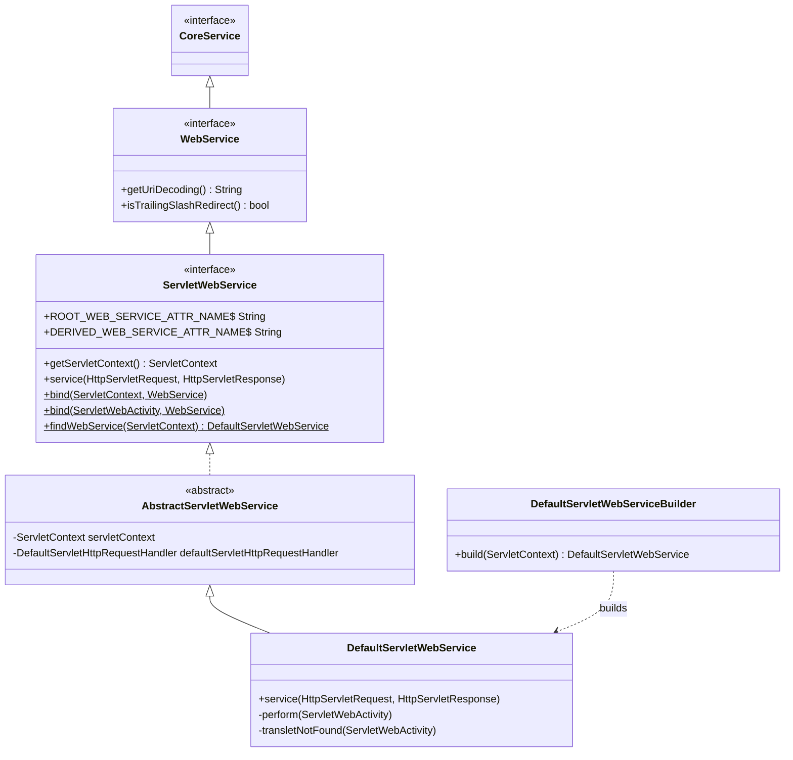
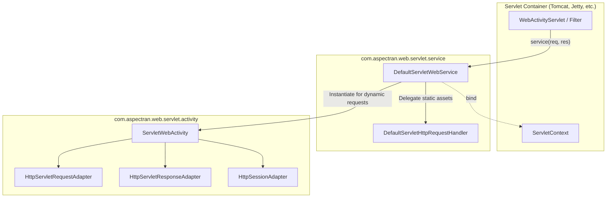

## 1. Design Goals and Primary Roles

The `com.aspectran.web.servlet.service` package provides core service layer implementations designed to execute the Aspectran framework **within standard Java/Jakarta EE servlet container environments (such as Apache Tomcat, Eclipse Jetty, etc.)**. Extending the `WebService` interface from the pure web abstraction module `aspectran-web`, it serves as a seamless bridge between the standard servlet specification (`jakarta.servlet`) and the protocol-independent Aspectran core engine.

The core architectural objectives of this package are:

*   **Seamless Integration with Standard Jakarta Servlet APIs**: Performs elaborate adaptations between standard servlet abstractions (`HttpServletRequest`, `HttpServletResponse`, `ServletContext`) and the protocol-agnostic Aspectran core engine.
*   **Single Point of Entry for the Front Controller Pattern**: Exposes the `service(HttpServletRequest, HttpServletResponse)` entry point receiving all HTTP web requests, unifying request authorization (`RequestAcceptor`), translet resolution, exception translation, and response delivery.
*   **Intelligent Separation of Static Assets and Dynamic Requests**: Routes dynamic requests matching Aspectran rules through the core translet pipeline, while delegating static assets (CSS, JavaScript, images, HTML) transparently to the container's default servlet via `DefaultServletHttpRequestHandler` for maximum serving efficiency.
*   **Servlet Scope-Based Service Binding and Service Locator**: Binds root web services (`ROOT_WEB_SERVICE_ATTR_NAME`) and request-scoped derived web services (`DERIVED_WEB_SERVICE_ATTR_NAME`) to `ServletContext` and `ServletRequest` attributes, enabling external servlet components (filters, listeners, custom tags) to access the active Aspectran context safely.

## 2. Key Classes and Interfaces In-Depth Analysis

### `ServletWebService` (Interface)

The top-level specification for Aspectran web services tailored for servlet environments, extending `WebService`.

*   **Core Responsibilities and Constants**:
    *   `ROOT_WEB_SERVICE_ATTR_NAME`: Attribute key used to store the root web service instance in the `ServletContext`.
    *   `DERIVED_WEB_SERVICE_ATTR_NAME`: Attribute key for request-scoped derived web services attached to `ServletRequest`.
    *   `getServletContext()`: Returns the underlying `ServletContext` reference for container communication.
    *   `service(HttpServletRequest, HttpServletResponse)`: The single front controller entry point processing all incoming HTTP requests.
    *   `bind(...)` / `findWebService(...)`: Static utility methods for binding and locating web services within the servlet context or active activities.

### `AbstractServletWebService` (Abstract Class)

An abstract base class encapsulating common servlet infrastructure integration logic for `ServletWebService`.

*   Parses injected `WebConfig` settings to establish URI encoding rules, session timeout limits, and trailing slash redirection policies.
*   Identifies the default servlet provided by the host servlet container (e.g., `default` in Tomcat, `org.eclipse.jetty.servlet.DefaultServlet` in Jetty) and initializes `DefaultServletHttpRequestHandler`.
*   Initializes and cleans up the servlet session manager and WebSocket endpoint exporter (`ServerEndpointExporter`) across service lifecycles (`doStart`, `doStop`).

### `DefaultServletWebService` (Concrete Implementation Class)

The primary concrete implementation of `ServletWebService`, handling all incoming HTTP requests delivered by the servlet container.

*   **Core Execution Pipeline (`service(HttpServletRequest, HttpServletResponse)`)**:
    1.  **Service State Verification**: If the service is paused (`isPaused`), immediately returns an HTTP `503 Service Unavailable` response.
    2.  **Request URI Parsing and Decoding**: Strips the context path from the request URI to resolve the translet name (`requestName`), safely decoding it according to the configured character encoding.
    3.  **Authorization Verification and Static Resource Delegation**:
        *   Evaluates `isRequestAcceptable(requestName)`.
        *   If the request is not managed by Aspectran, assumes it may target a static asset (CSS, JS, images) and delegates processing to the container's default servlet via `defaultServletHttpRequestHandler.handle(request, response)`.
    4.  **`ServletWebActivity` Instantiation**: Constructs a dedicated `ServletWebActivity` injected with the servlet request and response objects.
    5.  **`prepare()` and Trailing Slash Redirection**:
        *   If the translet rule is not found (`TransletNotFoundException`), verifies whether appending a trailing slash (`/`) matches an existing rule, automatically handling HTTP 301/302 redirects.
    6.  **`perform()` Execution and ClassLoader Isolation**:
        Switches to the service classloader via `ThreadContextHelper.overrideClassLoader()`, then executes standard AOP advice, business actions, and response transformations (JSON, XML, JSP, Thymeleaf, etc.).

### `DefaultServletWebServiceBuilder` (Builder Class)

A builder invoked during `ServletContextListener.contextInitialized()` or `WebActivityServlet.init()` to assemble the `DefaultServletWebService`.

*   Resolves configuration paths (`aspectran.config.file`) declared in `web.xml` `<context-param>` or servlet `<init-param>` blocks and loads `AspectranConfig`.
*   After building the service instance, binds it globally via `ServletWebService.bind(servletContext, webService)` and registers it with `CoreServiceHolder` for classloader-based service location.

### `DefaultServletHttpRequestHandler` (Static Resource Handler)

A dedicated component that forwards unmapped request URIs to the container's default servlet.

*   Detects container-specific default servlet names (`default`) across various servlet containers (Tomcat, Jetty, Resin) and efficiently delegates asset serving via `RequestDispatcher`.

## 3. Interactions with Other Packages

*   **`com.aspectran.web.service`**: Implements the pure web abstraction interface `WebService`, strictly honoring web service contracts.
*   **`com.aspectran.web.servlet.activity`**: Instantiates `ServletWebActivity` for every valid web request, connecting it directly into the core request processing pipeline.
*   **`jakarta.servlet`**: Directly interfaces with modern Jakarta EE servlet specifications (`HttpServletRequest`, `HttpServletResponse`, `ServletContext`, `AsyncContext`).

## 4. Package Summary and Architectural Significance

The `com.aspectran.web.servlet.service` package represents the **core adapter layer ensuring the Aspectran framework operates as a rock-solid, optimized enterprise web application within standard servlet containers**:

1.  **Comprehensive Environmental Separation and Abstraction**: Mounts servlet APIs on top of the protocol-independent core engine, ensuring business actions and translet rules remain completely decoupled from specific servlet implementations.
2.  **Efficient Hybrid Static/Dynamic Routing**: Avoids routing all requests through the framework pipeline by seamlessly bypassing static assets to the container's native default servlet, optimizing overall runtime throughput.
3.  **Full Jakarta EE Compliance**: Adheres strictly to modern `jakarta.servlet` standards (completely transitioning from legacy `javax.servlet`), ensuring seamless compatibility with modern enterprise application servers and container runtimes.
