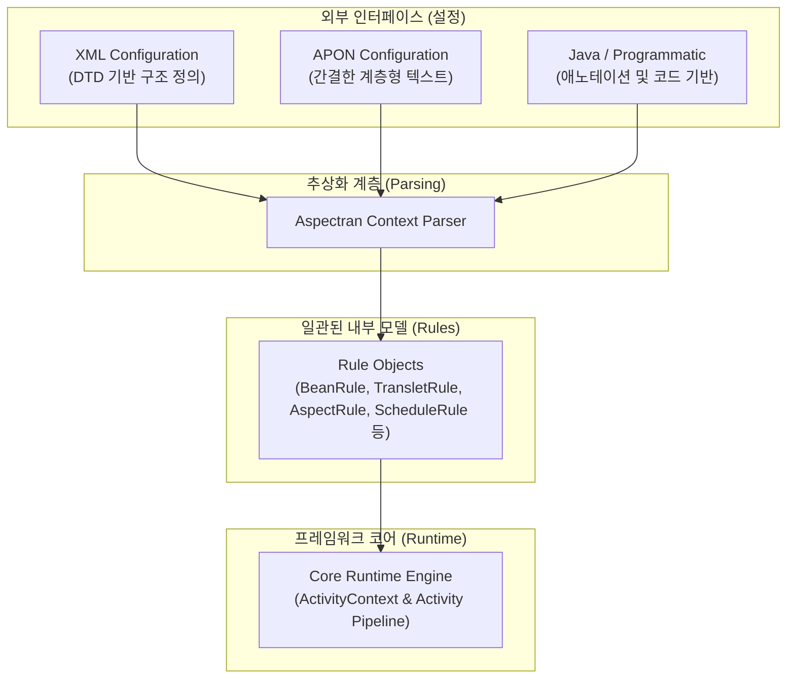
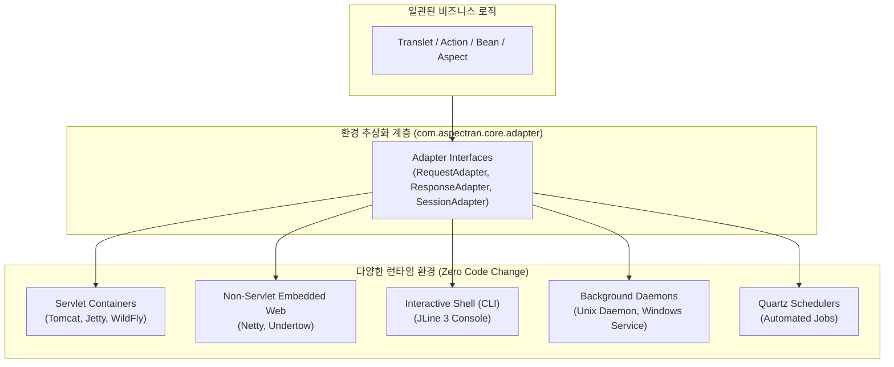

## 서론

소프트웨어 프레임워크는 시간이 흐르며 기능이 확장되고 과거 버전과의 호환성을 유지하는 과정에서 점차 복잡해지는 경향이 있습니다. 이러한 복잡성의 증가는 학습 곡선을 가파르게 만들고, 유지보수를 어렵게 하며, 프레임워크 본연의 생산성을 저해하는 요인이 되기도 합니다.

Aspectran은 바로 이 문제, 즉 **"기능의 풍부함과 설계의 단순함이 공존할 수 있는가?"** 라는 질문에 대한 하나의 해답으로 디자인되었습니다. 특히, 거대하고 복잡해진 스프링 프레임워크의 대안으로서, 더 가볍고 직관적이면서도 강력한 아키텍처를 제공하는 것을 목표로 합니다. 이 문서는 Aspectran이 어떻게 '지속 가능한 단순성'이라는 가치를 유지하며 발전해왔는지, 그 핵심적인 설계 원칙과 아키텍처 철학을 설명합니다.

이러한 철학은 프레임워크의 이름 자체에도 깊이 담겨 있습니다. 2008년 3월에 처음 개발을 시작했을 때, 이 프로젝트의 초기 이름은 **'Translets'**였습니다. 이는 'Transformation Servlet'의 합성어로, 사용자의 요청을 받아 변환(Transformation)하고 응답을 생성하는 핵심 기능에 집중하겠다는 초기 비전을 나타냅니다.

이후 개발 과정에서 AOP(관점 지향 프로그래밍) 기능이 핵심 사상으로 통합되면서, 2012년 7월경 프로젝트는 새로운 정체성을 담은 이름으로 변경됩니다. 그것이 바로 **Aspectran**입니다.



이름의 변화는 단순한 명칭 변경이 아니라, 'Translet'으로 대표되는 요청 처리의 명확한 구조 위에 'Aspect'라는 강력한 횡단 관심사 분리 기능을 더해, **구조의 단순함과 기능의 모듈화를 모두 달성하겠다**는 프레임워크의 진화 방향을 상징합니다.

2015년 9월 1일 첫 출시 이후 지금까지, Aspectran은 이러한 핵심 철학을 바탕으로 발전해왔습니다. 이제부터 Aspectran이 어떻게 단순함을 유지할 수 있었는지 그 구체적인 설계 원칙들을 자세히 살펴보겠습니다.

## 단순함을 향한 첫걸음: 실용주의적 선택

Aspectran의 설계 철학을 가장 잘 보여주는 초기 선택 중 하나는 XML 설정의 유효성 검증 방식으로 XML 스키마(XSD)가 아닌 DTD를 채택한 것입니다. XSD는 데이터 타입 지정, 네임스페이스 지원 등 기술적으로 더 강력한 기능을 제공하지만, Aspectran은 의도적으로 더 단순한 DTD를 선택했습니다. 이는 DTD가 더 뛰어나서가 아니라, Aspectran의 목표에 **충분하고 적합했기 때문**입니다.

- **핵심은 '구조', 검증은 '프레임워크'**: Aspectran 설정의 핵심은 데이터 타입의 유효성이 아닌, `<bean>`, `<translet>`, `<aspect>` 등 요소 간의 구조적 관계를 올바르게 정의하는 것입니다. DTD는 이 구조적 유효성을 검증하는 데 충분한 역할을 합니다. 클래스 이름의 존재 여부나 속성값의 정확성 등 데이터 값에 대한 세밀한 검증은 프레임워크가 설정을 읽어들이는 시점에 Java 코드로 직접 처리하는 것이 더 효율적이고 일관성 있다는 실용적인 판단을 내렸습니다.

- **불필요한 복잡성 배제**: Aspectran의 설정은 다른 XML 어휘와 혼용될 필요가 없으므로, XSD의 가장 큰 장점인 네임스페이스 지원은 불필요했습니다. 프레임워크의 목표에 꼭 필요하지 않은 기술적 복잡성을 과감히 배제한 것입니다.

이처럼 Aspectran은 기술 그 자체의 우월성보다, 해결하려는 문제에 가장 적합하고 단순한 해법을 선택하는 실용주의적 접근을 통해 단순성을 확보하기 시작했습니다.

## 지속 가능한 단순성의 핵심: 일관된 내부 '규칙(Rule)' 모델

시간이 지나도 Aspectran이 단순함을 유지할 수 있었던 가장 핵심적인 비결은 **일관된 내부 설정 모델, 즉 '규칙(Rule) 객체'**에 있습니다.

외부 설정 파일(XML, APON)은 사용자가 프레임워크의 동작을 정의하는 인터페이스일 뿐, Aspectran은 이를 직접 사용하지 않습니다. 대신, 어떤 형식의 설정이든 파싱하여 `com.aspectran.core.context.rule` 패키지에 정의된 `BeanRule`, `TransletRule`, `AspectRule` 등의 '규칙 객체'로 변환합니다.

이 아키텍처는 다음과 같은 강력한 이점을 제공합니다.

1. **복잡성의 격리**: XML 파싱의 복잡함, 새로운 설정 속성의 추가 등 외부 인터페이스의 변화가 프레임워크의 핵심 실행 로직에 직접적인 영향을 미치지 않습니다. 모든 변경은 '규칙 모델'이라는 추상화 계층에서 흡수되고 표준화됩니다.

2. **설정 방식의 유연성**: Aspectran이 나중에 APON(Aspectran Parameter Object Notation)이라는 JSON과 유사한 새로운 설정 방식을 추가할 수 있었던 것도 이 덕분입니다. APON 파서는 그저 XML 파서와 동일한 '규칙 객체'를 생성하기만 하면 되므로, 프레임워크의 다른 코드는 전혀 수정할 필요가 없었습니다.

3. **명확한 역할 분담**: 프레임워크는 '규칙 객체'라는 잘 정의된 데이터 구조만 다루면 되므로, 로직이 훨씬 단순하고 명확해집니다. '어떻게 읽을 것인가(Parsing)'와 '어떻게 실행할 것인가(Runtime)'가 완벽하게 분리됩니다.

결국, 외부의 복잡다단한 설정을 **'규칙'이라는 단순하고 일관된 내부 모델로 변환하여 제어**하는 것이야말로 Aspectran이 지속 가능한 단순성을 확보한 핵심적인 설계 기법입니다.

## 단순함을 지키는 원칙들

'규칙 모델' 외에도, Aspectran은 다음과 같은 설계 원칙들을 통해 단순함을 유지합니다.

### 명확한 역할 분리 (Clear Separation of Concerns)

Aspectran의 핵심 개념들은 각자의 역할이 명확하게 분리되어 서로를 침범하지 않습니다.

- **Translet**: 요청의 접수, 처리 흐름 제어, 최종 응답이라는 하나의 작업 단위(Unit of Work)에만 집중합니다.
- **Bean**: 상태를 가지는 재사용 가능한 컴포넌트(객체)의 정의와 생명주기 관리에만 집중합니다.
- **Aspect**: 트랜잭션, 로깅, 보안 등 여러 비즈니스 로직에 공통적으로 적용되는 횡단 관심사를 분리하여 모듈화하는 데만 집중합니다.

하나의 요소가 너무 많은 책임을 갖지 않도록 의도적으로 설계되었습니다. 예를 들어, `Translet`이 직접 데이터베이스에 접근하는 대신, `Action`을 통해 `Bean`에게 로직을 위임하는 구조는 각 요소의 역할을 명확하게 하고 전체적인 설계를 단순하고 예측 가능하게 만듭니다.

### 환경으로부터의 자유: 어댑터(Adapter) 기반 환경 추상화

프레임워크가 복잡해지는 주요 원인 중 하나는 비즈니스 로직이 특정 런타임 환경(예: 서블릿 API나 웹 컨테이너)에 강하게 종속되는 것입니다. 비즈니스 코드에 `HttpServletRequest`나 `HttpServletResponse` 같은 서블릿 전용 객체가 침투하면, 해당 코드는 웹 컨테이너 외부(CLI 명령행 도구, 배치 데몬, 독립 실행형 스케줄러)에서 재사용하거나 단위 테스트하기가 극히 어려워집니다.

Aspectran은 **어댑터 패턴(Adapter Pattern)**을 통해 런타임 환경을 완전히 추상화했습니다.

프레임워크 코어와 비즈니스 로직은 오직 추상화된 어댑터 인터페이스(`RequestAdapter`, `ResponseAdapter`, `SessionAdapter`)만을 바라보며, 실제 실행 환경(서블릿, Netty, Undertow, 콘솔 셸, 데몬)에 맞는 구체적인 구현체는 부트스트랩 시점에 유연하게 결합됩니다.

그 결과 개발자가 구현한 비즈니스 로직은 **단 한 줄의 코드 수정 없이** 웹 브라우저 요청, 대화형 CLI 명령, 주기적 스케줄링 배치 작업 어디에서든 완벽하게 동일한 방식으로 실행됩니다. 환경 종속성을 원천적으로 제거한 이 순수성이야말로 시스템 전체의 복잡성을 낮추고 확장성을 보장하는 핵심 철학입니다.

### 블랙박스 마법(Magic)을 배제한 명시적 제어 가능성 (Explicit & Controllable)

현대의 많은 프레임워크는 개발자의 편의를 명분으로 수많은 자동 설정(Auto-configuration)과 보이지 않는 런타임 프록시 '마법(Magic)'을 남용합니다. 그 결과 초기 진입 장벽은 낮아 보이지만, 서비스가 고도화되거나 예외 상황이 발생했을 때 "도대체 내부에서 무슨 일이 일어나고 있는가?"를 파악하기 매우 어렵게 만듭니다.

Aspectran은 **"개발자가 이해하고 제어할 수 없는 블랙박스는 존재해서는 안 된다"**는 철학을 고수합니다.

- **투명한 실행 파이프라인**: 요청 인입부터 Aspect 인터셉션, Action 순차 실행, 최종 응답 변환(Text, JSON, XML, Template 엔진)에 이르는 전 과정이 `Activity` 파이프라인을 통해 명시적으로 정의됩니다.
- **예측 가능한 동작 방식**: 감춰진 자동 결합 대신 명확한 규칙과 POJO 객체 간의 관계에 기반하여 동작하므로, 디버깅과 장애 분석이 직관적이며 시스템의 안정적인 장기 운영이 가능해집니다.

### 설정과 로직의 명확한 경계 (Separation of Configuration and Logic)

설정(Configuration)은 애플리케이션의 컴포넌트와 실행 규칙을 선언하는 뼈대이며, 비즈니스 로직은 온전히 Java POJO 코드 안에 머물러야 합니다. 설정 영역에 복잡한 연산이나 업무 로직이 침투하지 않도록 경계를 명확히 유지함으로써, 시스템 전체의 가독성과 장기적인 유지보수성을 보존합니다.

## 결론

Aspectran의 단순함은 우연의 결과가 아니라, **'복잡해지는 프레임워크'에 대한 문제의식에서 출발하여 '지속 가능한 단순성'을 목표로 한 의도적인 설계의 산물**입니다. 

실용주의에 기반한 기술 선택, '규칙(Rule)'이라는 일관된 내부 모델을 통한 복잡성 격리, 각 구성 요소의 명확한 역할 분리와 어댑터 기반 환경 추상화, 그리고 마법을 배제하고 설정과 로직의 경계를 명확히 지키는 원칙들이 유기적으로 결합하여 오늘날 Aspectran의 가볍고 강력한 아키텍처를 완성했습니다. 

이를 통해 Aspectran은 개발자에게 블랙박스 없는 높은 생산성과 직관적인 유지보수성을 제공하며, 급변하는 엔터프라이즈 환경 속에서도 지속 가능하고 견고한 소프트웨어를 구축할 수 있는 탄탄한 토대를 제공합니다.
