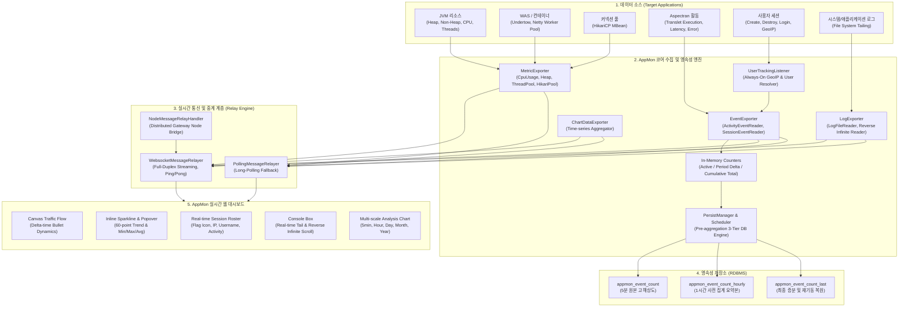
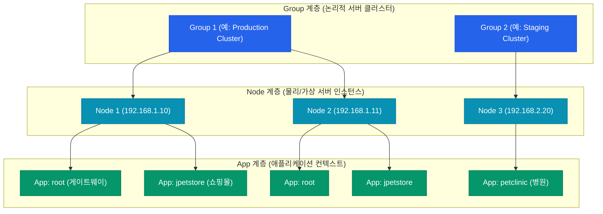
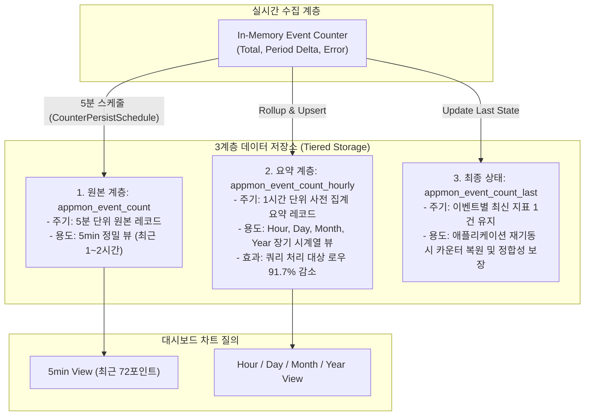

Aspectow AppMon은 Aspectran 프레임워크 기반 애플리케이션의 실시간 이벤트, 시스템 메트릭, 세션 및 로그 스트리밍을 정밀하게 관찰하고 시각화하는 고성능 경량 모니터링 솔루션입니다.

## 1. 개요

Aspectow AppMon은 분산 환경 및 마이크로서비스 환경에서 구동되는 Aspectran 기반 애플리케이션을 위한 경량(Lightweight) 실시간 모니터링 및 가시성(Observability) 플랫폼입니다. 애플리케이션의 런타임 성능에 미치는 오버헤드를 1% 미만으로 극소화하면서, 운영 중에 발생하는 다양한 활동(Activity/Translet), 세션 라이프사이클, 로그, JVM 및 WAS 시스템 메트릭을 웹 대시보드를 통해 실시간 스트리밍으로 관찰할 수 있도록 설계되었습니다.

AppMon은 **Aspectow Console에 내장(Embedded)**되어 중앙 집중형 전사 통합 관제 환경으로 구동될 수도 있으며, Console 설치 없이 **특정 단일 서버나 독립 클러스터에 AppMon을 단독(Standalone) 솔루션으로 배포**하여 가볍고 민첩하게 운용할 수도 있습니다.



## 2. 주요 특징

*   **극저지연 실시간 스트리밍 (Real-Time Push)**: WebSocket 연결을 기본으로 사용하여 서버 내부 상태를 지연 없이 UI로 스트리밍하며, 프록시나 방화벽 제약이 있는 환경에서는 Long-Polling 기법으로 자동 폴백(Fallback)되어 신뢰성을 보장합니다.
*   **비침투적(Non-intrusive) 경량 통합**: 대상 애플리케이션의 비즈니스 코드를 전혀 수정하지 않고, Aspectran 빈(Bean) 정의 및 AOP 설정만으로 모니터링 엔진을 손쉽게 플러그인합니다.
*   **상시 사용자 추적 및 지오로케이션 (Always-On User Tracking & Geolocation)**: 관리자가 대시보드를 켜두지 않은 평상시에도 24시간 365일 신규 세션 생성 시 클라이언트 IP를 자동 추출하고 ISO 2자리 국가 코드를 변환하여 세션에 주입합니다.
*   **비침투적 사용자명 추출 (Non-intrusive Username Resolution)**: 복잡한 엔티티(`UserSession`, `Account` 등)로 세션에 보관된 사용자 식별자를 선언적 프로퍼티 경로(`usernameAttribute`) 또는 `SessionUserResolver` 확장을 통해 코드 변경 없이 유연하게 파싱합니다.
*   **고성능 시각화 엔진**:
    *   **Canvas 기반 트래픽 플로우 (Traffic Flow)**: 델타 타임(Delta-time) 기반 동역학 물리 엔진을 적용하여 초당 수천 건의 트래픽을 미려한 '총알(Bullet)' 궤적으로 시각화하고 응답 지연 시 속도 감속 및 체류 시간 연장 효과를 제공합니다.
    *   **인라인 스파크라인(Sparkline) 및 상세 팝오버(Detail Popover)**: 각 메트릭의 최근 60개 시점 미니 트렌드를 인라인으로 표시하고, 클릭 시 듀얼 시계열(실선/점선)과 Min/Max/Avg 통계를 담은 플로팅 카드를 제공합니다.
    *   **역방향 무한 스크롤 로그 뷰어 (`loadPrevious`)**: 실시간 로그 테일링 도중 상단으로 스크롤 시 과거 로그를 역방향으로 추가 로드하여 시스템 장애 전후의 맥락을 끊김 없이 분석합니다.
*   **사전 집계(Pre-aggregation) 3계층 영속성 아키텍처**:
    *   대규모 트래픽 누적 시에도 대시보드 조회 속도가 저하되지 않도록 5분 단위 원본(`appmon_event_count`), 1시간 단위 요약본(`appmon_event_count_hourly`), 최종 상태(`appmon_event_count_last`)로 계층화하여 조회 시 처리 대상 레코드를 90% 이상 절감합니다.
*   **자가 완비형 자체 인증 (Standalone Token-Based Auth)**: 독립형 모드 구동 시 `AppMonAuthCheckAspect`와 암호화 PBToken(`TimeLimitedPBTokenIssuer`)을 통해 안전한 세션 쿠키 인증 및 토큰 자동 갱신을 자체 수행합니다.

## 3. 핵심 아키텍처 및 3계층 식별 체계

Aspectow AppMon은 대규모 분산 클라우드 환경 및 멀티 노드 아키텍처를 원활하게 관제하기 위해 **`Group` (서버 그룹) - `Node` (물리/논리 노드) - `App` (애플리케이션)**으로 이어지는 3계층 논리 식별 체계를 핵심 모델로 채택하고 있습니다.



### 주요 엔진 컴포넌트

*   **`AppMonManager`**: AppMon 엔진의 전체 생명주기(Lifecycle)를 총괄하며, 설정된 애플리케이션 정보(`AppInfoHolder`), 노드 클러스터(`NodeManager`), 메시지 릴레이(`MessageRelayManager`), 영속성 엔진(`PersistManager`)을 통합 조율합니다.
*   **`AppInfoHolder` & `AppInfo`**: 모니터링 대상 애플리케이션 컨텍스트들의 메타데이터와 이벤트, 메트릭, 로그 등의 설정 항목을 보관하고 조회합니다.
*   **`ExporterManager`**: 특정 애플리케이션(`appId`) 및 Exporter 타입(`LOG`, `METRIC`, `EVENT`, `DATA`) 단위로 등록된 `Exporter` 인스턴스들의 생명주기 및 전용 스케줄러를 관리하고 데이터를 수집합니다.
*   **`Exporter`**: 특정 성격의 데이터 소스(로그, 메트릭, 이벤트, 시각화 차트)를 책임지는 최상위 수집 단위입니다.
    *   **`Reader`**: `Exporter` 내부에서 실제 저수준 리소스(JMX, JVM Native, OS 프로시저, 서블릿 컨텍스트, 파일 시스템)를 읽어내는 구체적인 구현체입니다.
*   **`UserTrackingListener`**: 세션 생성 시 클라이언트 IP 주소(`user.ipAddress`)와 ISO 국가 코드(`user.countryCode`)를 세션 속성에 상시 주입하는 핵심 리스너입니다.
*   **`CounterPersistSchedule` & `PersistManager`**: 인메모리 카운터에 기록된 지표를 주기적(기본 5분)으로 사전 집계 테이블에 영속화하는 스케줄러 및 관리자입니다.
*   **`MessageRelayer` & `MessageRelayManager`**: 클라이언트 웹 브라우저와의 실시간 데이터 통신 세션(`RelaySession`)을 관리하며, WebSocket 및 Polling 방식으로 브로드캐스트 및 유니캐스트 패킷을 중계합니다.
*   **`NodeMessageRelayHandler`**: 멀티 노드 환경에서 게이트웨이 노드를 통해 원격 노드의 모니터링 패킷을 브릿징(Bridging)하는 분산 릴레이 핸들러입니다.

## 4. 수집 엔진 및 리더(Readers) 카탈로그

AppMon은 시스템 하드웨어 자원부터 WAS 워커 스레드, 데이터베이스 커넥션, 애플리케이션 트랜잭션, 사용자 세션, 파일 로그까지 포괄하는 풍부한 기본 Reader를 제공합니다.

| Exporter 타입 | Reader 클래스 풀네임 | 수집 대상 및 주요 지표 | 샘플링 주기 (권장) |
| :--- | :--- | :--- | :--- |
| **`metric`** | `com.aspectran.aspectow.appmon.engine.exporter.metric.jvm.CpuUsageReader` | JVM 프로세스 CPU 사용률, 호스트 OS 전체 CPU 사용률, 가용 프로세서 코어 수, System Load Average | 500ms ~ 1000ms |
| **`metric`** | `com.aspectran.aspectow.appmon.engine.exporter.metric.jvm.HeapMemoryUsageReader` | JVM 힙 메모리 현재 사용량(Used), 최대 할당 한도(Max), 커밋된 메모리(Committed) | 500ms ~ 1000ms |
| **`metric`** | `com.aspectran.aspectow.appmon.engine.exporter.metric.undertow.UndertowThreadPoolMetricsReader` | Undertow Worker 스레드 풀 활성 스레드(Active), 최대 스레드(Max), 풀 크기(Pool Size), 대기 큐 작업 수(Queued Tasks) | 500ms ~ 1000ms |
| **`metric`** | `com.aspectran.aspectow.appmon.engine.exporter.metric.netty.NettyThreadPoolMetricsReader` | Netty EventLoop 스레드 풀 상태, 활성 스레드, 작업 처리 지표 | 500ms ~ 1000ms |
| **`metric`** | `com.aspectran.aspectow.appmon.engine.exporter.metric.jdbc.HikariPoolMBeanReader` | HikariCP 커넥션 풀 상태 (Active Connections, Idle Connections, Total Connections, Threads Awaiting Connection) | 500ms ~ 2000ms |
| **`event`** | `com.aspectran.aspectow.appmon.engine.exporter.event.activity.ActivityEventReader` | Aspectran Activity/Translet 실행 추적, 응답 시간(Latency), 성공/실패 카운트, 처리 중인 활성 요청 수 | 이벤트 발생 즉시 |
| **`event`** | `com.aspectran.aspectow.appmon.engine.exporter.event.session.SessionEventReader` | 세션 생성/소멸, 활성 세션 수, 사용자 로그인 상태 변경, 클라이언트 IP 및 지오로케이션 | 세션 생명주기 즉시 |
| **`log`** | `com.aspectran.aspectow.appmon.engine.exporter.log.LogExporter` | 애플리케이션 로그 파일, 액세스 로그 파일의 실시간 테일링(Tailing) 및 역방향 탐색(`loadPrevious`) | 200ms ~ 500ms |
| **`data`** | `com.aspectran.aspectow.appmon.engine.exporter.event.ChartDataExporter` | 시계열 분석 차트(5분, 시간, 일, 월, 년)를 위한 사전 집계 통계 데이터 생성 및 전송 | 온디맨드 갱신 |

## 5. 실시간 대시보드 시각화 UX/UI 아키텍처

AppMon 대시보드는 단순한 숫자 텍스트 나열을 탈피하여, 시스템 내부의 부하와 사용자 흐름을 운영자가 직관적으로 체감할 수 있는 감각적인 프런트엔드 시각화 기술을 채택하고 있습니다.

### 5.1 Canvas 기반 동역학적 트래픽 플로우 (Traffic Flow)
*   모든 HTTP 요청(Activity)은 화면 왼쪽에서 오른쪽으로 날아가는 고유한 **'총알(Bullet)'** 객체로 Canvas에 렌더링됩니다.
*   **델타 타임(Delta-time) 렌더링**: 프레임 드롭 없이 초당 수천 건의 동시 요청 상황에서도 브라우저 CPU 점유율을 일정하게 유지하며 부드러운 애니메이션을 보장합니다.
*   **지연 시간 비례 감속**: 서버 처리 응답 시간이 길어질수록 총알의 비행 속도가 최대 60%까지 느려집니다. 이를 통해 서버가 지연을 겪고 있음을 시각적 슬로우 모션으로 즉시 인지할 수 있습니다.
*   **체류 시간(Persistence) 비례 연장**: 총알이 우측 타겟에 도달한 후 사라지기까지의 체류 시간이 서버 응답 시간에 비례하여 연장됩니다. 지연된 요청일수록 화면 우측에 오래 머무르며 운영자의 시선을 유도합니다.
*   **핫스팟 및 하얀 핵(Hot Core)**: 활동 지수(Activity Intensity)가 0.3을 초과하는 헤비 트래픽 유저의 요청은 총알 중심부에 **빛나는 하얀 핵(Hot Core)**이 생성되어 공격이나 특정 유저의 과도한 호출을 즉시 식별할 수 있습니다.
*   **상태별 색상 인코딩**:
    *   **초록색(Green)**: 정상 속도로 완료된 요청.
    *   **노란색(Yellow)**: 500ms 이상 소요된 경고(Warning) 지연 요청.
    *   **빨간색(Red)**: 처리 중 익셉션(5xx)이 발생한 에러 요청.

### 5.2 인라인 스파크라인(Sparkline) 및 상세 팝오버(Detail Popover)
*   **실시간 인라인 스파크라인**: CPU, 힙 메모리, 스레드 풀 등 각 지표 우측에 최근 60회 샘플의 실시간 미니 트렌드 라인과 최신 포인트 도트(Dot)를 인라인으로 표시합니다.
*   **임계치 경고 색상 전환**: CPU 사용률이 85%를 초과하는 등 위험 상태가 발생하면 스파크라인의 색상이 기본 청색에서 적색 경고 색상으로 즉시 전환됩니다.
*   **원클릭 상세 팝오버 (Interactive Popover)**:
    *   지표 카드를 클릭하면 상세 플로팅 카드가 활성화되어 정밀한 듀얼 시계열 그래프를 렌더링합니다.
    *   **듀얼 시계열(Dual Time-series) 표현**:
        *   **CPU**: 프로세스 CPU 사용률(실선) + 시스템 전체 CPU 사용률(점선)
        *   **Heap Memory**: 현재 사용량(실선) + 최대 할당 한도(점선)
        *   **Thread Pool**: 활성 워커 스레드 수(실선) + 전체 스레드 풀 크기(점선)
    *   **실시간 통계 요약**: 현재 대시보드가 열려 있는 동안 수집된 데이터의 **최솟값(Min), 최댓값(Max), 평균값(Avg)**을 실시간 연산하여 제공합니다.

### 5.3 역방향 무한 스크롤 로그 콘솔 (`loadPrevious`)
*   실시간 로그 스트리밍 창에서 사용자가 스크롤을 맨 위(`scrollTop === 0`)로 올릴 때 **'이전 로그 더 보기'** 트리거가 활성화됩니다.
*   클라이언트는 현재 수신된 가장 오래된 라인 위치를 기준으로 `command:loadPrevious` APON 명령을 서버에 발행하고, 서버는 지정된 라인 수(예: 300라인)만큼 거슬러 올라가 로그를 역방향으로 전송합니다.
*   클라이언트는 수신된 과거 로그를 상단에 역방향 추가(Prepend)하면서도 사용자가 읽고 있던 화면 위치가 아래로 밀려나지 않도록 **스크롤 앵커링(Scroll Anchoring)**을 유지합니다.

### 5.4 3단계 활동 수치 및 5분 주기 타이머
*   **Active Activity**: 현재 서버에서 동시에 처리 중인 실시간 트랜잭션 수입니다.
*   **Current Period Count**: 현재 5분 집계 구간 동안 유입된 누적 요청 수입니다 (`+94` 형태).
*   **Cumulative Total**: 서버 구동 이후 또는 전체 누적 요청 합계입니다.
*   **5분 주기 카운트다운 타이머**: 수치 하단에 `280/300` 형태로 5분(300초) 집계 주기의 진행 경과를 표시합니다. 300초에 도달하면 해당 주기의 집계 데이터를 DB에 저장하고 차트에 반영한 뒤 카운터를 리셋합니다.

## 6. 세션 모니터링 및 사용자 추적 아키텍처

AppMon은 **상시 세션 추적(Always-On User Tracking)**과 **온디맨드 실시간 브로드캐스트(On-Demand Live Broadcasting)**를 유기적으로 결합한 정교한 세션 모니터링 아키텍처를 제공합니다.

### 6.1 생명주기 분리: 상시 동작(Always-On) vs 온디맨드(On-Demand)

*   **상시 세션 추적 (`UserTrackingListener`)**:
    *   서버 기동 시 `SessionEventReader.init()`에서 대상 컨텍스트(`contextName`)의 `SessionManager`에 **영구 상시 등록**됩니다.
    *   관리자가 AppMon 웹 UI를 보고 있지 않은 평상시에도 24시간 365일 모든 신규 세션에 클라이언트 IP 주소와 국가 코드를 안전하게 주입합니다.
    *   이를 통해 관리자가 나중에 접속하여 전체 활성 세션 목록(`getAllActiveSessions`)을 조회하더라도 모든 세션의 위치/IP 정보가 누락 없이 완전하게 표시됩니다.
    *   내장된 중복 등록 방지 가드(`registeredTrackingTargets`)를 통해 동일한 타겟(`tow.server/demo` 또는 `netty.server/demo`)을 여러 `app`에서 참조하더라도 리스너는 정확히 단 1회만 등록됩니다.
*   **온디맨드 실시간 브로드캐스트 (`SessionEventReadingListener`)**:
    *   관리자가 특정 앱의 대시보드에 접속(`subscribe`)할 때만 등록되고, 구독자가 0명이 되면 해제(`stop()`)되어 런타임 리소스 낭비를 최소화합니다.

### 6.2 국가 코드 해석 (`IPCountryResolver`)

AppMon은 플러그형 인터페이스인 `IPCountryResolver`를 통해 클라이언트 IP 주소로부터 ISO 2자리 국가 코드(예: `KR`, `US`, `JP`)를 자동 판별합니다:

```java
package com.aspectran.aspectow.appmon.common.support;

public interface IPCountryResolver {
    String resolveCountryCode(String ipAddress, Locale locale);
    default String resolveCountryCode(String ipAddress) { ... }
}
```

KISA WHOIS OpenAPI 연동 구현체(`WhoisIPCountryResolver`)나 MaxMind GeoIP 데이터베이스 연동 구현체를 `appmon-rules.xml`에 빈으로 등록해 두면, AppMon이 세션 생성 시 이를 자동으로 조회하여 `user.countryCode`에 주입하며 대시보드 세션 목록에 해당 국가의 국기 아이콘이 렌더링됩니다.

### 6.3 비침투적 사용자명 추출 (`usernameAttribute` & `SessionUserResolver`)

실제 엔터프라이즈 웹 애플리케이션은 단순 문자열이 아니라 `UserSession`, `Account`, `Principal` 같은 커스텀 객체 단위로 세션에 로그인 정보를 보관합니다. AppMon은 애플리케이션 코드를 전혀 수정하지 않고도 사용자명을 추출할 수 있도록 3단계 우선순위 체계를 지원합니다:

1.  **커스텀 리졸버 (`userResolver`)**: `event.parameters.userResolver` 또는 컨텍스트에 등록된 `SessionUserResolver` 빈/클래스를 우선 호출합니다:
    ```java
    public interface SessionUserResolver {
        String resolveUsername(String deploymentName, Session session);
    }
    ```
2.  **선언적 프로퍼티 경로 탐색 (`usernameAttribute`)**: JavaBean 프로퍼티 경로(예: `user.account.username`)를 선언하면 세션 내 객체의 중첩 게터(`session.getAttribute("user").getAccount().getUsername()`)를 자동 탐색합니다:
    ```apon
    event: {
        id: session
        target: tow.server/jpetstore
        parameters: {
            usernameAttribute: user.account.username
        }
    }
    ```
3.  **기본값 폴백 (Default Fallback)**: 세션에 설정된 `user.name` 속성이 존재할 경우 이를 기본 조회합니다.

### 6.4 실시간 로그인 상태 변경 감지

사용자가 비로그인 상태로 서핑하다가 로그인하여 세션에 인증 객체(예: `"user"`)가 추가되거나 갱신될 때, `SessionEventReader`가 `attributeAdded` / `attributeUpdated` 이벤트를 즉시 감지하여 AppMon 대시보드로 실시간 세션 갱신 이벤트를 전송함으로써 게스트 상태에서 특정 사용자명으로의 전환을 실시간 반영합니다.

## 7. 사전 집계(Pre-aggregation) 데이터 영속성 아키텍처

AppMon은 수백만 건의 트랜잭션이 누적되더라도 대시보드 조회 속도를 수십 밀리초(ms) 단위로 일정하게 유지하기 위해 **사전 집계(Pre-aggregation) 3계층 영속성 아키텍처**를 채택하고 있습니다.



### 7.1 핵심 컬럼 구조 및 복합 기본키 (PK)

이벤트 카운트 테이블은 `node_id`, `app_id`, `event_id`, `datetime`으로 구성된 복합 기본 키(PK)와 그룹 단위 집계를 위한 `group_id` 인덱스를 사용하여 최적화된 형태로 데이터를 식별합니다:

*   **`node_id`**: 서버 노드 식별자 (예: `appmon-node1`, `node01`)
*   **`group_id`**: 서버 그룹 식별자 (예: `group1`, `cluster-prod`)
*   **`app_id`**: 모니터링 대상 애플리케이션 ID (예: `jpetstore`, `console`)
*   **`event_id`**: 지표 이벤트 식별자 (`activity`, `session`)
*   **`datetime`**: 데이터 수집 시점의 타임스탬프 (UTC)

### 7.2 Gauge와 Counter의 하이브리드 기록 원리

*   **`total` (Gauge)**: 이벤트 시작 시점부터 현재까지의 전체 누적 합계 (자동차의 적산 거리계). 시스템 재시작 시에도 정합성을 유지하는 기준이 됩니다.
*   **`delta` (Counter)**: 직전 수집 주기(5분) 동안 발생한 신규 이벤트 횟수 (자동차의 구간 거리계). TPS 및 분당 요청 수를 시각화하는 핵심 지표입니다.
*   **`error` (Counter)**: 직전 수집 주기 동안 발생한 에러 발생 횟수.

### 7.3 성능 최적화 및 롤업(Rollup) 무결성 유지
데이터가 5분 주기로 영속화될 때, `CounterPersistSchedule`은 원본 레코드를 `appmon_event_count`에 삽입하는 동시에, 시간 단위를 절삭(`truncatedTo(ChronoUnit.HOURS)`)하여 요약 테이블(`appmon_event_count_hourly`)에 `ON DUPLICATE KEY UPDATE`(MySQL/MariaDB) 또는 `MERGE`(PostgreSQL/Oracle) 구문으로 `delta`와 `error`를 지속 합산합니다.

이를 통해 일(Day), 월(Month), 년(Year) 단위의 방대한 시계열 차트 질의 시 수백만 건의 원본 행을 풀스캔할 필요 없이 이미 1/12 이하로 축약된 요약 테이블을 고속 조회할 수 있습니다.

## 8. 실시간 통신 및 중계(Relay) 아키텍처

AppMon은 단일 서버 관제뿐 아니라 다중 노드로 구성된 분산 환경을 완벽히 지원하기 위해 독자적인 텍스트 기반 스트리밍 프로토콜과 중계(Relay) 아키텍처를 갖추고 있습니다.

### 8.1 서버-클라이언트 푸시 메시지 구조
서버에서 클라이언트로 브로드캐스트되는 모든 지표 패킷은 콜론(`:`) 구분자를 사용하는 정형화된 형식을 따릅니다:

```text
{nodeId}:{exporterType}[/{subType}]:{exporterName}:{content}
```

*   **실시간 로그 스트리밍**: `node01:log:app:[INFO] User logged in...`
*   **과거 로그 역방향 로드**: `node01:log/p:app:[WARN] Cache refreshed...` (클라이언트는 이를 인지하여 상단에 Prepend)
*   **시계열 차트 데이터**: `node01:data/chart:activity:{"labels":[...],"data1":[...]}`
*   **세션 변경 이벤트**: `node01:event:session:{"numberOfActives":12,"createdSessions":[...]}`
*   **시스템 메트릭**: `node01:metric:heap:{"format":"{used}/{max}","data":{"used":"512MB","max":"2GB"}}`

### 8.2 클라이언트 제어 명령 구조 (APON Inline Protocol)
클라이언트가 서버에 내리는 요청은 APON 인라인 형식(세미콜론 구분)을 사용합니다:

```text
command:{commandName};nodeId:{nodeId};{optionKey1}:{value1};...
```

*   **구독 요청 (`subscribe`)**: `command:subscribe;timeZone:Asia/Seoul;nodeToSubscribe:node01;appsToSubscribe:jpetstore;nodeId:node01`
*   **과거 로그 로드 (`loadPrevious`)**: `command:loadPrevious;nodeId:node01;appId:jpetstore;logId:app;loadedLines:300`
*   **차트 리프레시 (`refresh`)**: `command:refresh;nodeId:node01;appId:jpetstore;dateUnit:hour`
*   **하트비트 생존 확인 (`ping`)**: `command:ping` → 서버 응답: `node01::pong:{securityToken}`

### 8.3 분산 게이트웨이 브릿지 중계 (`NodeMessageRelayHandler`)
다중 서버 환경에서 외부 망에 노출된 메인 게이트웨이 노드만 클라이언트 브라우저와 웹소켓을 맺고, 내부망에 위치한 복수 워커 노드(`Node-2`, `Node-3` 등)의 지표는 게이트웨이의 `NodeMessageRelayHandler`가 내부 백본 채널을 통해 수집하여 일괄 중계합니다. 이때 패킷은 `{nodeId}::...` 형태의 시스템 제어 패킷을 통해 클라이언트에 전달되므로, 클라이언트는 단 하나의 웹소켓 세션만으로 클러스터 전체 노드를 통합 관제할 수 있습니다.

## 9. 보안 및 접근 제어 아키텍처

AppMon은 구동 환경에 따라 최적화된 이중화 보안 체계를 제공합니다.

### 9.1 단독(Standalone) 모드: 자체 암호화 토큰 기반 인증
Console 없이 AppMon을 단독으로 구동할 때 활성화되는 자체 보안 아키텍처입니다:

*   **`@Profile("appmon.standalone")` 기반 AOP 가드**:
    *   [`AppMonAuthCheckAspect`](file:///Users/Aspectran/Projects/workspace/aspectow/appmon/src/main/java/com/aspectran/aspectow/appmon/common/auth/aspect/AppMonAuthCheckAspect.java)가 모든 요청(`+: /**`, `-: /auth-expired`)을 가로채어 인증 여부를 선행 검증합니다.
*   **시간 제한형 PBToken 암호화 토큰 (`TimeLimitedPBTokenIssuer`)**:
    *   [`AppMonTokenIssuer`](file:///Users/Aspectran/Projects/workspace/aspectow/appmon/src/main/java/com/aspectran/aspectow/appmon/common/auth/AppMonTokenIssuer.java)는 만료 시간(기본 30분)과 데모 모드 플래그를 암호화 서명하여 고유 토큰을 생성합니다.
    *   생성된 토큰은 `AppMonCookieIssuer`를 통해 보안 세션 쿠키(`HttpOnly`, `Path: /`)로 브라우저에 안전하게 주입됩니다.
*   **슬라이딩 세션 갱신 (Sliding Session Expiration)**:
    *   유효한 토큰을 가진 사용자가 요청을 보낼 때마다 `AppMonAuthCheckAspect`가 잔여 시간을 검증하고, 유효한 경우 만료 시한을 자동으로 연장하여 지속적인 관제 편의성을 보장합니다.

### 9.2 Console 내장(Embedded) 모드: 전사 통합 RBAC 및 보안 연동
*   Aspectow Console과 함께 구동될 때는 Console의 통합 계정 관리 및 역할 기반 권한 제어(RBAC) 시스템에 종속됩니다.
*   운영자의 인가 권한(`APPMON_VIEW`, `APPMON_MANAGE` 등)에 따라 노드별, 애플리케이션별 접근 권한이 엄격히 제어되며, Console의 Remember-Me 토큰 회전 보안 체계와도 유기적으로 결합됩니다.

## 10. 운영 모드 비교 (Standalone vs Console Embedded)

Aspectow AppMon은 조직의 인프라 규모와 요구사항에 따라 두 가지 형태로 유연하게 배포될 수 있습니다.

| 비교 항목 | 단독 모드 (Standalone AppMon) | Console 내장 모드 (Embedded AppMon) |
| :--- | :--- | :--- |
| **적합한 환경** | 단일 서비스, 개발/스테이징 환경, 경량 마이크로서비스 | 전사 통합 관제 센터, 멀티 테넌트 엔터프라이즈 환경 |
| **Console 필요 여부** | 불필요 (독립 구동) | 필수 (Aspectow Console 내장 엔진으로 동작) |
| **필수 프로필** | `appmon.standalone` 필수 활성화 | `console` 프로필과 통합 구동 |
| **사용자 인증/권한** | `TimeLimitedPBTokenIssuer` 기반 자체 세션 쿠키 인증 | Console RBAC, 세션 격리, 감사 로그, Remember-Me |
| **설정 위치** | 대상 애플리케이션의 `/config/appmon/` 디렉토리 | Console 및 개별 노드의 통합 설정 관리 |
| **데이터베이스** | 내장 H2 또는 전용 단독 RDBMS | Console 공유 데이터베이스 및 전사 집계 DB |
| **배포 복잡도** | 매우 낮음 (JAR/WAR에 포함하여 즉시 구동) | 중간 (Console 및 노드 관리 체계 수립 필요) |

## 11. Console 없이 AppMon 단독(Standalone) 설치 및 설정 가이드

Console 구축 없이 특정 애플리케이션 서버에 AppMon만 단독으로 구동하고자 할 때는 프로젝트의 **`/config/appmon/`** 디렉토리에 설정 파일들을 구성합니다.

### 11.1 설정 디렉토리 구성 (`/config/appmon/`)

*   **`appmon-config.apon`**: 수집 대상 애플리케이션(`app`), 이벤트, 메트릭, 로그 및 카운터 저장 주기를 정의하는 메인 설정 파일
*   **`node-config.apon`**: 서버 그룹(`group`) 및 노드(`node`) 정의 파일
*   **`appmon-rules.xml` & `node-rules.xml`**: `AppMonConfigResolver` 및 `NodeConfigResolver`를 통해 설정 파일들을 로드하고 `NodeManagerFactoryBean`을 등록하는 Aspectran XML 규칙 파일
*   **`appmon.db-h2.properties`**: 내장 H2 DB 보관 경로 설정 프로퍼티 파일

### 11.2 APON 메인 설정 (`appmon-config.apon`) 예시

`appmon-config.apon` 파일에는 모니터링할 애플리케이션(`app`), 수집 이벤트, 메트릭, 로그 및 저장 주기를 정의합니다.

```apon
# DB 카운터 저장 주기 (분 단위, 예: 1분)
counterPersistInterval: 1

# Long-Polling 설정 (WebSocket 미지원 환경)
pollingConfig: {
    pollingInterval: 3000   # 폴링 주기(ms)
    sessionTimeout: 30000   # 세션 만료 시간(ms)
}

# 모니터링 대상 애플리케이션 정의
app: {
    id: jpetstore
    title: JPetStore Webapp
    event: {
        id: activity
        target: jpetstore
        parameters: {
            +: /**
        }
    }
    event: {
        id: session
        target: tow.server/jpetstore
        parameters: {
            # 코드 수정 없이 세션 객체에서 사용자명을 선언적으로 추출
            usernameAttribute: user.account.username
        }
    }
    metric: {
        id: cpu
        title: CPU Usage
        description: 시스템 및 JVM CPU 사용량을 모니터링합니다.
        reader: com.aspectran.aspectow.appmon.engine.exporter.metric.jvm.CpuUsageReader
        sampleInterval: 500
    }
    metric: {
        id: heap
        title: Heap Usage
        description: JVM Heap 메모리 사용량을 모니터링합니다.
        reader: com.aspectran.aspectow.appmon.engine.exporter.metric.jvm.HeapMemoryUsageReader
        sampleInterval: 500
    }
    # Undertow 서버를 사용하는 경우
    metric: {
        id: undertow-tp
        title: Undertow Thread Pool
        description: Undertow 워커 스레드 풀을 모니터링합니다.
        reader: com.aspectran.aspectow.appmon.engine.exporter.metric.undertow.UndertowThreadPoolMetricsReader
        target: tow.server
        sampleInterval: 500
    }
    # Netty 서버를 사용하는 경우
    # metric: {
    #     id: netty-tp
    #     title: Netty Thread Pool
    #     description: Netty 워커 스레드 풀 및 동시 요청 처리 상태를 모니터링합니다.
    #     reader: com.aspectran.aspectow.appmon.engine.exporter.metric.netty.NettyThreadPoolMetricsReader
    #     target: netty.server
    #     sampleInterval: 500
    # }
    log: {
        id: app
        file: /logs/jpetstore.log
        sampleInterval: 300
        lastLines: 300
    }
}
```

### 11.3 주요 APON 파라미터 명세

*   **`counterPersistInterval`**: 이벤트 카운터의 집계 데이터를 DB에 저장하는 주기(분 단위, 기본값: 5분). `0` 설정 시 DB 저장 비활성화.
*   **`pollingConfig`**: Long-Polling 접속 동작을 설정합니다 (`pollingInterval`, `sessionTimeout`).
*   **`app`**: 모니터링할 개별 애플리케이션 단위.
    *   **`event`**:
        *   `id`: 이벤트 종류 (`activity`, `session`).
        *   `target`: 대상 컨텍스트 식별자 또는 서버 컨텍스트 경로 (`tow.server/<contextName>` 또는 `netty.server/<contextName>`).
        *   `parameters`:
            *   `activity`인 경우: Pointcut `+`/`-` 경로 필터.
            *   `session`인 경우: `usernameAttribute` (프로퍼티 경로, 예: `user.account.username`), `userResolver` (커스텀 `SessionUserResolver` 구현 클래스명 또는 빈 ID).
    *   **`metric`**: `reader` (수집을 담당하는 `MetricReader` 구현 클래스 풀네임), `parameters` (추가 인자).
    *   **`log`**: `file` (테일링 대상 로그 파일 경로), `lastLines` (UI 접속 시 초기 로드 라인 수).

### 11.4 단계별 설치 및 구동 가이드

#### 1단계: 수집 대상 애플리케이션 정의 (`/config/appmon/appmon-config.apon`)
`appmon-config.apon` 파일에 모니터링할 `app`, `event`, `metric`, `log` 대상을 정의합니다.

#### 2단계: 노드 클러스터 정의 (`/config/appmon/node-config.apon`)
`node-config.apon` (또는 `node-config-gateway.apon`) 파일에 서버 그룹(`group`)과 서버 노드(`node`)를 정의합니다.

```apon
cluster: {
    id: appmon-cluster1
    mode: direct
}
group: {
    id: group1
    title: Group 1
}
node: {
    id: appmon-node1
    group: group1
    title: Localhost
    endpoint: {
        mode: auto
    }
}
```

#### 3단계: XML 룰 구성 (`appmon-rules.xml` & `node-rules.xml`)
`appmon-rules.xml`에서 `AppMonConfigResolver`를 통해 설정 파일을 지정하고, 적절한 노드 룰(`node-rules.xml`)을 append 합니다.

```xml
<!-- appmon-rules.xml 예시 -->
<aspectran>
    <bean class="com.aspectran.aspectow.appmon.engine.config.AppMonConfigResolver">
        <properties profile="!prod">
            <item name="configLocation">/config/appmon/appmon-config.apon</item>
        </properties>
        <properties profile="prod">
            <item name="configLocation">/config/appmon/appmon-config-prod.apon</item>
        </properties>
    </bean>

    <!-- 선택 사항: 국가 코드 해석기 빈 등록 -->
    <!-- <bean id="ipCountryResolver" class="com.aspectran.aspectow.demo.root.common.WhoisIPCountryResolver"/> -->

    <append file="/config/appmon/node-rules.xml"/>
</aspectran>
```

`node-rules.xml`에서는 `NodeConfigResolver`로 `node-config.apon` 경로를 로드하고 `NodeManagerFactoryBean`을 등록합니다.

```xml
<!-- node-rules.xml 예시 -->
<aspectran>
    <bean class="com.aspectran.aspectow.node.config.NodeConfigResolver">
        <properties>
            <item name="configLocation">/config/appmon/node-config.apon</item>
        </properties>
    </bean>

    <bean id="nodeManager" class="com.aspectran.aspectow.node.manager.NodeManagerFactoryBean" lazyDestroy="true"/>
</aspectran>
```

#### 4단계: 데이터베이스 접속 및 프로필 설정 (Database & Profile Configuration)

독립형(Standalone) AppMon을 구동하려면 실행 프로필(Profiles) 및 데이터베이스 접속 정보를 바르게 설정해야 합니다.

*   **독립형 필수 프로필 (`appmon.standalone`)**: Console 없이 AppMon을 독립 솔루션으로 구동하려면 **반드시 `appmon.standalone` 프로필 지정이 필수**입니다.
*   **기본 프로필 및 H2 DB**: 기본 구성(`aspectran-config.apon`)에서는 `appmon.standalone`과 내장 `h2` 프로필이 디폴트로 활성화되어 별도 DB 설정 없이 즉시 개발 및 시연 환경을 구동할 수 있습니다.
*   **RDBMS 변경 및 프로퍼티 파일 추가**: `h2` 대신 다른 데이터베이스(MariaDB, MySQL, PostgreSQL, Oracle 등)를 연동하려면, 해당 DB 프로필(예: `mariadb`)을 지정하고 프로젝트의 `/config/appmon/` 디렉토리에 맞는 프로퍼티 파일(**`appmon.db-mariadb.properties`**)을 추가로 작성해야 합니다.

독립형 AppMon은 일반적으로 `appmon` 컨텍스트 이름으로 구동되므로, 다음과 같이 Java 시스템 속성(System Property)을 통해 실행 프로필과 접속 프로퍼티를 전달합니다.

```bash
# 독립형(appmon.standalone) 모드에서 MariaDB 연동 구동 예시
-Daspectran.profiles.base.appmon=appmon.standalone,mariadb -Dappmon.db-mariadb.url=jdbc:mariadb://127.0.0.1:3306/appmon_db -Dappmon.db-mariadb.username=appmon -Dappmon.db-mariadb.password=your-password
```

## 12. 결론 및 향후 확장성

Aspectow AppMon은 애플리케이션의 런타임 성능을 저해하지 않는 극단적인 경량성과 비침투성을 유지하면서도, 시각적 동역학 트래픽 플로우와 정밀한 시계열 차트, 사전 집계 영속성 아키텍처를 결합하여 차세대 애플리케이션 가시성을 제공합니다.

단독 배포를 통한 민첩한 진단부터 Aspectow Console과 결합된 전사 통합 관제에 이르기까지 일관된 3계층 모델과 유연한 APON 선언적 설정을 바탕으로 어떤 복잡한 엔터프라이즈 환경에서도 신뢰할 수 있는 모니터링 허브의 역할을 수행합니다.
