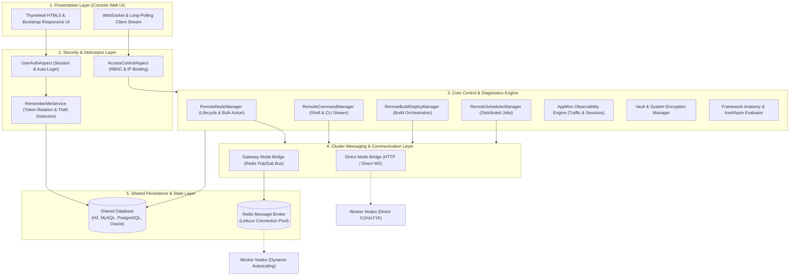
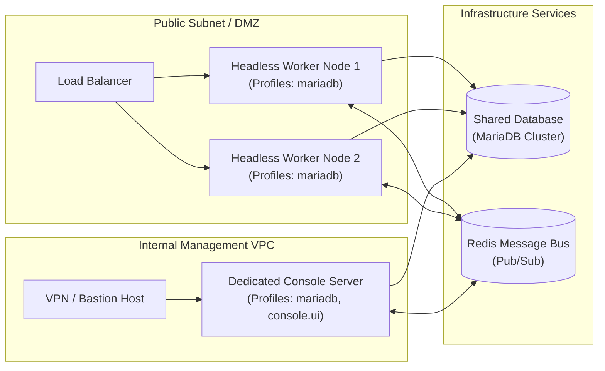

Aspectow Console은 Aspectran 기반 애플리케이션 서버 생태계의 분산 노드 클러스터, 스케줄러, 실시간 모니터링, 빌드 및 배포 파이프라인, 보안 Vault 및 런타임 진단 도구를 중앙에서 통합 제어하는 차세대 엔터프라이즈 관제 플랫폼입니다.

## 1. Aspectow Console의 탄생 배경과 핵심 비전

### 엔터프라이즈 분산 환경의 도전 과제

현대의 엔터프라이즈 웹 애플리케이션 환경은 단일 모놀리식 서버 중심에서 수십, 수백 개의 마이크로서비스 및 분산 인스턴스(Node Cluster) 환경으로 급격히 진화했습니다. 이러한 대규모 분산 환경에서는 개별 서버의 힙 메모리와 CPU 사용량을 단순 모니터링하는 것만으로는 안정적인 서비스 연속성을 보장할 수 없습니다.

실제 프로덕션 환경의 운영팀은 다음과 같은 복합적인 과제에 끊임없이 직면합니다:

*   **관측성과 제어성의 분리**: 모니터링 대시보드(APM)를 통해 장애 징후를 발견하더라도, 문제 해결을 위해 별도의 터미널(SSH)을 열고 개별 서버에 직접 접속하여 프로세스를 재기동하거나 로그를 확인해야 하는 컨텍스트 스위칭(Context Switching) 오버헤드.
*   **분산 스케줄러의 통제 불능**: 여러 노드에 걸쳐 동작하는 복잡한 배치 스케줄러 작업들의 실행 상태, 실패 이력, 동시 실행 여부를 실시간으로 추적하고 필요 시 특정 잡을 안전하게 일시 정지(Pause)하거나 수동 재실행할 수 있는 중앙 제어점의 부재.
*   **보안 자격증명 및 설정 불일치**: 데이터베이스 접속 비밀번호, 외부 연동 API 키, 암호화 마스터 키 등의 민감 정보가 각 노드의 설정 파일에 평문으로 분산 보관되어 보안 감사에 취약하고 변경 관리가 어려운 점.
*   **분산 빌드 및 배포 이력 관리**: 클러스터 내 특정 노드들에 수행된 핫픽스 빌드, 배포 스크립트 실행 이력, 실행 당시의 Git 커밋 해시 및 콘솔 로그의 체계적인 추적 부재.

### Observability(관측성)와 Controllability(제어성)의 결합

Aspectow Console은 이러한 엔터프라이즈 인프라 운영의 고질적인 분절성을 해결하기 위해 탄생했습니다.

과거에는 모니터링 기능이 `Aspectow AppMon`이라는 전용 솔루션으로 제공되었습니다. 하지만 진정한 엔터프라이즈 관제는 시스템 상태를 '보는 것(Observability)'을 넘어, 발견된 문제에 즉각적으로 '개입하고 통제하는 것(Controllability)'이 유기적으로 결합되어야 합니다.

Aspectow Console은 기존 AppMon의 검증된 고성능 실시간 모니터링 엔진을 1급 구성 요소(First-class Citizen)로 내부에 완전 통합하는 동시에, 분산 노드 라이프사이클 제어, 원격 명령 센터, 분산 빌드 및 배포 오케스트레이션, 보안 Vault 자산 금고, 런타임 프레임워크 진단, 그리고 세밀한 RBAC 거버넌스를 하나의 매끄러운 단일 웹 콘솔 인터페이스로 완성한 **차세대 엔터프라이즈 통합 관리 플랫폼**입니다.

## 2. 시스템 아키텍처 및 핵심 설계 원칙

Aspectow Console은 특정 벤더에 종속되지 않는 고가용성 분산 아키텍처를 구현하기 위해 다음과 같은 4대 핵심 설계 원칙을 준수합니다.

### 2.1. 노드 내장형 관제 아키텍처 (Self-Contained Every-Node Console Architecture)

기존 레거시 WAS 솔루션(예: WebLogic, WebSphere)의 경우 클러스터 관리를 위해 별도의 무거운 중앙 관리 서버(Admin Server / DMGR)를 반드시 구축해야 했습니다. 이 구조는 중앙 관리 서버 장애 시 클러스터 전체의 관제 기능이 마비되는 **단일 장애점(SPOF, Single Point of Failure)**을 안고 있었습니다.

Aspectow Console은 이러한 구조적 한계를 극복하기 위해 **노드 내장형 관제 아키텍처**를 채택합니다:

*   **단일 코드베이스 및 프로필 제어**: 모든 Aspectow 서버 노드는 태생적으로 관제 콘솔 기능을 내장하고 있습니다. 별도의 콘솔 전용 바이너리를 배포할 필요 없이 실행 프로필(`console.ui`) 활성화 여부에 따라 일반 워커 노드로 동작하거나 완전한 웹 관제 콘솔 서버로 즉시 동작합니다.
*   **SPOF 없는 고가용성 관제**: 특정 노드가 다운되더라도 클러스터 내 살아있는 다른 정상 노드의 웹 인터페이스에 접속하면 동일한 클러스터 상태를 즉시 모니터링하고 제어할 수 있습니다.
*   **초저지연 로컬 데이터 버스**: 콘솔과 서버 엔진이 동일 JVM 메모리 내에서 유기적으로 맞물려 구동되므로, 원격 API 호출에 따른 네트워크 오버헤드 없이 초고속 진단과 메트릭 수집이 가능합니다.

### 2.2. 공유 데이터베이스 기반 단일 상태 관리 (Shared Database Architecture)

Aspectow Console이 다루는 모든 메타데이터(관리자 계정, RBAC 권한, Vault 암호화 자산, Remember-Me 토큰, 분산 빌드 로그, 보안 감사 이력 등)는 **클러스터 전체의 단일 상태(Cluster-wide State)**를 나타냅니다.

따라서 Aspectow Console은 클러스터 내 모든 노드가 단일한 "공유 데이터베이스(Shared Database)"를 바라보는 환경을 표준 아키텍처로 전제합니다:

*   **분산 자율 영속화 (Decentralized Persistence)**: 각 노드는 원격 빌드 실행, 노드 상태 변경, 사용자 감사 로그를 중앙 관리자 경유 없이 자신의 로컬 트랜잭션을 통해 공유 DB에 직접 기록합니다.
*   **단일 진실 공급원 (Single Source of Truth)**: 관리자가 로드밸런서를 통해 임의의 노드에 접속하거나 특정 노드가 재기동되더라도, 모든 화면과 REST/WebSocket 엔드포인트는 항상 공유 DB로부터 최신의 클러스터 상태와 이력을 일관되게 조회합니다.
*   **다양한 RDBMS 지원**: H2, MariaDB, MySQL, Oracle, PostgreSQL을 공식 지원하며, 각 DB별 최적화된 DDL 스키마와 MyBatis 매퍼가 내장되어 있습니다.

### 2.3. 계층별 시스템 구조 (System Architecture Diagram)

Aspectow Console은 프론트엔드 인터페이스부터 데이터베이스 및 메시징 버스까지 모듈화된 5계층 아키텍처로 구성되어 있습니다.

### 2.4. 유연한 클러스터 통신 모드 (`direct` vs `gateway`)

네트워크 토폴로지와 인프라 규모에 최적화할 수 있도록 두 가지 클러스터 통신 파이프라인을 지원합니다.

*   **Direct 통신 모드 (`mode: direct`)**:
    *   Console 서버가 워커 노드의 IP 및 포트로 직접 HTTP 및 양방향 WebSocket 통신을 수립합니다.
    *   외부 메시지 브로커(Redis) 설치가 불필요하여 단일 머신, 사내 고정 IP 온프레미스 인프라, 소규모 서버군에 가장 경제적이고 직관적입니다.
*   **Gateway 통신 모드 (`mode: gateway`)**:
    *   고성능 Lettuce 비동기 커넥션 풀 기반의 Redis Pub/Sub 메시지 버스를 메시징 백본으로 활용합니다.
    *   워커 노드가 방화벽, 사설 NAT 서브넷 뒤에 있거나 동적 IP를 사용하는 환경에서도 아웃바운드 연결만으로 완벽한 원격 제어가 가능합니다.
    *   쿠버네티스 파드(Kubernetes Pod)나 AWS Auto Scaling Group과 같이 노드가 동적으로 생성·소멸되는 클라우드 네이티브 환경에 필수적인 통신 모드입니다.

## 3. 주요 기능 영역별 심층 아키텍처

Aspectow Console은 운영자가 서버 생태계를 종합적으로 관제할 수 있도록 7대 핵심 기능 영역을 제공합니다.

### 3.1. 클러스터 노드 라이프사이클 관리 (Node Management)

클러스터에 참여한 모든 노드의 실시간 생존 상태와 성능 지표를 중앙에서 한눈에 파악하고 통제합니다.

*   **실시간 Heartbeat 감시**: 노드가 주기적(기본 50초)으로 발송하는 펄스(Pulse) 패킷을 수집하여 활성, 지연, 응답 없음 상태를 실시간 진단합니다.
*   **상세 노드 프로필 조회**: 노드의 호스트명, OS 정보, Java 런타임 버전, JVM 힙 메모리(사용량/최대치), 로컬 포트 및 바인딩 인터페이스를 검사합니다.
*   **정밀 라이프사이클 제어**:
    *   Graceful Shutdown: 진행 중인 트랜잭션을 안전하게 마무리한 후 정상 종료.
    *   Hard Stop / Restart: 긴급 장애 발생 시 프로세스 즉시 종료 및 재구동.
    *   Pause / Resume: 특정 노드로의 신규 요청 인입을 차단하여 무중단 점검 수행.
    *   Bulk Action: 전체 또는 특정 서버 그룹 단위로 노드를 일괄 제어.

### 3.2. 통합 분산 빌드 및 배포 오케스트레이션 (Build & Deployment)

Aspectow Console은 단순 뷰어를 넘어 클러스터 내 노드들을 대상으로 직접 빌드와 배포를 수행할 수 있는 CI/CD 오케스트레이션 엔진을 내장하고 있습니다.

*   **스크립트 기반 원격 실행**: 노드 호스트에 배치된 배포 쉘 스크립트(또는 로컬 스크립트)를 원격에서 트리거합니다.
*   **실시간 빌드 콘솔 스트리밍**: 실행 중인 빌드의 표준 출력(StdOut) 및 에러 출력(StdErr)을 WebSocket을 통해 브라우저 화면에 실시간 ANSI 컬러 터미널 형태로 스트리밍합니다.
*   **SHA-256 무결성 다이제스트 및 감사 기록**: 빌드 실행자, Git 브랜치, 빌드 전/후 Git 커밋 해시, 종료 코드(Exit Code), 소요 시간, 그리고 출력 로그의 SHA-256 무결성 해시를 마스터 테이블(`asc_build_history`) 및 상세 로그 테이블(`asc_build_log`)에 영구 보존합니다.

### 3.3. 원격 명령 센터 (Remote Command Center)

SSH 터미널 접속 없이도 웹 콘솔에서 클러스터 내 지정 노드로 즉각적인 쉘 및 Aspectran CLI 명령을 실행할 수 있습니다.

*   **양방향 스트리밍 브릿지**: `WebsocketCommandBridge` 및 Long-Polling 브릿지를 통해 명령 실행 결과를 터미널 스타일 뷰어로 실시간 브로드캐스팅합니다.
*   **RCE 보안 통제**: 원격 명령 실행 권한은 최상위 관리자(`SUPER_ADMIN`) 및 `COMMAND_EXECUTE` 권한 보유자에게만 제한되며, 실행된 모든 명령어와 실행자 IP는 보안 감사 로그에 실시간 기록됩니다.

### 3.4. 분산 스케줄러 관리 및 잡 제어 (Scheduler Management)

Aspectran 내장 Quartz 기반 스케줄러 서비스의 분산 잡들을 통합 관제합니다.

*   **잡 상태 실시간 조회**: 클러스터 내 각 노드에 등록된 스케줄 잡의 트리거 유형(Cron, Simple), 다음 실행 예정 시각, 최근 실행 결과 및 상태(Running, Paused, Normal)를 집계합니다.
*   **수동 제어 및 트리거**: 정기 배치 작업의 수동 즉시 실행, 특정 잡의 긴급 일시 정지(Pause) 및 재개(Resume) 제어 패킷을 노드로 전달합니다.

### 3.5. AppMon 실시간 모니터링 엔진 (Observability Engine)

Console 내부에 1급 구성 요소로 탑재된 AppMon 엔진을 통해 고성능 실시간 모니터링을 제공합니다.

*   **트래픽 플로우 분석 (Traffic Flow)**: 초당 트랜잭션 수(TPS), 평균 응답 속도(Latency), HTTP 에러율(5xx, 4xx)을 실시간 시각화합니다.
*   **활성 세션 추적 및 지오로케이션**: `WebUtils` 기반으로 안전하게 추출된 클라이언트 IP와 `IPCountryResolver`를 결합하여 현재 접속 중인 사용자의 세션 상태와 접속 국가(ISO 2자리 코드)를 대시보드에 표출합니다.
*   **비침투적 사용자명 추출**: `usernameAttribute: user.account.username` 설정 하나만으로 비즈니스 코드 수정 없이 세션 객체에서 로그인 사용자명을 추출합니다.
*   **시스템 메트릭 및 로그 테일링**: JVM Heap, 가비지 컬렉션(GC), Undertow/Netty 워커 스레드 풀 메트릭 및 지정된 로그 파일의 실시간 테일링을 지원합니다.
*   **계층적 사전 집계 (Hierarchical Pre-aggregation)**: 5분, 1시간, 1일, 1월, 1년 단위로 집계 데이터를 사전 요약하여 DB에 저장하므로 장기 트렌드 분석 시에도 대시보드가 지연 없이 응답합니다.

### 3.6. 보안 Vault 및 암호화 자산 관리 (System Vault)

시스템 내 민감 자격증명을 중앙에서 안전하게 암호화 보관하고 관리합니다.

*   **PBE 기반 암호화 자산 금고**: 데이터베이스 접속 비밀번호, 외부 연동 토큰, 시크릿 키 등을 PBE(Password-Based Encryption) 암호화하여 `asc_vault` 테이블에 보관합니다.
*   **마스터 키 거버넌스**: 시스템 마스터 키 및 암호화 설정에 대한 조회 권한은 엄격히 통제되며, 웹 화면 표출 시 민감 값 마스킹 처리가 적용됩니다.

### 3.7. 프레임워크 런타임 진단 도구 (Framework Diagnostics)

애플리케이션 운영 중 코드 재배포 없이 프레임워크 수준의 상태를 진단할 수 있는 개발자/운영자 친화적 도구를 제공합니다.

*   **Context Anatomy (프레임워크 해부)**: 현재 서버에 등록된 모든 Aspectran 빈(Bean), 트랜슬릿(Translet), 애스펙트(Aspect), 뷰 디스패처 등의 런타임 메타데이터와 의존성 주입 관계를 시각적으로 탐색합니다.
*   **Asel Evaluator**: Aspectran 표현식 언어(Asel, Aspectran Expression Language) 구문을 런타임 컨텍스트에서 즉시 평가하고 테스트합니다.
*   **Apon 변환기**: APON(Aspectran Parameter Object Notation) 데이터의 유효성 검증 및 JSON/XML 상호 변환을 지원합니다.

## 4. 보안 거버넌스 및 접근 통제 체계

Aspectow Console은 인프라 핵심 제어 권한을 다루는 특성에 맞춰 엔터프라이즈 환경에서 요구하는 최고 수준의 보안 방어선을 구축하고 있습니다.

### 4.1. 정교한 RBAC 역할 및 핀포인트 권한 체계

*   **내장 역할 모델**:
    *   `SUPER_ADMIN`: 시스템 전권(노드 제어, 원격 명령, 계정 관리, Vault, 빌드/배포).
    *   `ADMIN`: 일반 운영 권한(모니터링, 스케줄러 제어, 빌드/배포).
    *   `BUILDER`: 빌드 및 배포 파이프라인 전담 실행 권한.
    *   `VIEWER`: 시스템 상태 및 로그 조회 전용 읽기 권한.
    *   `DEMO`: 시연 목적의 격리된 샌드박스 권한 (시스템 변경 행위 일체 차단).
*   **세분화된 기능 권한 (Granular Permissions)**:
    `NODE_MANAGE`, `COMMAND_EXECUTE`, `BUILD_EXECUTE`, `BUILD_VIEW`, `MONITOR_VIEW`, `MONITOR_CONTROL`, `USER_MANAGE` 등의 단위 권한을 역할별로 유연하게 조합 및 커스텀 구성할 수 있습니다.

### 4.2. 계정 보호 및 세션 하이재킹 방어

*   **계정 무차별 대입 방지 (Account Lockout)**: 비밀번호 5회 연속 오류 시 계정이 `LOCKED` 상태로 자동 전환되어 공격을 차단합니다.
*   **세션 고정 공격 차단 (Session Fixation Protection)**: 로그인 성공 시 기존 세션을 파기하고 새로운 세션 ID를 발급합니다.
*   **세션 IP 바인딩 (Session Hijacking Protection)**: 최초 로그인 시점의 IP 주소를 세션에 고정하여, 탈취된 세션 쿠키를 사용해 타 IP에서 접근할 경우 세션을 즉시 무효화하고 차단합니다.
*   **사용자별 허용 IP 화이트리스트 (`allowedIps`)**: 개별 계정 단위로 접속 허용 IP 대역(단일 IP, 서브넷 와일드카드)을 지정하여 비인가 위치에서의 접근을 차단합니다.

### 4.3. 영속적 토큰 기반 Remember-Me 보안 아키텍처

세션 만료 후에도 로그인 상태를 유지할 수 있는 Remember-Me 기능에 대해 **Persistent Token Rotation 및 4중 보안 방어선**을 적용하고 있습니다:

*   **Opt-In 선언적 제어**: 보안을 위해 일반 프로덕션 환경에서는 기본적으로 비활성화(`false`)되며, `console-rules.xml`의 환경 설정(`aspectow.console.auth.rememberMe.enabled`) 또는 `demo` 프로파일에서만 명시적으로 활성화됩니다.
*   **토큰 유효기간 유연화 (`DurationUtils`)**: `aspectow.console.auth.rememberMe.tokenValiditySeconds` 설정을 통해 `"30d"`, `"7d"`, `"24h"` 등 직관적인 기간 문자열을 직접 지정할 수 있습니다.
*   **Series & Token Rotation**: DB 기반 `asc_persistent_login` 테이블을 활용하여, 자동 로그인이 수행될 때마다 매번 일회용 암호화 토큰을 새로 갱신(Rotation)합니다.
*   **토큰 탈취 감지(Theft Detection)**: 탈취자가 훔친 이전 토큰으로 접속을 시도할 경우 토큰 불일치가 감지되어, **해당 사용자의 모든 Remember-Me 토큰을 즉시 강제 폐기**하고 감사 로그(`REMEMBER_ME_THEFT_DETECTED`)를 남깁니다.
*   **IP 및 User-Agent 바인딩**: 토큰 발급 시점의 접속 IP와 브라우저 `User-Agent`가 일치할 때만 자동 로그인을 허용합니다.

### 4.4. 전사적 보안 감사 로그 (Security Audit Trail)

계정 생성/수정/삭제, 역할 권한 변경, 원격 명령 실행, Vault 접근, 시스템 설정 변경 등 고위험 작업이 발생할 때마다 **실행자 ID, 작업 유형, 대상 리소스, 상세 내역, 접속 IP, 타임스탬프**를 `asc_audit_log` 테이블에 실시간으로 전수 기록하여 침해 사고 조사 및 컴플라이언스 준수를 보장합니다.

## 5. 유연한 배포 토폴로지 (Deployment Topologies)

Aspectow의 단일 프로젝트 아키텍처 덕분에 실행 프로필 조합만으로 다양한 인프라 토폴로지에 유연하게 대응할 수 있습니다.

*   **전용 관리 콘솔 노드 (Dedicated Management Node)**: 내부 보안 VPC에 `aspectow-enterprise` 아티팩트를 배치하고 `console.ui` 프로필을 활성화하여 사내 VPN을 통해서만 접근 가능한 단일 전용 관리 서버를 구성합니다.
*   **Headless 워커 노드 (Headless Worker Node)**: 비즈니스 서비스 인스턴스에는 `console.ui` 프로필을 제외하여 구동합니다. 콘솔 웹 UI 엔드포인트는 원천 차단되며 순수 노드 및 스케줄러 엔진만 동작하여 공격 표면을 최소화합니다.
*   **소규모 올인원 통합 노드 (All-in-One Integrated Node)**: 자원이 제한된 소규모 환경에서는 단일 인스턴스에 비즈니스 서비스와 콘솔 UI를 함께 구동하되, IP 화이트리스트(`allowedIps`)와 포트 분리 방화벽 규칙을 적용하여 안전하게 운용합니다.

## 6. 독립형 AppMon과의 관계 및 공존 전략

Aspectow Console의 탄생으로 기존 `Aspectow AppMon`의 입지가 대체되는 것은 아닙니다. 운영 목적과 시스템 규모에 따라 최적의 배포 조합을 선택할 수 있습니다.

| 구분 | Aspectow AppMon (독립형) | Aspectow Console (통합형) |
| :--- | :--- | :--- |
| **핵심 목적** | 순수 경량 애플리케이션 모니터링 (APM) | 전사적 노드 제어, 배포, 거버넌스 및 통합 관제 |
| **주요 기능** | 트래픽 플로우, 세션 추적, 시스템 메트릭, 로그 테일링 | AppMon 전체 기능 + 노드 제어 + 빌드/배포 + 스케줄러 + Vault + RBAC |
| **추천 환경** | 관제 권한 없이 특정 단일 앱의 상태만 모니터링할 때 | 다중 노드 클러스터를 통합 관리하고 원격 제어가 필요할 때 |
| **배포 패키지** | 독립 경량 WAR/JAR 또는 Standalone 데몬 | WAS 내장 통합 모듈 또는 전용 콘솔 서버 |
| **상호 운용성** | 독립 엔드포인트로 메트릭 수집 및 스트리밍 제공 | 외부 독립 AppMon 엔드포인트를 콘솔 화면으로 통합 임베딩 |

추가적인 상세 가이드는 아래 문서를 통해 확인하실 수 있습니다:

*   화면별 상세 기능 안내: [Aspectow Console 주요 화면 및 기능 가이드](/ko/docs/aspectow/console/feature-guide/)
*   설정 파일 작성 가이드: [Aspectow Console 구성 가이드](/ko/docs/aspectow/console/configuration-guide/)
*   보안 강화 및 운영 가이드: [Aspectow Console 운영 보안 아키텍처 및 보안 강화 가이드](/ko/docs/aspectow/console/security-architecture/)
