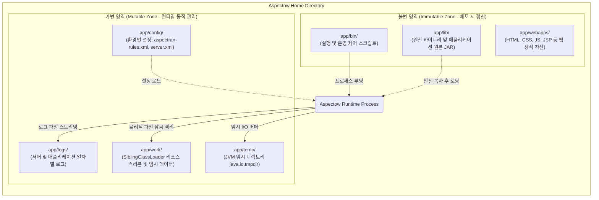
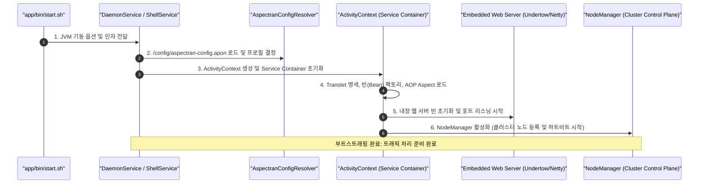
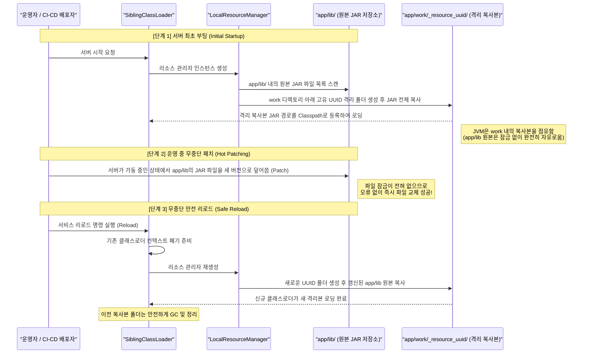
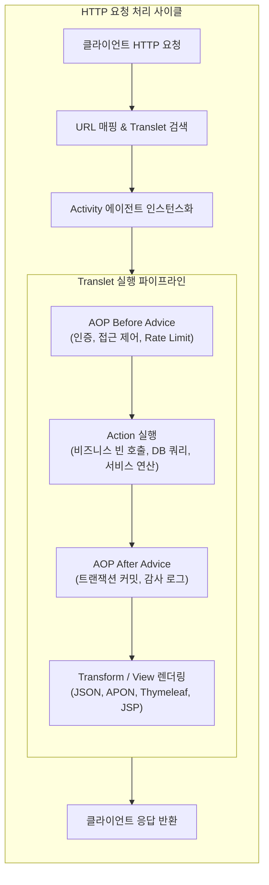
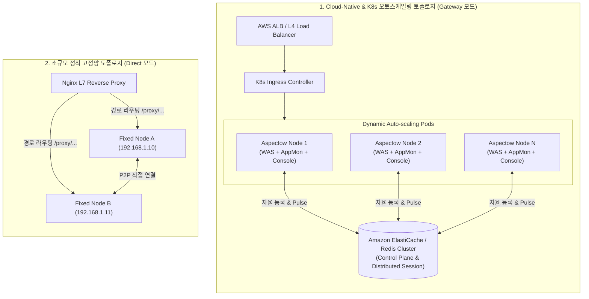

Aspectow는 Aspectran 프레임워크를 기반으로 고성능 WAS 엔진, 분산 클러스터 제어 평면, 실시간 관찰성(Observability) 및 웹 운영 콘솔을 완벽하게 통합한 차세대 엔터프라이즈 애플리케이션 플랫폼입니다.

## 1. 플랫폼 종합 개요 (Platform Overview)

Aspectow는 마이크로서비스 아키텍처(MSA) 및 대규모 분산 클라우드 환경에서 발생하는 복잡성을 극복하기 위해 설계된 **올인원(All-in-One) 엔터프라이즈 WAS 및 관제 플랫폼**입니다.

과거의 엔터프라이즈 WAS는 무거운 독립 관리 서버(Admin/DMGR)를 별도로 요구하거나, 반대로 경량 서블릿 컨테이너는 분산 제어, 캐싱, 스케줄링, 모니터링 라이브러리를 개발자가 직접 조립해야 하는 극심한 번거로움(Assembly Hell)이 존재했습니다. 또한 현대의 플랫폼들은 과도한 자동 설정(Magic)으로 인해 런타임 내부의 세밀한 제어와 문제 추적이 어려웠습니다.

Aspectow는 이러한 한계를 극복하여 **"명시적이고 제어 가능한 애플리케이션 프레임워크(Aspectran)"**와 **"자율적 분산 클러스터링 및 웹 콘솔을 자체 내장한 런타임 플랫폼(Aspectow)"**을 하나로 결합하였습니다.

```mermaid
flowchart TB
    subgraph WebConsoleLayer["1. 통합 운영 및 관제 계층 (Aspectow Console)"]
        direction LR
        CON_NODE["노드 클러스터 관리<br/>(Live/Pause/Restart)"]
        CON_CMD["대화형 원격 명령 터미널<br/>(Remote Shell / WebSocket)"]
        CON_SCHED["분산 스케줄러 관리<br/>(Dashboard & Detail View)"]
        CON_BUILD["원격 빌드 & 롤아웃 배포<br/>(Git/Maven/Detached Restart)"]
        CON_SEC["보안 & Vault 관리<br/>(PBE Token / Audit Log)"]
    end

    subgraph ObservabilityLayer["2. 실시간 관찰성 및 텔레메트리 계층 (Aspectow AppMon)"]
        direction LR
        MON_TRAFFIC["Canvas 트래픽 플로우<br/>(Bullet 동역학 엔진)"]
        MON_SPARK["인라인 스파크라인<br/>(60-pt Trend & 팝오버)"]
        MON_SESSION["실시간 세션 로스터<br/>(Always-On GeoIP / IP)"]
        MON_LOG["역방향 무한스크롤 로그<br/>(loadPrevious)"]
        MON_PRE["사전 집계 3계층 영속성<br/>(Raw / Hourly / Last)"]
    end

    subgraph ControlPlaneLayer["3. 분산 클러스터 제어 평면 계층 (Node Manager)"]
        direction LR
        NM_GW["Gateway 모드<br/>(Redis 기반 동적 클러스터링 / NAT 통과)"]
        NM_DIR["Direct 모드<br/>(정적 L7 Nginx / P2P 통신)"]
        NM_PULSE["생존 신호 (Pulse) & 자동 GC<br/>(Dead Node Cleanup)"]
        NM_3TIER["3계층 식별 체계<br/>(Group - Node - App)"]
    end

    subgraph AppBizLayer["4. 애플리케이션 및 비즈니스 로직 계층 (Aspectran Engine)"]
        direction LR
        TRANSLET["Translet<br/>(선언적 요청 명세서)"]
        ACTIVITY["Activity<br/>(실행 에이전트)"]
        AOP_CTX["Aspectran AOP & DI<br/>(관점 분리 / 빈 컨테이너)"]
        SESSION_STRAT["다중 컨텍스트 세션 전략<br/>(Non-blocking Redis Lettuce)"]
    end

    subgraph WASEngineLayer["5. 고성능 WAS 런타임 계층 (Aspectow WAS Engines)"]
        direction LR
        ED_ENT["Enterprise Edition<br/>(Undertow + Apache Jasper JSP)"]
        ED_EDGE["Edge Edition<br/>(Netty + Java 21 Virtual Threads)"]
        ED_JETTY["Jetty Edition<br/>(Eclipse Jetty Server)"]
    end

    subgraph InfraLayer["6. 인프라 및 운영체제 계층 (Infrastructure)"]
        direction LR
        JVM["Java Virtual Machine (JVM 17 / 21+)"]
        OS["Linux / macOS / Windows (Docker, Kubernetes, Bare Metal)"]
    end

    WebConsoleLayer --> ObservabilityLayer
    ObservabilityLayer --> ControlPlaneLayer
    ControlPlaneLayer --> AppBizLayer
    AppBizLayer --> WASEngineLayer
    WASEngineLayer --> InfraLayer
```



### 1.1. Aspectow 런타임 3대 공식 에디션

Aspectow는 서비스의 성격과 인프라 요건에 따라 최적의 성능을 낼 수 있도록 3가지 모듈화된 에디션을 제공합니다:

1.  **Aspectow Enterprise Edition**:
    *   완전한 Java 서블릿(Servlet) 사양을 지원하는 전통적/엔터프라이즈 웹 애플리케이션 전용 에디션입니다.
    *   JBoss의 초고속 비차단 웹 서버인 **Undertow**와 Apache Tomcat의 검증된 JSP 엔진인 **Apache Jasper**가 내장되어 있습니다.
    *   웹 기반 운영 관제 플랫폼인 **Aspectow Console이 기본 내장**되어 단독 실행만으로도 즉시 운영 환경이 완성됩니다.
2.  **Aspectow Edge Edition**:
    *   서블릿의 모든 오버헤드를 배제하고 초경량/초고속 REST API 및 마이크로서비스 처리에 특화된 에디션입니다.
    *   비동기 이벤트 기반 네트워킹 프레임워크인 **Netty**와 **Java 21 가상 스레드(Virtual Threads)**를 결합하여 최소한의 메모리와 CPU 점유율로 극대화된 동시 처리량(Throughput)을 실현합니다.
3.  **Aspectow Jetty Edition**:
    *   Eclipse **Jetty** 서버가 내장된 서블릿 에디션으로, 특정 클라우드 벤더 환경이나 Jetty 기반 플러그인 생태계를 활용해야 하는 인프라에 최적화되어 있습니다.

## 2. 물리 및 시스템 디렉토리 아키텍처

Aspectow는 안전한 배포, 무중단 핫 패치, 설정 분리, 그리고 운영 유지보수의 효율성을 극대화하기 위해 명확한 아키텍처적 의도를 담은 표준 시스템 디렉토리 구조를 따릅니다.



### 2.1. 불변 영역 (Immutable Zone)
시스템 바이너리와 애플리케이션 코드가 위치하는 영역으로, 배포 시점에 갱신되며 서버 가동 중에는 원본 파일이 직접 수정되지 않아야 하는 영역입니다.

*   **`app/bin/`**: 서버 구동 및 관리를 위한 쉘/배치 스크립트(`start.sh`, `stop.sh`, `restart.sh`, `status.sh` 등)와 데몬/서비스 제어기가 위치합니다.
*   **`app/lib/`**: Aspectow 플랫폼 엔진과 애플리케이션 비즈니스 로직이 담긴 모든 JAR 라이브러리가 위치합니다.
*   **`app/webapps/`**: HTML, CSS, JavaScript, 이미지, JSP 등 브라우저로 서비스되는 정적 웹 리소스가 위치합니다.

### 2.2. 가변 영역 (Mutable Zone)
런타임에 동적으로 생성되는 데이터나, 배포 환경(개발/스테이징/운영)에 따라 달라지는 설정 정보가 위치하는 영역입니다.

*   **`app/config/`**: 애플리케이션 비즈니스 규칙(`aspectran-config.apon`, `aspectran-rules.xml`), 서버 엔진 구성(`server.xml`), 로깅 설정(`logging.xml`)이 위치합니다. 애플리케이션 JAR 코드를 수정하지 않고도 설정 교체만으로 다양한 환경에 유연하게 대응합니다.
*   **`app/logs/`**: 서버 구동 로그, 트랜슬릿 처리 로그, 에러 로그가 저장됩니다.
*   **`app/work/`**: 서버 실행 중 생성되는 임시 데이터(세션 영속성 데이터, 컴파일된 JSP 클래스 등)가 저장됩니다. 특히 **안전한 리로딩(Safe Reloading)**을 위해 `app/lib/`의 원본 JAR 파일들을 이곳의 고유 격리 디렉토리로 복사하여 로드함으로써 OS 레벨의 **파일 잠금(File Locking) 문제를 원천 차단**합니다.
*   **`app/temp/`**: 시스템 임시 파일 디렉토리(`java.io.tmpdir`)로 사용됩니다.

## 3. 서버 런타임 및 클래스로더 격리 모델

Aspectow가 WAS로서 구동되고 요청을 처리하는 생명주기는 철저히 격리되고 제어 가능한 모델을 따릅니다.

### 3.1. 부트스트래핑 생명주기 (Bootstrapping Lifecycle)



1.  **스크립트 실행**: `app/bin`의 스크립트가 적절한 JVM 옵션(메모리, GC, 시스템 프로퍼티)을 바인딩하여 백그라운드 프로세스를 구동합니다.
2.  **서비스 초기화**: 실행 환경에 맞는 `CoreService` 구현체(예: 데몬 백그라운드 서비스인 `DaemonService`, CLI 대화형 쉘인 `ShellService`)가 동작하며 `app/config/`의 메인 설정을 파싱합니다.
3.  **컨텍스트 로드**: 핵심 컨테이너인 `ActivityContext`가 생성되고, 선언된 모든 빈(Bean), 트랜슬릿(Translet), 관점(Aspect)이 메모리에 로드됩니다. 이 과정에서 빈으로 정의된 웹 서버(Undertow, Netty, Jetty)가 초기화되고 포트 바인딩을 수행합니다.
4.  **클러스터 조인**: `NodeManager`가 구동되어 노드 ID를 부여받고 Redis(Gateway 모드) 또는 설정된 클러스터 레지스트리에 활성 상태를 등록합니다.

### 3.2. 클래스로더 전략: SiblingClassLoader와 안전한 리로딩 (Safe Reloading)

Java 가상 머신(JVM)은 한번 클래스로더를 통해 JAR 파일을 로드하면 해당 파일에 물리적 OS 파일 잠금(File Lock)을 생성하여, 서버가 구동 중인 상태에서는 JAR 파일을 덮어쓰거나 삭제할 수 없습니다.

Aspectow는 독자적인 **SiblingClassLoader**와 **LocalResourceManager** 아키텍처를 도입하여 이 문제를 해결했습니다.



이 메커니즘을 통해 운영자는 서버를 중단하거나 강제 종료할 필요 없이 `app/lib/`에 새로운 버전의 JAR를 안전하게 배포하고 리로드할 수 있습니다.

## 4. 요청 처리 파이프라인: Translet과 AOP

Aspectow 내부의 비즈니스 로직은 전통적인 MVC 패턴의 한계를 넘어선 **Translet과 Activity 중심의 AOP 파이프라인**을 통해 처리됩니다.



### 4.1. Translet: 선언적 요청 처리의 완전한 설계도
전통적인 프레임워크의 컨트롤러는 요청 수신, 데이터 변환, 비즈니스 호출, 뷰 지정 코드가 절차적으로 뒤섞이기 쉽습니다. Aspectran의 **Translet**은 요청 URL에 대응하는 처리 규칙(입력-로직-출력-예외)을 하나의 독립된 '관점'으로 캡슐화한 완전한 설계도입니다.

```xml
<translet name="/api/user/info">
    <action bean="userService" method="getUserInfo"/>
    <transform format="json"/>
</translet>
```

### 4.2. Activity: 격리된 실행 에이전트
요청이 유입되면 Aspectow 엔진은 해당 요청만을 전담하는 **Activity** 인스턴스를 즉시 생성합니다. Activity는 Translet 설계도에 따라:
*   요청 파라미터를 파싱하고 유효성을 검증합니다.
*   선언된 AOP 규칙(보안, 세션 체크, 트랜잭션 등)을 실행 전후에 투명하게 인터셉트합니다.
*   지정된 비즈니스 Bean의 액션(Action)을 호출합니다.
*   결과 데이터를 JSON, APON, HTML(Thymeleaf/JSP) 등의 다양한 포맷으로 변환(Transform)하여 응답을 송출합니다.

### 4.3. 어댑터(Adapter) 기반의 런타임 독립성
비즈니스 로직(`Translet` 및 빈)은 서블릿 API(`HttpServletRequest`, `HttpServletResponse`)나 특정 벤더의 클래스에 직접 의존하지 않습니다. Aspectran의 요청/응답 어댑터(`RequestAdapter`, `ResponseAdapter`)를 통해 추상화되어 있으므로, 동일한 코드가 Undertow 서블릿 환경이든 Netty 비동기 논서블릿 환경이든 **단 한 줄의 코드 수정 없이 완벽하게 동일하게 실행**됩니다.

## 5. 핵심 서브시스템 아키텍처 (The 4 Pillars)

Aspectow는 엔터프라이즈 운영을 완성하는 4대 핵심 축(Pillars)으로 구성되어 있습니다.

### 5.1. 축 1: 고성능 분산 제어 평면 (Node Manager)
클러스터 내 모든 서버 노드를 지능적으로 묶어주는 핵심 컨트롤 플레인 라이브러리입니다.

*   **Gateway 모드 (클라우드 & 오토스케일링 네이티브)**:
    *   **Redis를 메시지 브로커 및 분산 레지스트리**로 사용합니다.
    *   노드가 기동될 때 UUID 기반의 논리 식별자를 자율 발급하고 레지스트리에 조인합니다.
    *   노드가 동적으로 생성되고 소멸되는 **Kubernetes Pod 및 AWS Auto Scaling 환경**에 완벽하게 대응합니다.
    *   내부 사설망(NAT)이나 방화벽 뒤에 위치한 노드들도 별도의 외부 포트 포워딩 없이 안전하게 클러스터에 편입됩니다.
    *   주기적 생존 신호(Pulse)를 통해 비정상 종료된 노드의 메타데이터를 클러스터에서 자동으로 청소(Cleanup GC)합니다.
*   **Direct 모드 (소규모 고정망 & 온프레미스)**:
    *   Redis 인프라 없이 노드 간 직접 통신(P2P)을 수행하는 정적 운영 방식입니다.
    *   L7 Nginx의 경로 기반 라우팅이나 고정 IP 환경에 적합합니다.

### 5.2. 축 2: 전사 통합 웹 운영 콘솔 (Aspectow Console)
서버 단순 구동을 넘어 전체 분산 클러스터를 웹 브라우저에서 단일 창으로 완벽하게 통제하는 종합 관제 플랫폼입니다.

*   **클러스터 노드 관리**: 전체 노드의 생존 상태(Active, Paused, Inactive)를 실시간 감시하고 일괄 제어(Pause, Resume, Restart)합니다.
*   **대화형 원격 명령 터미널**: 클러스터 내 임의의 노드로 원격 CLI/쉘 명령을 발송하고 WebSocket 다크 터미널을 통해 실시간 출력을 스트리밍합니다.
*   **분산 스케줄러 관리자**: 모든 노드에 분산된 Quartz/Aspectran 스케줄러 잡(Job)의 상태, 실행 이력, 트리거를 실시간 감시하고 동적으로 일시정지/재개합니다.
*   **원클릭 원격 빌드 및 롤아웃 배포 오케스트레이터**:
    *   외부 젠킨스나 별도 에이전트 없이 웹 콘솔에서 원클릭으로 Git 소스 동기화, Maven 빌드 패키징, 설정/웹 자산 배포를 수행합니다.
    *   OS 독립 프로세스 분리 기법(Detached Restart)을 통해 배포 프로세스 종료 시에도 안전한 무중단 재기동을 보장합니다.
*   **엔터프라이즈 보안 및 토큰 회전 (Remember-Me)**:
    *   Spring Security 스타일의 Persistent Token Rotation 및 토큰 탈취 탐지(Theft Detection) 체계, 클라이언트 IP 및 User-Agent 디바이스 바인딩, PBE 암호화 쿠키를 적용하여 최고 수준의 관리자 보안을 제공합니다.

### 5.3. 축 3: 실시간 관찰성 및 텔레메트리 (Aspectow AppMon)
운영 성능 저하를 1% 미만으로 억제하면서 내부 런타임을 감각적으로 관찰하는 고성능 경량 모니터링 엔진입니다.

*   **3계층 식별 체계 (`Group - Node - App`)**: 분산된 대규모 클러스터에서도 논리 그룹, 물리 노드, 개별 애플리케이션 컨텍스트를 지능형 탭으로 즉시 탐색합니다.
*   **Canvas 기반 동역학 트래픽 플로우 (Traffic Flow)**: 초당 수천 건의 요청을 델타 타임 물리 엔진 기반의 '총알(Bullet)' 애니메이션으로 렌더링하며, 응답 지연 시 비행 감속 및 체류 시간 연장 효과, 활동 지수 0.3 초과 헤비 유저의 **하얀 핵(Hot Core)** 시각화를 제공합니다.
*   **인라인 스파크라인 및 상세 팝오버**: 최근 60개 시점 미니 트렌드를 인라인 표시하고, 고부하 감지 시 적색 경고 전환 및 클릭 시 정밀 듀얼 시계열(실선/점선)과 Min/Max/Avg 통계를 제공합니다.
*   **역방향 무한 스크롤 로그 콘솔 (`loadPrevious`)**: 실시간 로그 스트리밍을 유지하면서 스크롤 상단에서 과거 이력 로그를 역방향으로 탐색합니다.
*   **사전 집계(Pre-aggregation) 3계층 영속성 아키텍처**: 5분 원본(`appmon_event_count`), 1시간 요약(`appmon_event_count_hourly`), 최종 상태(`appmon_event_count_last`)로 계층화하여 수백만 건의 데이터 누적 시에도 대시보드 조회 속도를 일정하게 유지합니다.

### 5.4. 축 4: Redis 네이티브 고성능 세션 스토어
마이크로서비스 및 다중 노드 환경에서 상태 저장(Stateful) 서비스의 수평 확장을 지원하는 세션 아키텍처입니다.

*   `aspectran-rss-lettuce` 모듈을 통해 고성능 논블로킹 Redis 클라이언트인 **Lettuce**를 네이티브 드라이버로 사용합니다.
*   범용 JDBC 기반 세션 스토어 대비 I/O 병목이 없으며, 서블릿 세션과 Aspectran 네이티브 세션을 통합 관리합니다.
*   **다중 컨텍스트 세션 전략**: 동일 서버 내에서 구동되는 여러 웹 애플리케이션(`app`) 간에 세션을 안전하게 격리하거나 공유할 수 있는 유연한 쿠키 및 세션 스코프를 제공합니다.

## 6. 분산 배포 토폴로지 (Deployment Topologies)

Aspectow는 단일 온프레미스 서버부터 대규모 쿠베네티스(K8s) 클라우드 환경에 이르기까지 일관된 방식으로 배포할 수 있습니다.



### 6.1. Cloud-Native & Kubernetes 배포 (권장)
*   모든 노드가 WAS 엔진, AppMon 모니터링 에이전트, 웹 관제 콘솔을 자체 내장(Self-Contained)하고 있습니다.
*   관리자는 L4/ALB를 거쳐 살아있는 임의의 파드(Pod)에 접속하여 웹 콘솔을 열면, 중앙 Redis를 통해 클러스터 전체 노드들의 상태, 원격 명령, 스케줄러, 실시간 트래픽을 완벽히 관제할 수 있습니다.
*   특정 노드가 장애로 종료되더라도 관리 기능이 마비되는 **단일 장애점(SPOF)이 원천적으로 존재하지 않습니다.**

### 6.2. 독립형(Standalone) 단독 배포
*   Console이나 복잡한 클러스터 없이 특정 단일 인스턴스에 애플리케이션과 AppMon만 가볍게 올려 운용하는 형태입니다.
*   `appmon.standalone` 프로필을 통해 자체 PBToken 암호화 인증을 수행하며, 내장 H2 데이터베이스로 최소 리소스를 사용하여 구동됩니다.

## 7. 결론

Aspectow는 명시적이고 제어 가능한 Aspectran 프레임워크의 설계 철학을 엔터프라이즈 인프라 및 운영 영역으로 확장한 현대적 플랫폼입니다.

불변/가변 영역의 디렉토리 분리와 SiblingClassLoader를 통한 **무중단 안전 리로딩**, Netty와 가상 스레드를 품은 **초경량 Edge Edition**, Redis 기반의 **자율형 클러스터 제어 평면(Node Manager)**, 직관적 **실시간 관찰성(AppMon)**, 그리고 원격 빌드/배포를 아우르는 **통합 웹 콘솔(Console)**의 결합을 통해 개발과 운영 모두에 최상의 생산성과 견고함을 보장합니다.
