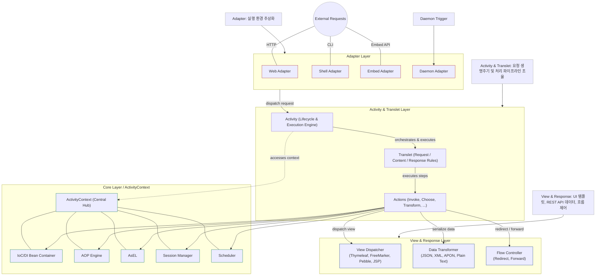
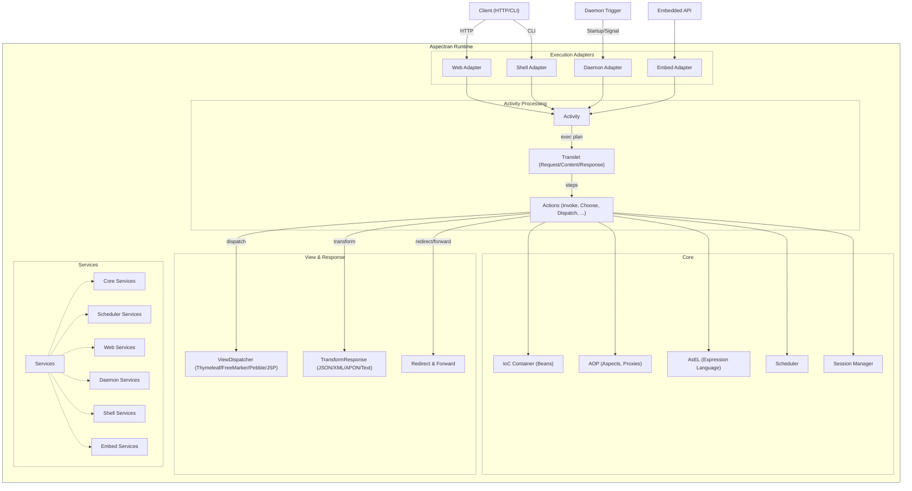
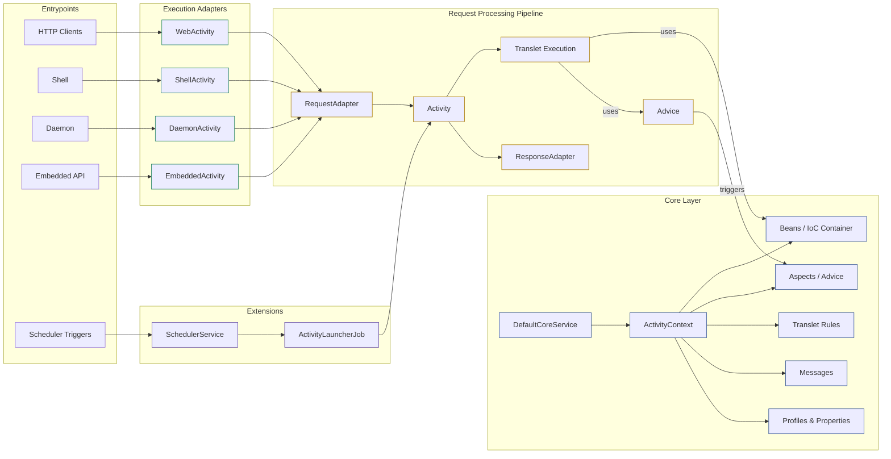
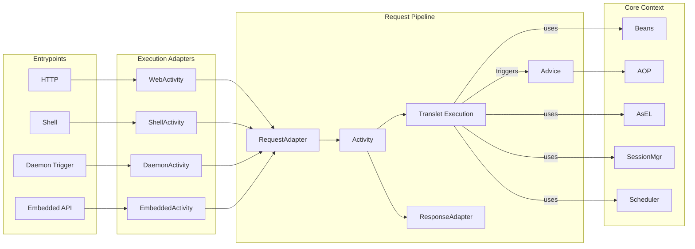
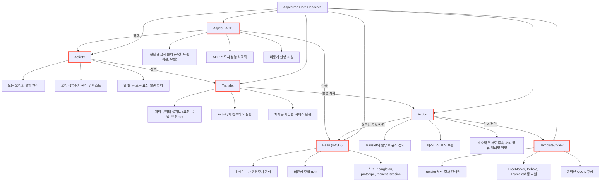
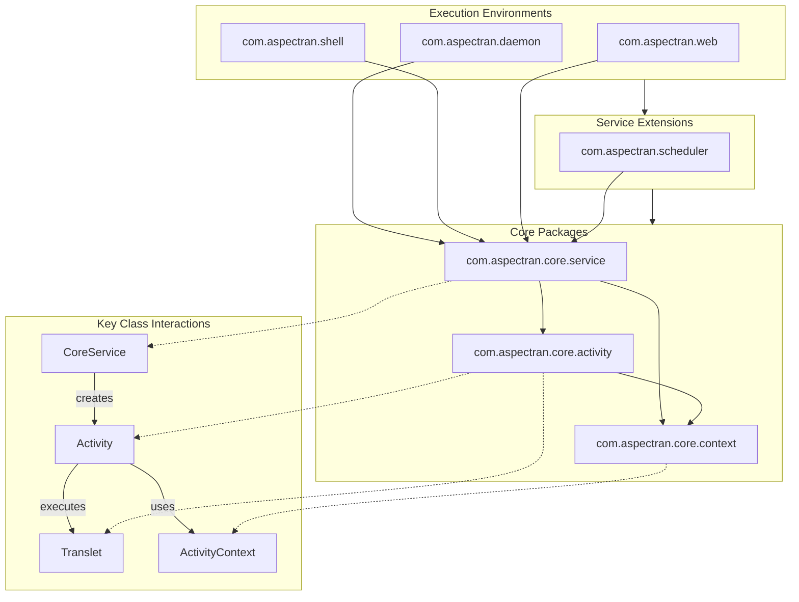
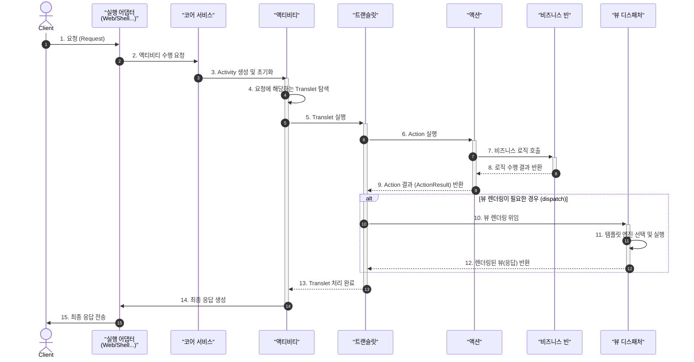
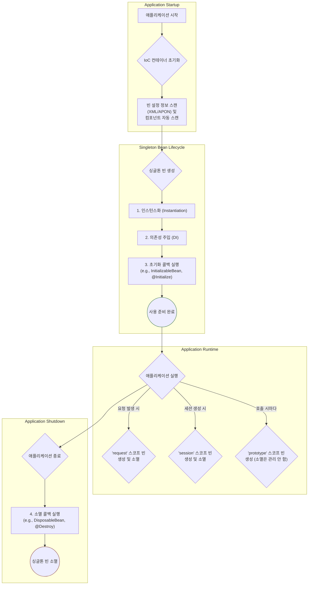
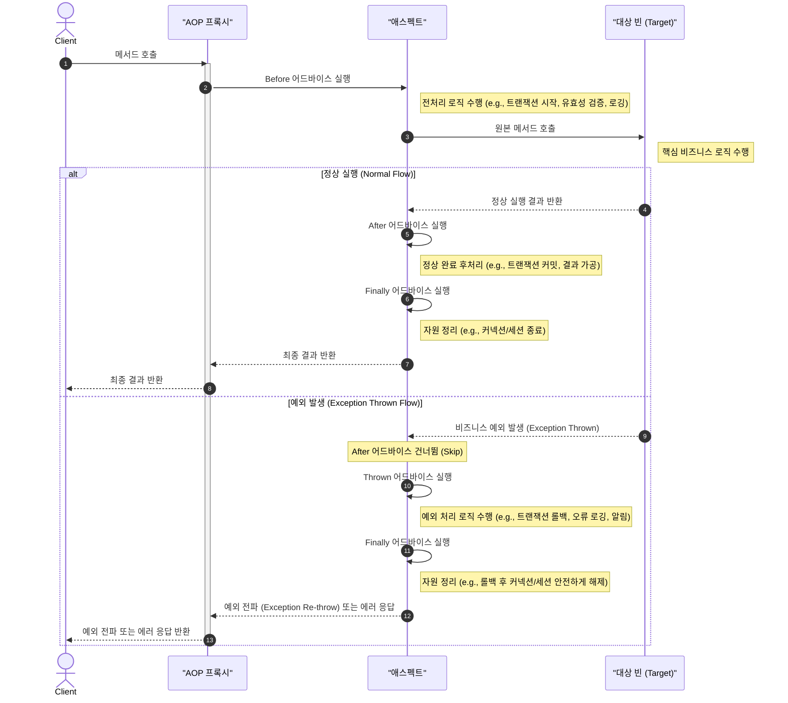

Aspectran은 JVM 기반의 경량 고성능 프레임워크로, 요청 지향적(Request-Oriented) 아키텍처와 환경 추상화 메커니즘을 바탕으로 웹(Web), 명령행 셸(Shell), 백그라운드 데몬(Daemon), 임베디드(Embedded) 등 다양한 실행 환경에서 단일하고 일관된 프로그래밍 모델을 제공합니다.

이 문서는 Aspectran의 내부 구조와 핵심 동작 원리를 9가지 관점(계층 구조, 요청 처리 파이프라인, 개념 모델, 패키지 의존성, 런타임 생명주기 및 AOP 등)에서 시각화한 다이어그램 모음입니다. 각 다이어그램은 특정 아키텍처 측면을 조명하여, 개발자와 아키텍트가 프레임워크의 설계 철학과 상호작용 메커니즘을 입체적으로 이해할 수 있도록 돕습니다.

## 주요 핵심 컴포넌트 개요

*   **어댑터 (Adapters)**: 웹(Web), 명령행 셸(Shell), 백그라운드 데몬(Daemon), 임베디드 API 등 서로 다른 실행 환경의 입력 및 출력을 표준 인터페이스로 추상화하여, 일관된 방식으로 `Activity`에 요청을 전달하고 응답을 반환합니다.
*   **액티비티 (Activity)**: 단일 요청의 전체 생명주기를 통제하고 실행하는 엔진입니다. 요청 진입부터 컨텍스트 접근, 트랜슬릿 탐색 및 실행, 뷰 렌더링, 응답 전송 및 자원 해제까지의 전 과정을 총괄합니다.
*   **트랜슬릿 (Translet)**: 하나의 요청을 처리하기 위한 선언적 실행 규칙의 단위입니다. 어떤 조건에서 어떤 `Action`들을 순차적·조건부로 실행하고, 최종 결과를 어떤 `View` 템플릿으로 디스패치할지를 정의합니다.
*   **액션 (Actions)**: 비즈니스 로직을 구체적으로 실행하는 최소 단위입니다. 자바 빈(Bean)의 메서드를 호출하거나(InvokeAction), 조건에 따라 실행 경로를 분기하거나(ChooseAction), 다른 트랜슬릿 또는 뷰로 제어를 전달합니다.
*   **코어 컴포넌트 (Core Components)**: 프레임워크의 토대를 이루는 기반 서비스들로, IoC/DI 빈 컨테이너, AOP 프록시 엔진, AsEL(Aspectran Expression Language), 세션 관리자(Session Manager), 스케줄러(Scheduler) 등을 포함합니다.
*   **뷰 및 응답 (View & Response)**: 액션들의 실행 결과를 최종 클라이언트 응답 형태로 표현하고 전달하는 계층입니다.
    *   **View Dispatcher**: FreeMarker, Pebble, Thymeleaf, JSP 등 다양한 템플릿 엔진과 연동하여 동적 UI 화면을 렌더링합니다 (`<dispatch>`).
    *   **Data Transformation**: JSON, XML, APON, Plain Text 등 최신 REST API 및 데이터 교환 규격으로 결과를 자동 직렬화·변환합니다 (`<transform>`).
    *   **Redirect & Forward**: 클라이언트 리다이렉트(`RedirectResponse`) 및 서버 측 내부 포워딩(`ForwardResponse`)을 지원합니다.
*   **서비스 (Services)**: 프레임워크의 생명주기(`ServiceLifeCycle`)를 관리하고 특정 실행 환경을 부트스트랩하는 컨테이너입니다. 최상위 `CoreService`를 기반으로 `WebService`, `ShellService`, `DaemonService` 등이 파생되어 시스템을 구성합니다.

## 1. 모듈화 계층형 아키텍처 (Modular Layered Architecture)

Aspectran의 전체 구성 요소를 기능적 계층별로 나누어 표현한 다이어그램입니다. 외부 요청(HTTP, CLI, Daemon Trigger, Embed API)이 진입하여 어댑터 계층(Adapter Layer)을 통해 표준화되고, 통합된 액티비티 & 트랜슬릿 계층(Activity & Translet Layer)에서 요청 생명주기 및 처리 파이프라인이 조율되며, 코어 계층(Core Layer / ActivityContext)의 인프라 기능과 뷰 & 응답 계층(View & Response Layer)으로 유기적으로 연결되는 4대 계층 아키텍처를 보여줍니다.

*   **Adapter Layer**: 웹, 셸, 데몬, 임베디드 등 다양한 프로토콜과 진입 환경의 차이를 추상화하여 공통 요청 규격으로 변환합니다.
*   **Activity & Translet Layer**: 요청 단위의 생명주기를 총괄하는 실행 엔진(`Activity`)과 요청 처리 규칙의 청사진인 `Translet`이 유기적으로 결합되어, 비즈니스 액션(`Actions`)의 실행 흐름을 조율하고 관리합니다.
*   **Core Layer (ActivityContext)**: 프레임워크의 심장인 `ActivityContext`를 중심으로 IoC/DI 빈 컨테이너, AOP 엔진, AsEL 표현 언어, 세션 관리자, 스케줄러 등 핵심 인프라 역량을 제공합니다.
*   **View & Response Layer**: 비즈니스 로직의 수행 결과를 최종 클라이언트에게 전달하는 출력 계층입니다. 템플릿 엔진 기반의 동적 화면 렌더링(`ViewDispatcher`), RESTful API를 위한 데이터 포맷 직렬화(`TransformResponse` - JSON, XML, APON, Plain Text), 그리고 흐름 제어(`Redirect & Forward`)를 모두 포괄합니다.

## 2. 계층 구조 상세 (Detailed Layered Structure)

`Aspectran Runtime` 컨테이너 내부의 세부 모듈 그룹과 그들 간의 상호작용 구조를 상세하게 보여주는 다이어그램입니다. 서비스 계층(`Services`)이 환경별 서비스(`CoreServices`, `SchedulerServices`, `WebServices`, `DaemonServices`, `ShellServices`, `EmbedServices`)를 부트스트랩하고 총괄하며, 어댑터로부터 유입된 요청이 Activity -> Translet -> Actions 순으로 전개되면서 코어 역량(Beans, AOP, AsEL, Session, Scheduler)을 유기적으로 활용하고 뷰 디스패처, 데이터 변환(Transform), 리다이렉트 등 다양한 응답 채널로 전달되는 전 과정을 입체적으로 조망할 수 있습니다.

## 3. 파이프라인 중심 뷰 (Pipeline-Centric View)

요청이 발생하여 최종 응답이 반환될 때까지의 처리 흐름을 파이프라인 형태로 표현한 다이어그램입니다. 각 실행 환경의 진입점(HTTP, CLI, Daemon, Embedded, Scheduler)으로부터 유입된 요청이 전용 어댑터(WebActivity, ShellActivity, DaemonActivity 등)를 거쳐 일원화된 요청 처리 파이프라인(`RequestAdapter` → `Activity` → `Translet` → `Advice/Actions` → `ResponseAdapter`)으로 연결되는 데이터 및 제어 흐름을 명확하게 보여줍니다.

*   `DefaultCoreService`가 `ActivityContext`를 생성하여 빈, AOP 애스펙트, 트랜슬릿 규칙, 메시지, 프로필 환경을 파이프라인에 공급합니다.
*   스케줄러 서비스는 `ActivityLauncherJob`을 통해 정기적/주기적 작업을 동일한 액티비티 파이프라인으로 구동시킵니다.

## 4. 파이프라인 축약 뷰 (Simplified Pipeline View)

파이프라인 중심 뷰의 복잡성을 간소화하여 핵심 요청 처리 흐름만을 압축해 표현한 다이어그램입니다. 개발자가 Aspectran의 요청-응답 멘탈 모델을 직관적으로 형성할 수 있도록 4대 핵심 축(`Entrypoints` → `Execution Adapters` → `Request Pipeline` → `Core Context`)의 연결 고리를 직관적으로 보여줍니다.

## 5. 핵심 개념 맵 (Core Concept Map)

Aspectran을 구성하는 5가지 핵심 개념(`Activity`, `Translet`, `Bean`, `Action`, `Aspect`)과 뷰 템플릿(`Template / View`) 간의 유기적 관계와 역할을 도식화한 다이어그램입니다.

*   **Activity**: 모든 요청의 통합 실행 엔진이자 생명주기 관리 컨텍스트입니다.
*   **Translet**: Activity가 참조하여 실행하는 요청 처리 규칙의 설계도입니다.
*   **Bean**: IoC/DI 컨테이너에 의해 생명주기 및 의존성이 관리되는 컴포넌트입니다.
*   **Action**: Translet의 실행 계획에 따라 실제 비즈니스 로직을 수행하는 단위입니다.
*   **Aspect**: 로깅, 보안, 트랜잭션 등 횡단 관심사를 Activity와 Bean에 투명하게 적용하는 AOP 모듈입니다.
*   **Template / View**: 액션 수행 결과를 동적으로 렌더링하여 사용자에게 표현하는 출력 계층입니다.

## 6. 코어 패키지 관계 (Core Package Relationships)

프레임워크의 주요 패키지 간 의존성 구조와 핵심 클래스들의 상호작용 관계를 보여주는 다이어그램입니다. 상위 레벨의 실행 환경 모듈(`daemon`, `shell`, `web`)과 서비스 확장(`scheduler`)이 하위의 코어 서비스 패키지(`core.service`)를 통해 코어 기능과 결합되며, 코어 서비스는 액티비티(`core.activity`) 및 컨텍스트(`core.context`) 패키지를 유기적으로 총괄합니다.

*   `CoreService`는 요청을 처리할 `Activity`를 생성합니다.
*   `Activity`는 `ActivityContext`를 참조하여 선언된 `Translet`을 실행합니다.

## 7. 요청 생명주기 시퀀스 (Request Lifecycle Sequence)

클라이언트의 요청이 발생했을 때부터 최종 응답이 전달될 때까지, 각 핵심 컴포넌트 간의 상호작용을 시간 순서에 따라 추적하는 시퀀스 다이어그램입니다.

1.  **요청 진입 (1~3단계)**: 클라이언트 요청이 실행 어댑터(Web/Shell 등)에 도달하면 코어 서비스에 액티비티 수행을 요청하고, `Activity` 인스턴스가 생성 및 초기화됩니다.
2.  **규칙 탐색 및 실행 (4~5단계)**: `Activity`가 요청 URI 및 조건에 매칭되는 `Translet` 규칙을 탐색하고 실행을 시작합니다.
3.  **액션 및 비즈니스 빈 호출 (6~9단계)**: `Translet`에 정의된 액션(Action)들이 실행되며, 비즈니스 빈의 메서드를 호출하고 결과(`ActionResult`)를 반환받습니다.
4.  **뷰 렌더링 분기 (10~12단계)**: 응답 디스패치(`dispatch`) 설정이 되어 있는 경우 `ViewDispatcher`를 호출하여 적절한 템플릿 엔진을 통해 뷰를 렌더링합니다.
5.  **응답 반환 및 종료 (13~15단계)**: `Translet` 실행이 완료되면 `Activity`가 어댑터를 통해 최종 응답을 클라이언트에게 안전하게 전송합니다.

## 8. 빈 생명주기 및 스코프 (Bean Lifecycle & Scopes)

Aspectran IoC 컨테이너가 빈(Bean)을 생성, 관리, 소멸시키는 전체 생명주기와 다양한 스코프(Scope)의 라이프사이클 정책을 보여주는 다이어그램입니다.

*   **Application Startup**: 컨테이너가 구동될 때 XML, APON 설정 파일 및 애너테이션 기반 컴포넌트 자동 스캔을 통해 빈 정의 메타데이터를 수집합니다.
*   **Singleton Bean Lifecycle**: 싱글톤 빈은 `인스턴스화(Instantiation)` → `의존성 주입(DI)` → `초기화 콜백 실행(InitializableBean, @Initialize)` 순서로 준비를 완료하고 런타임에 재사용됩니다.
*   **Application Runtime Scopes**:
    *   `request` 스코프: 각 요청(`Activity`)이 시작될 때 생성되고 요청 종료 시 함께 소멸합니다.
    *   `session` 스코프: 사용자 세션이 생성될 때 생성되고 세션 만료 시 소멸합니다.
    *   `prototype` 스코프: 컨테이너에 요청할 때마다 새로운 인스턴스가 생성됩니다.
*   **Application Shutdown**: 애플리케이션 종료 신호를 수신하면 `소멸 콜백(DisposableBean, @Destroy)`을 호출하여 자원을 안전하게 정리하고 소멸합니다.

## 9. AOP 작동 방식 (AOP Mechanism)

Aspectran의 AOP 프록시(AOP Proxy)가 비즈니스 메서드 호출을 가로채어 트랜잭션, 로깅, 보안 등 횡단 관심사(Cross-cutting Concerns)를 투명하게 적용하는 메커니즘을 보여주는 시퀀스 다이어그램입니다. 정상 실행 흐름뿐만 아니라, 대상 로직에서 예외가 발생했을 때의 예외 처리(Exception Thrown) 흐름까지 명확하게 제어합니다.

### 실행 흐름 구분

1.  **사전 처리 (Before Advice)**: 클라이언트가 대상 빈을 호출하면 동적 프록시가 이를 가로채고, 매칭된 애스펙트(Aspect)의 `Before` 어드바이스를 먼저 실행합니다. (예: 트랜잭션 시작, 파라미터 유효성 검증, 실행 시작 로깅)
2.  **대상 메서드 실행 (Target Execution)**: 사전 처리가 완료되면 실제 대상 빈(Target Bean)의 원본 메서드를 호출하여 핵심 비즈니스 로직을 수행합니다.
3.  **분기 1: 정상 실행 완료 (Normal Flow)**
    *   **After Advice**: 비즈니스 로직이 성공적으로 완료되면 `After` 어드바이스가 실행되어 결과 가공이나 트랜잭션 커밋을 수행합니다.
    *   **Finally Advice**: 성공/실패 여부와 무관하게 항상 실행되어 데이터베이스 세션 닫기 등 리소스를 안전하게 해제합니다.
    *   최종 정상 결과를 클라이언트에게 반환합니다.
4.  **분기 2: 예외 발생 시 처리 (Exception Thrown Flow)**
    *   **After 건너뜀 (Skip)**: 비즈니스 로직 수행 도중 예외가 발생하면 `After` 어드바이스는 즉시 건너뜁니다.
    *   **Thrown Advice**: `Finally` 단계보다 **먼저 실행**되어, 리소스가 해제되기 전에 트랜잭션 롤백, 에러 로깅, 관리자 알림을 안전하게 수행합니다.
    *   **Finally Advice**: 롤백 처리가 완료된 후 항상 실행되어 연결 세션이나 메모리를 안전하게 정리합니다.
    *   예외를 상위로 전파(Exception Re-throw)하거나 정의된 에러 응답을 클라이언트에게 전달합니다.

이 다이어그램들은 Aspectran의 핵심 설계 사상과 내부 동작 메커니즘을 입체적으로 이해하고, 안정적이고 확장성 높은 시스템을 설계·개발하는 데 든든한 기준이 될 것입니다.
