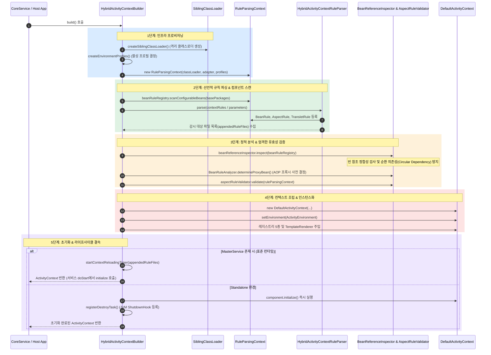
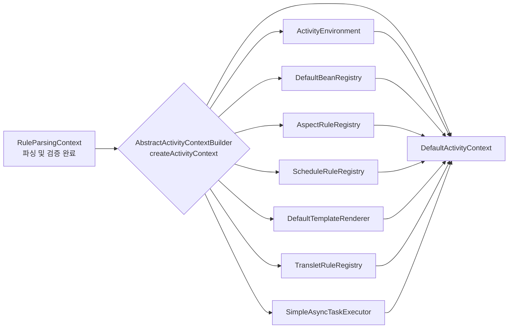

Aspectran 애플리케이션의 핵심 IoC/DI 컨테이너인 [`ActivityContext`](https://github.com/aspectran/aspectran/blob/master/core/src/main/java/com/aspectran/core/context/ActivityContext.java)는 런타임에 직접 생성되지 않고, 전용 빌더인 [`ActivityContextBuilder`](https://github.com/aspectran/aspectran/blob/master/core/src/main/java/com/aspectran/core/context/builder/ActivityContextBuilder.java)의 체계적이고 엄격한 파이프라인을 거쳐 조립됩니다.

빌드 과정은 단순한 설정 파싱을 넘어, **전용 클래스로더 격리, 환경 프로필 해석, XML/APON/어노테이션 하이브리드 파싱, 빈 참조 무결성 검사([`BeanReferenceInspector`](https://github.com/aspectran/aspectran/blob/master/core/src/main/java/com/aspectran/core/context/rule/validation/BeanReferenceInspector.java)), AOP 프록시 사전 분석([`BeanRuleAnalyzer`](https://github.com/aspectran/aspectran/blob/master/core/src/main/java/com/aspectran/core/component/bean/BeanRuleAnalyzer.java)), 애스펙트 유효성 검증([`AspectRuleValidator`](https://github.com/aspectran/aspectran/blob/master/core/src/main/java/com/aspectran/core/context/rule/validation/AspectRuleValidator.java)), 그리고 실시간 리로딩 감시 타이머 결속**에 이르는 종합 엔지니어링 프로세스입니다.

전체 빌드 프로세스는 [`HybridActivityContextBuilder`](https://github.com/aspectran/aspectran/blob/master/core/src/main/java/com/aspectran/core/context/builder/HybridActivityContextBuilder.java) 클래스가 총괄합니다.

## 1. 엔드투엔드 빌드 파이프라인 아키텍처

`ActivityContext`의 빌드는 5개의 명확한 단계(Phases)로 나뉘어 순차 진행됩니다.

## 2. 1단계: 빌더 설정 및 인프라 프로비저닝

빌드 파이프라인의 첫 번째 단계는 컨텍스트가 구동될 물리적 자원과 런타임 환경을 격리하고 초기화하는 것입니다.

### 1) 클래스로더 분리 ([`createSiblingClassLoader`](https://github.com/aspectran/aspectran/blob/master/core/src/main/java/com/aspectran/core/context/builder/AbstractActivityContextBuilder.java#L396))
- 외부 호스트 애플리케이션의 시스템 클래스로더와 분리된 전용 [`SiblingClassLoader`](https://github.com/aspectran/aspectran/blob/master/core/src/main/java/com/aspectran/core/context/resource/SiblingClassLoader.java)를 생성합니다.
- `<resourceLocations>`로 지정된 외부 디렉토리나 JAR 파일 경로를 클래스패스에 동적으로 추가하며, 핫 리로딩 시 클래스로더 단위의 안전한 폐기 및 재생성을 가능하게 합니다.

### 2) 환경 프로필 확정 ([`createEnvironmentProfiles`](https://github.com/aspectran/aspectran/blob/master/core/src/main/java/com/aspectran/core/context/builder/AbstractActivityContextBuilder.java#L430))
- 시스템 프로퍼티, 환경 변수, 설정 파일에 지정된 활성 프로필(`activeProfiles`)과 기본 프로필(`defaultProfiles`)을 평가하여 [`EnvironmentProfiles`](https://github.com/aspectran/aspectran/blob/master/core/src/main/java/com/aspectran/core/context/env/EnvironmentProfiles.java) 객체를 생성합니다.
- 이후 파싱되는 모든 컴포넌트와 프로퍼티는 이 프로필 조건에 부합할 때만 활성화됩니다.

### 3) 파싱 컨텍스트 초기화 ([`RuleParsingContext`](https://github.com/aspectran/aspectran/blob/master/core/src/main/java/com/aspectran/core/context/rule/parsing/RuleParsingContext.java))
- 파싱 과정에서 생성되는 임시 규칙 객체(`*Rule`)들을 보관하고 상호 관계를 결속하는 전용 파싱 세션 객체인 `RuleParsingContext`를 인스턴스화하고 준비(`prepare()`)합니다.

## 3. 2단계: 선언적 규칙 파싱 및 컴포넌트 스캔

이 단계에서는 다양한 소스(자바 어노테이션, XML, APON)로부터 컴포넌트 메타데이터를 수집하여 규칙 객체 트리로 변환합니다.

### 1) 어노테이션 컴포넌트 스캔
- `basePackages`에 지정된 패키지 경로를 스캔하여 `@Component`, `@Bean`, `@Aspect`, `@Service`, `@Controller` 등의 어노테이션이 선언된 클래스를 탐색합니다.
- 탐색된 클래스는 파서에 의해 즉시 동등한 [`BeanRule`](https://github.com/aspectran/aspectran/blob/master/core/src/main/java/com/aspectran/core/context/rule/BeanRule.java) 및 [`AspectRule`](https://github.com/aspectran/aspectran/blob/master/core/src/main/java/com/aspectran/core/context/rule/AspectRule.java)로 변환되어 `RuleParsingContext`에 등록됩니다.

### 2) XML / APON 하이브리드 파싱 및 Appender 처리 ([`HybridActivityContextRuleParser`](https://github.com/aspectran/aspectran/blob/master/core/src/main/java/com/aspectran/core/context/rule/parser/HybridActivityContextRuleParser.java))
선언적 설정 파일은 포맷(XML 또는 APON)과 전달 방식(파일 경로, 클래스패스 리소스, 매개변수 객체)에 따라 단일화된 하이브리드 파서 파이프라인을 통해 처리됩니다:

- **파서 계층 구조 및 역할 분담**:
  - [`ActivityContextRuleParser`](https://github.com/aspectran/aspectran/blob/master/core/src/main/java/com/aspectran/core/context/rule/parser/ActivityContextRuleParser.java): 설정 규칙을 읽어 [`RuleParsingContext`](https://github.com/aspectran/aspectran/blob/master/core/src/main/java/com/aspectran/core/context/rule/parsing/RuleParsingContext.java)를 구성하는 최상위 파서 규격(`AutoCloseable`)을 정의합니다.
  - [`AbstractActivityContextRuleParser`](https://github.com/aspectran/aspectran/blob/master/core/src/main/java/com/aspectran/core/context/rule/parser/AbstractActivityContextRuleParser.java): `RuleParsingContext` 보관, 문자 인코딩(`encoding`), XML-to-APON 변환 플래그(`useXmlToApon`), 디버그 모드(`debugMode`) 상태를 관리하며, 리소스 경로를 분석해 적절한 [`RuleAppender`](https://github.com/aspectran/aspectran/blob/master/core/src/main/java/com/aspectran/core/context/rule/appender/RuleAppender.java)를 생성하는 `resolveAppender()` 로직을 제공합니다.
  - [`HybridActivityContextRuleParser`](https://github.com/aspectran/aspectran/blob/master/core/src/main/java/com/aspectran/core/context/rule/parser/HybridActivityContextRuleParser.java): XML과 APON 두 형식을 모두 수용하는 통합 파서 구현체로, 내부적으로 [`HybridRuleAppendHandler`](https://github.com/aspectran/aspectran/blob/master/core/src/main/java/com/aspectran/core/context/rule/appender/HybridRuleAppendHandler.java)를 생성하여 실제 구문 분석과 하위 규칙 파일 연계를 위임합니다.
- **리소스 식별 및 Appender 결정 (`resolveAppender`)**:
  - 지정된 규칙 경로 접두사에 따라 적합한 `RuleAppender`를 생성합니다:
    - `classpath:` 접두사: [`ResourceRuleAppender`](https://github.com/aspectran/aspectran/blob/master/core/src/main/java/com/aspectran/core/context/rule/appender/ResourceRuleAppender.java)를 통해 컨텍스트 격리 클래스로더([`SiblingClassLoader`](https://github.com/aspectran/aspectran/blob/master/core/src/main/java/com/aspectran/core/context/resource/SiblingClassLoader.java))에서 리소스를 로드합니다.
    - `file:` 접두사: [`FileRuleAppender`](https://github.com/aspectran/aspectran/blob/master/core/src/main/java/com/aspectran/core/context/rule/appender/FileRuleAppender.java)를 통해 절대 파일 시스템 경로에서 로드합니다.
    - 접두사가 없는 상대 경로: `ruleParsingContext.getBasePath()`를 기준으로 하는 [`FileRuleAppender`](https://github.com/aspectran/aspectran/blob/master/core/src/main/java/com/aspectran/core/context/rule/appender/FileRuleAppender.java)를 생성합니다.
  - 파일 확장자가 `.apon`(대소문자 무관)인 경우 [`AppendableFileFormatType.APON`](https://github.com/aspectran/aspectran/blob/master/core/src/main/java/com/aspectran/core/context/rule/type/AppendableFileFormatType.java)으로, 그 외의 경우는 [`AppendableFileFormatType.XML`](https://github.com/aspectran/aspectran/blob/master/core/src/main/java/com/aspectran/core/context/rule/type/AppendableFileFormatType.java)로 포맷 타입을 지정합니다.
- **포맷별 구문 분석 실행 (`HybridRuleAppendHandler`)**:
  - `HybridRuleAppendHandler`는 `RuleAppender`의 타입과 파일 포맷에 따라 적합한 엔진으로 파싱을 분기합니다:
    - **XML 기반 설정 (기본 방식 - Nodelet 고속 XML 파싱)**: 별도의 변환 단계 없이 [`AspectranNodeParser`](https://github.com/aspectran/aspectran/blob/master/core/src/main/java/com/aspectran/core/context/rule/parser/xml/AspectranNodeParser.java)를 직접 구동하여 Nodelet 기반 SAX 방식으로 XML 노드를 순회하며 규칙 객체(`BeanRule`, `TransletRule`, `AspectRule` 등)를 즉각 생성하여 `RuleParsingContext`에 등록합니다.
    - **XML 기반 설정 (대체 방식 및 교차 검증 - `useXmlToApon` 활성화 시)**: [`XmlToParameters`](https://github.com/aspectran/aspectran/blob/master/utils/src/main/java/com/aspectran/utils/apon/XmlToParameters.java)를 통해 XML 문서를 파라미터 구조체인 [`RootParameters`](https://github.com/aspectran/aspectran/blob/master/core/src/main/java/com/aspectran/core/context/rule/params/RootParameters.java)로 파싱한 후, [`ParametersToRules`](https://github.com/aspectran/aspectran/blob/master/core/src/main/java/com/aspectran/core/context/rule/converter/ParametersToRules.java)를 거쳐 규칙 객체로 일괄 변환합니다. 이 경로는 고속 Nodelet 직접 파싱 방식의 결과와 대조하여 구문 분석의 정확성을 비교·검증할 수 있는 **독립적인 교차 검증(Cross-Validation) 기준점** 역할을 수행하며, 파서 엔진 간의 규칙 매핑 일관성을 보증하고 결함을 신속하게 격리할 수 있도록 돕습니다.
    - **APON 기반 설정 (`.apon` 파일)**: Reader를 통해 APON 문서를 읽어 [`RootParameters`](https://github.com/aspectran/aspectran/blob/master/core/src/main/java/com/aspectran/core/context/rule/params/RootParameters.java) 객체를 생성하고, [`ParametersToRules`](https://github.com/aspectran/aspectran/blob/master/core/src/main/java/com/aspectran/core/context/rule/converter/ParametersToRules.java)를 통해 규칙 객체로 변환합니다.
    - **매개변수 객체 직접 전달 (`AspectranParameters`)**: 파일 경로가 아닌 자바 코드에서 `AspectranParameters` 객체로 직접 전달된 경우([`AppenderType.PARAMETERS`](https://github.com/aspectran/aspectran/blob/master/core/src/main/java/com/aspectran/core/context/rule/type/AppenderType.java)), `ParametersToRules` 변환기를 통해 컨텍스트 규칙 객체 트리로 조립합니다.
- **외부 설정 파일 임포트(`<append>`) 및 자동 리로딩 감시 목록 실시간 수집**:
  - 최상위 설정 파일뿐만 아니라, 파싱 도중 `<append file="..." />`(XML) 또는 `append: { file: "..." }`(APON)을 통해 추가로 임포트되는 모든 설정 파일들이 `HybridRuleAppendHandler.handle(appender)`를 통해 재귀적으로 처리됩니다.
  - 파일 시스템 기반의 Appender([`FileRuleAppender`](https://github.com/aspectran/aspectran/blob/master/core/src/main/java/com/aspectran/core/context/rule/appender/FileRuleAppender.java))가 처리될 때마다, 빌더가 등록한 [`RuleFileAppendedListener`](https://github.com/aspectran/aspectran/blob/master/core/src/main/java/com/aspectran/core/context/builder/HybridActivityContextBuilder.java#L173) 콜백이 실시간으로 트리거되어 물리 `File` 객체를 `appendedRuleFiles` 목록에 중복 없이 누적합니다. 이 목록은 이후 [`ContextReloadingTimer`](https://github.com/aspectran/aspectran/blob/master/core/src/main/java/com/aspectran/core/context/builder/reload/ContextReloadingTimer.java)에 감시 대상으로 등록됩니다.
- **스코프 격리 및 스코프 오버라이드 (Scoped Overrides)**:
  - `<append>`를 통해 외부 규칙을 임포트할 때 [`RuleParsingScope`](https://github.com/aspectran/aspectran/blob/master/core/src/main/java/com/aspectran/core/context/rule/parsing/RuleParsingScope.java)를 백업하고 파싱 완료 후 복원함으로써 중첩 스코프의 독립성을 보장합니다.
  - `<append>` 태그 내에 자식 규칙(`childRules`)이 선언되어 있는 경우(`applyScopedOverrides`), 임포트된 스코프 내에서 정의된 특정 빈(`BeanRule`), 프로퍼티(`EnvironmentRule`), 타입 별칭(`TypeAliasRule`), 트랜슬릿(`TransletRule`), 애스펙트(`AspectRule`), 스케줄(`ScheduleRule`), 템플릿(`TemplateRule`)을 정밀하게 오버라이드(재정의)할 수 있습니다.
- **디버그 모드 지원 (XML to APON)**:
  - `debugMode`가 활성화된 경우 XML 설정 파일 파싱 시 동일한 디렉토리에 동등한 내용의 APON 파일(`.apon`)을 자동 생성/덤프하여 XML 설정을 손쉽게 검증하거나 APON 기반 설정으로 마이그레이션할 수 있도록 지원합니다.

## 4. 3단계: 정적 분석 및 엄격한 유효성 검증 (Validation)

메모리에 로드된 모든 선언 규칙이 런타임에 문제를 일으키지 않도록 사전에 철저한 정적 분석과 검증을 수행합니다.

### 1) 사후 처리 (`BeanRuleRegistry.postProcess`)
- 별칭(Alias) 등록, 부모 빈 상속 구조 해결, 자동 주입 후보 플래그 설정 등 빈 규칙의 누락된 메타데이터를 보정합니다.

### 2) 빈 참조 무결성 및 순환 의존성 검사 ([`BeanReferenceInspector`](https://github.com/aspectran/aspectran/blob/master/core/src/main/java/com/aspectran/core/context/rule/validation/BeanReferenceInspector.java))
- 생성자 주입, 필드 주입, 프로퍼티 설정에 명시된 참조 빈 ID와 타입이 실제로 존재하는지 확인합니다.
- 부모 서비스가 존재하는 경우 상위 컨텍스트의 빈 레지스트리까지 연계하여 조회를 검증합니다.
- **순환 참조(Circular Dependency) 방지**: 빈과 빈 사이의 직접적인 생성자 순환 참조 고리를 추적하여 발견 즉시 명확한 오류를 발생시킴으로써 런타임 데드락이나 스택오버플로우를 원천 방지합니다.

### 3) AOP 프록시 필요 여부 사전 결정 ([`BeanRuleAnalyzer.determineProxyBean`](https://github.com/aspectran/aspectran/blob/master/core/src/main/java/com/aspectran/core/component/bean/BeanRuleAnalyzer.java))
- 등록된 모든 `AspectRule`의 포인트컷 표현식을 전체 빈의 메서드 시그니처와 대조 분석합니다.
- 어떤 빈이 AOP 어드바이스의 적용 대상(Advisable)인지를 부트스트랩 시점에 미리 판별하여 해당 `BeanRule`에 프록시 생성 플래그를 마킹합니다. 런타임에 매 호출마다 AOP 대상 여부를 판단하는 오버헤드를 완전히 제거합니다.

### 4) 애스펙트 유효성 검증 ([`AspectRuleValidator.validate`](https://github.com/aspectran/aspectran/blob/master/core/src/main/java/com/aspectran/core/context/rule/validation/AspectRuleValidator.java))
- 애스펙트 규칙에 지정된 어드바이스 빈과 어드바이스 메서드가 실제로 존재하는지, 메서드의 파라미터 시그니처가 어드바이스 규격에 맞는지 철저히 검증합니다.

## 5. 4단계: `ActivityContext` 조립 및 인스턴스화

검증이 완료된 규칙 객체들을 실질적인 서비스 레지스트리 인스턴스로 변환하여 [`DefaultActivityContext`](https://github.com/aspectran/aspectran/blob/master/core/src/main/java/com/aspectran/core/context/DefaultActivityContext.java)에 조립합니다.

1. **`DefaultActivityContext` 생성**: 클래스로더, 애플리케이션 어댑터, 마스터 서비스 참조를 전달하여 컨텍스트 골격을 생성합니다.
2. **`ActivityEnvironment` 생성**: 활성 프로필과 선언된 `<properties>`를 취합하고, 시스템 환경 변수 및 암호화 속성을 치환 평가하여 주입합니다.
3. **5대 서브시스템 레지스트리 조립**:
   - `DefaultBeanRegistry`: `BeanRuleRegistry`의 메타데이터를 기반으로 빈 인스턴스화 풀 생성
   - `AspectRuleRegistry`: 사전 컴파일된 포인트컷 규칙 인덱스 전달
   - `ScheduleRuleRegistry`: 스케줄 작업 규칙 전달
   - `DefaultTemplateRenderer`: 템플릿 규칙 레지스트리 전달
   - `TransletRuleRegistry`: 트랜슬릿 라우팅 트리 전달
4. **비동기 태스크 실행기 구성**: `contextConfig.asyncConfig.enabled` 설정이 활성화된 경우, 전용 스레드 풀을 갖춘 [`SimpleAsyncTaskExecutor`](https://github.com/aspectran/aspectran/blob/master/core/src/main/java/com/aspectran/core/component/bean/async/SimpleAsyncTaskExecutor.java)를 생성하여 주입합니다.

## 6. 5단계: 초기화 및 라이프사이클 결속

조립된 컨텍스트는 호스트 환경의 구동 방식에 따라 차별화된 초기화 및 생명주기 관리 절차를 밟습니다.

### 1) 마스터 서비스 연동 환경 (표준 웹, 데몬, 셸 등)
- 컨텍스트 빌더는 아직 `ActivityContext.initialize()`를 직접 호출하지 않고 조립된 컨텍스트 객체를 마스터 서비스([`DefaultCoreService`](https://github.com/aspectran/aspectran/blob/master/core/src/main/java/com/aspectran/core/service/DefaultCoreService.java))로 반환합니다.
- 마스터 서비스의 `doStart()` 라이프사이클 훅에서 `component.initialize()`가 호출되며, 싱글톤 빈 인스턴스화 및 의존성 주입이 일괄 진행됩니다.
- **자동 리로딩 타이머 가동**: 파싱 과정에서 수집된 모든 설정 파일 목록(`appendedRuleFiles`)을 감시 대상에 등록하고 [`ContextReloadingTimer`](https://github.com/aspectran/aspectran/blob/master/core/src/main/java/com/aspectran/core/context/builder/reload/ContextReloadingTimer.java)를 시작합니다.

### 2) 단독(Standalone) 빌더 구동 환경
- 마스터 서비스 없이 빌더가 단독으로 사용된 경우(테스트 코드 또는 독립 유틸리티):
  - 빌더가 즉시 `((Component)activityContext).initialize()`를 호출하여 컨텍스트를 완전 활성화합니다.
  - JVM 종료 시 컨텍스트가 안전하게 소멸될 수 있도록 [`ShutdownHook.Manager`](https://github.com/aspectran/aspectran/blob/master/utils/src/main/java/com/aspectran/utils/ShutdownHook.java)를 통해 프로세스 종료 훅을 등록합니다.

> 🔍 **관련 세부 메커니즘**
> - 빌드된 컨텍스트가 런타임에 동작하는 상세 구조는 [ActivityContext: Aspectran 컨테이너의 심장부](/ko/docs/mechanisms/activity-context/) 문서를 참고하십시오.
> - 파일 변경 감지 시 컨텍스트를 무중단으로 재빌드하는 원리는 [Aspectran 자동 리로딩 메커니즘](/ko/docs/mechanisms/aspectran-reloading-mechanism/) 문서를 참고하십시오.
> - 환경 프로필 및 프로퍼티 치환 규칙은 [ActivityEnvironment 아키텍처](/ko/docs/mechanisms/activity-environment/) 문서를 참고하십시오.

## 7. 다음 단계: 세부 메커니즘 탐색

컨텍스트의 동적 환경 설정(프로필, 시스템 프로퍼티 치환, 암호화 변수)을 관장하는 상세 메커니즘은 [ActivityEnvironment 아키텍처](/ko/docs/mechanisms/activity-environment/) 문서에서 확인할 수 있습니다.

전체 메커니즘 및 패키지 명세의 유기적 연결 관계를 확인하려면 **[Aspectran 세부 메커니즘 색인](/ko/docs/mechanisms/)**을 확인하십시오.
