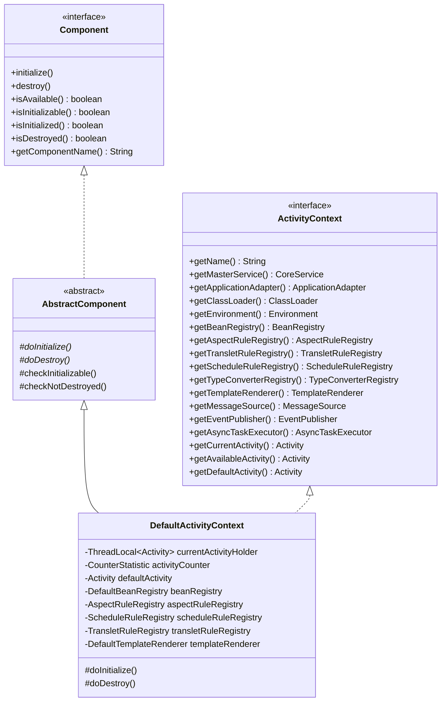
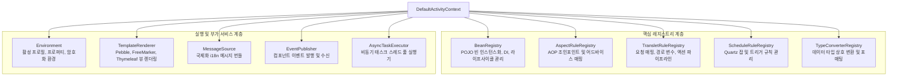
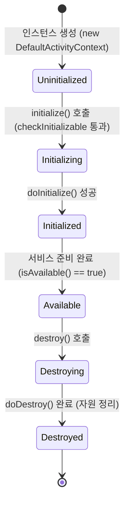

[`ActivityContext`](https://github.com/aspectran/aspectran/blob/master/core/src/main/java/com/aspectran/core/context/ActivityContext.java)는 Aspectran 프레임워크의 심장부(Heart of Framework)이자 애플리케이션의 모든 구성 요소를 총괄하는 최상위 IoC/DI 컨테이너(Inversion of Control & Dependency Injection Container)입니다.

전통적인 프레임워크의 컨테이너가 단순한 객체(Bean)의 생명주기와 의존성 주입에 집중하는 것과 달리, Aspectran의 `ActivityContext`는 **빈(Bean) 레지스트리뿐만 아니라 트랜슬릿(Translet), 애스펙트(Aspect), 스케줄(Schedule), 템플릿 렌더러(Template Renderer), 타입 변환기(Type Converter), 비동기 태스크 실행기(AsyncTaskExecutor), 다국어 메시지 소스(MessageSource)** 등 프레임워크가 제공하는 모든 서브시스템의 메타데이터와 실행 런타임을 유기적으로 결합하여 통제하는 중앙 오케스트레이터입니다.

## 1. `ActivityContext`의 구조적 위상과 인터페이스 계약

[`ActivityContext`](https://github.com/aspectran/aspectran/blob/master/core/src/main/java/com/aspectran/core/context/ActivityContext.java)는 표준 인터페이스이며, 프레임워크 내부에서는 [`DefaultActivityContext`](https://github.com/aspectran/aspectran/blob/master/core/src/main/java/com/aspectran/core/context/DefaultActivityContext.java)가 실질적인 핵심 구현체로 동작합니다.

### 핵심 계약 및 상속 구조
- **[`Component`](https://github.com/aspectran/aspectran/blob/master/core/src/main/java/com/aspectran/core/component/Component.java) 계약 준수**:
  `ActivityContext`의 구현체인 `DefaultActivityContext`는 [`AbstractComponent`](https://github.com/aspectran/aspectran/blob/master/core/src/main/java/com/aspectran/core/component/AbstractComponent.java)를 상속하여 엄격한 수명주기 상태 머신(State Machine)을 내장합니다. 초기화되지 않았거나 이미 파괴된 상태에서의 부정한 접근은 즉시 예외로 차단됩니다.
- **마스터 서비스([`CoreService`](https://github.com/aspectran/aspectran/blob/master/core/src/main/java/com/aspectran/core/service/CoreService.java))와의 결속**:
  컨텍스트는 자신을 소유하고 있는 최상위 서비스 인스턴스를 [`getMasterService()`](https://github.com/aspectran/aspectran/blob/master/core/src/main/java/com/aspectran/core/context/ActivityContext.java#L84)를 통해 참조함으로써 호스트 환경 및 생명주기 관리자와 양방향으로 연동됩니다.

## 2. 9대 핵심 서브시스템 및 레지스트리

`ActivityContext`는 애플리케이션을 지탱하는 9대 핵심 서브시스템을 통합 관리합니다.

### 1) 빈 관리 서브시스템: [`BeanRegistry`](https://github.com/aspectran/aspectran/blob/master/core/src/main/java/com/aspectran/core/component/bean/BeanRegistry.java)
- XML, APON, Java 어노테이션(`@Component`, `@Bean`, `@Autowired`)으로 정의된 모든 객체의 메타데이터([`BeanRule`](https://github.com/aspectran/aspectran/blob/master/core/src/main/java/com/aspectran/core/context/rule/BeanRule.java))를 보관합니다.
- 싱글톤(Singleton), 프로토타입(Prototype), 요청(Request), 세션(Session) 등 다양한 스코프(Scope)를 관리합니다.
- 생성자 주입, 필드 주입, 세터 주입을 지원하며, 순환 참조 검사([`BeanReferenceInspector`](https://github.com/aspectran/aspectran/blob/master/core/src/main/java/com/aspectran/core/context/rule/validation/BeanReferenceInspector.java))를 통해 부트스트랩 시점에 잠재적 오류를 차단합니다.
- 초기화 콜백(`@Initialize`, `InitializableBean`)과 소멸 콜백(`@Destroy`, `DisposableBean`)을 실행합니다.

### 2) AOP 서브시스템: [`AspectRuleRegistry`](https://github.com/aspectran/aspectran/blob/master/core/src/main/java/com/aspectran/core/component/aspect/AspectRuleRegistry.java)
- 선언된 애스펙트 규칙([`AspectRule`](https://github.com/aspectran/aspectran/blob/master/core/src/main/java/com/aspectran/core/context/rule/AspectRule.java))을 인덱싱하여 보관합니다.
- 특정 트랜슬릿이나 빈 메서드가 호출될 때 조인포인트(Before, After, Thrown, Finally)에 맞춰 어떤 어드바이스 메서드를 실행해야 하는지 즉각 매핑 정보를 제공합니다.

### 3) 요청 라우팅 서브시스템: [`TransletRuleRegistry`](https://github.com/aspectran/aspectran/blob/master/core/src/main/java/com/aspectran/core/component/translet/TransletRuleRegistry.java)
- 애플리케이션의 핵심 처리 단위인 트랜슬릿 규칙([`TransletRule`](https://github.com/aspectran/aspectran/blob/master/core/src/main/java/com/aspectran/core/context/rule/TransletRule.java))을 관리합니다.
- RESTful 경로 패턴(예: `/users/{id}`), 와일드카드 패턴(예: `/order/**`), HTTP 메서드 제약 조건을 평가하여 인입된 요청을 정확한 트랜슬릿으로 고속 라우팅합니다.

### 4) 스케줄링 서브시스템: [`ScheduleRuleRegistry`](https://github.com/aspectran/aspectran/blob/master/core/src/main/java/com/aspectran/core/component/schedule/ScheduleRuleRegistry.java)
- Cron 표현식이나 지정된 주기로 구동되는 스케줄 작업 규칙([`ScheduleRule`](https://github.com/aspectran/aspectran/blob/master/core/src/main/java/com/aspectran/core/context/rule/ScheduleRule.java))을 관리하며, 하위 `SchedulerService`에 스케줄 정보를 제공합니다.

### 5) 타입 변환 서브시스템: [`TypeConverterRegistry`](https://github.com/aspectran/aspectran/blob/master/core/src/main/java/com/aspectran/core/component/converter/TypeConverterRegistry.java)
- 문자열 요청 파라미터를 자바 기본형, 날짜, 컬렉션, 사용자 정의 Enum 등으로 안전하고 유연하게 변환하는 컨버터 풀을 유지합니다.

### 6) 뷰 템플릿 렌더링 서브시스템: [`TemplateRenderer`](https://github.com/aspectran/aspectran/blob/master/core/src/main/java/com/aspectran/core/component/template/TemplateRenderer.java)
- Pebble, FreeMarker, Thymeleaf, JSP 등 다양한 템플릿 엔진과의 통합 렌더링을 담당하는 표준 컴포넌트입니다.

### 7) 국제화(i18n) 서브시스템: [`MessageSource`](https://github.com/aspectran/aspectran/blob/master/core/src/main/java/com/aspectran/core/support/i18n/message/MessageSource.java)
- 클라이언트 로케일(`Locale`)에 따라 다국어 메시지를 동적으로 번역하여 반환합니다.
- 별도의 메시지 소스 빈(`messageSource`)이 정의되지 않은 경우 기본적으로 [`DelegatingMessageSource`](https://github.com/aspectran/aspectran/blob/master/core/src/main/java/com/aspectran/core/support/i18n/message/DelegatingMessageSource.java)를 생성하여 안전하게 호출을 위임합니다.

### 8) 이벤트 서브시스템: [`EventPublisher`](https://github.com/aspectran/aspectran/blob/master/core/src/main/java/com/aspectran/core/component/bean/event/EventPublisher.java)
- 애플리케이션 내의 다양한 컴포넌트 간 비결합(Decoupled) 통신을 위한 이벤트 발행 및 리스너 전파 메커니즘을 제공합니다.

### 9) 비동기 서브시스템: [`AsyncTaskExecutor`](https://github.com/aspectran/aspectran/blob/master/core/src/main/java/com/aspectran/core/component/bean/async/AsyncTaskExecutor.java)
- 백그라운드 스레드 풀에서 비동기 작업을 병렬로 처리할 수 있도록 지원하는 실행 엔진입니다.

## 3. `Component` 생명주기 상태 머신과 초기화/소멸 파이프라인

[`DefaultActivityContext`](https://github.com/aspectran/aspectran/blob/master/core/src/main/java/com/aspectran/core/context/DefaultActivityContext.java)는 프레임워크 초기화 및 종료 시 모든 컴포넌트의 일관성을 완벽히 보장하기 위해 2단계 생명주기 파이프라인을 실행합니다.

### 초기화 파이프라인 (`doInitialize`)
컨텍스트의 `initialize()`가 호출되면 다음 절차가 스레드 컨텍스트 클래스로더([`ThreadContextHelper.runThrowable`](https://github.com/aspectran/aspectran/blob/master/utils/src/main/java/com/aspectran/utils/thread/ThreadContextHelper.java)) 격리 환경에서 연쇄 실행됩니다:

1. **사전 유효성 검증**:
   모든 필수 레지스트리(`beanRegistry`, `aspectRuleRegistry`, `scheduleRuleRegistry`, `transletRuleRegistry`, `templateRenderer`)가 누락 없이 주입되었는지 단언(`Assert.state`)합니다.
2. **타입 변환기 초기화**: `typeConverterRegistry.initialize()`
3. **빈 레지스트리 초기화**: `beanRegistry.initialize()`
   - 싱글톤 스코프 빈들을 생성자 주입 방식으로 인스턴스화합니다.
   - 필드 및 세터 의존성을 주입합니다.
   - `@Initialize` 또는 `InitializableBean.initialize()` 콜백을 호출합니다.
4. **애스펙트 및 룰 레지스트리 초기화**:
   - `aspectRuleRegistry.initialize()`: 포인트컷 표현식을 사전 컴파일하고 빠른 매칭을 위한 인덱스를 구축합니다.
   - `scheduleRuleRegistry.initialize()`: 스케줄 잡 규칙을 활성화합니다.
   - `transletRuleRegistry.initialize()`: 트랜슬릿 라우팅 트리를 최적화합니다.
5. **템플릿 렌더러 초기화**: `templateRenderer.initialize()`
6. **메시지 소스 해석**:
   - 빈 레지스트리에 `messageSource`라는 ID를 가진 빈이 등록되어 있는지 확인하고 바인딩합니다. 없을 경우 디폴트 `DelegatingMessageSource`를 인스턴스화합니다.
7. **이벤트 퍼블리셔 구성**: 빈 이벤트 리스너 레지스트리와 연동되는 `DefaultEventPublisher`를 생성합니다.

### 소멸 파이프라인 (`doDestroy`)
애플리케이션 종료 시 역순으로 모든 자원을 안전하게 해제합니다:
1. **비동기 태스크 종료**: 실행 중인 `AsyncTaskExecutor`가 존재하면 안전하게 작업을 마무리하고 닫습니다(`AutoCloseable.close()`).
2. **이벤트 리스너 해제**: 등록된 모든 이벤트 리스너를 정리합니다.
3. **빈 인스턴스 폐기**: 싱글톤 빈들의 소멸 콜백(`@Destroy`, `DisposableBean.destroy()`)을 실행하고 내부 캐시를 비웁니다.
4. **템플릿 및 레지스트리 역순 소멸**: `templateRenderer`, `transletRuleRegistry`, `scheduleRuleRegistry`, `aspectRuleRegistry`, `typeConverterRegistry`를 차례로 소멸시키고 메모리를 해제합니다.

## 4. 멀티스레드 환경의 요청 격리와 Activity 제어

웹 애플리케이션과 같은 고성능 동시성 환경에서는 서로 다른 클라이언트 요청이 동일한 `ActivityContext`를 동시에 참조합니다. 컨텍스트는 완벽한 스레드 안전성(Thread Safety)을 유지하면서 각 요청의 실행 상태를 격리하기 위해 다음과 같은 활동 관리 체계를 제공합니다.

### `ThreadLocal` 기반 격리 메커니즘
- [`currentActivityHolder`](https://github.com/aspectran/aspectran/blob/master/core/src/main/java/com/aspectran/core/context/DefaultActivityContext.java#L60):
  스레드 로컬에 현재 스레드가 처리 중인 [`Activity`](https://github.com/aspectran/aspectran/blob/master/core/src/main/java/com/aspectran/core/activity/Activity.java) 인스턴스를 격리 보관합니다.
- **활동 조회 3단계 전략**:
  - [`getCurrentActivity()`](https://github.com/aspectran/aspectran/blob/master/core/src/main/java/com/aspectran/core/context/DefaultActivityContext.java#L297):
    현재 스레드에 바인딩된 활동을 반환합니다. 만약 바인딩된 활동이 없으면 [`NoActivityStateException`](https://github.com/aspectran/aspectran/blob/master/core/src/main/java/com/aspectran/core/context/NoActivityStateException.java)을 던져 잘못된 비동기 접근이나 컨텍스트 누수를 방어합니다.
  - [`getAvailableActivity()`](https://github.com/aspectran/aspectran/blob/master/core/src/main/java/com/aspectran/core/context/DefaultActivityContext.java#L291):
    현재 스레드의 활동이 있으면 반환하고, 없으면 시스템 공용 [`defaultActivity`](https://github.com/aspectran/aspectran/blob/master/core/src/main/java/com/aspectran/core/context/DefaultActivityContext.java#L108)를 안전하게 대체 반환합니다.
  - [`getDefaultActivity()`](https://github.com/aspectran/aspectran/blob/master/core/src/main/java/com/aspectran/core/context/DefaultActivityContext.java#L286):
    클라이언트 요청과 무관한 백그라운드 초기화, 정적 템플릿 렌더링, 시스템 설명 렌더링 등에 사용되는 폴백 활동입니다.
- **실시간 활성 요청 계측 ([`CounterStatistic`](https://github.com/aspectran/aspectran/blob/master/utils/src/main/java/com/aspectran/utils/statistic/CounterStatistic.java))**:
  컨텍스트 내부의 [`activityCounter`](https://github.com/aspectran/aspectran/blob/master/core/src/main/java/com/aspectran/core/context/DefaultActivityContext.java#L62)는 현재 컨텍스트 내에서 실행 중인 활동의 총개수를 실시간으로 추적하며, 서비스의 graceful shutdown 및 상태 모니터링(`isBusy()`)에 활용됩니다.

## 5. 의존성 주입을 위한 Aware 인터페이스 체계

Aspectran IoC 컨테이너에 등록된 일반 Bean은 특정 `*Aware` 인터페이스를 구현함으로써 컨텍스트의 핵심 인프라 객체들을 직접 주입받을 수 있습니다.

| Aware 인터페이스 | 주입 대상 | 주입 시점 및 목적 |
| :--- | :--- | :--- |
| [`ActivityContextAware`](https://github.com/aspectran/aspectran/blob/master/core/src/main/java/com/aspectran/core/component/bean/aware/ActivityContextAware.java) | `ActivityContext` | 빈 생성 직후 전체 컨텍스트 인스턴스 주입 |
| [`CurrentActivityAware`](https://github.com/aspectran/aspectran/blob/master/core/src/main/java/com/aspectran/core/component/bean/aware/CurrentActivityAware.java) | `Activity` | 요청 처리 시점에 현재 스레드의 활성 활동 주입 |
| [`EnvironmentAware`](https://github.com/aspectran/aspectran/blob/master/core/src/main/java/com/aspectran/core/component/bean/aware/EnvironmentAware.java) | `Environment` | 활성 프로필 및 프로퍼티 접근 객체 주입 |
| [`ApplicationAdapterAware`](https://github.com/aspectran/aspectran/blob/master/core/src/main/java/com/aspectran/core/component/bean/aware/ApplicationAdapterAware.java) | `ApplicationAdapter` | 서블릿 컨텍스트 등 호스트 환경 어댑터 주입 |
| [`ClassLoaderAware`](https://github.com/aspectran/aspectran/blob/master/core/src/main/java/com/aspectran/core/component/bean/aware/ClassLoaderAware.java) | `ClassLoader` | 컨텍스트가 사용하는 전용 클래스로더 주입 |

> **관련 세부 메커니즘**:
> - `ActivityContext`를 생성하고 설정 파일을 파싱하는 상세 빌드 프로세스는 [ActivityContext 빌드 과정](/ko/docs/mechanisms/activity-context-building/) 문서를 참고하십시오.
> - 컨텍스트가 관리하는 각 요청 단위의 라이프사이클과 실행 흐름은 [Aspectran 활동(Activities) 아키텍처](/ko/docs/mechanisms/aspectran-activities/) 문서를 참고하십시오.
> - 컨텍스트의 프로필 및 환경 변수 처리 원리는 [ActivityEnvironment 아키텍처](/ko/docs/mechanisms/activity-environment/) 문서를 참고하십시오.

## 6. 다음 단계: 세부 메커니즘 탐색

`ActivityContext`의 생성 과정과 내부 규칙 파서의 동작 방식은 [ActivityContext 빌드 과정](/ko/docs/mechanisms/activity-context-building/) 문서에서 상세히 확인할 수 있습니다.

전체 메커니즘 및 패키지 명세의 유기적 연결 관계를 확인하려면 **[Aspectran 세부 메커니즘 색인](/ko/docs/mechanisms/)**을 확인하십시오.
