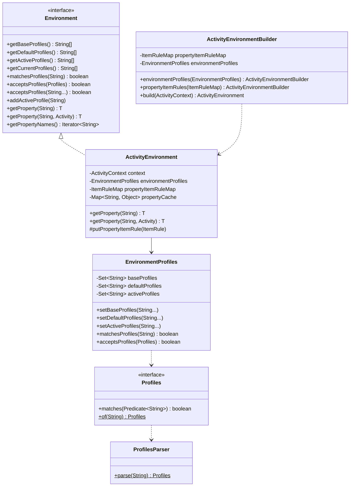
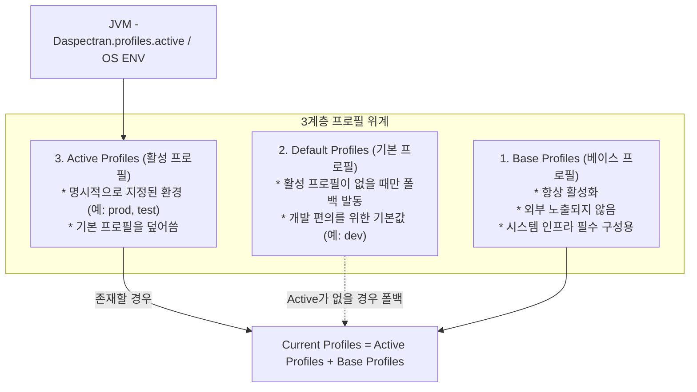
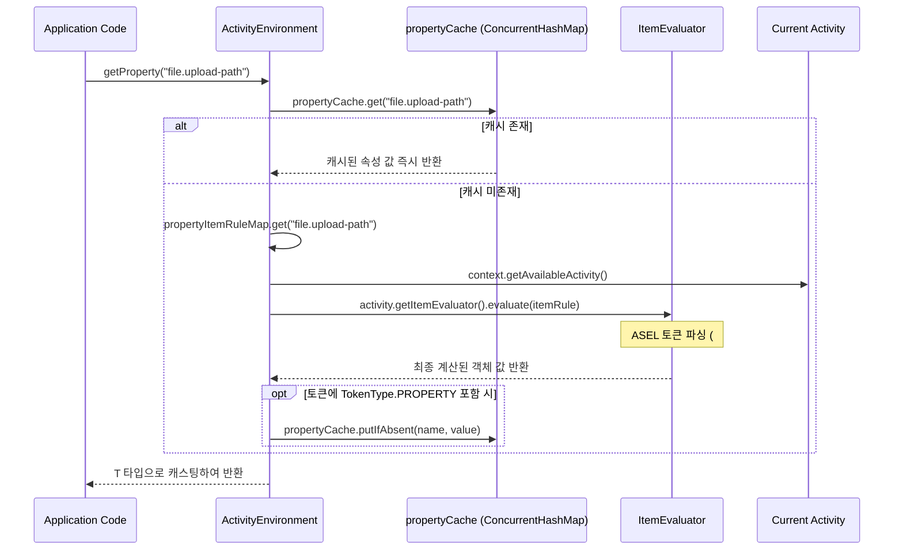

[`Environment`](https://github.com/aspectran/aspectran/blob/master/core/src/main/java/com/aspectran/core/context/env/Environment.java) 및 [`ActivityEnvironment`](https://github.com/aspectran/aspectran/blob/master/core/src/main/java/com/aspectran/core/context/env/ActivityEnvironment.java)는 Aspectran 애플리케이션의 런타임 실행 환경을 지배하는 핵심 서브시스템입니다.

현대적인 엔터프라이즈 애플리케이션은 동일한 코드베이스를 로컬 개발(Local), 테스트(Test), 검증(Staging), 운영(Production) 등 다양한 인프라에 배포해야 합니다. Aspectran은 **다차원 프로필(Profiles)**과 **선언적 동적 속성(Properties)** 메커니즘을 통해, 코드 수정이나 리빌드 없이 환경 변수나 시스템 프로퍼티만으로 전체 애플리케이션 컴포넌트의 활성화 여부와 동작 파라미터를 유연하게 전환할 수 있는 강력한 환경 제어 체계를 제공합니다.

특히 단순한 정적 문자열 키-값(Key-Value) 쌍을 유지하는 일반적인 환경 모델과 달리, Aspectran의 속성 시스템은 **ASEL(Aspectran Expression Language) 기반의 지연 평가(Lazy Evaluation)와 토큰 캐싱 메커니즘**을 결합하여 런타임 상태에 반응하는 지능형 환경 속성을 지원합니다.

## 1. 아키텍처 다이어그램 및 핵심 컴포넌트

[`com.aspectran.core.context.env`](https://github.com/aspectran/aspectran/blob/master/core/src/main/java/com/aspectran/core/context/env) 패키지는 단일 책임 원칙에 따라 프로필 관리와 속성 평가를 철저히 분리하여 캡슐화하고 있습니다.



### 1) [`Environment`](https://github.com/aspectran/aspectran/blob/master/core/src/main/java/com/aspectran/core/context/env/Environment.java) (인터페이스)
- 프로필 조회(`getActiveProfiles`, `getDefaultProfiles`, `getBaseProfiles`), 프로필 일치 검사(`matchesProfiles`, `acceptsProfiles`), 속성 조회(`getProperty`)의 표준 계약을 정의합니다.

### 2) [`ActivityEnvironment`](https://github.com/aspectran/aspectran/blob/master/core/src/main/java/com/aspectran/core/context/env/ActivityEnvironment.java) (구현체)
- `ActivityContext`에 바인딩되는 표준 환경 구현체입니다. 프로필 판단은 내부의 `EnvironmentProfiles`에 위임하고, 속성 조회는 [`ItemRule`](https://github.com/aspectran/aspectran/blob/master/core/src/main/java/com/aspectran/core/context/rule/ItemRule.java)과 [`ItemEvaluator`](https://github.com/aspectran/aspectran/blob/master/core/src/main/java/com/aspectran/core/context/asel/item/ItemEvaluator.java)를 통해 실시간 동적 평가를 수행합니다.

### 3) [`EnvironmentProfiles`](https://github.com/aspectran/aspectran/blob/master/core/src/main/java/com/aspectran/core/context/env/EnvironmentProfiles.java)
- 베이스, 기본, 활성 프로필 세트를 스레드 안전하게 관리하고, 시스템 프로퍼티와의 동기화를 전담합니다.

### 4) [`Profiles`](https://github.com/aspectran/aspectran/blob/master/core/src/main/java/com/aspectran/core/context/env/Profiles.java) 및 [`ProfilesParser`](https://github.com/aspectran/aspectran/blob/master/core/src/main/java/com/aspectran/core/context/env/ProfilesParser.java)
- 불리언 논리식 문자열(예: `(dev & local) | !cloud`)을 파싱하여 함수형 조건 프레디케이트(`Predicate<String>`)로 컴파일하는 프로필 표현식 엔진입니다.

## 2. 3계층 프로필 모델 (Base, Default, Active)

Aspectran은 프로필을 단순한 평면 목록이 아닌 3계층 위계(Hierarchy)로 관리합니다.



### 1) 베이스 프로필 ([`Base Profiles`](https://github.com/aspectran/aspectran/blob/master/core/src/main/java/com/aspectran/core/context/env/EnvironmentProfiles.java#L61))
- **속성 키**: `aspectran.profiles.base`
- 시스템 인프라 구축에 항상 필수적으로 적용되어야 하는 내부 프로필입니다.
- 외부 API인 `getActiveProfiles()`에는 노출되지 않으나, 내부적으로 모든 프로필 매칭 검사 시 항상 참(`true`)으로 평가됩니다.

### 2) 기본 프로필 ([`Default Profiles`](https://github.com/aspectran/aspectran/blob/master/core/src/main/java/com/aspectran/core/context/env/EnvironmentProfiles.java#L67))
- **속성 키**: `aspectran.profiles.default`
- 활성 프로필이 명시적으로 지정되지 않았을 때 폴백(Fallback)으로 적용되는 프로필입니다. 일반적으로 로컬 개발 환경(`dev` 또는 `local`)을 지정하여 개발자가 별도의 JVM 옵션 없이 즉시 애플리케이션을 실행할 수 있도록 돕습니다.

### 3) 활성 프로필 ([`Active Profiles`](https://github.com/aspectran/aspectran/blob/master/core/src/main/java/com/aspectran/core/context/env/EnvironmentProfiles.java#L72))
- **속성 키**: `aspectran.profiles.active`
- 배포 대상 환경에 맞추어 명시적으로 활성화되는 프로필입니다. 쉼표(`,`)로 구분하여 다중 프로필(예: `prod,ap-northeast-2,mysql`)을 동시에 활성화할 수 있습니다.
- 활성 프로필이 하나라도 지정되면 기본 프로필은 완전히 비활성화됩니다.

### 다중 컨텍스트 환경의 프로필 우선순위
단일 JVM 내에서 복수의 `ActivityContext`가 구동될 때, 특정 컨텍스트에만 프로필을 적용할 수 있도록 컨텍스트 이름이 접미사로 붙은 시스템 프로퍼티를 우선 지원합니다:
```bash
# context1에만 prod 프로필 적용
-Daspectran.profiles.active.context1=prod

# 전역 기본 활성 프로필
-Daspectran.profiles.active=dev
```

## 3. 프로필 표현식 엔진 (`ProfilesParser`)

Aspectran은 단순한 1:1 문자열 매칭을 넘어, 복잡한 환경 조건을 단일 표현식으로 검증할 수 있는 강력한 불리언 표현식 파서를 탑재하고 있습니다.

### 지원하는 논리 연산자
- **`!` (NOT)**: 지정된 프로필이 비활성 상태일 때 참
- **`&` (AND)**: 양쪽 조건이 모두 활성 상태일 때 참
- **`|` (OR)**: 어느 한쪽 조건이라도 활성 상태일 때 참
- **`(...)` (괄호)**: 연산자 우선순위 제어

### 프로필 평가 예시
```java
Environment env = activityContext.getEnvironment();

// 'prod'와 'cloud'가 모두 활성화되어 있거나, 'local'이 비활성화되어 있는 경우
boolean match = env.matchesProfiles("(prod & cloud) | !local");

// 간이 가변인자 검사 (OR 조건으로 결합)
boolean accepted = env.acceptsProfiles("dev", "test");
```

## 4. 선언적 프로필 격리 예제

프로필을 활용하면 환경별 데이터소스(DataSource), 보안 인증 모듈, 외부 통신 게이트웨이를 선언적으로 분리할 수 있습니다.

### XML 기반 환경 및 데이터소스 분리
```xml
<aspectran>
    <!-- 개발 환경: 인메모리 H2 데이터베이스 -->
    <environment profiles="dev, local">
        <properties>
            <item name="db.driver">org.h2.Driver</item>
            <item name="db.url">jdbc:h2:mem:devdb;DB_CLOSE_DELAY=-1</item>
            <item name="db.username">sa</item>
            <item name="db.password"></item>
        </properties>
    </environment>

    <!-- 운영 클라우드 환경: AWS Aurora MySQL 및 비밀번호 환경변수 연동 -->
    <environment profiles="prod & aws">
        <properties>
            <item name="db.driver">com.mysql.cj.jdbc.Driver</item>
            <item name="db.url">jdbc:mysql://aurora-cluster.internal:3306/service_db</item>
            <item name="db.username">app_user</item>
            <!-- ASEL 환경 변수 참조 토큰 사용 -->
            <item name="db.password">${ENV:PROD_DB_PASSWORD}</item>
        </properties>
    </environment>

    <!-- 프로필에 맞춰 동적으로 주입되는 단일 데이터소스 Bean 정의 -->
    <bean id="dataSource" class="com.zaxxer.hikari.HikariDataSource">
        <property name="driverClassName">%{db.driver}</property>
        <property name="jdbcUrl">%{db.url}</property>
        <property name="username">%{db.username}</property>
        <property name="password">%{db.password}</property>
    </bean>
</aspectran>
```

## 5. 동적 속성(Properties) 관리 및 ASEL 평가 파이프라인

Aspectran 속성 시스템의 핵심 차별점은 단순 문자열이 아니라, 규칙 기반의 [`ItemRule`](https://github.com/aspectran/aspectran/blob/master/core/src/main/java/com/aspectran/core/context/rule/ItemRule.java) 객체로 속성을 보관한다는 점입니다.



### ASEL(Aspectran Expression Language) 토큰 치환 지원
속성 값 정의 시 다양한 런타임 토큰을 결합할 수 있습니다:
- **`%{property.name}`**: 다른 환경 속성 참조 (중첩 평가 지원)
- **`#{beanId^propertyName}`**: 컨텍스트에 등록된 빈의 게터(Getter) 프로퍼티 값 참조
- **`${paramName}`**: 현재 인입된 요청 파라미터 값 참조
- **`@{attributeName}`**: 현재 활동 데이터의 속성 값 참조
- **`${ENV:VAR_NAME}`**: 운영체제 시스템 환경 변수 참조
- **`${SYS:prop.name}`**: JVM 시스템 프로퍼티 참조

### 지능형 프로퍼티 캐싱 (`propertyCache`)
- 속성 표현식 내에 다른 프로퍼티 토큰([`TokenType.PROPERTY`](https://github.com/aspectran/aspectran/blob/master/core/src/main/java/com/aspectran/core/context/rule/type/TokenType.java))이 포함되어 있는 경우, 반복적인 표현식 평가 비용을 절감하기 위해 최초 평가 후 스레드 안전한 `ConcurrentHashMap`([`propertyCache`](https://github.com/aspectran/aspectran/blob/master/core/src/main/java/com/aspectran/core/context/env/ActivityEnvironment.java#L46))에 결과를 보관합니다.
- 반면 요청 단위 상태(파라미터, 요청 속성)를 참조하는 동적 속성은 캐싱되지 않고 매 요청마다 현재 `Activity`의 컨텍스트를 반영하여 유연하게 계산됩니다.

## 6. 암호화 속성 및 보안 환경 변수 연동

보안이 중요한 데이터베이스 접속 비밀번호, API Secret Key, 개인정보 암호화 키 등은 형상 관리 시스템(Git)에 평문으로 저장되지 않도록 철저한 암호화 메커니즘을 지원합니다.

### `PBEncryptionUtils` 기반 암호화 프로퍼티
Aspectran은 패스워드 기반 암호화([`PBEncryptionUtils`](https://github.com/aspectran/aspectran/blob/master/utils/src/main/java/com/aspectran/utils/PBEncryptionUtils.java)) 유틸리티를 내장하고 있습니다.

- **암호화 표기법**:
  ```xml
  <item name="db.password">ENC(vK9+Qz81dJk3A4F89gP1==)</item>
  ```
- **마스터 키 주입**:
  서버 구동 시 환경 변수나 시스템 프로퍼티로 마스터 암호화 비밀번호를 주입하면, 컨텍스트 부트스트랩 단계에서 자동으로 복호화되어 메모리에 적재됩니다:
  ```bash
  -Daspectran.encryption.password=MyMasterSecretKey!
  ```

> **관련 세부 메커니즘**:
> - 환경 객체가 주입되는 전체 컨테이너 구조는 [ActivityContext: Aspectran 컨테이너의 심장부](/ko/docs/mechanisms/activity-context/) 문서를 참고하십시오.
> - 환경 프로필이 컨텍스트 빌드 시점에 평가되는 절차는 [ActivityContext 빌드 과정](/ko/docs/mechanisms/activity-context-building/) 문서를 참고하십시오.
> - 동적 속성 평가에 사용되는 표현식 및 토큰 시스템은 [Aspectran 규칙 아키텍처](/ko/docs/mechanisms/aspectran-rule-architecture/) 문서를 참고하십시오.

## 7. 다음 단계: 세부 메커니즘 탐색

환경 변수와 프로필 설정을 바탕으로 요청을 실제로 가공하고 응답을 출력하는 파이프라인은 [요청 및 응답 처리 메커니즘](/ko/docs/mechanisms/aspectran-request-response/) 문서에서 확인할 수 있습니다.

전체 메커니즘 및 패키지 명세의 유기적 연결 관계를 확인하려면 **[Aspectran 세부 메커니즘 색인](/ko/docs/mechanisms/)**을 확인하십시오.
