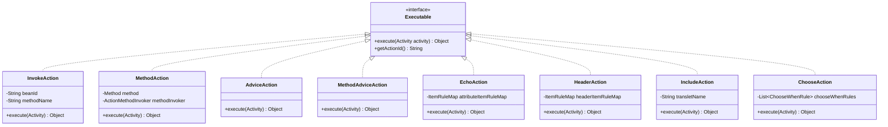
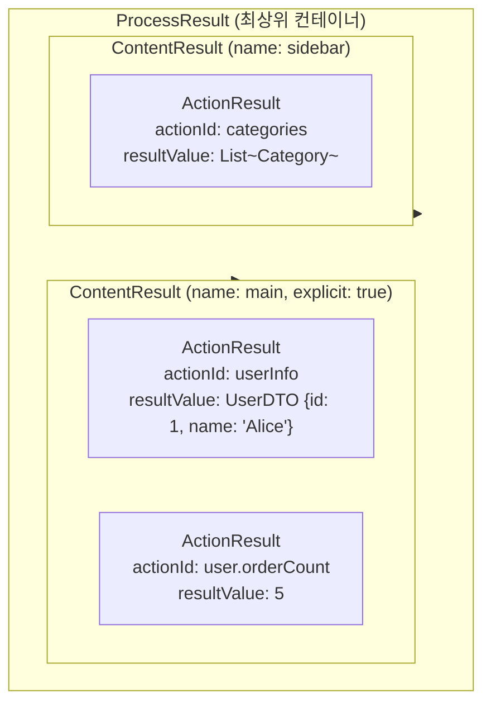

Aspectran 프레임워크에서 **액션([`Action`](https://github.com/aspectran/aspectran/blob/master/core/src/main/java/com/aspectran/core/activity/process/action/Executable.java))**은 트랜슬릿(Translet)의 실행 흐름 내부에서 비즈니스 로직 호출, 데이터 평가, 헤더 조작, 서브 프로세스 합성, 조건부 흐름 분기 등 구체적인 작업을 수행하는 가장 기본적인 실행 단위입니다.

하나의 트랜슬릿은 하나 이상의 액션을 순차적 또는 조건부로 조합하여 복잡한 비즈니스 파이프라인을 완성하며, 각 액션이 생산한 결과는 정교한 3단계 데이터 계층([`ActionResult`](https://github.com/aspectran/aspectran/blob/master/core/src/main/java/com/aspectran/core/activity/process/result/ActionResult.java) -> [`ContentResult`](https://github.com/aspectran/aspectran/blob/master/core/src/main/java/com/aspectran/core/activity/process/result/ContentResult.java) -> [`ProcessResult`](https://github.com/aspectran/aspectran/blob/master/core/src/main/java/com/aspectran/core/activity/process/result/ProcessResult.java))으로 집계되어 뷰 렌더링이나 RESTful 변환에 활용됩니다.

## 1. 액션의 핵심 계약: `Executable` 인터페이스

모든 Action 구현체는 최상위 인터페이스인 [`Executable`](https://github.com/aspectran/aspectran/blob/master/core/src/main/java/com/aspectran/core/activity/process/action/Executable.java)을 구현합니다.



- **[`execute(Activity activity)`](https://github.com/aspectran/aspectran/blob/master/core/src/main/java/com/aspectran/core/activity/process/action/Executable.java#L48)**:
  - 액션의 비즈니스 작업을 수행하는 단일 진입점입니다.
  - 현재 요청의 전체 컨텍스트를 소유한 [`Activity`](https://github.com/aspectran/aspectran/blob/master/core/src/main/java/com/aspectran/core/activity/Activity.java) 객체를 매개변수로 전달받아, 요청 파라미터, 세션 데이터, IoC 빈 레지스트리에 자유롭게 접근합니다.
  - 실행 결과를 `Object` 형태로 반환하며, 이 반환값은 액션의 고유 식별자(`actionId`)와 결속되어 트랜슬릿의 결과 풀에 자동 저장됩니다.
- **예외 처리 표준화**:
  - 액션 실행 도중 발생하는 모든 비즈니스 예외나 리플렉션 예외는 프레임워크 표준 예외인 [`ActionExecutionException`](https://github.com/aspectran/aspectran/blob/master/core/src/main/java/com/aspectran/core/activity/process/action/ActionExecutionException.java)으로 포장되어 상위 트랜슬릿 예외 처리 파이프라인으로 전달됩니다.

## 2. 내장 액션(Action) 종류 및 상세 메커니즘

Aspectran은 다양한 아키텍처 패턴과 요구사항을 충족하기 위해 8종의 특화된 내장 액션을 기본 제공합니다.

### 1) 선언적 빈 메서드 호출: [`InvokeAction`](https://github.com/aspectran/aspectran/blob/master/core/src/main/java/com/aspectran/core/activity/process/action/InvokeAction.java)
- XML 또는 APON 설정에 정의된 빈(Bean) ID와 메서드 이름을 바탕으로 비즈니스 로직을 호출합니다.
- 선언된 인자(`<argument>`) 표현식을 ASEL 토큰으로 평가하여 메서드 파라미터로 전달합니다.
- 설정 예시:
  ```xml
  <action id="user" bean="userService" method="getUserById">
      <argument name="id">${userId}</argument>
  </action>
  ```

### 2) 어노테이션 기반 메서드 호출: [`MethodAction`](https://github.com/aspectran/aspectran/blob/master/core/src/main/java/com/aspectran/core/activity/process/action/MethodAction.java)
- `@Component`, `@Action`, `@RequestToGet` 등 Java 어노테이션으로 매핑된 컴포넌트 메서드를 실행합니다.
- XML 설정 없이 관례(Convention over Configuration)를 바탕으로 비즈니스 컴포넌트를 직접 트랜슬릿에 결합합니다.
- 전용 메서드 호출기인 [`ActionMethodInvoker`](https://github.com/aspectran/aspectran/blob/master/core/src/main/java/com/aspectran/core/activity/process/action/ActionMethodInvoker.java)와 직결되어 지능적인 파라미터 자동 바인딩을 수행합니다.

### 3) 지능형 파라미터 해석기: [`ActionMethodInvoker`](https://github.com/aspectran/aspectran/blob/master/core/src/main/java/com/aspectran/core/activity/process/action/ActionMethodInvoker.java)
`MethodAction`이 실행될 때 자바 메서드의 파라미터 시그니처를 리플렉션으로 분석하여 컨텍스트 데이터를 자동으로 변환 및 주입합니다:
- **프레임워크 코어 객체 주입**: 메서드 파라미터 타입이 `Activity`, `Translet`, `Environment`, `RequestAdapter`, `ResponseAdapter`, `SessionAdapter`인 경우 현재 활성 인스턴스를 즉시 주입합니다.
- **파라미터 및 업로드 파일 주입**: `ParameterMap`, `FileParameter`, `FileParameterMap` 타입을 자동 인식하여 바인딩합니다.
- **커맨드 객체(DTO / POJO) 자동 바인딩**: 일반 자바빈 객체가 파라미터로 선언된 경우, 요청 파라미터들을 DTO의 게터/세터 프로퍼티에 자동 매핑하고 타입 변환기([`TypeConverterRegistry`](https://github.com/aspectran/aspectran/blob/master/core/src/main/java/com/aspectran/core/component/converter/TypeConverterRegistry.java))를 통해 문자열을 대상 타입으로 변환합니다.

### 4) AOP 어드바이스 전용 액션: [`AdviceAction`](https://github.com/aspectran/aspectran/blob/master/core/src/main/java/com/aspectran/core/activity/process/action/AdviceAction.java) & [`MethodAdviceAction`](https://github.com/aspectran/aspectran/blob/master/core/src/main/java/com/aspectran/core/activity/process/action/MethodAdviceAction.java)
- AOP 조인포인트(Before, After, Thrown, Finally)에 등록된 어드바이스 빈의 메서드를 실행하는 특수 액션입니다.
- 메서드 실행 전후의 횡단 관심사(트랜잭션 시작/커밋, 인가 검증, 실행 시간 프로파일링)를 비즈니스 액션과 동일한 파이프라인에서 실행합니다.

### 5) 컨텍스트 데이터 에코: [`EchoAction`](https://github.com/aspectran/aspectran/blob/master/core/src/main/java/com/aspectran/core/activity/process/action/EchoAction.java)
- 비즈니스 로직 호출 없이, 현재 활동 컨텍스트에 존재하는 파라미터, 속성, 환경 프로퍼티, 빈의 특정 필드 값을 평가하여 뷰 모델에 전달할 데이터를 조립합니다.
- 설정 예시:
  ```xml
  <echo id="pageInfo">
      <item name="title">사용자 관리</item>
      <item name="currentPage">${page:1}</item>
      <item name="serverTime">#{systemBean^currentTimeMillis}</item>
  </echo>
  ```

### 6) HTTP 헤더 조작: [`HeaderAction`](https://github.com/aspectran/aspectran/blob/master/core/src/main/java/com/aspectran/core/activity/process/action/HeaderAction.java)
- 아웃바운드 응답에 HTTP 헤더를 동적으로 추가하거나 덮어씁니다.
- 브라우저 캐시 제어(`Cache-Control`), CORS 헤더, 보안 헤더(`X-Content-Type-Options`)를 선언적으로 적용할 때 사용됩니다.
- 설정 예시:
  ```xml
  <headers>
      <item name="Cache-Control">no-cache, no-store, must-revalidate</item>
      <item name="Pragma">no-cache</item>
      <item name="X-Frame-Options">DENY</item>
  </headers>
  ```

### 7) 서브 트랜슬릿 합성: [`IncludeAction`](https://github.com/aspectran/aspectran/blob/master/core/src/main/java/com/aspectran/core/activity/process/action/IncludeAction.java)
- 현재 트랜슬릿 실행 도중 다른 트랜슬릿을 내부적으로 호출하고, 그 실행 결과를 현재 트랜슬릿의 `ProcessResult`에 자식 노드로 통합합니다.
- 공통 사이드바 데이터 조회, 인증 세션 검증, 푸터 정보 로딩 등 공통 관심사를 독립된 트랜슬릿으로 분리하고 필요 시 합성하는 컴포지트 패턴을 구현합니다.
- 설정 예시:
  ```xml
  <include translet="/common/navigation">
      <item name="menuId">USER_MNG</item>
  </include>
  ```

### 8) 동적 조건 분기: [`ChooseAction`](https://github.com/aspectran/aspectran/blob/master/core/src/main/java/com/aspectran/core/activity/process/action/ChooseAction.java)
- 자바의 `switch-case` 또는 `if-else` 구조와 유사하게, 선언된 `<when>` 조건식들을 순차 평가하여 가장 먼저 참(`true`)이 되는 블록의 내부 액션들만 실행합니다.
- 이전 액션의 실행 결과나 요청 파라미터를 기반으로 실행 흐름을 분기합니다.
- 설정 예시:
  ```xml
  <choose>
      <when test="${role} == 'ADMIN'">
          <action id="data" bean="adminService" method="getAdminData"/>
      </when>
      <when test="${role} == 'USER'">
          <action id="data" bean="userService" method="getUserData"/>
      </when>
      <otherwise>
          <redirect path="/login"/>
      </otherwise>
  </choose>
  ```

## 3. 액션 처리 결과의 3단계 계층 구조

액션이 실행된 후 반환된 결과값은 단순한 객체 레퍼런스로 버려지지 않고, 트랜슬릿의 전 수명주기 동안 조회 및 렌더링에 사용될 수 있도록 정교한 3단계 데이터 모델로 구조화됩니다.



### 1) 단위 결과: [`ActionResult`](https://github.com/aspectran/aspectran/blob/master/core/src/main/java/com/aspectran/core/activity/process/result/ActionResult.java)
- 단일 `Executable` 액션의 실행 결과값을 저장하는 가장 작은 단위입니다.
- **점 표기법(Dot Notation)과 중첩 맵 (`ResultValueMap`)**:
  `actionId`에 점(`.`)이 포함된 경우(예: `order.customer.name`), Aspectran은 이를 단일 키가 아닌 중첩된 맵 구조로 자동 파싱하여 계층형 데이터 모델을 형성합니다.

### 2) 그룹 결과: [`ContentResult`](https://github.com/aspectran/aspectran/blob/master/core/src/main/java/com/aspectran/core/activity/process/result/ContentResult.java)
- 트랜슬릿 설정의 `<content>` 또는 `<contents>` 블록 내에서 실행된 액션들의 `ActionResult` 집합을 묶는 논리적 그룹입니다.
- **명시적 콘텐츠(`explicit="true"`)**: 특정 콘텐츠 블록에 이름을 부여하여 뷰 템플릿의 특정 UI 섹션에만 바인딩되도록 스코프를 제한할 수 있습니다.

### 3) 최상위 컨테이너: [`ProcessResult`](https://github.com/aspectran/aspectran/blob/master/core/src/main/java/com/aspectran/core/activity/process/result/ProcessResult.java)
- 단일 `Activity`가 완료된 후 생산된 모든 `ContentResult`를 포함하는 최상위 결과 집합입니다.
- 뷰 디스패처에 전달되는 모델의 루트 객체이며, `TransformResponse`가 JSON/XML로 직렬화할 때의 원천 데이터가 됩니다.

## 4. 액션 결과 값의 4대 활용 시나리오

축적된 `ProcessResult`는 다양한 후속 파이프라인에서 핵심 데이터 소스로 활용됩니다.

```mermaid
graph LR
    PR["ProcessResult"] --> View["1. 뷰 템플릿 모델 주입<br/>* Pebble / Thymeleaf / JSP<br/>* &#123;&#123; userInfo.name &#125;&#125;"]
    PR --> Rest["2. RESTful 응답 직렬화<br/>* JsonTransformResponse<br/>* {'userInfo': {'name': 'Alice'}}"]
    PR --> Inter["3. 후속 액션 및 트랜슬릿 간 전달<br/>* ASEL 참조: @{userInfo.userId}<br/>* Forward 시 ProcessResult 인계"]
    PR --> Cond["4. 조건부 흐름 제어<br/>* ChooseAction 평가: @{userInfo^active}"]
```



### 1) 뷰 템플릿(SSR) 모델 데이터 바인딩
액션의 `actionId`가 템플릿 엔진의 컨텍스트 변수명이 됩니다:
- **Translet 설정**:
  ```xml
  <translet name="/user/profile">
      <action id="user" bean="userService" method="getUser">
          <argument name="id">${userId}</argument>
      </action>
      <dispatch name="user/profile.html"/>
  </translet>
  ```
- **Thymeleaf 템플릿 (`user/profile.html`)**:
  ```html
  <h1 th:text="${user.name}">사용자 이름</h1>
  <p th:text="${user.email}">이메일</p>
  ```

### 2) REST API 변환 응답 (JSON/XML)
`TransformResponse`는 `ProcessResult`에 담긴 객체들을 루트 JSON 객체의 필드로 직렬화합니다:
```json
{
  "user": {
    "id": 100,
    "name": "Aspectran User",
    "email": "user@aspectran.com"
  }
}
```

### 3) 후속 액션과의 데이터 체이닝 (ASEL 참조)
앞서 실행된 액션의 결과값을 후속 액션의 인자로 전달할 때 `@{actionId}` 표기법을 사용합니다:
```xml
<!-- 1단계: 사용자 조회 -->
<action id="user" bean="userService" method="getUser"/>

<!-- 2단계: 1단계 결과의 속성을 인자로 받아 주문 목록 조회 -->
<action id="orders" bean="orderService" method="getOrdersByUserId">
    <argument name="userId">@{user.id}</argument>
</action>
```

### 4) `ChooseAction`의 조건식 평가
액션 결과 객체의 프로퍼티 값을 불리언 조건으로 평가하여 동적 라우팅을 수행합니다:
```xml
<choose>
    <when test="@{user^admin}">
        <forward translet="/admin/dashboard"/>
    </when>
    <otherwise>
        <dispatch name="user/dashboard.html"/>
    </otherwise>
</choose>
```

## 5. 프로그래밍 방식 결과 접근 API

애플리케이션 코드나 후속 인터셉터에서는 [`Translet`](https://github.com/aspectran/aspectran/blob/master/core/src/main/java/com/aspectran/core/activity/Translet.java) 인스턴스를 통해 결과에 직접 접근할 수 있습니다:

```java
// 최상위 ProcessResult 획득
ProcessResult processResult = translet.getProcessResult();

// 특정 actionId의 실행 결과 객체 직접 조회 (점 표기법 중첩 탐색 지원)
User user = (User)processResult.getResultValue("user");
String city = (String)processResult.getResultValue("user.address.city");
```

> **관련 세부 메커니즘**:
> - 액션들이 실행되는 상위 수명주기 파이프라인은 [Aspectran 활동(Activities) 아키텍처](/ko/docs/mechanisms/aspectran-activities/) 문서를 참고하십시오.
> - 액션 결과를 직렬화하여 클라이언트에 전송하는 방식은 [요청 및 응답 처리 메커니즘](/ko/docs/mechanisms/aspectran-request-response/) 문서를 참고하십시오.
> - 액션을 구성하는 선언적 문법과 XML/APON 스키마 구조는 [Aspectran 규칙 아키텍처](/ko/docs/mechanisms/aspectran-rule-architecture/) 문서를 참고하십시오.

## 6. 다음 단계: 세부 메커니즘 탐색

트랜슬릿, 액션, 뷰, 애스펙트를 선언적으로 기술하는 전체 메타데이터 모델은 [Aspectran 규칙 아키텍처](/ko/docs/mechanisms/aspectran-rule-architecture/) 문서에서 확인할 수 있습니다.

전체 메커니즘 및 패키지 명세의 유기적 연결 관계를 확인하려면 **[Aspectran 세부 메커니즘 색인](/ko/docs/mechanisms/)**을 확인하십시오.
