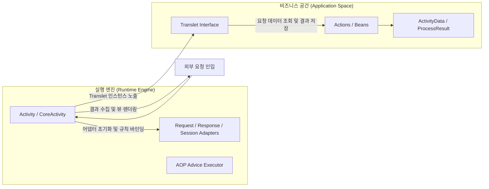
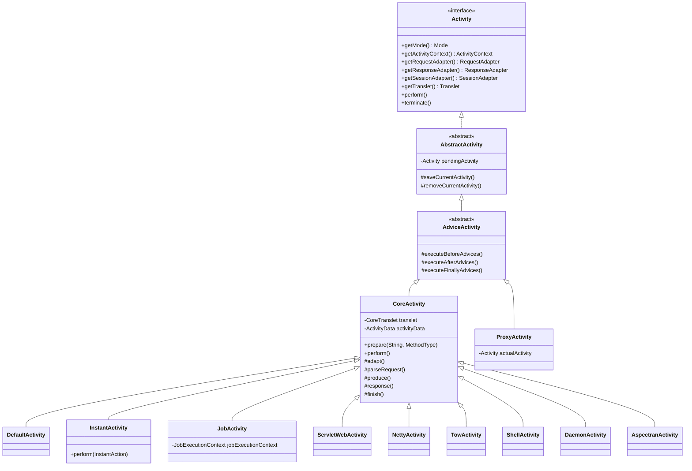
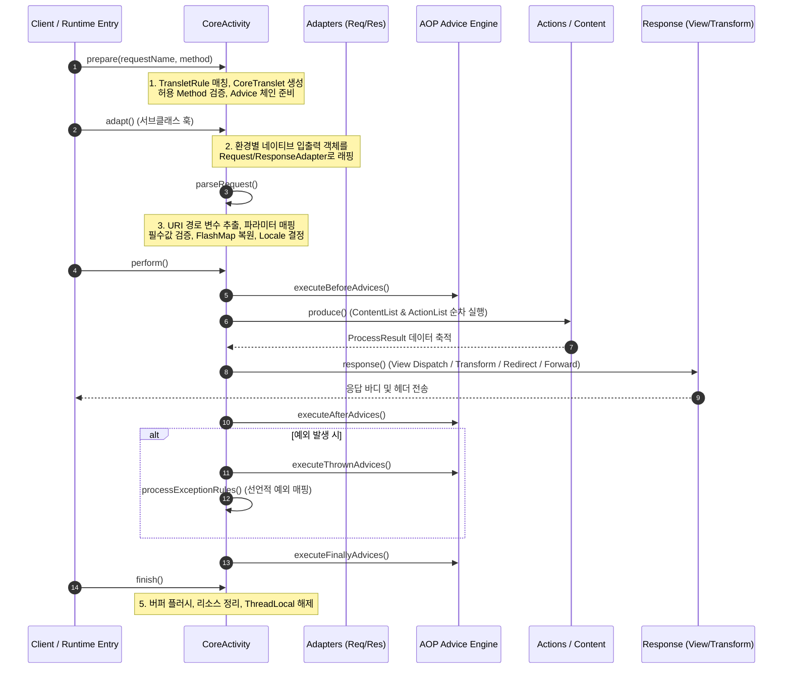

Aspectran에서 **활동([`Activity`](https://github.com/aspectran/aspectran/blob/master/core/src/main/java/com/aspectran/core/activity/Activity.java))**은 단일 요청-응답(Request-Response) 생명주기를 오케스트레이션하는 프레임워크의 핵심 실행 엔진(Runtime Execution Engine)입니다. 웹 브라우저의 HTTP 요청, 비동기 네트워킹 이벤트 루프, 백그라운드 스케줄러 트리거, 대화형 CLI 명령어, 내부 메서드 호출 등 외부 세계에서 인입되는 모든 실행 단위는 전용 `Activity` 객체에 캡슐화되어 처리됩니다.

`Activity` 아키텍처는 비즈니스 로직(Action, Bean)과 하부 실행 환경(서블릿, Netty, Undertow 등)을 완벽히 분리하고, AOP 어드바이스, 파라미터 파싱, 트랜슬릿 규칙 평가, 응답 렌더링, 예외 처리 파이프라인을 일관된 표준 라이프사이클로 제어합니다.

## 1. `Activity`와 `Translet`의 역할 분담

Aspectran 실행 모델을 이해하기 위해서는 [`Activity`](https://github.com/aspectran/aspectran/blob/master/core/src/main/java/com/aspectran/core/activity/Activity.java)와 [`Translet`](https://github.com/aspectran/aspectran/blob/master/core/src/main/java/com/aspectran/core/activity/Translet.java)의 상호작용 관계를 명확히 이해해야 합니다.



- **[`Activity`](https://github.com/aspectran/aspectran/blob/master/core/src/main/java/com/aspectran/core/activity/Activity.java) (내부 실행 엔진)**:
  - 프레임워크 관점의 런타임 컨트롤러입니다.
  - `ActivityContext`, 클래스로더, 환경 어댑터(`RequestAdapter`, `ResponseAdapter`, `SessionAdapter`), AOP 어드바이스 체인, 예외 처리기를 소유하고 상태 머신(State Machine)을 구동합니다.
  - 일반적으로 애플리케이션 개발자가 직접 다루지 않고, 서비스 계층이 생성하여 파이프라인을 동작시킵니다.
- **[`Translet`](https://github.com/aspectran/aspectran/blob/master/core/src/main/java/com/aspectran/core/activity/Translet.java) (사용자 코드 접점 및 Facade)**:
  - 개발자 관점의 비즈니스 매개체입니다.
  - 하나의 요청에 해당하는 트랜슬릿 규칙([`TransletRule`](https://github.com/aspectran/aspectran/blob/master/core/src/main/java/com/aspectran/core/context/rule/TransletRule.java))과 실행 데이터([`ActivityData`](https://github.com/aspectran/aspectran/blob/master/core/src/main/java/com/aspectran/core/activity/ActivityData.java)), 실행 결과([`ProcessResult`](https://github.com/aspectran/aspectran/blob/master/core/src/main/java/com/aspectran/core/activity/process/result/ProcessResult.java))를 캡슐화합니다.
  - 액션 메서드나 뷰 템플릿에서 파라미터를 읽거나 속성을 설정할 때 주입받아 사용하는 표준 인터페이스입니다.

## 2. 계층적 클래스 구조 및 핵심 모델

Aspectran의 `Activity` 클래스 체계는 단일 책임 원칙과 템플릿 메서드 패턴에 기초하여 고도로 계층화되어 있습니다.



### 1) [`Activity.Mode`](https://github.com/aspectran/aspectran/blob/master/core/src/main/java/com/aspectran/core/activity/Activity.java#L79): 6대 런타임 모드
`Activity`는 자신이 현재 구동 중인 환경의 동작 특성을 나타내는 `Mode` 열거형 상수를 정의합니다:
- `WEB`: 표준 서블릿 또는 비서블릿 HTTP 웹 요청 처리
- `SHELL`: 대화형 터미널 커맨드 라인 실행
- `DAEMON`: 백그라운드 데몬 프로세스 상주 실행
- `SCHEDULER`: Quartz 기반 스케줄된 잡 실행
- `PROXY`: IoC 컨테이너 내 AOP 프록시 객체 메서드 가로채기 실행
- `DEFAULT`: 특정 서비스에 귀속되지 않은 범용 모드

### 2) [`AbstractActivity`](https://github.com/aspectran/aspectran/blob/master/core/src/main/java/com/aspectran/core/activity/AbstractActivity.java): ThreadLocal 바인딩과 중첩 스택 관리
현재 스레드에서 실행 중인 활성 `Activity`를 ThreadLocal로 안전하게 바인딩하고 해제하는 역할을 수행합니다.
- **중첩 실행(`pendingActivity`) 스택 메커니즘**:
  요청 처리 도중 내부적으로 `InstantActivity`를 실행하거나 `ProxyActivity`가 개입할 경우, 기존에 실행 중이던 활동을 [`pendingActivity`](https://github.com/aspectran/aspectran/blob/master/core/src/main/java/com/aspectran/core/activity/AbstractActivity.java#L158) 필드에 보관하고 새로운 활동을 현재 스레드에 등록합니다. 내부 실행이 종료되면 이전 활동을 완벽하게 복원합니다.

### 3) [`AdviceActivity`](https://github.com/aspectran/aspectran/blob/master/core/src/main/java/com/aspectran/core/activity/AdviceActivity.java): AOP 어드바이스 실행 엔진
Aspectran의 독자적인 경량 AOP 엔진과 직결되어, 트랜슬릿 전후 및 예외 발생 시 적용되어야 할 Aspect 규칙들을 실행합니다.
- `executeBeforeAdvices()`: `before` 어드바이스 체인 실행
- `executeAfterAdvices()`: `after` 어드바이스 체인 실행
- `executeFinallyAdvices()`: 정상/예외 여부와 무관하게 호출되는 `finally` 어드바이스 실행

### 4) [`CoreActivity`](https://github.com/aspectran/aspectran/blob/master/core/src/main/java/com/aspectran/core/activity/CoreActivity.java): 5단계 요청 처리 파이프라인
요청을 받아 트랜슬릿을 찾고, 파라미터를 파싱하며, 비즈니스 액션을 호출하고, 최종 응답을 렌더링하는 전 과정을 지휘하는 핵심 추상 클래스입니다.

## 3. 엔드투엔드(End-to-End) 요청 처리 5단계 라이프사이클

`CoreActivity`가 주관하는 요청 처리 수명주기는 5개의 결정적 단계(Deterministic Phases)로 구성됩니다.



### 1단계: 준비 단계 (`prepare`)
- 인입된 요청 URI(`requestName`)와 HTTP 메서드(`MethodType`)를 기반으로 [`TransletRuleRegistry`](https://github.com/aspectran/aspectran/blob/master/core/src/main/java/com/aspectran/core/component/translet/TransletRuleRegistry.java)에서 매칭되는 [`TransletRule`](https://github.com/aspectran/aspectran/blob/master/core/src/main/java/com/aspectran/core/context/rule/TransletRule.java)을 탐색합니다.
- 일치하는 규칙이 없으면 [`TransletNotFoundException`](https://github.com/aspectran/aspectran/blob/master/core/src/main/java/com/aspectran/core/activity/TransletNotFoundException.java)을 던집니다.
- [`CoreTranslet`](https://github.com/aspectran/aspectran/blob/master/core/src/main/java/com/aspectran/core/activity/CoreTranslet.java) 인스턴스를 생성하고, 허용된 HTTP 메서드인지 검증(`RequestMethodNotAllowedException`)합니다.
- 현재 트랜슬릿에 적용될 AOP Aspect 포인트컷을 계산하여 어드바이스 규칙 체인([`prepareAdviceRules`](https://github.com/aspectran/aspectran/blob/master/core/src/main/java/com/aspectran/core/activity/CoreActivity.java#L230))을 조립합니다.

### 2단계: 환경 적응 단계 (`adapt`)
- 각 실행 환경별 `Activity` 서브클래스(`ServletWebActivity`, `NettyActivity` 등)가 네이티브 요청/응답 객체를 표준 인터페이스인 [`RequestAdapter`](https://github.com/aspectran/aspectran/blob/master/core/src/main/java/com/aspectran/core/adapter/RequestAdapter.java) 및 [`ResponseAdapter`](https://github.com/aspectran/aspectran/blob/master/core/src/main/java/com/aspectran/core/adapter/ResponseAdapter.java)로 감싸 `CoreActivity`에 결속시킵니다.
- 이 단계를 거치면 이후의 모든 비즈니스 파이프라인은 서블릿이나 Netty와 같은 물리적 인프라에 의존하지 않게 됩니다.

### 3단계: 요청 파싱 단계 (`parseRequest`)
- 요청 파라미터, 인코딩, 세션 데이터를 정규화하여 컨텍스트에 주입합니다.
  - **경로 변수(Path Variables) 추출**: RESTful URI 패턴(예: `/users/{id}`)에 매핑된 동적 토큰을 추출하여 [`PathVariableMap`](https://github.com/aspectran/aspectran/blob/master/core/src/main/java/com/aspectran/core/activity/request/PathVariableMap.java)에 저장합니다.
  - **선언적 파라미터/속성 바인딩**: `RequestRule`에 정의된 기본값, ASEL 토큰 표현식을 평가하여 [`ActivityData`](https://github.com/aspectran/aspectran/blob/master/core/src/main/java/com/aspectran/core/activity/ActivityData.java)에 주입합니다.
  - **필수값 검증**: 선언된 필수 파라미터가 누락되었을 경우 [`MissingMandatoryParametersException`](https://github.com/aspectran/aspectran/blob/master/core/src/main/java/com/aspectran/core/activity/request/MissingMandatoryParametersException.java)을 즉시 발생시킵니다.
  - **FlashMap 및 Locale**: 직전 리다이렉트 요청에서 전달된 일회성 Flash 속성을 복원하고, `LocaleResolver`를 통해 클라이언트 언어를 결정합니다.

### 4단계: 실행 및 응답 단계 (`perform`)
- 비즈니스 로직 실행과 결과 렌더링이 이루어지는 중심 단계입니다:
  1. **Before 어드바이스 실행**: 트랜잭션 시작, 권한 체크, 공통 로깅 수행
  2. **콘텐츠 액션 실행 (`produce`)**: `<content>` 섹션에 정의된 액션([`Executable`](https://github.com/aspectran/aspectran/blob/master/core/src/main/java/com/aspectran/core/activity/process/action/Executable.java))들을 순차 실행하고 그 결과를 [`ProcessResult`](https://github.com/aspectran/aspectran/blob/master/core/src/main/java/com/aspectran/core/activity/process/result/ProcessResult.java)에 기록합니다.
  3. **응답 처리 (`response`)**:
     - `TransformResponse`: JSON, XML, Text, APON 등 데이터 변환 응답
     - `DispatchResponse`: JSP, Thymeleaf, FreeMarker 템플릿 뷰 디스패치
     - `RedirectResponse`: 다른 URL로 HTTP 302 리다이렉트
     - `ForwardResponse`: 기존 `ProcessResult`를 유지한 채 내부의 다른 트랜슬릿으로 흐름 이양 (포워딩 루프 구동)
  4. **After 어드바이스 실행**: 비즈니스 로직 정상 종료 후 부가 처리
  5. **예외 처리 (`processExceptionRules`)**: 실행 중 예외 발생 시 선언된 `<exception>` 규칙 및 `Thrown` 어드바이스를 통해 예외 뷰 또는 에러 응답 매핑
  6. **Finally 어드바이스 실행**: 리소스 정리

### 5단계: 마무리 및 해제 단계 (`finish`)
- 응답 버퍼를 최종 플러시하고 닫습니다.
- 현재 스레드의 ThreadLocal에서 `Activity`를 제거([`removeCurrentActivity()`](https://github.com/aspectran/aspectran/blob/master/core/src/main/java/com/aspectran/core/activity/AbstractActivity.java#L166))하거나 이전 `pendingActivity`로 복원합니다.
- `ActivityCounter` 통계 카운터를 감소시킵니다.

## 4. 실행 환경별 특화 `Activity` 구현체 체계

`CoreActivity`의 템플릿 파이프라인을 구체화하여 런타임별 입출력을 전담하는 6대 특화 구현체가 제공됩니다.

| 환경 | 전용 Activity 구현체 | 매핑 네이티브 객체 | 주요 역할 및 특징 |
| :--- | :--- | :--- | :--- |
| **Servlet Web** | [`ServletWebActivity`](https://github.com/aspectran/aspectran/blob/master/web-servlet/src/main/java/com/aspectran/web/servlet/activity/ServletWebActivity.java) | `HttpServletRequest`, `HttpServletResponse` | `HttpServletRequestAdapter`, `HttpServletResponseAdapter` 결합, 서블릿 세션 바인딩, 서블릿 비동기 요청(`AsyncContext`) 라이프사이클 관리 |
| **Netty** | [`NettyActivity`](https://github.com/aspectran/aspectran/blob/master/with-netty/src/main/java/com/aspectran/netty/activity/NettyActivity.java) | `ChannelHandlerContext`, `FullHttpRequest` | 논블로킹 이벤트 루프 직결, 제로카피 `ByteBuf` 응답 처리, 비서블릿 `NettyRequestAdapter` / `NettyResponseAdapter` 결합 |
| **Undertow** | [`TowActivity`](https://github.com/aspectran/aspectran/blob/master/with-undertow/src/main/java/com/aspectran/undertow/activity/TowActivity.java) | `HttpServerExchange` | Undertow 네이티브 통신, `TowRequestAdapter` / `TowResponseAdapter` 결합, 최소 오버헤드 서블릿-프리 스트리밍 |
| **Shell** | [`ShellActivity`](https://github.com/aspectran/aspectran/blob/master/shell/src/main/java/com/aspectran/shell/activity/ShellActivity.java) | `TransletCommandLine`, `ShellConsole` | JLine3 기반 터미널 I/O, `ShellRequestAdapter` / `ShellResponseAdapter` 결합, ANSI 스타일 서식 및 터미널 출력 제어 |
| **Daemon** | [`DaemonActivity`](https://github.com/aspectran/aspectran/blob/master/daemon/src/main/java/com/aspectran/daemon/activity/DaemonActivity.java) | 내부 `ParameterMap`, 속성 Map | 독립 OS 백그라운드 프로세스, `DaemonRequestAdapter` / `DaemonResponseAdapter` 결합, 입출력 버퍼링 캡처 |
| **Embedded** | [`AspectranActivity`](https://github.com/aspectran/aspectran/blob/master/embed/src/main/java/com/aspectran/embed/activity/AspectranActivity.java) | 인메모리 파라미터 / 속성 Map | 기존 Java 애플리케이션 내장 호출, `EmbeddedRequestAdapter` / `EmbeddedResponseAdapter` 결합, 트랜슬릿 결과 메모리 반환 |

## 5. 특수 목적 Activity 구현체

일반적인 트랜슬릿 실행 외에도 특정 목적에 특화된 경량 또는 인프라용 `Activity`들이 지원됩니다.

### 1) 경량 프로그래밍 방식 실행: [`InstantActivity`](https://github.com/aspectran/aspectran/blob/master/core/src/main/java/com/aspectran/core/activity/InstantActivity.java)
트랜슬릿 규칙을 미리 정의하지 않고, 순수 자바 코드 블록([`InstantAction<V>`](https://github.com/aspectran/aspectran/blob/master/core/src/main/java/com/aspectran/core/activity/InstantAction.java))을 Aspectran의 컨텍스트 환경(Bean 주입, 환경 변수 접근, 트랜잭션 제어 등) 안에서 일회성으로 즉시 실행할 때 사용됩니다.
```java
InstantActivity activity = new InstantActivity(activityContext);
Integer count = activity.perform(() -> {
    UserService userService = activity.getBean(UserService.class);
    return userService.countUsers();
});
```

### 2) Quartz 스케줄 전용 실행: [`JobActivity`](https://github.com/aspectran/aspectran/blob/master/core/src/main/java/com/aspectran/core/scheduler/activity/JobActivity.java)
Quartz의 [`JobExecutionContext`](https://github.com/aspectran/aspectran/blob/master/core/src/main/java/com/aspectran/core/scheduler/activity/JobActivity.java#L38)로부터 스케줄 메타데이터(`JobRule`, `Trigger`)를 인계받아 지정된 트랜슬릿을 백그라운드에서 구동합니다. 일반 웹 요청과 동일한 수준의 DI, AOP, 템플릿 기능을 배치 잡에 제공합니다.

### 3) IoC/AOP 프록시 가로채기: [`ProxyActivity`](https://github.com/aspectran/aspectran/blob/master/core/src/main/java/com/aspectran/core/activity/ProxyActivity.java)
Aspectran IoC 컨테이너에 등록된 일반 POJO Bean의 메서드가 호출될 때, Dynamic Proxy 또는 CGLIB/Javassist 프록시 내부에서 AOP 어드바이스를 가로채 실행하기 위한 특수 가상 활동 객체입니다. 현재 진행 중인 실제 활동([`actualActivity`](https://github.com/aspectran/aspectran/blob/master/core/src/main/java/com/aspectran/core/activity/ProxyActivity.java#L35))이 있으면 이를 참조하여 컨텍스트를 연결합니다.

## 6. 스레드 로컬 관리와 컨텍스트 주입

Aspectran은 웹 요청 등 멀티스레드 환경에서 동시성을 안전하게 보장하기 위해 [`ActivityContext`](https://github.com/aspectran/aspectran/blob/master/core/src/main/java/com/aspectran/core/context/ActivityContext.java) 내부에 `ThreadLocal<Activity>`를 유지합니다.

- **현재 활동 조회**:
  ```java
  Activity activity = ActivityContext.getCurrentActivity();
  ```
  현재 스레드에 바인딩된 활동이 없을 경우 [`NoActivityStateException`](https://github.com/aspectran/aspectran/blob/master/core/src/main/java/com/aspectran/core/context/NoActivityStateException.java)을 던져 잘못된 비동기 접근을 방어합니다.
- **의존성 주입 지원**:
  - [`CurrentActivityAware`](https://github.com/aspectran/aspectran/blob/master/core/src/main/java/com/aspectran/core/component/bean/aware/CurrentActivityAware.java) 인터페이스를 구현한 Bean은 인스턴스화 또는 메서드 호출 시 현재 활성 `Activity`를 자동 주입받습니다.
  - [`CurrentActivityDataFactoryBean`](https://github.com/aspectran/aspectran/blob/master/core/src/main/java/com/aspectran/core/support/CurrentActivityDataFactoryBean.java)을 통해 현재 요청의 `ActivityData`를 Bean 속성으로 주입받을 수 있습니다.

> 🔍 **관련 세부 메커니즘**
> - 활동 객체가 입출력 데이터를 격리하는 어댑터 인터페이스 상세는 [Aspectran 어댑터 아키텍처](/ko/docs/mechanisms/aspectran-adapters/) 문서를 참고하십시오.
> - 서비스 계층이 활동을 생성하고 제어하는 상위 컨테이너 구조는 [Aspectran 서비스 아키텍처](/ko/docs/mechanisms/aspectran-services/) 문서를 참고하십시오.
> - 활동이 해석하는 트랜슬릿 규칙 및 액션의 상세 구조는 [Aspectran 규칙 아키텍처](/ko/docs/mechanisms/aspectran-rule-architecture/) 문서를 참고하십시오.

## 7. 다음 단계: 세부 메커니즘 탐색

`Activity` 파이프라인의 핵심인 비즈니스 액션의 세부 종류(`BeanAction`, `MethodAction`, `EchoAction`, `HeaderAction` 등)와 응답 처리 방식은 개별 메커니즘 문서를 통해 더 깊이 있게 확인할 수 있습니다.

전체 메커니즘 및 패키지 명세의 유기적 연결 관계를 확인하려면 **[Aspectran 세부 메커니즘 색인](/ko/docs/mechanisms/)**을 확인하십시오.
