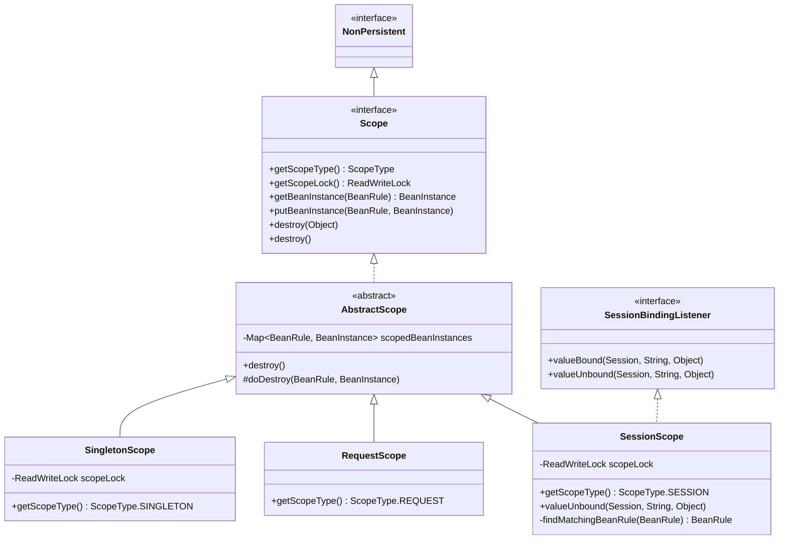
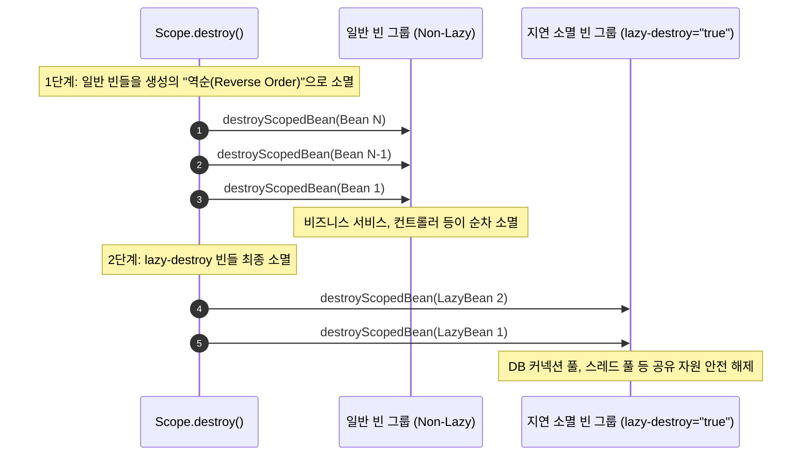

Aspectran의 IoC/DI 컨테이너는 빈(Bean) 객체의 생성 시점, 생명주기 범위, 그리고 메모리 상주 방식을 결정하는 **빈 스코프(Bean Scopes)** 전략을 지원합니다.

스코프는 특정 컴포넌트가 애플리케이션 전역에서 단 하나만 공유되어야 하는지(Singleton), 매 요청 시점마다 새롭게 생성되어야 하는지(Prototype), 또는 단일 HTTP/CLI 요청(Request)이나 사용자 세션(Session) 단위로 격리되어야 하는지를 규정합니다.

Aspectran은 [`ScopeType`](https://github.com/aspectran/aspectran/blob/master/core/src/main/java/com/aspectran/core/context/rule/type/ScopeType.java) 열거형에 정의된 4대 표준 스코프를 제공하며, 내부적으로는 전용 스코프 전략 인터페이스인 [`Scope`](https://github.com/aspectran/aspectran/blob/master/core/src/main/java/com/aspectran/core/component/bean/scope/Scope.java)와 [`AbstractScope`](https://github.com/aspectran/aspectran/blob/master/core/src/main/java/com/aspectran/core/component/bean/scope/AbstractScope.java)를 통해 스레드 세이프티, 생성 역순 소멸, 지연 소멸(`lazy-destroy`), 그리고 분산 클러스터링 세션 지원에 이르는 고도화된 수명주기 파이프라인을 구동합니다.

## 1. 스코프 아키텍처 클래스 다이어그램

Aspectran의 스코프 시스템은 전략 패턴(Strategy Pattern)에 기초하여 인스턴스 캐싱과 소멸 라이프사이클을 일관되게 추상화합니다.



## 2. 4대 표준 빈 스코프 심층 분석

Aspectran은 컴포넌트의 용도와 동시성 특성에 맞추어 4가지 스코프를 제공합니다.

### 1) `SINGLETON` ([`SingletonScope`](https://github.com/aspectran/aspectran/blob/master/core/src/main/java/com/aspectran/core/component/bean/scope/SingletonScope.java))
- **생명주기 및 가시성**:
  - `ActivityContext` 내에서 단 하나의 유일한 인스턴스만 생성되어 애플리케이션 전체에 공유됩니다.
  - 컨테이너 초기화(`initialize()`) 시점에 사전 인스턴스화(Eager Initialization)되거나, `lazy-init="true"` 설정 시 최초 조회 시점에 인스턴스화됩니다.
- **동시성 및 스레드 안전성**:
  - 내부적으로 [`ReentrantReadWriteLock`](https://github.com/aspectran/aspectran/blob/master/core/src/main/java/com/aspectran/core/component/bean/scope/SingletonScope.java#L33)을 내장하여 멀티스레드 환경에서의 동시 접근을 안전하게 제어합니다.
- **적합한 사용처**:
  - 상태를 가지지 않는(Stateless) 서비스 클래스, DAO, 리포지토리, 공통 유틸리티, 팩토리 객체.
- **주의사항**:
  - 여러 스레드가 동시에 공유하므로 변경 가능한 상태 필드(Mutable State)를 두어서는 안 되며, 상태 필드가 필요할 경우 별도의 동기화 처리가 요구됩니다.

### 2) `PROTOTYPE`
- **생명주기 및 가시성**:
  - 빈을 조회(인젝션 또는 `getBean()`)할 때마다 항상 새로운 독립 인스턴스를 생성하여 반환합니다.
- **컨테이너 비보관(Non-Managed) 특성**:
  - 컨테이너는 프로토타입 빈의 생성, 의존성 주입, 그리고 초기화 콜백(`@Initialize`)까지만 관여합니다.
  - 생성된 인스턴스는 내부 스코프 캐시에 보관되지 않고 즉시 호출자에게 인계되며, 이후의 수명 관리는 전적으로 JVM 가비지 컬렉터(GC)에 위임됩니다.
  - 따라서 **프로토타입 빈에 정의된 소멸 콜백(`@Destroy`, `DisposableBean.destroy()`)은 컨테이너에 의해 자동으로 호출되지 않습니다.**
- **적합한 사용처**:
  - 스레드 간에 공유되어서는 안 되는 상태를 유지하는(Stateful) 객체, 단기 배치 연산 태스크.

### 3) `REQUEST` ([`RequestScope`](https://github.com/aspectran/aspectran/blob/master/core/src/main/java/com/aspectran/core/component/bean/scope/RequestScope.java))
- **생명주기 및 가시성**:
  - 단일 요청 단위의 생명주기([`Activity`](https://github.com/aspectran/aspectran/blob/master/core/src/main/java/com/aspectran/core/activity/Activity.java)) 동안에만 유효한 인스턴스를 생성합니다.
  - 동일한 요청 내에서는 몇 번을 조회하더라도 동일 인스턴스가 반환되지만, 다른 클라이언트 요청에서는 완전히 격리된 새로운 인스턴스가 생성됩니다.
- **환경 바인딩 메커니즘**:
  - 각 환경의 [`RequestAdapter`](https://github.com/aspectran/aspectran/blob/master/core/src/main/java/com/aspectran/core/adapter/RequestAdapter.java) 내부 저장소에 바인딩됩니다.
  - 요청 처리가 끝나고 `Activity.finish()`가 호출되면, `RequestScope.destroy()`가 연쇄 실행되어 해당 요청에서 생성된 모든 request-scoped 빈의 소멸 콜백이 호출되고 메모리가 정리됩니다.
- **환경 제약 조건**:
  - `RequestAdapter`가 지원되는 웹 환경(`ServletWebActivity`, `NettyActivity`, `TowActivity`) 및 CLI 환경(`ShellActivity`)에서만 유효합니다. 환경이 지원되지 않는 곳에서 호출 시 [`UnsupportedBeanScopeException`](https://github.com/aspectran/aspectran/blob/master/core/src/main/java/com/aspectran/core/component/bean/UnsupportedBeanScopeException.java)이 발생합니다.
- **적합한 사용처**:
  - 요청 단위 보안 감사 토큰, 요청 추적자(Trace ID), 폼 파라미터 처리 커맨드 객체.

### 4) `SESSION` ([`SessionScope`](https://github.com/aspectran/aspectran/blob/master/core/src/main/java/com/aspectran/core/component/bean/scope/SessionScope.java))
- **생명주기 및 가시성**:
  - 단일 사용자 세션(Session)의 수명주기 동안 유효한 인스턴스를 유지합니다. 동일 사용자의 연속된 요청에서는 항상 같은 인스턴스가 공유됩니다.
- **세션 수명주기 결속 ([`SessionBindingListener`](https://github.com/aspectran/aspectran/blob/master/core/src/main/java/com/aspectran/core/component/session/SessionBindingListener.java))**:
  - 세션이 만료(Invalidate)되거나 타임아웃되어 언바인딩될 때 [`valueUnbound()`](https://github.com/aspectran/aspectran/blob/master/core/src/main/java/com/aspectran/core/component/bean/scope/SessionScope.java#L62) 콜백이 트리거되어, 세션 내에 보관된 모든 session-scoped 빈의 소멸 메서드를 안전하게 호출합니다.
- **분산 클러스터링 환경 지원 ([`findMatchingBeanRule`](https://github.com/aspectran/aspectran/blob/master/core/src/main/java/com/aspectran/core/component/bean/scope/SessionScope.java#L95))**:
  - 다중 서버 노드로 구성된 클러스터 환경에서 세션이 다른 JVM으로 직렬화/복제될 때, 메모리 주소(Hash)가 달라져도 빈 ID 또는 클래스명을 대조하여 일치하는 `BeanRule`을 찾아 인스턴스를 재매핑하는 정교한 클러스터 대응 로직을 내장하고 있습니다.
- **직렬화 방어 ([`NonPersistent`](https://github.com/aspectran/aspectran/blob/master/core/src/main/java/com/aspectran/core/component/session/NonPersistent.java))**:
  - 세션 전체가 파일이나 외부 캐시(Redis 등)로 덤프될 때 프레임워크 인프라 스코프 객체가 불필요하게 직렬화되는 것을 방지합니다.
- **적합한 사용처**:
  - 사용자 인증 상태 객체, 장바구니(Cart), 사용자 UI 개인화 환경 설정.

## 3. `AbstractScope`의 정교한 2단계 소멸 파이프라인

[`AbstractScope`](https://github.com/aspectran/aspectran/blob/master/core/src/main/java/com/aspectran/core/component/bean/scope/AbstractScope.java)는 빈 소멸 시 의존성 깨짐 문제를 방지하고 리소스를 안전하게 닫기 위해 **2단계 역순 소멸(Two-Phase Reverse Destruction)** 파이프라인을 실행합니다.



### 1) 생성 역순(Reverse Creation Order) 소멸 원칙
- 빈 A가 빈 B에 의존하고 있다면 빈 B가 먼저 생성되고 빈 A가 나중에 생성됩니다.
- 소멸할 때는 의존성을 사용하는 상위 빈(A)이 먼저 정리된 후 하위 빈(B)이 닫혀야 안전하므로, 내부 컬렉션([`scopedBeanInstances`](https://github.com/aspectran/aspectran/blob/master/core/src/main/java/com/aspectran/core/component/bean/scope/AbstractScope.java#L47))의 역순 이터레이터([`ListIterator.previous()`](https://github.com/aspectran/aspectran/blob/master/core/src/main/java/com/aspectran/core/component/bean/scope/AbstractScope.java#L125))를 순회하며 소멸 콜백을 호출합니다.

### 2) 지연 소멸 속성 (`lazy-destroy="true"`)
- 데이터베이스 커넥션 풀(HikariCP), 네트워크 소켓, 비동기 스레드 풀과 같은 인프라 리소스는 다른 모든 비즈니스 빈들이 완전히 닫힐 때까지 생존해 있어야 합니다.
- `lazy-destroy="true"`로 지정된 빈은 1단계 일반 소멸 목록에서 제외되어 대기했다가, 모든 일반 빈의 파괴가 완료된 후 2단계에서 최종적으로 소멸됩니다.

### 3) 팩토리 스타일 빈의 안전 소멸 처리
- 팩토리 빈(`factory`)을 통해 생성된 프로덕트 빈(`product`)의 경우:
  1. 프로덕트 빈 자체의 `destroyMethod` 및 `DisposableBean.destroy()` 호출
  2. 팩토리 객체 자체의 `destroyMethod` 및 `DisposableBean.destroy()` 호출
  3. 모든 계층의 소멸 콜백을 누락 없이 실행합니다.

## 4. 선언적 스코프 지정 방식

Aspectran은 XML, APON, Java 어노테이션 3대 설정 모델 전반에서 동일한 스코프 선언 문법을 지원합니다.

### XML 설정
```xml
<!-- 싱글톤 빈 (기본값) -->
<bean id="orderService" class="com.example.OrderServiceImpl" scope="singleton"/>

<!-- 프로토타입 빈 -->
<bean id="reportTask" class="com.example.ReportTask" scope="prototype"/>

<!-- 요청 스코프 빈 (지연 소멸 지정) -->
<bean id="requestContext" class="com.example.RequestContext" scope="request" lazy-destroy="true"/>

<!-- 세션 스코프 빈 -->
<bean id="userCart" class="com.example.UserCart" scope="session"/>
```

### APON 설정
```apon
bean: {
    id: userCart
    class: com.example.UserCart
    scope: session
}
```

### Java 어노테이션
```java
@Component
@Scope(ScopeType.PROTOTYPE)
public class ReportTask {
    // ...
}

@Component
@Scope("session")
public class UserCart {
    // ...
}
```

## 5. 빈 스코프 4종 종합 비교 매트릭스

| 스코프 | 기본 관리 클래스 | 인스턴스 공유 범위 | 스레드 안전성 | 컨테이너 소멸 관리 | 적합한 사용처 | 환경 제약 조건 |
| :--- | :--- | :--- | :--- | :--- | :--- | :--- |
| **`SINGLETON`** | [`SingletonScope`](https://github.com/aspectran/aspectran/blob/master/core/src/main/java/com/aspectran/core/component/bean/scope/SingletonScope.java) | `ActivityContext` 전체 | 높음 (`ReadWriteLock`) | 완전 관리 (컨텍스트 종료 시) | 무상태 서비스, DAO, 설정 컴포넌트 | 제약 없음 |
| **`PROTOTYPE`** | 없음 (생성 즉시 반환) | 공유되지 않음 (매번 생성) | 독립 (공유 없음) | 관리 안 함 (GC가 수거, 소멸 콜백 미호출) | 상태를 가지는 연산 객체, 단기 태스크 | 제약 없음 |
| **`REQUEST`** | [`RequestScope`](https://github.com/aspectran/aspectran/blob/master/core/src/main/java/com/aspectran/core/component/bean/scope/RequestScope.java) | 단일 요청 ([`Activity`](https://github.com/aspectran/aspectran/blob/master/core/src/main/java/com/aspectran/core/activity/Activity.java)) | 단일 스레드 격리 | 완전 관리 (요청 완료 시) | 요청 단위 트레이서, 폼 데이터 커맨드 객체 | `RequestAdapter` 필수 |
| **`SESSION`** | [`SessionScope`](https://github.com/aspectran/aspectran/blob/master/core/src/main/java/com/aspectran/core/component/bean/scope/SessionScope.java) | 단일 사용자 세션 | 높음 (`ReadWriteLock`) | 완전 관리 (세션 언바인딩 시) | 로그인 세션 객체, 장바구니, 사용자 개인화 설정 | `SessionAdapter` 필수 |

> 🔍 **관련 세부 메커니즘**
> - 빈들이 등록되고 인스턴스화되는 전체 컨테이너 구조는 [ActivityContext: Aspectran 컨테이너의 심장부](/ko/docs/mechanisms/activity-context/) 문서를 참고하십시오.
> - 빈 메서드 호출 시 AOP 어드바이스를 결합하는 프록시 메커니즘은 [Aspectran AOP 프록시 메커니즘](/ko/docs/mechanisms/new-aop-proxy-mechanism/) 문서를 참고하십시오.
> - 요청 스코프와 세션 스코프가 결속되는 환경별 인터페이스는 [Aspectran 어댑터 아키텍처](/ko/docs/mechanisms/aspectran-adapters/) 문서를 참고하십시오.

## 6. 다음 단계: 세부 메커니즘 탐색

동적으로 리소스를 격리하고 애플리케이션 클래스를 로드하는 Aspectran 전용 클래스로더의 동작 방식은 [Aspectran 클래스로더 아키텍처](/ko/docs/mechanisms/aspectran-classloader/) 문서에서 확인할 수 있습니다.

전체 메커니즘 및 패키지 명세의 유기적 연결 관계를 확인하려면 **[Aspectran 세부 메커니즘 색인](/ko/docs/mechanisms/)**을 확인하십시오.
