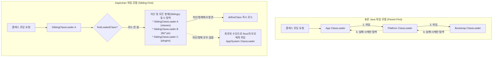
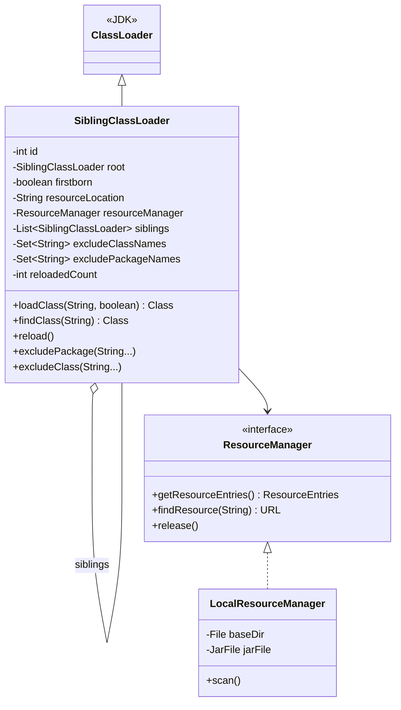
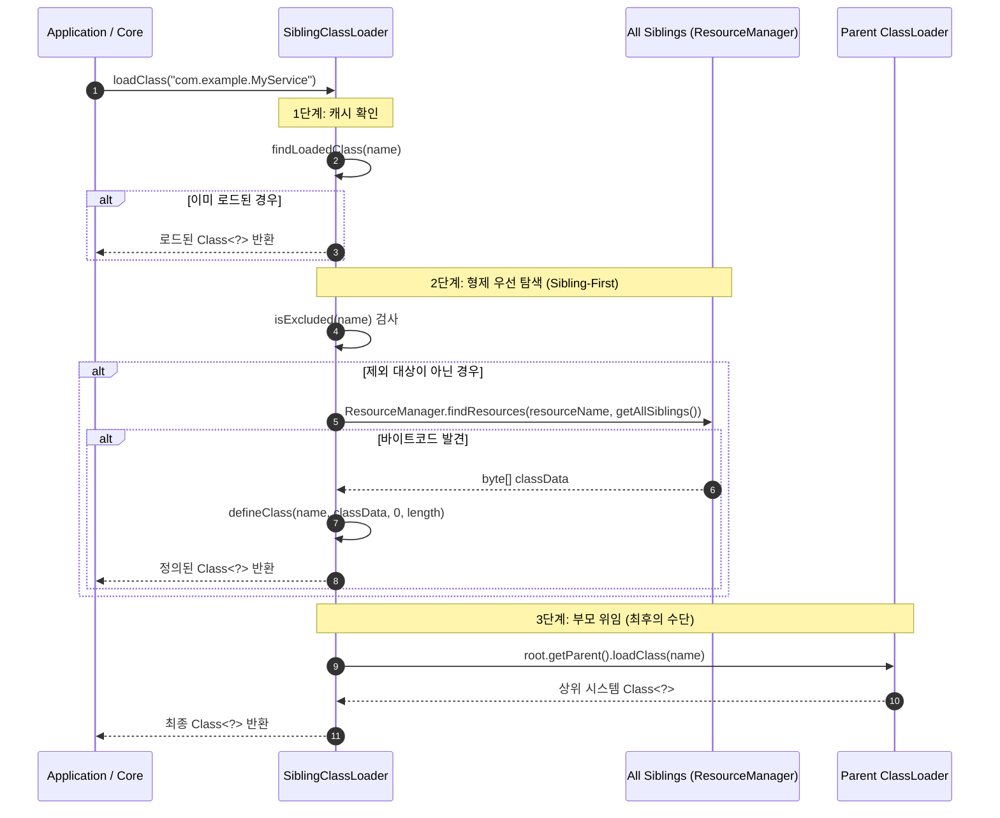
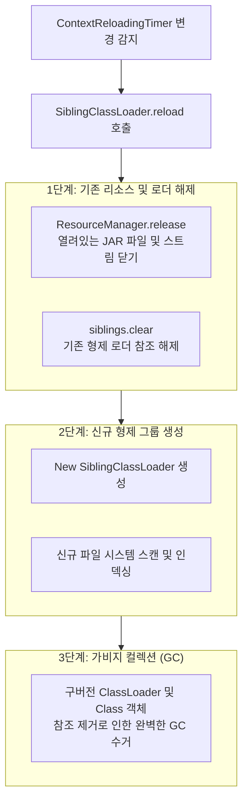

Aspectran 프레임워크는 표준 자바(Java) 가상 머신의 정적인 클래스 로딩 제약을 극복하고, 무중단 동적 리로딩(Hot Reloading)과 모듈형 아키텍처를 완벽하게 지원하기 위해 독자적인 클래스로더인 [`SiblingClassLoader`](https://github.com/aspectran/aspectran/blob/master/core/src/main/java/com/aspectran/core/context/resource/SiblingClassLoader.java)를 설계하여 사용합니다.

표준 JVM의 클래스 로더가 채택하고 있는 엄격한 "부모 우선 위임(Parent-First Delegation)" 모델은 클래스의 중복 로드를 방지하는 안정성을 제공하지만, 한 번 로드된 클래스의 바이트코드를 런타임에 동적으로 교체하는 것을 원천 차단합니다. Aspectran은 이를 해결하기 위해 위임 흐름을 혁신적으로 재구성한 **"형제 우선(Sibling-First)" 위임 전략**과 전용 리소스 매니저([`ResourceManager`](https://github.com/aspectran/aspectran/blob/master/core/src/main/java/com/aspectran/core/context/resource/ResourceManager.java))를 결합했습니다.

## 1. 표준 부모 우선 모델의 한계와 Aspectran의 해결책

표준 자바 클래스 로딩 체계와 Aspectran의 형제 우선 모델은 위임 방향과 우선순위에서 근본적인 차이가 있습니다.



### 표준 모델의 치명적 한계: 핫 리로딩 불가
- 부모 우선 모델에서는 애플리케이션 클래스로더(App ClassLoader)에 의해 한 번 클래스가 로드되면, 하위 클래스로더에 수정된 새 버전의 `.class` 파일이 존재하더라도 항상 부모가 캐시한 구버전 클래스가 우선 반환됩니다.
- 따라서 서버를 완전히 셧다운하고 JVM을 재시작하지 않는 한 비즈니스 코드나 설정을 동적으로 갱신할 수 없습니다.

### Aspectran의 혁신: "형제 우선(Sibling-First)" 탐색
- [`SiblingClassLoader`](https://github.com/aspectran/aspectran/blob/master/core/src/main/java/com/aspectran/core/context/resource/SiblingClassLoader.java)는 클래스 로딩 요청 인입 시 상위 부모로 무조건 직행하지 않고, **자신과 자신에게 결속된 모든 형제(Sibling) 클래스로더들이 관리하는 리소스 저장소에서 바이트코드를 최우선으로 탐색**합니다.
- 복수의 디렉토리(`classes/`)나 독립된 JAR 파일들을 각각 전담하는 형제 로더들이 서로의 리소스를 수평적으로 공유함으로써, 마치 하나의 거대한 가상 클래스패스(Virtual Classpath)처럼 유기적으로 협력합니다.
- 자신과 형제들의 리소스 저장소 어디에서도 클래스를 찾지 못했을 때에만 최상위 부모(System/App ClassLoader)로 위임합니다.

## 2. `SiblingClassLoader`의 내부 아키텍처 및 계층 구조

[`SiblingClassLoader`](https://github.com/aspectran/aspectran/blob/master/core/src/main/java/com/aspectran/core/context/resource/SiblingClassLoader.java)는 병렬 클래스 로딩([`ClassLoader.registerAsParallelCapable()`](https://github.com/aspectran/aspectran/blob/master/core/src/main/java/com/aspectran/core/context/resource/SiblingClassLoader.java#L59))을 완벽히 지원하며, 다음과 같은 내부 구조를 가집니다.



### 1) 핵심 필드 및 역할
- **`root`**: 형제 그룹 전체의 최상위 앵커 역할을 하는 루트 클래스로더입니다. 부모 클래스로더와의 최종 위임 창구 역할을 전담합니다.
- **`firstborn`**: 부모의 첫 번째 자식 여부를 나타내는 플래그로, 오직 첫째(firstborn) 로더만이 다른 형제 로더들을 추가 생성하고 관리할 수 있는 권한을 갖습니다.
- **`resourceLocation`**: 해당 클래스로더 인스턴스가 전담하여 감시하고 클래스를 로드할 물리적 파일 시스템 경로(특정 디렉토리 또는 단일 JAR 파일)입니다.
- **[`ResourceManager`](https://github.com/aspectran/aspectran/blob/master/core/src/main/java/com/aspectran/core/context/resource/ResourceManager.java)**:
  - 지정된 `resourceLocation`을 스캔하여 클래스 파일과 리소스를 메모리에 인덱싱([`ResourceEntries`](https://github.com/aspectran/aspectran/blob/master/core/src/main/java/com/aspectran/core/context/resource/ResourceEntries.java))하고 고속 검색을 지원하는 전용 리소스 관리자입니다.
- **`siblings` (`CopyOnWriteArrayList<SiblingClassLoader>`)**:
  - 현재 로더와 수평적으로 연결된 형제 로더들의 스레드 안전한 목록입니다.

## 3. 클래스 로딩 3단계 실행 알고리즘

[`loadClass(String name, boolean resolve)`](https://github.com/aspectran/aspectran/blob/master/core/src/main/java/com/aspectran/core/context/resource/SiblingClassLoader.java#L443) 메서드는 세밀하게 조정된 동기화 블록([`getClassLoadingLock(name)`](https://github.com/aspectran/aspectran/blob/master/core/src/main/java/com/aspectran/core/context/resource/SiblingClassLoader.java#L444)) 안에서 3단계로 실행됩니다.



1. **1단계: 로컬 캐시 조회 (`findLoadedClass`)**:
   JVM 내부 캐시에 이미 로드된 클래스인지 확인합니다. 이미 존재하면 즉시 반환합니다.
2. **2단계: 형제 저장소 우선 탐색 (`findClass` -> `loadClassData`)**:
   - 제외 규칙([`isExcluded(name)`](https://github.com/aspectran/aspectran/blob/master/core/src/main/java/com/aspectran/core/context/resource/SiblingClassLoader.java#L271))에 걸리지 않는 경우, 모든 형제 로더([`getAllSiblings()`](https://github.com/aspectran/aspectran/blob/master/core/src/main/java/com/aspectran/core/context/resource/SiblingClassLoader.java#L505))의 `ResourceManager`를 순회하며 바이트코드를 읽어옵니다.
   - 바이트코드가 발견되면 즉시 [`defineClass()`](https://github.com/aspectran/aspectran/blob/master/core/src/main/java/com/aspectran/core/context/resource/SiblingClassLoader.java#L484)를 호출하여 현재 로더에 새 클래스를 동적으로 정의합니다.
3. **3단계: 상위 위임 (최후의 수단)**:
   - 형제 로더들의 경로 어디에서도 바이트코드가 발견되지 않거나 명시적으로 제외된 클래스인 경우, 최상위 부모([`root.getParent()`](https://github.com/aspectran/aspectran/blob/master/core/src/main/java/com/aspectran/core/context/resource/SiblingClassLoader.java#L456))에게 위임하여 JDK 표준 API(`java.lang.*`)나 호스트 컨테이너 클래스를 안전하게 로드합니다.

## 4. 클래스 충돌 방지를 위한 제외 규칙 (Exclusion)

형제 우선 모델을 무분별하게 적용할 경우, 여러 모듈이 공통으로 사용하는 기반 라이브러리(예: `org.slf4j.Logger`, 서블릿 API 등)가 각 형제 로더에 제각각 로드되어 서로 다른 클래스 로더에 의해 정의되는 문제가 발생합니다. 이 경우 클래스 패키지와 이름이 완전히 동일하더라도 JVM은 별개의 클래스로 취급하여 상호 참조 시 심각한 [`ClassCastException`](https://github.com/aspectran/aspectran/blob/master/core/src/main/java/com/aspectran/core/context/resource/SiblingClassLoader.java#L43)을 발생시킵니다.

`SiblingClassLoader`는 이를 방어하기 위해 정교한 제외 메커니즘을 지원합니다:
- **패키지 단위 제외 ([`excludePackage`](https://github.com/aspectran/aspectran/blob/master/core/src/main/java/com/aspectran/core/context/resource/SiblingClassLoader.java#L233))**:
  ```java
  classLoader.excludePackage("org.slf4j", "jakarta.servlet");
  ```
  지정된 패키지에 속한 클래스는 형제 탐색 단계를 완전히 건너뛰고 항상 부모 클래스로더로 직행하여 로드되므로, 애플리케이션 전역에서 해당 라이브러리의 클래스 단일성(Uniqueness)이 철저히 보장됩니다.
- **클래스 단위 제외 ([`excludeClass`](https://github.com/aspectran/aspectran/blob/master/core/src/main/java/com/aspectran/core/context/resource/SiblingClassLoader.java#L251))**:
  특정 FQCN 클래스명에 대해서만 개별적으로 제외를 적용할 수 있습니다.

## 5. 무중단 핫 리로딩(`reload()`)과 메모리 수거

`SiblingClassLoader`의 가장 강력한 역량은 애플리케이션의 재부팅 없이 변경된 클래스 바이트코드를 교체하는 무중단 핫 리로딩입니다.



- **클래스로더 그룹 전체 폐기**:
  자바 가상 머신 사양상 한 번 로드된 `Class<?>` 객체 자체는 재정의할 수 없습니다. 따라서 `SiblingClassLoader`의 [`reload()`](https://github.com/aspectran/aspectran/blob/master/core/src/main/java/com/aspectran/core/context/resource/SiblingClassLoader.java#L408)는 기존 형제 로더들의 리소스 매니저를 닫고(`rm.release()`), 기존 로더들을 참조 목록에서 제거([`leave()`](https://github.com/aspectran/aspectran/blob/master/core/src/main/java/com/aspectran/core/context/resource/SiblingClassLoader.java#L423))합니다.
- **신규 로더 그룹 인스턴스화**:
  새로운 버전의 파일들을 읽어 들일 완전히 새로운 `SiblingClassLoader` 그룹을 생성합니다.
- **메모리 누수 방지**:
  이전 클래스를 로드했던 구버전 클래스로더에 대한 참조가 끊어지면서, 해당 로더가 로드했던 모든 구버전 클래스 메타스페이스(Metaspace) 메모리가 가비지 컬렉터(GC)에 의해 깨끗하게 수거됩니다.
- **리로딩 카운터 ([`reloadedCount`](https://github.com/aspectran/aspectran/blob/master/core/src/main/java/com/aspectran/core/context/resource/SiblingClassLoader.java#L87))**:
  해당 클래스로더 그룹이 몇 번 갱신되었는지를 추적하여 모니터링 메트릭으로 제공합니다.

> **관련 세부 메커니즘**:
> - 클래스로더의 `reload()`를 주기적으로 트리거하는 전체 감시 메커니즘은 [Aspectran 자동 리로딩 메커니즘](/ko/docs/mechanisms/aspectran-reloading-mechanism/) 문서를 참고하십시오.
> - 클래스로더가 생성되어 `ActivityContext`에 바인딩되는 과정은 [ActivityContext 빌드 과정](/ko/docs/mechanisms/activity-context-building/) 문서를 참고하십시오.
> - 서비스 계층에서 클래스로더를 격리하고 라우팅하는 방식은 [Aspectran 서비스 아키텍처](/ko/docs/mechanisms/aspectran-services/) 문서를 참고하십시오.

## 6. 다음 단계: 세부 메커니즘 탐색

파일 시스템의 변경 사항을 실시간 감지하여 클래스로더와 컨텍스트의 재빌드를 조율하는 타이머 스케줄러의 동작 원리는 [Aspectran 자동 리로딩 메커니즘](/ko/docs/mechanisms/aspectran-reloading-mechanism/) 문서에서 확인할 수 있습니다.

전체 메커니즘 및 패키지 명세의 유기적 연결 관계를 확인하려면 **[Aspectran 세부 메커니즘 색인](/ko/docs/mechanisms/)**을 확인하십시오.
